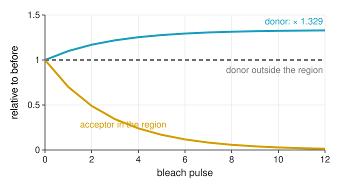

## About this lecture

FRET dims the donor. Destroy the acceptor, and the donor gets its light back. Comparing the donor **before** and **after** gives the efficiency from one sample, without bleed-through coefficients.

- The idea: $E = 1 - I_D^\text{pre}/I_D^\text{post}$.
- Corrections, each with its own control: **incomplete bleaching**, **donor bleaching**, **motion**, **photoconversion**.
- An **end-point** method; how it compares with sensitised emission and lifetimes.
- Pixel-wise against region-wise $E$: a ratio of noisy numbers.
- What every intensity method really measures: the **apparent** efficiency $f \cdot E$.

*Slides titled **The math** give the formulas and proofs; the ideas are complete without them.*

## The idea: dequenching

{width="54%" fig-align="center"}

- Image the donor. Then illuminate a region strongly with **acceptor** light only: the acceptor photobleaches (is destroyed).
- Without acceptor, nothing takes the donor's energy: the donor in the region gets **brighter**. Outside the region nothing changes.
- One sample, one channel that matters (the donor), no $d$, $a$ or $G$: the method calibrates itself.

## How much brighter?

The donor's brightness is proportional to $1 - E$ (the fraction of its excitations it keeps):

$$E = 1 - \frac{I_D^\text{pre}}{I_D^\text{post}} .$$

Example: donor 600 before, 800 after → $E = 1 - 600/800 = 0.25$.

- After full bleaching the donor shines as if alone: $I_D^\text{post}$ is the unquenched donor.
- Outside the bleached region $E$ must come out as 0: a built-in check.
- In the figure ($E = 0.25$, 12 pulses each bleaching 30 % of the acceptor), 1.4 % of the acceptor is left and the donor rises by a factor 1.33.

## Corrections, each with a control

| problem | effect on $E$ | control / fix |
|---|---|---|
| **incomplete** acceptor bleaching | too low | measure the acceptor left; correct |
| **donor bleaching** (imaging, bleach light) | too low | a non-bleached region drifts down; divide by it |
| **motion**, drift between before and after | edges, both signs | align first ([FFT registration](../phasecorr/lec.qmd)) |
| acceptor **photoconversion** into a donor-coloured form | too high | acceptor-only cells must show no donor increase |
| molecules **diffusing** into the region | too low, live cells | bleach fast, or fixed cells |

## Incomplete bleaching

If only a fraction $b$ of the acceptors is destroyed, only those donors are dequenched. The donor rises less, and $E$ comes out too low.

Example: true $E = 0.30$ with $b = 0.8$ gives an observed 0.255. Correction from the observed $E_\text{obs}$ and the measured $b$ (from the acceptor image, before/after):

$$E = \frac{E_\text{obs}}{b + (1 - b)\,E_\text{obs}}$$

The worked example: $E_\text{obs} = 0.25$, $b = 0.8$ → $E = 0.25/(0.8 + 0.05) = 0.294$.

## The math: incomplete bleaching {.math}

All donors paired, each acceptor independently bleached with probability $b$. Donor intensity (relative to the unquenched donor):

- before: $1 - E$;
- after: a fraction $b$ of donors is unquenched (1), a fraction $1 - b$ still quenched ($1 - E$): $\;b + (1 - b)(1 - E) = 1 - (1 - b)E$.

$$E_\text{obs} = 1 - \frac{1 - E}{1 - (1 - b)E} = \frac{bE}{1 - (1 - b)E}.$$

Solve for $E$: $E_\text{obs}\,(1 - (1 - b)E) = bE \;\Rightarrow\; E = \dfrac{E_\text{obs}}{b + (1 - b)E_\text{obs}}$. For $b = 1$ both are equal.

## Donor bleaching, motion, photoconversion

- **Donor bleaching**: the donor itself loses some brightness at every image, and the strong bleach light may hit it too. This lowers $I_D^\text{post}$, so $E$ comes out too low (it can even become negative). Control: the same cell outside the region, or a neighbouring cell. If it dropped by 5 %, divide the post value by 0.95: 600/800 → $1 - 600/(800/0.95) = 0.287$.
- **Motion**: if the cell moved between before and after, $1 - \text{pre}/\text{post}$ shows bright and dark **edges**. Align the images before dividing.
- **Photoconversion**: some acceptors, when bleached, turn into a species that emits in the donor channel. That looks like dequenching. Control: bleach **acceptor-only** cells; their donor channel must stay dark.

## Try it: bleach the acceptor

```{=html}
<link rel="stylesheet" href="../demos/dist/demo.css">
<div data-demo="apbleach" data-preset="ideal" data-presets="ideal early donorbleach moved few photo" data-compact></div>
<script src="../demos/dist/apbleach.js"></script>
```

::: notes
Two FRET cells (true E = 0.3, all donors paired) and an acceptor-only control cell (bottom left in the acceptor image, bleached as a whole). The yellow box is the bleach region; drag on "donor before" to draw a new one. Tour: "ideal": 15 pulses, 0.5 % acceptor left, region E (ratio of sums) 0.297, mean of pixel E 0.295. "Stop early": 4 pulses, 24.1 % acceptor left, E = 0.244; tick "correct incomplete bleaching": 0.298. "Donor bleaching" 1.5 % per pulse: control ratio 0.796, E = 0.117; tick "correct donor bleaching": 0.298. "The cell moved": 3 px drift, red and blue edges, E = 0.275 and the acceptor appears 20.8 % left (misaligned); tick "align": shift (−3, −2) found, E = 0.297. "Few photons": pixel map is noise (pixel sd 0.20), region E 0.292. "Photoconversion": acceptor-only cell's donor channel goes from 0 to 70, E = 0.388.
:::

## An end-point method

- The acceptor is gone: one measurement per cell, no time course.
- Bleaching takes seconds to minutes; in live cells unbleached acceptors **diffuse** into the region and the dequenching is underestimated.

| | sensitised emission | acceptor photobleaching | donor lifetime (FLIM day) |
|---|---|---|---|
| images | 3 per time point | donor before/after | donor decay |
| controls | donor only, acceptor only, $G$ | non-bleached region, acceptor only | donor alone ($\tau_D$) |
| time-lapse | yes | no (end point) | yes |
| sensitive to | coefficients, background, alignment | bleaching, motion, diffusion | fitting, photon numbers |

## Pixel-wise or region-wise?

$E = 1 - P/Q$ in every pixel is a **ratio of two noisy counts** (unit 4 treats ratios in general):

- $P = 600$, $Q = 800$ photons per pixel: $\sigma_E \approx 0.04$.
- $P = 60$, $Q = 80$: $\sigma_E \approx 0.13$: the map is speckle, and dim pixels are biased.
- Better: sum before and after over the region, then divide (**ratio of sums**). Or smooth both images with the same filter before dividing ([denoise](../denoise/lec.qmd): a linear filter on both is allowed).

## The math: the noise of $E = 1 - P/Q$ {.math}

First-order Taylor expansion (delta method, derived in unit 4) of $g(P, Q) = 1 - P/Q$ around the means:

$$\delta E \approx -\frac{1}{Q}\,\delta P + \frac{P}{Q^2}\,\delta Q, \qquad \sigma_E^2 \approx \frac{\sigma_P^2}{Q^2} + \frac{P^2\sigma_Q^2}{Q^4} .$$

With Poisson counts, $\sigma_P^2 = P$ and $\sigma_Q^2 = Q$:

$$\sigma_E \approx \frac{P}{Q}\sqrt{\frac{1}{P} + \frac{1}{Q}} .$$

$P = 600$, $Q = 800$: $0.75\sqrt{1/600 + 1/800} = 0.0405$.

## What an efficiency means: apparent $E$

Not every donor has an acceptor. With a fraction $f$ of donors paired at efficiency $E$, every **intensity** method measures

$$E_\text{app} = f \cdot E .$$

- 50 % bound at $E = 0.4$ looks exactly like 100 % bound at $E = 0.2$: both give 0.2.
- The distances differ: with $R_0 = 5$ nm, $E = 0.4$ is 5.35 nm ($1.07R_0$), $E = 0.2$ is 6.30 nm ($1.26R_0$).
- Also in unit 2: $E_\text{app} = F_c/(F_c + G I_{DD}) = fE$.

A change in $E_\text{app}$ can be a change in distance **or** in how many molecules bind.

## The math: why intensities give $f \cdot E$ {.math}

Donors are a mixture: a fraction $1 - f$ unpaired (brightness 1), a fraction $f$ paired (brightness $1 - E$). Before bleaching the total is $(1 - f) + f(1 - E) = 1 - fE$; after full bleaching it is 1:

$$1 - \frac{I^\text{pre}}{I^\text{post}} = fE .$$

Intensities add, so the two populations cannot be told apart. The donor's **decay** can: it is a sum of two exponentials, $(1 - f)\,e^{-t/\tau_D} + f\,e^{-t/\tau_{DA}}$, with $\tau_{DA} = \tau_D(1 - E)$. Fitting it gives $E$ and $f$ separately: lifetime imaging (FLIM day) and its phasor plots exist largely for this.

## Try it: half the donors paired

```{=html}
<link rel="stylesheet" href="../demos/dist/demo.css">
<div data-demo="apbleach" data-preset="half" data-presets="half ideal" data-compact></div>
<script src="../demos/dist/apbleach.js"></script>
```

::: notes
Preset "half the donors paired": f = 0.5, E = 0.3. Region E = 0.147, the true f·E = 0.150. Now set f = 1 and E = 0.15: the same number. Nothing in the donor intensities tells the two apart.
:::

## Before claiming a distance

- One well-defined pair (one donor, one acceptor, one distance)?
- $\kappa^2$ justified (freely rotating dyes, or a known structure)?
- Fraction paired $f$ known (or measured by lifetimes)?
- $E$ inside the sensitive window ($0.5R_0$–$1.5R_0$)?
- Corrections and controls listed (bleaching, background, alignment, photoconversion)?

Usually the honest statement is a **change** in $E_\text{app}$ between conditions, not a distance.

## Summary

- Bleaching the acceptor **dequenches** the donor: $E = 1 - I_D^\text{pre}/I_D^\text{post}$, from one sample, no coefficients.
- Correct for **incomplete bleaching** ($E = E_\text{obs}/(b + (1 - b)E_\text{obs})$), **donor bleaching** (a non-bleached control), **motion** (align), and check **photoconversion** with acceptor-only cells.
- An **end-point** method; diffusion limits it in live cells.
- Pixel-wise $E$ is a noisy ratio ($\sigma_E \approx 0.04$ at 600/800 photons); sum over a region first.
- Intensity methods measure $E_\text{app} = fE$: binding fraction and distance are mixed. Lifetimes separate them (FLIM day).
