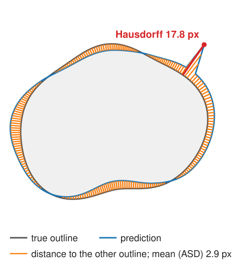
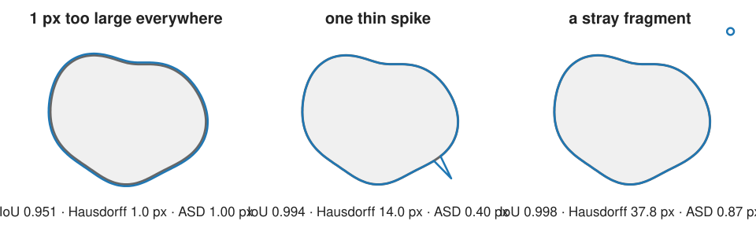
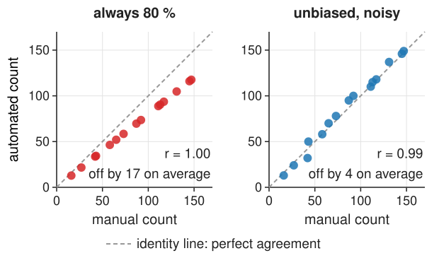
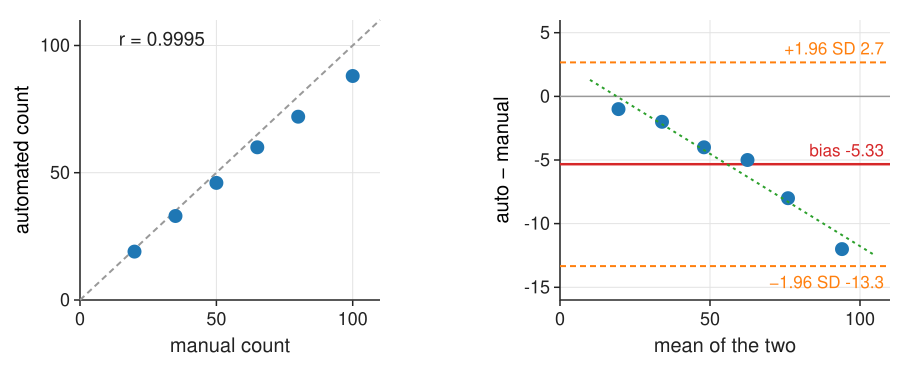
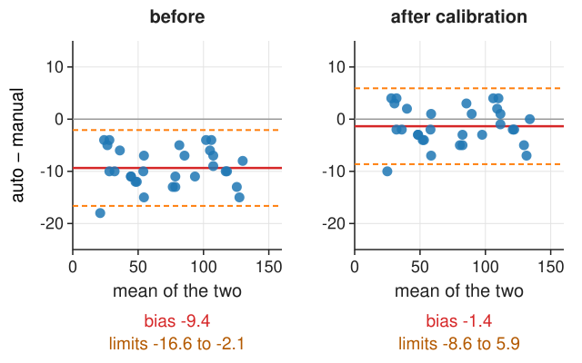
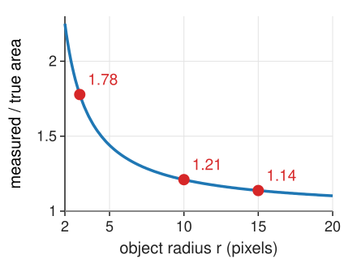
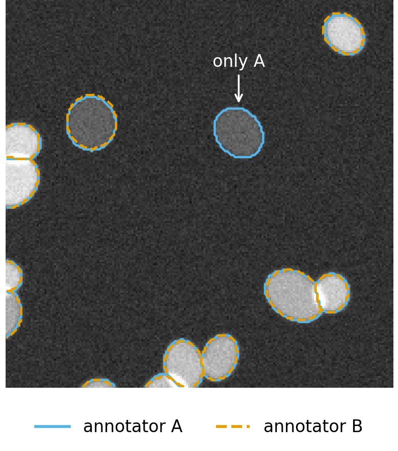
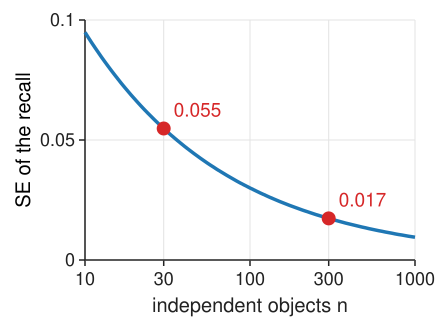

## About this lecture

Last unit matched objects and counted them. Often what matters is not the match but **the outline** or **the numbers** we measure. And the "truth" we compare with is drawn by people.

- **Boundary metrics**: Hausdorff distance and average surface distance, and what each is sensitive to.
- **Counts and measurements** against manual values: why **correlation is not agreement**, and the **Bland–Altman plot**: bias and limits of agreement.
- **Ground truth is uncertain**: the agreement between two annotators is the ceiling of any score.
- **How many annotated images** an evaluation needs.

*Slides titled **The math** give the formulas and proofs; the ideas are complete without them.*

## When the outline matters

:::: {.columns}
::: {.column width="56%"}
A tumour margin, the shape of a cell, the thickness of a membrane: here a good match is not enough.

For every point on the predicted outline, find the **distance to the nearest point of the true outline**, and the same the other way round. Then summarise all these distances:

- **Hausdorff distance**: the **largest** of them (both directions). "Every point is within $H$ pixels of the other outline."
- **Average surface distance** (ASD): the **mean**. "The typical outline error is ASD pixels."
- **HD95**: the 95th percentile, a compromise that ignores the worst 5 %.

In pixels, or in µm if the pixel size is known.
:::
::: {.column width="44%"}
{fig-alt="A nucleus outline (grey) and a predicted outline (blue) with a thin spike. Orange whiskers join points of the prediction to the nearest point of the true outline; the longest, at the tip of the spike, is the Hausdorff distance, 17.8 px; the mean of all distances (ASD) is 2.9 px." width=100%}
:::
::::

## Three kinds of outline error

{width=100%}

- Uniform one-pixel offset: every distance is 1 px. Hausdorff = ASD = 1; IoU 0.95.
- One thin spike, 14 px long: IoU hardly notices (0.994), Hausdorff jumps to 14; ASD stays small (0.40).
- A tiny fragment far away: IoU 0.998, Hausdorff 38; HD95 0 (the fragment is less than 5 % of the outline).

IoU and Dice count **pixels**, the boundary metrics measure **distances**: choose by what matters.

## The math: Hausdorff and surface distances {.math}

Boundaries $\partial A$, $\partial B$ (finite sets of boundary points), $d(a, \partial B) = \min_{b \in \partial B}\|a - b\|$.

$$h(A, B) = \max_{a \in \partial A} d(a, \partial B), \qquad H(A, B) = \max\big(h(A, B),\, h(B, A)\big)$$

$$\text{ASD} = \frac{\sum_{a \in \partial A} d(a, \partial B) + \sum_{b \in \partial B} d(b, \partial A)}{|\partial A| + |\partial B|}$$

The directed distance $h$ is not symmetric: a fragment of $B$ far from $A$ raises $h(B, A)$ but not $h(A, B)$.

**Fast computation** with the distance transform (the morphology day): the distance transform of "not $\partial B$" gives $d(x, \partial B)$ at every pixel $x$ in one pass, $O(N)$ for $N$ pixels; read it on $\partial A$.

## Try it: boundary distances

```{=html}
<link rel="stylesheet" href="../demos/dist/demo.css">
<div data-demo="contourdist" data-preset="spike"></div>
<script src="../demos/dist/contourdist.js"></script>
```

::: notes
Grey: the true outline, blue: the prediction; drag the round handles to deform the prediction. Whiskers join boundary points to the nearest point of the other outline; the red whisker is the Hausdorff distance. Tour: "one thin spike": IoU 0.994, Hausdorff 14.0, ASD 0.40, the histogram has a long thin tail. "one-pixel dilation": everything 1.00, IoU 0.951. "a stray fragment": drag the dashed circle around; Hausdorff follows it, IoU and HD95 do not move. "same error, small object" (radius 8 px): the same 1-px error now gives IoU 0.787. Move the radius slider: the pixel errors stay, IoU changes.
:::

## Counts and measurements

Often the outlines are only a means: the result is **a number per image** (cells per field, mean nuclear area, intensity per cell).

Then evaluate **the numbers directly**: for a set of images, measure the same quantity automatically and manually, and compare the two lists.

The first idea is a scatter plot of automated against manual, with the correlation $r$. It answers the wrong question.

## Correlation is not agreement

:::: {.columns}
::: {.column width="50%"}
A method that always reports **80 %** of the manual count has correlation $r = 1$ and is wrong by 20 %.

- Correlation measures whether the points lie on **some** straight line, not whether they lie on the **identity line**.
- A wider range of values gives a higher $r$ for the same errors: counts from 10 to 150 cells make almost any method look good.

We want to know **how far apart** the two measurements are, and whether that depends on the size of the value.
:::
::: {.column width="50%"}
{fig-alt="Two scatter plots of automated against manual counts for 15 images, with the identity line dashed. Left: a method that always reports 80 % of the manual count: r = 1.00, but off by 17 on average. Right: an unbiased but noisy method: r = 0.99, off by 4 on average." width=100%}
:::
::::

## The Bland–Altman plot

For each image: the **difference** (auto − manual) against the **mean** of the two.

{width=78%}

Manual 20, 35, 50, 65, 80, 100; auto 19, 33, 46, 60, 72, 88. $r = 0.9995$, yet:

- **bias** = mean difference = −5.33 (a systematic undercount);
- **limits of agreement** = bias ± 1.96 SD = −13.3 to +2.7: the range of the error for a new image;
- the cloud **slopes** down: the undercount grows with the count (**proportional bias**, e.g. more merges in dense images). Then the limits mislead; compare **ratios** (or work on a log scale): auto/manual drops from 0.95 to 0.88.

## The math: Bland–Altman {.math}

Pairs $(x_i, y_i)$, $i = 1, \dots, n$ (reference, method). Differences $d_i = y_i - x_i$, means $m_i = (x_i + y_i)/2$.

$$\text{bias} = \bar d, \qquad s_d = \sqrt{\tfrac{1}{n-1}\textstyle\sum_i (d_i - \bar d)^2}, \qquad \text{limits} = \bar d \pm 1.96\, s_d$$

(95 % of differences inside, if they are roughly normal). Proportional bias: fit $d_i = \alpha + \beta m_i$; $\beta \ne 0$ means the error depends on the size.

Why correlation ignores bias: for $y = a x + b$ with $a > 0$, $r(x, y) = 1$ for every $a$ and $b$. And if $y = a x + b$ exactly, then $d = (a - 1)x + b$ and $m = \frac{a + 1}{2}x + \frac b2$, so the points lie on a line with slope $\frac{2(a - 1)}{a + 1}$: zero only for $a = 1$.

## Bias and scatter have different cures

:::: {.columns}
::: {.column width="46%"}
- **Bias** (systematic): can be **calibrated** away if it is stable (multiply by 1/0.8, subtract the offset), measured on a calibration set.
- **Scatter** (random): cannot be calibrated; only a better method, or averaging over more objects, reduces it.
- For **comparing two conditions** measured the same way, a constant bias often cancels. But not if it depends on the condition: if treated wells are denser and merge more, the undercount is larger there and fakes (or hides) an effect.
:::
::: {.column width="54%"}
{fig-alt="Two Bland–Altman plots of 30 images. Before: the method undercounts by about 9 (bias −9.4, limits −16.6 to −2.1). After adding the bias estimated on 20 separate calibration images: bias −1.4, limits −8.6 to 5.9; the band is as wide as before." width=100%}
:::
::::

## Measurements: small objects, large relative error

:::: {.columns}
::: {.column width="58%"}
Areas of objects, automated vs manual: a **one-pixel outline offset** is a fixed **absolute** error at the boundary, so a large **relative** error for small objects.

- A disc of radius $r$ drawn 1 px too large: area ratio $(r + 1)^2 / r^2$: 1.78 for $r = 3$, 1.21 for $r = 10$, 1.14 for $r = 15$.
- In a Bland–Altman plot of areas the differences grow with the size, while the **ratio** plot shows the relative bias growing for small objects.
- The same effect makes perimeters and small areas biased in the measurements day; the point spread function adds to it (the image formation day).
:::
::: {.column width="42%"}
{fig-alt="Measured over true area of a disc drawn 1 pixel too large, against its radius: 1.78 at r = 3, 1.21 at r = 10, 1.14 at r = 15, falling towards 1 for large objects." width=100%}
:::
::::

## Try it: agreement of counts

```{=html}
<link rel="stylesheet" href="../demos/dist/demo.css">
<div data-demo="blandaltman" data-preset="corr"></div>
<script src="../demos/dist/blandaltman.js"></script>
```

::: notes
40 synthetic images with manual counts 17–146. Tour: "r = 0.99, still 20 % off": r 0.997, bias −16.2, mean ratio 0.81. "merges at high density": r 0.990, the Bland–Altman cloud slopes (slope −0.38), limits −41 to +9. "scatter only": bias 1.2, limits −16.5 to 18.9, no slope. "small objects: area bias": 150 objects, outline 1 px too large: the ratio is about 1.66 for objects below 50 px², about 1.17 above 400 px². "two annotators": bias 0.55, limits −3.2 to 4.3: the ceiling.
:::

## Ground truth is uncertain

:::: {.columns}
::: {.column width="62%"}
Annotators disagree: on **boundaries** (a few pixels, where exactly is the edge of a blurred nucleus?) and on **objects** (is this dim blob a nucleus? is this dividing cell one or two?).

- The agreement between two annotators (their F1 against $\tau$, their Bland–Altman plot) is the **ceiling** of any score against one of them.
- A method with F1 0.90 against annotator A, where annotator B scores 0.88 against A, is "**as good as a human**", not "better than 0.88".
- Remedies: several annotators and a **consensus**; an "**ignore**" label for ambiguous objects; **synthetic data** where the truth is known by construction (but then the domain differs from real images).
:::
::: {.column width="38%"}
{fig-alt="Synthetic nuclei outlined by two annotators: A in solid blue, B in dashed orange. Their outlines differ by a pixel or so; one dim nucleus is outlined only by A." width=100%}
:::
::::

## How many annotated images?

:::: {.columns}
::: {.column width="60%"}
A score from few objects wobbles. A recall of 0.9 measured on $n$ independent objects has a standard error

$$\text{SE} = \sqrt{0.9 \cdot 0.1 / n}: \quad 0.055 \text{ for } n = 30, \quad 0.017 \text{ for } n = 300.$$

Roughly 95 % of the time the true recall lies within ±2 SE of the measured one.

But objects in one image are **not independent**: same illumination, same density, same staining. 300 objects from 2 images are closer to "2 measurements" than to 300. Evaluate **per image**, look at the spread across images, and collect images from several experiments. Units 3 and 4 make this precise.
:::
::: {.column width="40%"}
{fig-alt="Standard error of a recall of 0.9 against the number of independent objects, on a log axis: 0.055 at 30 objects, 0.017 at 300." width=100%}
:::
::::

## The math: standard error of a proportion {.math}

A recall is a proportion: $\hat p = X/n$ with $X$ the number of found objects among $n$. If the objects are independent with the same $p$, $X \sim \text{Binomial}(n, p)$, $\text{Var}(\hat p) = p(1 - p)/n$:

$$\text{SE}(\hat p) = \sqrt{\frac{p(1-p)}{n}} \le \frac{1}{2\sqrt n}.$$

For a 95 % interval of half-width $w$: $n \ge 1.96^2\, p(1-p)/w^2$; in the worst case $p = \frac12$ and $w = 0.05$: $n = 385$.

With $m$ objects per image and correlation $\rho$ between objects of the same image, the variance grows by the **design effect** $1 + (m - 1)\rho$: the effective number of objects is $n / (1 + (m-1)\rho)$ (derived in the replicates unit).

## Summary

- **Hausdorff** = the worst boundary distance (sensitive to one spike or a stray fragment); **ASD** = the typical one; HD95 in between. IoU and Dice hardly see thin errors.
- Evaluate **counts and measurements** directly. **Correlation is not agreement**.
- **Bland–Altman**: difference against mean; **bias** (calibratable), **limits of agreement** (scatter), slope = **proportional bias** (then use ratios).
- A one-pixel outline error is a large **relative** error for small objects.
- **Inter-annotator agreement** is the ceiling; use several annotators, consensus, "ignore" labels.
- A score from $n$ objects has SE $\approx \sqrt{p(1-p)/n}$, and objects within an image are not independent: count **images and experiments**.
