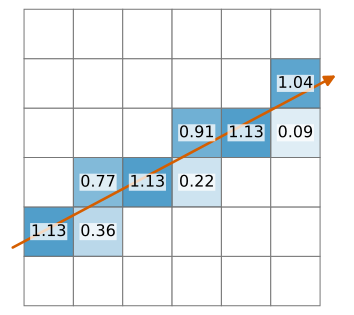
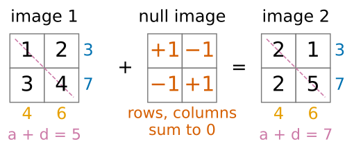
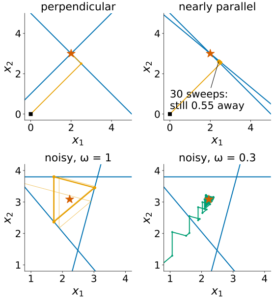
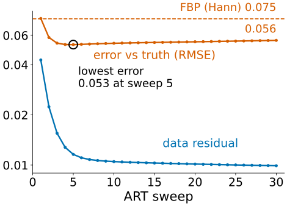
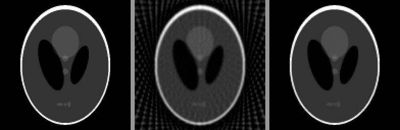

## About this lecture

FBP is fast, but it needs many angles and many photons, and it cannot use anything we know about the object. Today tomography becomes linear algebra.

- Unknown image $\mathbf x$, data $\mathbf b$, projector $A$: **$A\mathbf x = \mathbf b$**. Its **null space** = what the data cannot see.
- **$A^\top$ is back-projection**; there is no usable inverse, so we solve iteratively.
- **ART** (Kaczmarz): fix one ray at a time. **SIRT**: fix all rays at once, averaged.
- With noise: **semi-convergence**. With few views or a missing wedge: **priors** (non-negativity, total variation).

*Slides titled **The math** give the formulas and proofs; the ideas are complete without them.*

::: notes
Linear algebra needed: matrix–vector products, transpose, rank, null space, least squares. Recalls: the forward model and ill-posed inversion (image formation day), regularisation and early stopping (deconvolution day), total variation (Ising/MRF elective), energy = data + λ·prior (graph cuts, seg-energy). Demos: artsmall (by hand, interactive), iterrecon.
:::

## Tomography is $A\mathbf x = \mathbf b$

:::: {.columns}
::: {.column width="60%"}
Put the pixel values in a vector $\mathbf x$. Each measurement is a weighted sum of the pixels on its ray: $b_i = \sum_j a_{ij}x_j$.

- Row $i$ of $A$ says which pixels ray $i$ passes and with which weight (the length inside the pixel, or the interpolation weights of the first unit).
- $A$ is **huge**: a $256 \times 256$ image with 400 angles × 256 bins is a $102\,400 \times 65\,536$ matrix, 6.7 billion entries.
- But **sparse**: each ray touches only about 512 pixels, under 1 %. We never store $A$; we compute $A\mathbf x$ by projecting and $A^\top\mathbf y$ by back-projecting.

:::
::: {.column width="40%"}
{width="92%"}
:::
::::

Recall (image formation day): measuring is a linear forward operator, and inverting it amplifies noise wherever the operator loses information. Tomography is that story with $A$ = the projector.

## By hand: a $2 \times 2$ image

Pixels $\mathbf x = (a, b, c, d)$ (top row $a, b$). Measure row sums and column sums:

$$A = \begin{bmatrix}1&1&0&0\\0&0&1&1\\1&0&1&0\\0&1&0&1\end{bmatrix}, \qquad \begin{bmatrix}1&2\\3&4\end{bmatrix} \text{ and } \begin{bmatrix}2&1\\2&5\end{bmatrix} \text{ both give } \mathbf b = (3, 7, 4, 6).$$

- $A$ has rank **3**, not 4. Their difference $(1, -1, -1, 1)$ is in the **null space**: $A(1, -1, -1, 1) = 0$. Adding it to an image changes nothing the scanner sees.
- One diagonal ray, $a + d$, tells them apart: 5 versus 7. Rank 4.
- More angles = more rows = a smaller null space: the linear-algebra version of "too few angles".

{width="60%"}

## Try it: rays, matrix and null space

```{=html}
<link rel="stylesheet" href="../demos/dist/demo.css">
<div data-demo="artsmall" data-preset="same"></div>
<script src="../demos/dist/artsmall.js"></script>
```

::: notes
Image mode. Left: the true image (click a pixel: +1) with its rays; middle: the estimate; the table is A with the data, the current sums and the residual; the readout gives the rank and a null-space image. "2×2: two images, same data": rank 3, null image (1, −1; −1, 1). Press "+ null image": the truth becomes (2, 1; 2, 5), the data column does not change. Turn on 45° (diagonals): rank 4, no null image. 3×3 rows and columns: rank 5 of 9, a 4-dimensional null space.
:::

## $A^\top$ is back-projection

$A^\top\mathbf y$ sends each measurement $y_i$ back to the pixels of ray $i$ with the same weights: exactly the **back-projection** of the second unit.

- For the $2 \times 2$ example: $A^\top\mathbf b = (3 + 4,\ 3 + 6,\ 7 + 4,\ 7 + 6) = (7, 9, 11, 13)$. The right order, far too large, blurred towards the mean.
- The inverse is not available: $A$ is not square, has a null space, and the data are noisy (so $A\mathbf x = \mathbf b$ may have **no** exact solution).
- So: **least squares**, $\min_{\mathbf x}\|A\mathbf x - \mathbf b\|^2$, solved **iteratively** with only $A\mathbf x$ and $A^\top\mathbf y$, never a matrix inverse.

## ART: one ray at a time

**Kaczmarz's method**, called **ART** (algebraic reconstruction technique) in tomography: take one ray; change the image as little as possible so that this ray's sum is right, by spreading its error **evenly over its pixels**. Then the next ray. Sweep, repeat.

By hand, $\mathbf b = (3, 7, 4, 6)$, from $\mathbf x = 0$, rays in the order row 1, row 2, column 1, column 2:

| step | ray | error | $\mathbf x = (a, b, c, d)$ |
|---|---|---|---|
| 1 | $a + b = 3$ | 3 | (1.5, 1.5, 0, 0) |
| 2 | $c + d = 7$ | 7 | (1.5, 1.5, 3.5, 3.5) |
| 3 | $a + c = 4$ | −1 | (1, 1.5, 3, 3.5) |
| 4 | $b + d = 6$ | 1 | (1, 2, 3, 4) |

One sweep returns $\begin{psmallmatrix}1&2\\3&4\end{psmallmatrix}$, even if the truth was $\begin{psmallmatrix}2&1\\2&5\end{psmallmatrix}$: the data cannot tell, and ART picks the **smallest** image (squared norm 30 against 34).

## Two pixels: ART in a picture

:::: {.columns}
::: {.column width="55%"}
With two unknown pixels $(x_1, x_2)$, every measurement is a **line** in the plane; the true image is where the lines meet.

- ART **projects** the current point onto one line, then the next: a zig-zag towards the intersection.
- **Perpendicular** lines: one sweep. $x_1 + x_2 = 5$, $x_1 - x_2 = -1$: $(0, 0) \to (2.5, 2.5) \to (2, 3)$.
- **Nearly parallel** lines (similar rays): tiny steps. $x_1 + x_2 = 5$ and $x_1 + 1.2x_2 = 5.6$ (5° apart): after 30 sweeps still 0.55 from the solution.
- **Noise**: three lines do not meet in one point. ART **circles** forever between them; a **relaxation** $\omega < 1$ (step a fraction $\omega$ of the way) shrinks the circle onto a point near the least-squares solution.
:::
::: {.column width="45%"}
{width="86%"}
:::
::::

## Try it: ART and SIRT with two pixels

```{=html}
<link rel="stylesheet" href="../demos/dist/demo.css">
<div data-demo="artsmall" data-preset="noisy"></div>
<script src="../demos/dist/artsmall.js"></script>
```

::: notes
Mode "2 pixels". Drag a square handle to move a line, the round one to turn it. Orange = ART path from (0, 0), star = least-squares point. "2 pixels: ART zig-zags": perpendicular lines, done in one sweep. "Nearly parallel rays": 15° apart, still 0.42 from the solution after 30 sweeps. "noisy: ART circles": the path ends in a triangle cycle; "ω = 0.3 settles": the cycle shrinks to about 0.15 from the star. Tick "show SIRT path": SIRT moves to the average of the projections, smooth and straight to the star.
:::

## SIRT: all rays at once

**SIRT** (simultaneous iterative reconstruction technique): compute the error of **every** ray with the current image, back-project all errors at once (each spread evenly along its ray), average at each pixel, update.

- From $\mathbf x = 0$ on the $2 \times 2$ example: errors $(3, 7, 4, 6)$, spread over 2 pixels each: $(1.5, 3.5, 2, 3)$; each pixel averages its row and column values: $(1.75, 2.25, 2.75, 3.25)$.
- That is $A^\top\mathbf b / 4$: **the first SIRT step from zero is (normalised) plain back-projection.** The iterations then remove its blur step by step.
- Smoother and more robust to noise than ART (the errors of all rays are averaged), but slower: many iterations instead of a few sweeps.

## The math: Kaczmarz and SIRT {.math}

**Kaczmarz/ART**, ray $i$ with row $\mathbf a_i$:
$$\mathbf x \leftarrow \mathbf x + \omega\,\frac{b_i - \mathbf a_i^\top\mathbf x}{\|\mathbf a_i\|^2}\,\mathbf a_i \qquad (\omega = 1: \text{orthogonal projection onto } \mathbf a_i^\top\mathbf x = b_i).$$
Every update is a multiple of some $\mathbf a_i$, so from $\mathbf x_0 = 0$ the iterate stays in the row space of $A$; on a consistent system it converges to the **minimum-norm** solution (the one orthogonal to the null space).

**SIRT**, with $W_r$ and $W_c$ the diagonal matrices of inverse row sums and inverse column sums of $A$:
$$\mathbf x \leftarrow \mathbf x + \omega\,W_cA^\top W_r(\mathbf b - A\mathbf x).$$
This is gradient descent on the weighted least-squares cost $\tfrac12\|A\mathbf x - \mathbf b\|^2_{W_r}$ (preconditioned by $W_c$); with $W_r = W_c = I$ it is **Landweber** iteration. Its fixed points solve the (weighted) normal equations $A^\top W_r A\mathbf x = A^\top W_r\mathbf b$; it converges for $0 < \omega < 2$.

## Semi-convergence: stop early

:::: {.columns}
::: {.column width="55%"}
With noisy data the iteration first recovers the image, then starts fitting the **noise**:

- the **data residual** $\|A\mathbf x - \mathbf b\|$ keeps falling,
- but the **error** against the truth falls, reaches a minimum, and rises again.

Demo (Shepp–Logan, 60 angles, 3000 photons per ray, ART with $\omega = 0.5$): lowest error 0.053 after 5 sweeps, 0.056 after 30, while the residual keeps falling. FBP (Hann): 0.075.
:::
::: {.column width="45%"}
{width="100%"}
:::
::::

Stopping early is a form of **regularisation**, as on the deconvolution day: the first iterations recover the strong, well-measured components, the later ones the weakly measured ones, which are mostly noise.

## Priors: what we know that the data don't say

- **Non-negativity**: attenuation cannot be negative. Clip $x_j < 0$ to 0 after each step.
- **Total variation** (TV): the object is mostly piecewise constant. TV adds up the gradient magnitudes, $\mathrm{TV}(\mathbf x) = \sum_p \|\nabla x_p\|$: it allows a few sharp edges but punishes noise and ripples (the Ising/MRF elective treats TV in 1D). Alternate a data step (ART or SIRT) with a TV-denoising step of weight $\lambda$.

{width="72%"}

From 30 views the demo gives RMSE 0.081 for FBP, 0.028 for ART with non-negativity, 0.020 with TV ($\lambda = 0.003$). The price of TV: fine texture is lost and smooth ramps become staircases. Too large a $\lambda$ gives a cartoon.

## The math: regularised reconstruction {.math}

The same "data + λ · prior" form as segmentation energies (graph cuts) and the deconvolution day, now with $A \ne I$:

$$\hat{\mathbf x} = \arg\min_{\mathbf x \ge 0}\ \tfrac12\|A\mathbf x - \mathbf b\|^2 + \lambda\,\mathrm{TV}(\mathbf x), \qquad \mathrm{TV}(\mathbf x) = \sum_p\|\nabla x_p\| \ \Big(\text{or } \sum_p\sqrt{\|\nabla x_p\|^2 + \varepsilon^2}\Big).$$

- The smoothed TV is differentiable, so gradient steps work; the demo alternates a data step with an exact TV-denoising step instead (a splitting method).
- For **emission** data (PET, SPECT) the counts are Poisson, and the data term becomes the Poisson log-likelihood. Its classic iteration is multiplicative, **MLEM**: $\mathbf x \leftarrow \dfrac{\mathbf x}{A^\top\mathbf 1}\,A^\top\dfrac{\mathbf b}{A\mathbf x}$ (elementwise), which keeps $\mathbf x \ge 0$ automatically. It is Richardson–Lucy deconvolution (deconvolution day) with $A$ = the projector.

## Try it: iterative reconstruction with priors

```{=html}
<link rel="stylesheet" href="../demos/dist/demo.css">
<div data-demo="iterrecon" data-preset="fewviews"></div>
<script src="../demos/dist/iterrecon.js"></script>
```

::: notes
Each preset runs a number of iterations automatically. The plot shows RMSE against the truth (red), the relative data residual (blue) and the FBP error (dashed). "SIRT step 1 = back-projection": a blurred image, RMSE 0.206. "SIRT converging": 100 iterations, RMSE 0.057 (FBP 0.074 with these 60 angles). "noisy: stop early": the red curve has its minimum at 5 sweeps while the blue one keeps falling. "30 views": TV 0.020 vs FBP 0.081. "±60° wedge": iterative with priors 0.067 vs FBP 0.132, the lemon partly fixed. "noisy + TV": 0.027. "TV too strong": 0.048 and a cartoon.
:::

## Summary

- Tomography is **$A\mathbf x = \mathbf b$** with a huge, sparse projector $A$; its **null space** holds the images the scan cannot see. More angles, more rows, smaller null space.
- **$A^\top$ = back-projection**; the inverse is not usable, so we solve least squares iteratively.
- **ART**: project onto one ray's equation at a time; fast, converges to the **minimum-norm** image; with noise it circles unless relaxed ($\omega < 1$).
- **SIRT**: all rays at once, averaged; step 1 is back-projection; smoother, slower.
- With noise the error **semi-converges**: stop early. With few views or a missing wedge, **priors** (non-negativity, **TV**) give clean images where FBP streaks, at the price of texture.
