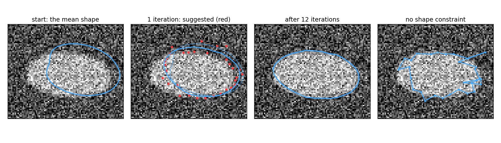
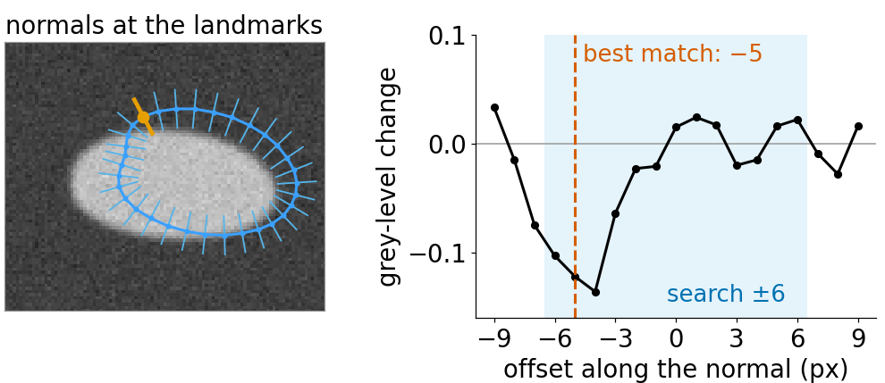
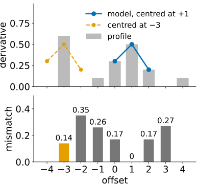
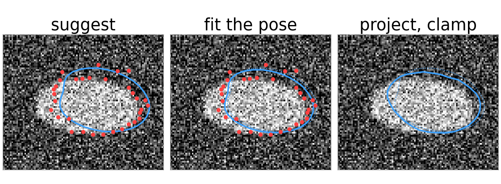
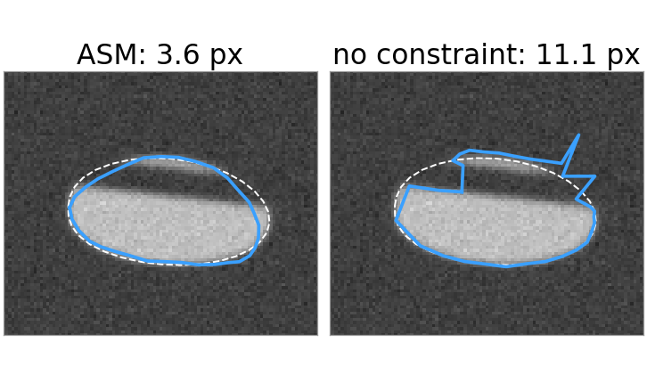
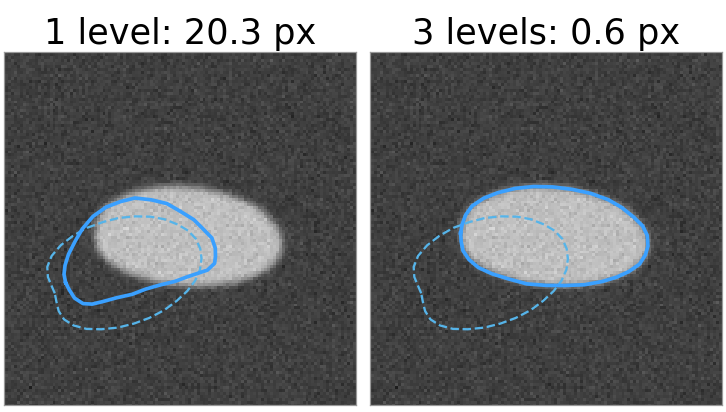
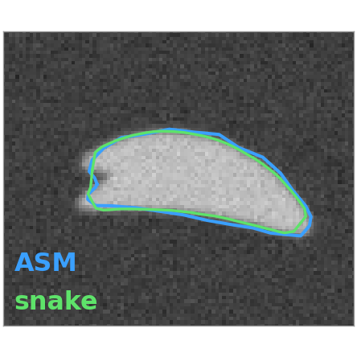

## About this lecture

A snake moves its points towards edges and keeps them smooth. An **active shape model** (Cootes, Taylor, Cooper & Graham, 1995) also moves its points towards the image, and then pulls the whole set back to the **nearest plausible shape** of a trained model.

- **Profiles** along the normals: what the image looks like across the boundary, at each landmark.
- The **search loop**: suggest points, fit the pose, project onto the modes, clamp, repeat.
- What the shape constraint buys: robustness to **noise**, **occlusion** and clutter.
- **Coarse to fine** on an image pyramid: a larger capture range.
- Snake or shape model: when to use which.

*Slides titled **The math** give the formulas and proofs; the ideas are complete without them.*

## The idea

{width="100%" fig-alt="Four panels on a noisy nucleus image: the mean shape placed off the object; the first iteration with the suggested points in red; after 12 iterations the outline fits the nucleus; without the shape constraint the outline follows the noise and falls apart."}

- Start: the **mean shape** of the model, placed roughly over the object.
- Each landmark looks along its **normal** for a better position (red). Alone, these suggestions are noisy and some are wrong.
- Then the model finds the plausible shape closest to the suggestions. Repeat: after 12 iterations the outline fits.
- Right: the same suggestions without the shape model: the points follow the noise and the outline falls apart.

::: notes
A synthetic nucleus image with strong noise (SD 0.25 on a contrast of 0.5), shape model trained on 40 synthetic nuclei (32 landmarks, 3 modes). Start: 10 px right, 4 px up, turned by 10°, 5 % too small. RMS landmark error 11.8 px at the start, 2.85 after 12 iterations; without the constraint 10.5.
:::

## Looking along the normal

At each landmark, sample the image along a short line **perpendicular to the outline** (the normal), a few pixels inside and outside: a **profile**.

{width="80%" fig-align="center" fig-alt="Left: a nucleus with the model outline placed slightly off, and a short normal line through each landmark; one landmark and its normal are highlighted. Right: the grey-level change along that normal for offsets −9 to 9; the search range ±6 is shaded, the profile has a deep dip at −4 to −5, and the best match is marked at −5."}

- Simplest rule: move the landmark to the **strongest edge** along the normal (as a snake's image force would, but searching instead of sliding).
- Better: learn from the training images what the profile **should look like** at this landmark (dark-to-bright, a thin dark line, a ramp), and move to the position whose profile matches best.
- Search a few pixels each way, $m$, with a profile of half-length $k < m$: try each offset, keep the best.

::: notes
Figure: the demo's "clean image, good start" preset before the first iteration (search m = 6, profile k = 3). At the highlighted landmark the trained-profile match (Mahalanobis distance) is best at offset −5, next to the strongest edge at −4.
:::

## A profile by hand

:::: {.columns}
::: {.column width="58%"}
Model profile at a landmark (3 samples of the derivative): $(0.3, 0.5, 0.2)$. Profile sampled along the normal, offsets $-4$ to $4$:

| offset | −4 | −3 | −2 | −1 | 0 | 1 | 2 | 3 | 4 |
|---|---|---|---|---|---|---|---|---|---|
| derivative | 0.0 | 0.6 | 0.0 | 0.1 | 0.3 | 0.5 | 0.2 | 0.0 | 0.1 |

- **Strongest edge**: the largest value, 0.6 at offset $-3$.
- **Profile match**: slide the 3-sample model over the profile and add the squared differences. Centred at $-3$: $(0 - 0.3)^2 + (0.6 - 0.5)^2 + (0 - 0.2)^2 = 0.14$. Centred at $+1$: $(0.3 - 0.3)^2 + (0.5 - 0.5)^2 + (0.2 - 0.2)^2 = 0$. Best: offset $+1$.
- A single strong spike (clutter, a neighbour's edge) wins the strongest-edge rule; it does not look like the trained profile.
:::
::: {.column width="42%"}
{width="100%" fig-alt="Top: the nine profile values as grey bars, with the three-sample model drawn on top centred at +1, where it fits exactly, and centred at −3, where it does not. Bottom: the mismatch for each centre from −3 to 3: 0.14, 0.35, 0.26, 0.17, 0, 0.17, 0.27; the smallest, 0, is at +1."}
:::
::::

## The math: the profile model {.math}

At landmark $j$ of every training image, sample $2k + 1$ points along the normal, take differences (derivative), normalise by $\sum|g|$ (insensitive to contrast): a vector $\mathbf g \in \mathbb R^{2k+1}$.

- Over the training set: mean $\bar{\mathbf g}_j$ and covariance $S_j$ (per landmark, per pyramid level).
- Fit of a candidate profile: the **Mahalanobis distance**

$$d(\mathbf g) = (\mathbf g - \bar{\mathbf g}_j)^\top S_j^{-1}(\mathbf g - \bar{\mathbf g}_j).$$

- If profiles were Gaussian, $d$ is $-2\log$ likelihood plus a constant: the best offset is the most probable profile. With $S_j = \sigma^2 I$ it is the sum of squared differences of the slide before, divided by $\sigma^2$.
- $S_j$ is estimated from few samples: regularise it ($S_j + \varepsilon I$) before inverting.

## The search loop

1. Start with the mean shape $\bar{\mathbf x}$, placed at a rough position, size and angle (the **pose** $T$).
2. **Suggest**: for every landmark, search along its normal for the best offset: suggested points $\mathbf Y$.
3. **Pose**: fit position, size and angle of the current model shape to $\mathbf Y$ (Procrustes, previous unit).
4. **Project**: undo the pose on $\mathbf Y$ and find the model parameters $\mathbf b$ closest to it.
5. **Clamp**: limit each $|b_j| \le 3\sqrt{\lambda_j}$. The new shape is the model shape with these $\mathbf b$, in this pose.
6. Repeat until few points move.

Step 2 alone is a snake without internal forces. Steps 3–5 replace $\alpha$ and $\beta$ by **learnt** knowledge: not "be smooth" but "look like the training shapes".

{width="56%" fig-align="center" fig-alt="One iteration on a noisy nucleus, in three panels. Suggest: red points along the normals, several of them off the outline. Fit the pose: the model outline is moved and turned towards the red points. Project and clamp: the outline changes shape to the closest plausible nucleus and now covers the object better."}

::: notes
Figure: the first iteration of the "noise" preset (noise 0.25; start 10 px right, 4 px up, 10°, 5 % small); dotted: the outline at the start of the iteration. In this iteration nothing needs clamping (b = −0.11, 0.14, −0.40; limits ±1.38, ±0.68, ±0.44).
:::

## The math: pose and shape parameters {.math}

The model shape in the image: $X = T(\bar{\mathbf x} + \Phi\mathbf b)$, with $T$ the similarity $\mathbf p \mapsto \begin{pmatrix} a & -b \\ b & a\end{pmatrix}\mathbf p + \mathbf t$.

- Pose: Procrustes of $\bar{\mathbf x} + \Phi\mathbf b$ onto the suggested points $\mathbf Y$ gives $(a, b, \mathbf t)$.
- Project: $\mathbf y = T^{-1}(\mathbf Y)$, $\mathbf b \leftarrow \Phi^\top(\mathbf y - \bar{\mathbf x})$: the least-squares closest shape in the model frame.
- Clamp: $b_j \leftarrow \max(-3\sqrt{\lambda_j}, \min(3\sqrt{\lambda_j}, b_j))$. Or, with a Mahalanobis limit, scale $\mathbf b$ down when $\sum_j b_j^2/\lambda_j > D_\text{max}^2$.
- Cootes et al. alternate pose and shape a few times per iteration and project $\mathbf y$ into the tangent space of the mean; one pass works well in practice.

## Try it: active shape model search

```{=html}
<link rel="stylesheet" href="../demos/dist/demo.css">
<div data-demo="asm" data-preset="clean"></div>
<script src="../demos/dist/asm.js"></script>
```

::: notes
Synthetic nucleus image (128 px, blur 1.2, noise 0.03), model of 40 training nuclei, 3 modes, profile model k = 3, search m = 6. The blue normals show the search range. Press 1 suggest (red points), 2 pose, 3 project (red dots in the b plot: the raw b), 4 clamp; then play. "clean": RMS error 11.8 → 1.6 px after 12 iterations (the outline itself is within 0.5 px: the landmarks slide a little along the smooth outline). Click a landmark to see its cost curve. "noise" (0.25): 2.85 px; with "strongest edge" the search fails (12.2 px). "no shape constraint": 10.5 px, points scatter. "occlusion": 3.6 px, the model bridges the bar; without the constraint 11.1. "far start" (22 px, 20°): single level 20.3 px; set pyramid levels to 3: 0.60 px. "outside the training set": tick "snake too": the snake follows the unusual shape (0.21 px from the outline), the clamped ASM cannot (0.98 px; b1 stuck at −3).
:::

## What the shape constraint buys

:::: {.columns}
::: {.column width="58%"}
Noisy image, 10 px / 10° start, 12 iterations (RMS distance of the landmarks to the truth):

| | start | ASM | suggestions only (no constraint) |
|---|---|---|---|
| noise 0.25 | 11.8 px | **2.9 px** | 10.5 px |
| occluding bar | 11.8 px | **3.6 px** | 11.1 px |

- Wrong suggestions (noise, a bar across the object, clutter) are a **minority**: the pose and the few mode parameters are fitted to all landmarks at once, so the majority wins.
- Where the edge is missing (occlusion), the model **fills in** the outline from what nuclei look like, instead of bridging with a straight line.
:::
::: {.column width="42%"}
{width="100%" fig-alt="A nucleus with a dark bar across its top, the true outline dashed. Left, ASM: a smooth nucleus outline across the bar, 3.6 pixels off. Right, without the shape constraint: the points follow the bar's edges and spike out, 11.1 pixels off."}

Occluding bar, after 12 iterations; dashed: the true outline.
:::
::::

## Coarse to fine

:::: {.columns}
::: {.column width="56%"}
The search only looks $m$ pixels each way: a far start does not see the object. The same idea as a large $\sigma$ for snakes:

- Build a **Gaussian pyramid**: blur and halve the image, two or three times (the edges day, scale space).
- Train a profile model at **each level**. Search the coarsest level first: $m = 6$ pixels there are 24 pixels at full size (two halvings). When few points move, go one level finer.
- Larger capture range, and faster: the coarse levels have few pixels and few iterations.

Far start (22 px, 20°): one level ends 20.3 px off; two levels 1.2 px; three levels 0.6 px.
:::
::: {.column width="44%"}
{width="100%" fig-alt="A nucleus with a start outline (dashed) far down and to the left. Left, one pyramid level: the outline ends stuck half on the nucleus, 20.3 pixels off. Right, three levels: the outline sits on the nucleus, 0.6 pixels off."}
:::
::::

## Snake or shape model?

:::: {.columns}
::: {.column width="66%"}
| | snake | active shape model |
|---|---|---|
| prior knowledge | smooth, short | the shapes in the training set |
| training data | none | annotated examples with landmarks |
| noise, clutter, occlusion | wanders, bridges with straight lines | robust; fills in from the model |
| unusual shape | follows it | **cannot**: clamped to the model |
| result | an outline | an outline **with** landmarks and parameters $\mathbf b$ |

:::
::: {.column width="34%"}
{width="100%" fig-alt="A banana-shaped nucleus more bent and dented than any training shape. The snake (green) follows the dent closely; the ASM outline (blue) is clamped to the model and stays smoother, missing the dent."}

A nucleus more bent than any in the training set.
:::
::::

::: notes
Figure: the "shape outside the training set" preset. Snake: 0.21 px from the outline; ASM: 0.98 px, with b1 = −1.38 stuck at its limit −3√λ1.
:::

Applications: outlines of hands, bones in radiographs, the heart's ventricles, faces, nuclei and cells in microscopy. Today's networks that detect landmarks are often still regularised by a point distribution model.

## Beyond: appearance models

- **Active appearance models** (Cootes, Edwards & Taylor, 1998): warp each training image to the mean shape, do PCA on the grey levels too, and fit shape and appearance together.
- **3D shape models**: meshes instead of polygons (organs from CT or MRI; marching cubes produces such meshes); the same Procrustes and PCA in $\mathbb R^{3n}$.
- **Shape priors** inside graph cuts and level sets: the energy gets a term "look like the model".

## Summary

- An ASM = a point distribution model + a profile model per landmark (and per pyramid level).
- Loop: **suggest** points along the normals → fit the **pose** → **project** onto the modes → **clamp** $|b_j| \le 3\sqrt{\lambda_j}$.
- Profile matching by **Mahalanobis distance** to the trained profile beats the strongest edge.
- The constraint makes the search robust to noise and occlusion, and **coarse to fine** extends its reach.
- It cannot follow shapes the training set never showed: then a snake does better.
