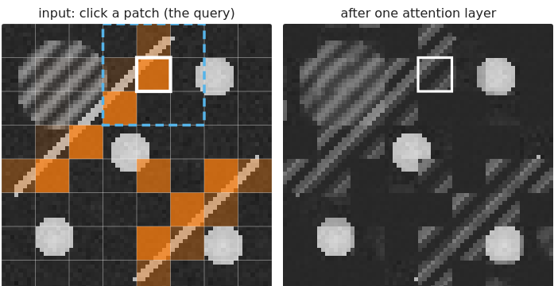

## Goal

By the end of this exercise you should be able to:

- compute a small **self-attention** step by hand and explain it as a content-dependent weighted average,
- compare attention with **convolution**: reach, weights, cost,
- choose between **frozen features** and **fine-tuning**, and say what **self-supervised** pretraining learns to ignore,
- read a **reliability diagram**, compute the ECE, and say what temperature scaling can and cannot fix,
- decide when a **classical** method is the better choice.

Do the pen-and-paper part first, then the demos. Questions marked *(math)* are for those who want the derivations; the concept questions do not depend on them.

## Background

| Idea | What it means |
|---|---|
| Token | a patch of the image as a vector (embedding + position code) |
| Attention weight $a_{ij}$ | softmax over $j$ of the score $\mathbf q_i \cdot \mathbf k_j$ (divided by a temperature) |
| Output of token $i$ | $\sum_j a_{ij}\mathbf v_j$, a weighted average of the values |
| Frozen features + linear probe | pretrained embeddings, only a logistic regression is trained |
| Fine-tuning | the pretrained network itself is trained further |
| Contrastive pretraining | two augmented views of a crop must have similar embeddings |
| Calibration | among predictions with confidence $c$, a fraction $c$ is correct |
| ECE | $\sum_b \frac{n_b}{n}|\mathrm{acc}_b - \mathrm{conf}_b|$ over confidence bins |

{width=80%}

## By hand

**B1.** Attention with three tokens: query $\mathbf q = (1, 0)$; keys $\mathbf k_1 = (1, 0)$, $\mathbf k_2 = (0, 1)$, $\mathbf k_3 = (1, 1)$; values $10, 0, 4$.
(a) Compute the scores, the weights (softmax) and the output.
(b) The same with temperature $T = \tfrac12$ (scores divided by $T$) and with $T = 2$.
(c) What is the output for $T \to 0$ and for $T \to \infty$?

**B2.** Tokens and cost.
(a) How many tokens does a $512 \times 512$ image give with $16 \times 16$ patches? With $8 \times 8$ patches? How many attention weights per layer and head in each case?
(b) Why do smaller patches help to see small structures, and what do they cost?

**B3.** Receptive field.
(a) A stack of $L$ convolutions with $3 \times 3$ kernels (stride 1): how large is the receptive field? How many layers are needed to relate two pixels 200 pixels apart?
(b) How many attention layers are needed for the same? What does the attention layer **not** know that the convolution knows for free?

**B4.** For each project, choose frozen features + a probe, fine-tuning, or training from scratch, and explain:
(a) 20 annotated images of nuclei from one microscope; a large pretrained network is available;
(b) 5000 annotated images from the same microscope;
(c) a new imaging modality (e.g. electron tomography) where the pretrained network has never seen anything similar, and 500 annotated slices.

**B5.** A contrastive network is pretrained with the augmentations rotation, flips, blur, brightness, contrast and **hue shifts**. Later you want to classify cells by **stain colour**. What goes wrong? Which augmentation must be left out, and which others would you check?

**B6.** A classifier's confidences and correctness on 10 test images:

| confidence | 0.55 | 0.60 | 0.65 | 0.70 | 0.72 | 0.80 | 0.85 | 0.90 | 0.95 | 0.99 |
|---|---|---|---|---|---|---|---|---|---|---|
| correct | 1 | 0 | 1 | 0 | 1 | 1 | 0 | 1 | 1 | 1 |

(a) Use two bins, $[0.5, 0.75)$ and $[0.75, 1]$. For each bin compute the accuracy and the mean confidence; draw the reliability diagram.
(b) Compute the ECE. Is the classifier over- or underconfident?
(c) After temperature scaling with $T > 1$, what happens to the accuracy?

**B7.** Classical or deep? For each task, decide and give the main reason:
(a) counting fluorescent beads of known size on a clean background, 30 images;
(b) segmenting irregular cells in 10 000 phase-contrast images from many labs;
(c) measuring the diameter of a calibration grid to check the microscope;
(d) finding mitotic cells in histology, with 2000 annotated examples.

::: {.callout-note collapse="true" title="Solutions"}
**B1.** (a) Scores $\mathbf q \cdot \mathbf k_j = 1, 0, 1$. Weights $e^1 : e^0 : e^1$ normalised: $0.422, 0.155, 0.422$. Output $0.422 \cdot 10 + 0.155 \cdot 0 + 0.422 \cdot 4 = 5.91$. (b) $T = \tfrac12$: scores $2, 0, 2$; weights $0.468, 0.063, 0.468$; output 6.56. $T = 2$: scores $0.5, 0, 0.5$; weights $0.384, 0.233, 0.384$; output 5.37. (c) $T \to 0$: all weight on the best matches, tokens 1 and 3 equally: output $(10 + 4)/2 = 7$. $T \to \infty$: equal weights: $(10 + 0 + 4)/3 = 4.67$.

**B2.** (a) $16 \times 16$: $32 \times 32 = 1024$ tokens, $1024^2 = 1\,048\,576$ weights. $8 \times 8$: $64 \times 64 = 4096$ tokens, $16\,777\,216$ weights: 4 times more tokens, 16 times more weights. (b) A structure smaller than a patch is mixed with everything else in its patch; smaller patches keep it apart, at a cost growing with the square of the number of tokens.

**B3.** (a) $(2L + 1) \times (2L + 1)$. Two pixels 200 apart are in one receptive field when $2L + 1 \ge 201$: $L = 100$ layers (without pooling). (b) One: every token attends to every token. But attention does not know which tokens are neighbours: locality and position must come from the position code and be learned from data.

**B4.** (a) Frozen features + a probe (or light fine-tuning of the last layers): 20 images are too few to train or fully fine-tune a large network without overfitting, but enough for a linear probe on good features. (b) Fine-tuning (or even training from scratch): with 5000 images from the same microscope the network can adapt its features to the task; fine-tuning a pretrained network usually converges faster and better. (c) Fine-tuning with care, or training a smaller network from scratch: features pretrained on very different images may not transfer; check a probe on frozen features first as a baseline; if it is poor, the features do not fit.

**B5.** The network has been taught that hue does not matter: two views differing only in colour must have the same embedding. Colour information is suppressed, so a probe cannot separate the stains. Leave out hue (and colour jitter, greyscale conversion). Check also brightness and contrast if the stain intensity matters, and any augmentation that changes what you want to measure.

**B6.** (a) Bin $[0.5, 0.75)$: 5 predictions, 3 correct: accuracy 0.6; mean confidence $(0.55 + 0.60 + 0.65 + 0.70 + 0.72)/5 = 0.644$. Bin $[0.75, 1]$: 5 predictions, 4 correct: accuracy 0.8; mean confidence $(0.80 + 0.85 + 0.90 + 0.95 + 0.99)/5 = 0.898$. Both points lie below the diagonal. (b) ECE $= 0.5 \cdot |0.6 - 0.644| + 0.5 \cdot |0.8 - 0.898| = 0.022 + 0.049 = 0.071$. Overconfident (confidence above accuracy in both bins; overall mean confidence 0.771 against accuracy 0.7). (c) Unchanged: dividing the logits by $T$ never changes which class has the largest score; only the confidences move towards 0.5.

**B7.** (a) Classical: known shape and size, clean background, few images: threshold + labelling, or a blob detector; easy to check. (b) Deep (an instance route such as flows), pretrained or trained on many labs' data: irregular shapes and large variation, and enough images. (c) Classical: the measurement's bias must be understood and traceable; a fitted model of the grid is explainable; a network adds an unknown error. (d) Deep: subtle appearance, many examples; but test on data from other labs or scanners (domain shift) and check calibration before using its confidences.
:::

### Math questions

**B8.** *(math)* Show that self-attention without position codes is permutation-equivariant: $\mathrm{Attn}(PX) = P\,\mathrm{Attn}(X)$ for every permutation matrix $P$.

**B9.** *(math)* Let $\mathbf q, \mathbf k \in \mathbb R^d$ have independent entries with mean 0 and variance 1. Show that $\mathbf q^\top\mathbf k$ has mean 0 and variance $d$. What happens to the softmax of scores with standard deviation $\sqrt d$ when $d$ is large?

**B10.** *(math)* Show that temperature scaling does not change the predicted class, and that for two classes it maps a confidence $c > \tfrac12$ to $\sigma(\mathrm{logit}(c)/T)$. Compute the new confidence of 0.88 with $T = 2$.

**B11.** *(math)* Write the InfoNCE loss for a batch of 3 pairs with $\tau = 0.5$ and embeddings $\mathbf z_1 = (1, 0)$, $\mathbf z_2 = (0, 1)$, $\mathbf z_3 = (0.6, 0.8)$; partners $\mathbf z_1' = (0.8, 0.6)$, $\mathbf z_2' = (0.6, 0.8)$, $\mathbf z_3' = (0, 1)$. Compute the three losses and identify the loss as a cross-entropy.

::: {.callout-note collapse="true" title="Solutions (math)"}
**B8.** $Q' = PXW_Q = PQ$, and likewise $K' = PK$, $V' = PV$. Scores $S' = Q'K'^\top/\sqrt d = PSP^\top$: entry $(i, j)$ of $S'$ is entry $(\pi(i), \pi(j))$ of $S$. The row-wise softmax of $PSP^\top$ is $P\,\mathrm{softmax}(S)P^\top$ (each row is a permuted row of $S$, permuted within itself, and the softmax treats the entries of a row symmetrically). So $\mathrm{Attn}(PX) = P\,\mathrm{softmax}(S)P^\top PV = P\,\mathrm{softmax}(S)V = P\,\mathrm{Attn}(X)$, using $P^\top P = I$.

**B9.** $E[q_mk_m] = E[q_m]E[k_m] = 0$, so $E[\mathbf q^\top\mathbf k] = 0$. $\mathrm{Var}(q_mk_m) = E[q_m^2]E[k_m^2] = 1$; the $d$ terms are independent, so the variance is $d$. Scores spread by $\sqrt d$ (e.g. 8 for $d = 64$): the largest score in a row dominates the softmax, which then puts nearly all weight on one token and has tiny gradients for the others. Dividing by $\sqrt d$ restores variance 1.

**B10.** $z_k/T$ is a strictly increasing function of $z_k$ for $T > 0$, so the arg max is unchanged. Two classes: $c = \sigma(z)$ with $z = \mathrm{logit}(c) = \log\frac{c}{1-c}$; after scaling $c' = \sigma(z/T)$. $c = 0.88$: $z = \log(0.88/0.12) = 1.99$; $c' = \sigma(0.996) = 0.73$.

**B11.** Scores $\mathbf z_i^\top\mathbf z_j'/\tau$:
$\begin{bmatrix} 1.6 & 1.2 & 0 \\ 1.2 & 1.6 & 2.0 \\ 1.92 & 2.0 & 1.6 \end{bmatrix}$. Row-wise softmax, diagonal entries: $0.534$, $0.316$, $0.258$. Losses $-\log$: $0.627$, $1.151$, $1.353$; mean $1.044$. Each row is a 3-class classification ("which partner is mine?") with logits $\mathbf z_i^\top\mathbf z_j'/\tau$ and the correct class $j = i$: the loss is the cross-entropy of that classification. Pair 3 has the largest loss: its embedding is closer to partner 2 than to its own.
:::

## Explore: attention on patches {#explore-selfattn}

A $64 \times 64$ image cut into $8 \times 8$ patches: 64 tokens. Click a patch (the query): its attention weights over all patches are shown in orange, the dashed blue square is what $L$ stacked $3 \times 3$ convolutions on the patch grid can see. The score is content weight × (similarity of hand-made features: brightness, contrast, edge orientation; or of the raw pixels) plus position weight × (closeness on the grid), with a temperature. The right panel is the image after **one** attention layer: every patch replaced by the weighted average of all patches. The weights are set by hand, not trained.

```{=html}
<link rel="stylesheet" href="../demos/dist/demo.css">
<div data-demo="selfattn" data-preset="position"></div>
<script src="../demos/dist/selfattn.js"></script>
```

**S1.** Preset **position only: a blur kernel**. Which patches get the largest weights, and is the pattern the same for every query? What does the output look like? Why is this a convolution?

**S2.** Preset **content only: similar patches, however far** (query on a filament). Where does the weight go? How many patches are effectively attended? Click a cell patch and a background patch.

**S3.** Preset **non-local means: denoise** (noisy image, raw-patch similarity). What weight does the query keep for itself? Compare the filaments in the input and output. Move the temperature down to 0.1 and up to 2: what happens to the output?

**S4.** Preset **temperature → 0: one patch**. What is the output image, and why?

**S5.** Preset **no position code: shuffling only reorders**. Read the shuffle test. Now untick "no position code" and set a position weight of 1: what does the shuffle test show? Explain with B8.

**S6.** Preset **a 3 × 3 conv needs many layers** (query in a corner). How many conv layers on this 8 × 8 patch grid are needed before the corner sees the whole image?

::: {.callout-note collapse="true" title="Solutions"}
**S1.** The query (3, 3) keeps 32 % for itself and 12 % for each of its direct neighbours, decaying with grid distance: a bell-shaped kernel, the same for every query (away from the border). The output is a blocky blur of the image. The weights depend only on the offset between patches, not on what they contain: a convolution (math slide).

**S2.** On the other filament patches, wherever they are in the image (top weights about 9 % each, at (4, 1), (4, 6) and (2, 3)), and almost nothing on background or cells: about 15 effective patches. A cell patch attends to the other cells, a background patch to background. The weights follow the content, not the distance.

**S3.** 51 % on itself, the rest on similar patches (11 % and 7 % for the next two); about 8.5 effective patches. The output filaments and cells are smoother, because similar noisy patches are averaged and the noise partly cancels, while the structure (the same in all of them) stays. At $T = 0.1$ nearly all weight stays on the patch itself: hardly any denoising. At $T = 2$ the weights spread over many dissimilar patches: the output is washed out (structures averaged with background).

**S4.** The query (1, 6) gives 100 % to itself; every patch does the same: the output equals the input. With $T \to 0$ attention picks the best match, which (with position closeness and identical content) is the patch itself.

**S5.** With no position code the shuffle test reads 0.0: attention on the shuffled image equals the shuffled attention output. With a position weight the result depends on where patches sit on the grid, so shuffling changes the result (the test shows a large difference, e.g. 58.8 grey levels in the position preset). Without a position code the network sees a **set** of patches: B8.

**S6.** From the corner (0, 0), $L$ layers see $L$ patches to the right and down: the far corner (7, 7) needs $L = 7$ layers (a $15 \times 15$ footprint). One attention layer already covers all 64 patches.
:::

## Explore: frozen features and a probe {#explore-embedprobe}

A $128 \times 128$ synthetic image: nuclei of any brightness among things that are **not** nuclei but can be as bright (debris spots, fibres, large soft cytoplasm-like regions); or the course micrograph. Three embeddings per pixel (on a $64 \times 64$ grid): **raw** $9 \times 9$ patches, the **filter stack** of the random-forest day, and **learned** features from a tiny encoder (7 k weights) trained without labels by a contrastive loss on synthetic images and the micrograph (its training script is next to the demo). Modes: **click: similarity** (cosine similarity to the clicked pixel), **paint + probe** (paint nucleus and background strokes; a logistic regression is trained on the frozen embeddings; Dice against the truth), **click: prompt** (similarity above a threshold, the connected piece containing the click). The **another microscope** sliders change the image after the probe was trained.

```{=html}
<link rel="stylesheet" href="../demos/dist/demo.css">
<div data-demo="embedprobe" data-preset="raw"></div>
<script src="../demos/dist/embedprobe.js"></script>
```

**P1.** Preset **raw pixels: similarity = brightness**. Where is the similarity to the bright nucleus high? Compare the mean similarity on nuclei and elsewhere with the presets for the learned features and (switch the embedding) the filter stack.

**P2.** Preset **five strokes, learned features**: two nucleus strokes (one bright, one dim nucleus) and three background strokes. Dice? Switch the embedding to raw and to filter stack, keeping the strokes. Which features need the fewest labels here?

**P3.** Add strokes where the probe is wrong (e.g. on a fibre or a soft bright region). How far can you push the Dice with each embedding?

**P4.** Preset **a click → a mask** (filter stack). Dice with the clicked nucleus? Switch to learned and raw features. Move the threshold: what happens when it is too low?

**P5.** Preset **new microscope: probe kept** (brightness × 0.5, blur 1.5, noise 8, probe trained on the original image). Dice with the learned features? With raw patches and with the filter stack? Why do all three survive the change of brightness here? Which change hurts most if you push the sliders further?

**P6.** Switch the image to the **micrograph** and click inside the nucleus in similarity mode with each embedding. Which one separates the nucleus from the cytoplasm?

::: {.callout-note collapse="true" title="Solutions"}
**P1.** Raw patches: high wherever the image is bright: on nuclei, but also on debris, fibres and the soft bright regions (mean similarity 0.23 on nuclei, 0.08 elsewhere: a weak separation). Learned features: 0.29 on nuclei, −0.05 elsewhere. Filter stack: 0.70 on nuclei, −0.25 elsewhere: on this image the hand-designed multiscale filters separate best.

**P2.** Learned features: Dice 0.55 with 69 labelled grid pixels. Raw: 0.39. Filter stack: 0.53. With five strokes, features that already encode "a compact blob of this size" (the stack, the learned features) do much better than raw pixels, where the probe can only learn "bright", which the debris and soft regions are too.

**P3.** (Results depend on your strokes.) Background strokes on the soft bright regions and on fibres help the stack and the learned features most: their embeddings separate these structures from nuclei, so a few examples suffice. With raw patches the gain is small: a linear rule on raw grey levels cannot express "compact and sharp-edged", and bright non-nuclei keep being confused with nuclei.

**P4.** Filter stack: 49 grid pixels, Dice 0.91 with that nucleus. Learned features: 30 pixels, Dice 0.65. Raw: 13 pixels, Dice 0.36. Too low a threshold lets the mask leak into neighbouring bright structures (it grows as long as they are connected); too high keeps only the centre of the nucleus. A click gives **a** mask; how far it reaches is a choice.

**P5.** Learned: 0.58 (0.55 before). Raw: 0.37 (0.39). Filter stack: 0.55 (0.53). Each embedding dimension is standardised over the image before the probe, so a global change of brightness cancels out for all three. Pushing the sliders further: strong noise (30) ruins the raw patches first (the probe on raw grey levels follows the noise), strong blur (3) costs the filter stack a little (edges and blob sizes change), while the learned encoder, trained with blur and noise augmentations, changes least. The augmentations decided what it ignores.

**P6.** The filter stack lights up the whole nucleus and little else: its smoothed intensities and texture at several scales describe "the even grey inside the envelope". Raw patches give a speckled map: on this grainy micrograph a $9 \times 9$ patch is dominated by grain, so a patch is similar mainly to itself. The tiny learned encoder gives a weak, streaky map: trained mostly on synthetic images, its features do not describe this kind of texture; a pretrained network is only as good as the match between its training images and yours.
:::

## Explore: calibration {#explore}

A simulated two-class classifier on 4000 test samples. **Overconfidence** multiplies its logits (1 = calibrated); **temperature** divides them; **fit T on validation** finds the temperature that minimises the negative log-likelihood on validation data from the training domain; **domain shift** moves the two test classes closer together after $T$ was fitted. Left: histogram of the confidences; right: the reliability diagram (bars: accuracy per confidence bin; red: mean confidence in the bin).

```{=html}
<link rel="stylesheet" href="../demos/dist/demo.css">
<div data-demo="calibration" data-preset="calibrated"></div>
<script src="../demos/dist/calibration.js"></script>
```

**C1.** Preset **calibrated**. Compare accuracy and mean confidence, and read the ECE. Where do the bars lie?

**C2.** Preset **overconfident network**. What happens to the accuracy, the mean confidence, the ECE and the histogram?

**C3.** Preset **temperature fixes it in-domain**. Which $T$ is fitted? What are the ECE and the accuracy now? Why did the accuracy not change?

**C4.** Preset **shift: overconfident again**. Accuracy, mean confidence, ECE? Press **fit T on validation** again: does it help? What would?

**C5.** Preset **accuracy unchanged, calibration changed** (overconfidence 0.4). Is this network over- or underconfident? Which $T$ would fix it?

::: {.callout-note collapse="true" title="Solutions"}
**C1.** Accuracy 89.0 %, mean confidence 88.4 %, ECE 0.9 %: the bars lie on the diagonal (57, 63, 75, 89, 98 % correct in the five bins).

**C2.** Accuracy unchanged at 89.0 % (the predicted classes are the same), mean confidence 96.1 %, ECE 7.0 %. The histogram piles up near 1; the bars fall below the diagonal (e.g. 62 % correct among predictions with confidence 0.8–0.9).

**C3.** $T = 2.86$ (close to the overconfidence factor 3). ECE 0.4 %, mean confidence 88.9 %, accuracy 89.0 %: dividing all logits by the same positive number does not change which class has the larger logit.

**C4.** Accuracy 73.0 %, mean confidence 83.5 %, ECE 10.5 %: on shifted data the network is overconfident again although $T$ was fitted. Fitting $T$ on validation data does not change anything (the validation data are from the training domain). What helps: validation (and recalibration) data from the new domain, or retraining/fine-tuning with such data; and flagging inputs that look unlike the training data.

**C5.** Underconfident: confidence 75.1 % against accuracy 89.0 %, ECE 13.9 %; the bars lie above the diagonal. A temperature $T < 1$ (about 0.4) sharpens the probabilities and fixes it; **fit T** finds it.
:::

## Where this leads

The last unit of the day uses everything here in reverse: networks that **generate** images (diffusion models), and what a generative prior does to a restored image. Calibration and domain shift return there as the question of which details in a restored image can be trusted.
