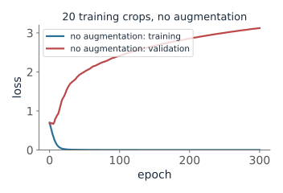
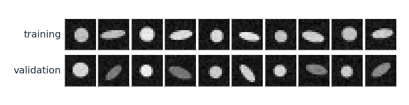
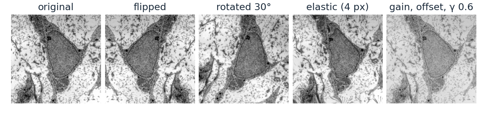
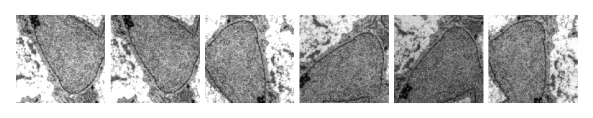
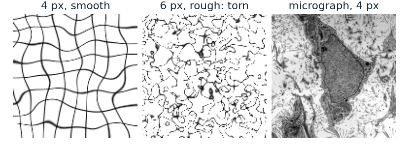
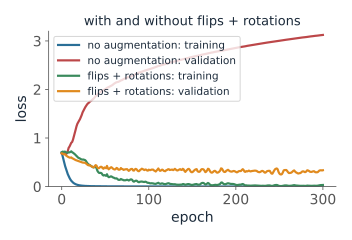
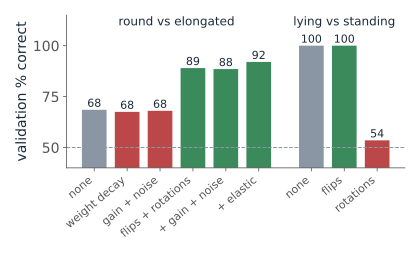

## About this lecture

Microscopy data sets are small: tens of annotated images, not millions. A network with thousands of weights memorises them. This unit:

- regularisation in practice: weight decay, dropout, early stopping (recall);
- **data augmentation**: train on modified copies, to tell the network **what does not matter**;
- geometric (flips, rotations, scale, elastic), intensity, noise and blur augmentations;
- which augmentations are **safe** for which task, and which ones lie.

*Slides titled **The math** give the formulas and proofs; the ideas are complete without them.*

::: notes
Demo tour: augmentlab explore view (presets original, flipped, rotated, zoom, elastic, too strong, dimmer, blur + noise; the grid overlay; 8 random copies), then the train view (recorded runs: flips + rotations, + gain + noise, + elastic, weight decay only, gain + noise only, lying vs standing with flips and with rotations). The experiment's numbers come from augmentlab/model.ts (recorded by tools/figs/augmentation/dump.ts); the coding exercise repeats it with its own random numbers.
:::

## Small data sets overfit

:::: {.columns}
::: {.column width="45%"}
An experiment: tell **round** cells from **elongated** ones in $16\times16$ crops. 20 training crops; the elongated cells in them all happen to **lie** horizontally. 200 validation crops: any direction, any brightness.

A small network (256 inputs, 32 hidden units, 2 outputs) learns the 20 crops perfectly within 25 epochs. On the validation crops: 68 % correct, and the validation loss climbs to 3.1.

It has learnt "horizontal bright stripe = elongated", which is true of the training data and wrong in general.
:::
::: {.column width="55%"}
{fig-alt="Loss against the epoch for 300 epochs without augmentation. Training loss falls to 0 within about 25 epochs. Validation loss falls only for the first 5 epochs, to 0.67, then rises steadily to 3.1." width="100%"}

{fig-alt="Ten training crops (round cells and horizontally lying elongated cells) and ten validation crops (round cells and elongated cells in many directions and brightnesses)." width="90%"}
:::
::::

## Regularisation: a recall

From the [backpropagation unit](../backprop/lec.qmd):

- **Weight decay**: penalise $\lambda\sum w^2$; smaller weights, smoother functions.
- **Dropout**: silence random hidden units during training.
- **Early stopping**: keep the weights from the epoch with the lowest validation loss ([evaluation day](../leakage/lec.qmd): that validation set may not be the test set).
- A **smaller** network, or **more data**.

On the crop experiment these help little: weight decay 0.01 keeps the validation loss at 1.4 instead of 3.1, but still 68 % correct; early stopping keeps epoch 5 (70 %). They make memorising **harder**; they cannot tell the network that **direction does not matter**. The data has to.

## The math: weight decay with Adam {.math}

- Gradient descent on $\mathcal L(\mathbf w) + \lambda\|\mathbf w\|^2$ shrinks every weight by $(1 - 2\eta\lambda)$ per step, plus the usual step: "decay".
- In a Bayesian reading, $\lambda\|\mathbf w\|^2$ is minus the log of a Gaussian prior on the weights: the trained network is the most probable one given data and prior (maximum a posteriori).
- With Adam, adding $2\lambda\mathbf w$ to the gradient is **not** the same: Adam divides by $\sqrt{\hat v}$, so weights with large gradients are decayed less. **AdamW** decays directly: $\mathbf w \leftarrow \mathbf w - \eta\lambda\mathbf w - \eta\,\hat{\mathbf m}/\sqrt{\hat{\mathbf v}}$ (Loshchilov and Hutter, 2019), the usual choice now.
- Early stopping acts like weight decay for gradient descent: weights start near 0 and move away step by step; stopping early limits how far.

## Augmentation: say what does not matter

:::: {.columns}
::: {.column width="40%"}
Train on **modified copies** of each image, made anew every time it is used. The label stays the same.

Each kind of change tells the network one thing that **does not matter** for the task:

- **flips, rotations**: the direction of the cell;
- **scale**: its size (careful: see later);
- **elastic deformation**: its exact shape;
- **gain, offset, gamma**: brightness and contrast of the microscope;
- **noise, blur**: camera noise, focus.
:::
::: {.column width="60%"}
{fig-alt="The cell micrograph and four augmented copies made by the course code: flipped left to right, rotated by 30 degrees (mirrored at the borders), elastically deformed by about 4 pixels, and with gain, offset and gamma 0.6." width="100%"}

{fig-alt="Six random augmented copies of a crop of the micrograph: random flips, any rotation angle, gain within 30 percent, and noise." width="100%"}
:::
::::

<small>Image: transmission electron micrograph of a mesenchymal stem cell, Robert M. Hunt, CC BY 3.0, via Wikimedia Commons.</small>

## Geometric augmentations

- **Flips** (left–right, up–down) and **rotations by 90°**: exact, no interpolation. Together they give 8 copies of every image.
- **Any rotation angle**: needs interpolation (bilinear), and something for the corners that come from outside the image: mirror the border, or crop.
- **Scale and crop**: random zoom and random crops of a larger image. Zoom changes the apparent **pixel size**: a nucleus of 10 µm at 0.2 µm per pixel looks like one of 15 µm after zooming by 1.5.
- **Translation**: convolutional networks are already (nearly) shift-equivariant ([convolutional networks](../cnn/lec.qmd)); random crops add the rest.

Each of these is the inverse mapping of the [geometric transforms](../images/lec.qmd) of day 1: for every output pixel, look up where it comes from.

## Elastic deformation

:::: {.columns}
::: {.column width="45%"}
A smooth random displacement for every pixel: two fields of random numbers (one for $x$, one for $y$), **blurred** so that neighbouring pixels move together, scaled to a few pixels.

- Two settings: the **strength** (how far pixels move) and the **smoothness** (how far apart the bends are).
- Imitates the natural variation of cell and tissue shapes. The original U-Net (30 training images) relied on it.
- Too strong or too rough, and cells get shapes no real cell has (demo preset "too strong").
:::
::: {.column width="55%"}
{fig-alt="Elastic deformation. A square grid deformed by a smooth random field of about 4 pixels: the lines bend gently. The same with 6 pixels and a rough field: the lines kink and fold. The micrograph deformed by 4 pixels by the course code." width="100%"}
:::
::::

## Intensity, noise and blur

- **Gain and offset**: $v \to a\,v + b$: brightness and contrast of the microscope, laser power, exposure.
- **Gamma**: $v \to v^\gamma$: a non-linear change of contrast (detector response, display settings).
- **Noise**: add Gaussian or Poisson noise: different exposure times, cameras ([camera noise](../cameranoise/lec.qmd)).
- **Blur**: a small Gaussian blur: slightly out of focus.
- **Colour** (stain variation in histology): small changes of hue and saturation.

All of these change **the values**, not the positions: the label image (masks, points) stays as it is. For geometric augmentation of a segmentation task, the **same** transformation must be applied to the image and its mask (nearest-neighbour for the labels).

## The math: inverse mapping and the elastic field {.math}

- A transformation $T$ maps input positions to output positions. To fill every output pixel, use the **inverse**: $\text{out}(\mathbf p) = \text{in}(T^{-1}\mathbf p)$, with bilinear interpolation between pixels. A rotation by $\theta$ about the centre $\mathbf c$: $T^{-1}\mathbf p = R(-\theta)(\mathbf p - \mathbf c) + \mathbf c$.
- Elastic field: $u = \alpha\,\frac{G_\sigma * n_u}{\text{rms}(G_\sigma * n_u)}$ with $n_u$ white noise, $G_\sigma$ a Gaussian; the same for $v$. Then $\text{out}(x, y) = \text{in}(x + u(x, y),\ y + v(x, y))$.
- Smoothness: the blurred field is correlated over about $\sigma$ pixels; the local stretch is about $\alpha/\sigma$. If $\alpha/\sigma$ approaches 1, the mapping can fold over (no longer one-to-one): torn cells.
- An augmentation $T$ is safe when the label is **invariant**: $y(T\mathbf x) = y(\mathbf x)$ (classification), or **equivariant**: $y(T\mathbf x) = T\,y(\mathbf x)$ (segmentation, apply it to the mask too).

## Try it: augmentations of a micrograph

```{=html}
<link rel="stylesheet" href="../demos/dist/demo.css">
<div data-demo="augmentlab" data-view="explore" data-preset="elastic"></div>
<script src="../demos/dist/augmentlab.js"></script>
```

::: notes
The red grid shows the deformation. Presets: elastic (3 px, smoothness 10) bends the cell gently; "too strong" (10 px, smoothness 3) tears it; "zoom 1.5" changes the apparent pixel size; "dimmer, gamma 0.6"; "blur + noise". The button below makes 8 random copies.
:::

## Does it help? The crop experiment again

:::: {.columns}
::: {.column width="45%"}
The same network and the same 20 crops, now with random flips and rotations by any angle in every epoch:

- training loss falls more slowly (the task is harder), but still to near 0;
- validation loss: 0.34 instead of 3.1; **89 %** correct instead of 68 %.
- adding gain and noise: 88 %; adding elastic deformation: 92 %.

The augmentation supplied exactly what the 20 crops lacked: elongated cells in other directions.
:::
::: {.column width="55%"}
{fig-alt="Loss against the epoch. Without augmentation: training loss drops to 0 at once, validation loss rises to 3.1. With flips and rotations: training loss falls gradually to about 0.03, validation loss falls to about 0.34 and stays there." width="100%"}
:::
::::

## Try it: training with and without augmentation

```{=html}
<link rel="stylesheet" href="../demos/dist/demo.css">
<div data-demo="augmentlab" data-view="train" data-setting="geom"></div>
<script src="../demos/dist/augmentlab.js"></script>
```

::: notes
Recorded runs (nothing trains in the browser; the augmented copies shown are made live). Validation accuracy at epoch 300: no augmentation 68 %, weight decay 0.01 68 %, flips + rotations 89 %, + gain + noise 88 %, + elastic 92 %, gain + noise only 68 %. Lying vs standing: no augmentation 100 %, flips 100 %, rotations 54 %.
:::

## The wrong augmentation helps nothing

:::: {.columns}
::: {.column width="45%"}
- **Gain + noise only**: 68 %, no better than nothing. The validation crops differ in brightness too, but the network's real problem was direction.
- **Weight decay only**: 68 %.
- A new task: **lying vs standing** cells. The class **is** the direction. Without augmentation: 100 %. With flips: still 100 % (a flip keeps a lying cell lying). With rotations: **54 %**, near guessing: the augmentation turned standing cells into lying ones with the label "standing".

An augmentation is a claim about the task. A wrong claim makes the labels contradict each other.
:::
::: {.column width="55%"}
{fig-alt="Bar chart of validation accuracy after 300 epochs. Round vs elongated: none 68, weight decay 68, gain + noise 68, flips + rotations 89, plus gain + noise 88, plus elastic 92. Lying vs standing: none 100, flips 100, rotations 54 (red), with a dashed line at 50 percent." width="100%"}
:::
::::

## Which augmentations are safe?

| change | usually safe for | not when |
|---|---|---|
| flips | cells in culture, nuclei, tissue | handedness matters (chirality, left/right body parts, text) |
| rotations | cells, nuclei, organelles seen from above | direction is the measurement (orientation, flow, polarity, gravity) |
| scale | objects of varying size | **size** is the measurement, or a fixed pixel size is known: zoom only within the real range |
| elastic | cells, tissue | shape is the measurement (morphology classes) |
| intensity | most segmentation | **intensity** is the readout (expression level, FRET ratio) |
| noise, blur | robustness to cameras and focus | fine detail is the target (super-resolution, spots near the noise level) |

Augment with what **varies in your experiments**, never with what you **want to measure**.

## When and how to augment

- **After the split**: augmented copies of a validation or test image in the training set are a leak ([leakage unit](../leakage/lec.qmd)).
- **On the fly**: a new random copy every epoch, not a fixed enlarged data set.
- **Strength**: start mild; check a grid of augmented images by eye (do they still look like real data?).
- **Test-time augmentation**: predict on several flipped/rotated copies and average the (inversely transformed) predictions: a little more accurate, and the disagreement flags doubtful regions.
- Augmentation helps most when data are few; with millions of images it matters less, but self-supervised learning is built entirely on it.

## Augmentation in the training loop, as pseudocode

```
for each epoch:
    shuffle the training images
    for each mini-batch of images (and their masks):
        for each image in the batch:
            if random() < 0.5: flip image and mask left–right
            angle = random angle in [−180°, 180°]
            image = rotate(image, angle, bilinear);  mask = rotate(mask, angle, nearest)
            image = gain · image + offset, gain and offset random      # image only
            image = image + noise                                       # image only
        gradient step on the augmented batch
validation and test: the original images, never augmented
```

::: notes
The coding exercise (training/src/augmentation/) writes flip_horizontal, rotate, elastic, intensity and augment on Image, then repeats the crop experiment with its own random numbers (74 % without augmentation, 83 % with flips and rotations) and the lying-vs-standing task.
:::

## Summary

| Idea | In one line |
|---|---|
| Small data overfit | a few thousand weights memorise 20 images |
| Weight decay, dropout, early stopping | make memorising harder; cannot add missing variation |
| Augmentation | modified copies with the same label: "this does not matter" |
| Geometric | flips, rotations, scale, elastic; apply the same to masks |
| Intensity | gain, offset, gamma, noise, blur; image only |
| Safe or not | never augment what you measure (direction, size, intensity, handedness) |
| Practice | after the split, on the fly, mild, look at the copies |

Next: how to read training curves, and what they say when something is wrong.
