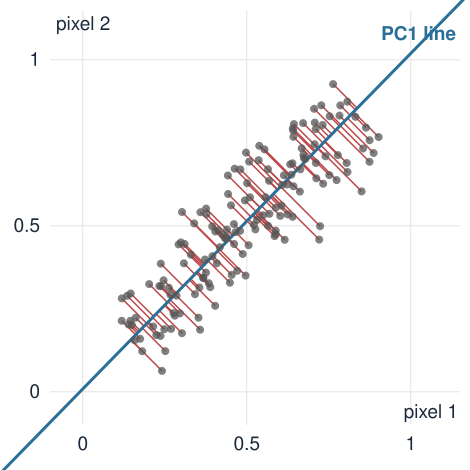
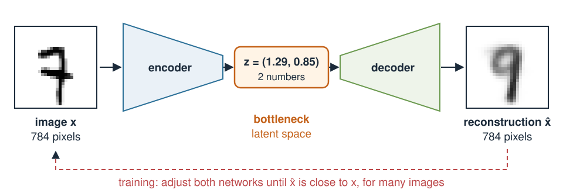
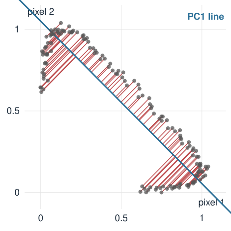
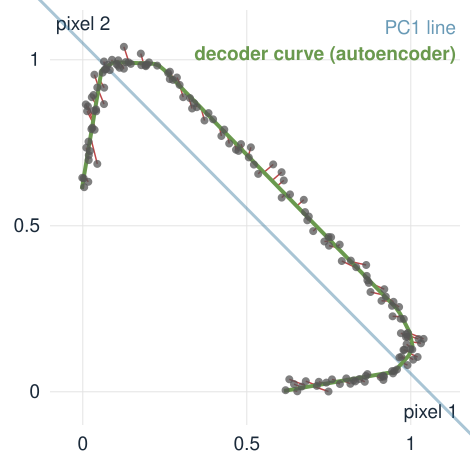

## About this lecture

Can we describe an image with **a few numbers**, and rebuild it from them?

- An image is a **point** in a space with one axis per pixel. Images of one kind fill only a thin part of it.
- **PCA** finds the best flat summary: keep the score along a few directions.
- PCA is an **autoencoder**: an **encoder** (image → few numbers) and a **decoder** (few numbers → image).
- Replace both straight maps by neural networks: an autoencoder that can follow **curved** families of images.

::: notes
This unit links PCA (eigenvectors of a covariance matrix) to neural networks (previous unit). If PCA was already covered in another unit (e.g. Shape models, where it gives the modes of variation of landmark shapes), the PCA slides are a recap; otherwise they are the introduction, from a two-pixel picture. The source of the "PCA is a linear autoencoder" example is the VAE unit of the 3MB00A course, there with two genes instead of two pixels.
:::

## An image is a point

A $28 \times 28$ image is a vector of 784 grey values: one point in $\mathbb R^{784}$.

- Almost every point of that space looks like **noise**. Handwritten digits, or masks of cells, fill a tiny, connected region of it.
- Moving along that region changes the image **smoothly**: a little thicker, a little more tilted, a little longer.
- So a few numbers should be enough to say **where** in the region an image is.

Today, start with images of **two pixels**: a point in the plane, which we can draw.

::: notes
The two-pixel image is the whole unit in miniature: everything we do in the plane works in 784 dimensions, we just cannot draw it. Ask: if you change one pixel of a digit at random, is it still a digit? Almost always yes; if you change all pixels at random, almost never. The region of real images is thin.
:::

## Neighbouring pixels: one number is almost enough {.smaller}

:::: {.columns}
::: {.column width="50%"}
{width="100%"}
:::
::: {.column width="50%"}
Each dot: two neighbouring pixels of a smooth image. They are almost equally bright, so the dots lie along the **diagonal**.

- Keep one number: the position **along the blue line** (the overall brightness).
- Rebuild: go back to that point on the line.
- Lost: the small **difference** between the pixels (red), the local edge.

The blue line is the direction of **largest spread**: the first **principal component** (PC1).
:::
::::

::: notes
This is PCA for two pixels, from the picture. PC1 is (0.71, 0.70) for these data, essentially "both pixels together", the average brightness; PC2 is "one minus the other", a tiny edge. Natural images look like this: neighbouring pixels are strongly correlated, which is why images compress so well. The figure is the default state of the demo with the PCA button pressed.
:::

## PCA is a linear autoencoder, by hand {.smaller}

Two pixels, mean subtracted. PC1 is the unit vector $\mathbf u = (0.8,\ 0.6)$. Image $\mathbf x = (3,\ 1)$.

- **Encode** (image → one number): the score $s = \mathbf u \cdot \mathbf x = 0.8 \cdot 3 + 0.6 \cdot 1 = 3.0$.
- **Decode** (number → image): $\hat{\mathbf x} = s\,\mathbf u = 3.0 \cdot (0.8,\ 0.6) = (2.4,\ 1.8)$.
- **Error**: $\mathbf x - \hat{\mathbf x} = (0.6,\ -0.8)$, squared length $1.0$.

With the mean added back: $\text{encode}(\mathbf x) = \mathbf u^\top(\mathbf x - \bar{\mathbf x})$, $\ \text{decode}(s) = \bar{\mathbf x} + s\,\mathbf u$.

With $k$ components: $k$ scores, and $\hat{\mathbf x} = \bar{\mathbf x} + s_1\mathbf u_1 + \dots + s_k\mathbf u_k$.

::: notes
Encoder: project. Decoder: go back along the line. Every image on the PC1 line is rebuilt exactly; an image perpendicular to it has score 0 and is rebuilt as the mean image. In 784 dimensions, each u_k is itself an image (an "eigen-image"), and decoding adds eigen-images with the scores as weights.
:::

## The math: why PCA is the best straight line {.smaller}

*Math layer: skip if you only want the idea.*

Data $\mathbf x_1, \dots, \mathbf x_n$ with mean $\bar{\mathbf x}$ and covariance $S = \frac1n\sum_i (\mathbf x_i - \bar{\mathbf x})(\mathbf x_i - \bar{\mathbf x})^\top$. For a unit vector $\mathbf u$, with $\mathbf y_i = \mathbf x_i - \bar{\mathbf x}$ (Pythagoras: $\|\mathbf y\|^2 = (\mathbf u^\top\mathbf y)^2 + \|\mathbf y - (\mathbf u^\top\mathbf y)\mathbf u\|^2$):

$$\frac1n\sum_i \big\|\mathbf y_i - (\mathbf u^\top\mathbf y_i)\,\mathbf u\big\|^2 = \underbrace{\frac1n\sum_i\|\mathbf y_i\|^2}_{\operatorname{tr} S} - \mathbf u^\top S\,\mathbf u.$$

- Smallest error ⇔ largest $\mathbf u^\top S\mathbf u$ ⇔ $\mathbf u$ = the **eigenvector** of $S$ with the largest eigenvalue $\lambda_1$. The error is then $\operatorname{tr}S - \lambda_1 = \lambda_2 + \dots$
- With $k$ components: the error is the sum of the **dropped** eigenvalues.
- More generally (Baldi & Hornik 1989): any linear encoder and decoder with $k$ numbers, trained on squared error, can do no better than PCA, and the best ones span the same subspace.

::: notes
For the neighbouring-pixel data in the demo: S = [[0.0406, 0.0352], [0.0352, 0.0414]], eigenvalues 0.0762 and 0.0058, so the best one-number error is 0.0058 and keeping nothing (decode everything as the mean) costs tr S = 0.0820. At angle 0° (keep pixel 1 only) the error is tr S − S11 = 0.0820 − 0.0406 = 0.0414. The demo's error-vs-angle plot is exactly tr S − uᵀSu.
:::

## The bottleneck must be narrow

{width="90%" fig-align="center"}

- **Encoder**: image → a few numbers $z$. **Decoder**: $z$ → image. Train both so that $\hat{\mathbf x} \approx \mathbf x$ for many images.
- With as many numbers as pixels, the "autoencoder" just copies (PCA with all components: rotate, rotate back). It learns **nothing**.
- A narrow bottleneck forces $z$ to keep what **varies most** between images.

::: notes
The digit is a real MNIST test image (a 7) encoded and decoded by the network of the last unit; the reconstruction is blurrier than the input because two numbers cannot hold every detail of the stroke. MNIST: Y. LeCun, C. Cortes, C. J. C. Burges; CC BY-SA 3.0 as stated in the Keras documentation.
:::

## When the images lie on a curve {.smaller}

:::: {.columns}
::: {.column width="50%"}
{width="100%"}
:::
::: {.column width="50%"}
A bright **spot moves** past two pixels. One true number (its position), but the images lie on a **curve**.

- PC1 is the best straight line, yet the spot at position $-0.5$ and the spot at $0.2$ (noise-free scores 0.42 and 0.46) get almost the **same score**: the line folds the curve.
- PCA needs **two** numbers to rebuild these images well.
:::
::::

::: notes
The spot is a Gaussian (sd 0.5 pixel) at positions from −0.5 to 1.5, seen by pixels at 0 and 1; noise-free pixel values at position −0.5 are (0.607, 0.011), at 0.2 they are (0.923, 0.278). The PC1 score is about (p1 − p2)/√2 up to the mean, which rises from 0.42 at −0.5 to 0.61 at 0 and falls back through 0.46 at 0.2. Starting far left, pixel 1 rises then falls while pixel 2 rises: the dots run along a horseshoe. Mean squared error with PC1: 0.0170, against 0.2642 for keeping nothing. A trajectory in any image family (a cell elongating, a digit getting thicker) behaves like this: it is curved in pixel space.
:::

## An autoencoder follows the curve {.smaller}

:::: {.columns}
::: {.column width="50%"}
{width="100%"}
:::
::: {.column width="50%"}
Replace both straight maps by small neural networks (unit *Neural networks*):

$$\text{encoder: } 2 \to 16 \to 1, \qquad \text{decoder: } 1 \to 16 \to 2 \quad (\text{ReLU}).$$

- Still **one** number per image, but the decoder draws a **curve** (green) instead of a line.
- Error after 1500 training steps: **0.0006**, against 0.0170 for PCA.
- Without the bends, this network would be a linear autoencoder: PCA again.
:::
::::

::: notes
Same data, same one-number bottleneck. The decoder curve is the set of all images the decoder can produce: a one-dimensional family, bent to follow the data. Training is the downhill walk of the previous unit on the reconstruction error. Fixed seed; the demo reproduces exactly this curve.
:::

## Try it: one number per image

```{=html}
<link rel="stylesheet" href="../demos/dist/demo.css">
<div data-demo="linae" data-data="pixels" data-angle="0"></div>
<script src="../demos/dist/linae.js"></script>
```

::: notes
Start at angle 0°: keep pixel 1 only, rebuild pixel 2 as its mean; error 0.0414. Drag u round: the error curve on the right is smallest at 45.3° (0.0058, the PCA button) and largest at −45° (0.0762, keeping only the edge). Click a dot to see it as a two-pixel image and its reconstructions. Then "moving spot": PCA 0.0170; train the nonlinear autoencoder: 0.0006. Note the reconstructions on the curve.
:::

## From autoencoders to generating images

An autoencoder gives every image a place $z$ in a small **latent space**, and a decoder that turns any $z$ into an image.

- Could we **pick a new $z$** and decode it, to make a new image?
- A plain autoencoder only learns to rebuild its **training** images. Nothing says what lies **between** them in $z$, or where in $z$ the images are.
- The **variational** autoencoder (next unit) fixes this.

## Summary

| Idea | In one line |
|---|---|
| Image as a point | one axis per pixel; images of one kind fill a thin region |
| Encoder / decoder | image → few numbers $z$ → image |
| PCA | the best **linear** autoencoder: encode = project, decode = mean + scores × eigen-images |
| Error of PCA | the variance in the dropped directions (sum of dropped eigenvalues) |
| Bottleneck | must be narrow, or the network just copies |
| Autoencoder | encoder and decoder are networks: the decoder can follow a **curve** |
