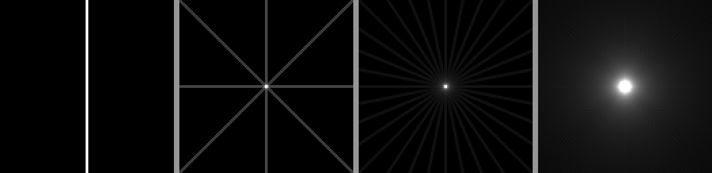

## About this lecture

Last unit: the scanner measures a **sinogram**, one projection per angle. Now we try to get the image back.

- **Back-projection**: smear every projection back along its own rays and add. Simple, and always blurred.
- **Why** it blurs: a halo falling off like $1/r$ around every point.
- The **Fourier slice theorem**: each projection hands us one line through the centre of the image's 2D spectrum.
- **Direct Fourier reconstruction**: fill the spectrum line by line and invert; why the gaps between the lines make it hard.

*Slides titled **The math** give the formulas and proofs; the ideas are complete without them.*

::: notes
Recall from the fourier unit: the 2D spectrum, centre = slow waves, direction = orientation; filtering = multiplying the spectrum. Demos: backproj with the plain filter (the main demo of the next unit) and fourierslice.
:::

## Smearing back

We do not know where along a ray the attenuation sat. So spread each measured value **evenly along its ray**, for every ray of every angle, and add everything up. That is **back-projection**.

{width="92%"}

- One angle: a stripe through the point.
- Four angles: a star; the arms cross only at the point.
- 180 angles: a bright centre in a **halo** that fades with distance.

The point is in the right place, but it now glows.

## By hand: three points, two angles

Back-project the projections of $A = (2, 0)$, $B = (0, 1)$ (mass 2) and $C = (-1, -1)$ at $0°$ and $90°$ on a $5 \times 5$ grid: each pixel gets its column's value from $p_0$ plus its row's value from $p_{90°}$.

| $y \backslash x$ | −2 | −1 | 0 | 1 | 2 |
|---|---|---|---|---|---|
| 2 | 0 | 1 | 2 | 0 | 1 |
| 1 | 2 | 3 | **4** | 2 | 3 |
| 0 | 1 | 2 | 3 | 1 | **2** |
| −1 | 1 | **2** | 3 | 1 | 2 |
| −2 | 0 | 1 | 2 | 0 | 1 |

$B$ is the brightest (4), but four **ghosts** at value 3 outshine $A$ and $C$ (value 2). With two angles every crossing of a bright row and a bright column lights up.

## Why it blurs

With many angles, every line through a point passes through the point itself. Around it the lines spread out:

- At distance $r$, the $N$ lines through the point cross a circle of circumference $2\pi r$ in $2N$ places.
- So the number of smears per unit length falls like $N / (\pi r)$: with 180 angles about 11 at $r = 5$ pixels, but only 3 at $r = 20$.
- **Plain back-projection = the true image blurred with a $1/r$ kernel.** Each point becomes a peak with a long halo.

The halo is not noise: it is a systematic overweighting of **slow** variations. Edges lose contrast and every object glows into its surroundings.

## The math: back-projection {.math}

Back-projection of a sinogram $g(\rho, \theta)$: for each pixel, add up the values of all rays through it,

$$\mathcal B g(\mathbf x) = \int_0^\pi g(\mathbf x\cdot\mathbf n_\theta, \theta)\,d\theta, \qquad \mathbf n_\theta = (\cos\theta, \sin\theta).$$

- A point at the origin has $\mathcal R\delta(\rho, \theta) = \delta(\rho)$. With $\mathbf x = r(\cos\varphi, \sin\varphi)$: $\mathcal B\mathcal R\delta(\mathbf x) = \int_0^\pi \delta(r\cos(\theta - \varphi))\,d\theta = \dfrac{1}{r}$ (one zero in a half turn, slope $r$ there).
- By linearity and the shift rule, for any image: $\mathcal B\mathcal R f = f * \dfrac{1}{|\mathbf x|}$.
- The 2D Fourier transform of $1/|\mathbf x|$ is $1/|\boldsymbol\omega|$. So back-projection **multiplies the spectrum by $1/|\boldsymbol\omega|$**: low frequencies are over-weighted. Undoing that is the next unit.

## Try it: back-projection, angle by angle

```{=html}
<link rel="stylesheet" href="../demos/dist/demo.css">
<div data-demo="backproj" data-preset="star"></div>
<script src="../demos/dist/backproj.js"></script>
```

::: notes
Filter "none" = plain back-projection. Preset "one point → star": 4 angles, the reconstruction is a star through the point. Set "angles in the scan" to 16, then 180 and press play: the star fills in to a bright spot with a halo (auto contrast). Then "plain: glow" on the Shepp–Logan phantom: right shape, but everything glows and the dark ellipses are washed out. Keep the ramp filter for the next lecture.
:::

## Back-projection is the transpose

Projecting is linear: sinogram $= A\,\mathbf x$, for a (huge) matrix $A$ with one row per ray and one column per pixel; row $i$ holds the weights with which ray $i$ sums the pixels.

- Back-projection sends each measured number back to the pixels of its ray **with the same weights**: that is multiplication by $A^\top$.
- $A^\top$ is not $A^{-1}$. $A^\top A$ is the blur we just saw, not the identity.
- So "smear back" is the natural first guess, but not the answer. Two ways out: **filter** before smearing (next unit), or solve the linear system $A\mathbf x = \mathbf b$ (the fourth unit).

The demos use a projector and back-projector built as an exact pair: $\langle A\mathbf x, \mathbf y\rangle = \langle\mathbf x, A^\top\mathbf y\rangle$ to rounding.

## Recall: the 2D spectrum

From the Fourier unit (day 1):

- An image is a sum of plane waves. The **2D spectrum** gives the amount of each wave; the **centre** holds the slow waves, the edge the fine ones.
- The **direction** from the centre to a spectrum point is the direction in which that wave varies.
- Filtering = turning frequencies up or down = multiplying the spectrum.

What a projection does to waves: summing along $y$ averages away every wave that varies in $y$. Only waves that vary along $x$ alone survive in the projection at $0°$.

## The Fourier slice theorem

**The 1D spectrum of the projection at angle $\theta$ equals the 2D spectrum of the image along the line through the centre at the same angle $\theta$.**

By hand: vertical stripes with period 8 in a $64 \times 64$ image ($I = \tfrac12 + \tfrac12\cos(2\pi x/8)$).

- Projection at $0°$ (onto $x$): a cosine with 8 cycles over 64 pixels. Its DFT: DC = 2048 and peaks of 1024 at $\pm 8$.
- Projection at $90°$ (onto $y$): constant 32. Its DFT: only DC = 2048.
- The 2D DFT: 2048 at the centre and 1024 at $(\pm 8, 0)$. The horizontal line through the centre holds the two peaks; the vertical line holds only DC. ✔

Each angle gives one **spoke** of the spectrum; all angles together fill it.

## The math: the Fourier slice theorem {.math}

Continuous Fourier transform (the limit of the DFT for fine sampling; Fourier unit): $F(\boldsymbol\omega) = \iint f(\mathbf x)\,e^{-2\pi i\,\boldsymbol\omega\cdot\mathbf x}\,d\mathbf x$, and $P_\theta(\omega) = \int p_\theta(\rho)\,e^{-2\pi i\omega\rho}\,d\rho$.

$$P_\theta(\omega) = \int\!\Big(\iint f(\mathbf x)\,\delta(\mathbf x\cdot\mathbf n_\theta - \rho)\,d\mathbf x\Big)e^{-2\pi i\omega\rho}\,d\rho = \iint f(\mathbf x)\,e^{-2\pi i\,\omega\,\mathbf n_\theta\cdot\mathbf x}\,d\mathbf x = F(\omega\,\mathbf n_\theta).$$

- For $\theta = 0$: $\int p_0(x)e^{-2\pi i u x}dx = \iint f(x, y)e^{-2\pi i(ux + 0\cdot y)}dx\,dy = F(u, 0)$.
- Discrete: the DFT of the column sums equals the $v = 0$ row of the 2D DFT **exactly**. At other angles the line falls between grid points, and the two agree only up to interpolation.

## Try it: projection spectrum = slice

```{=html}
<link rel="stylesheet" href="../demos/dist/demo.css">
<div data-demo="fourierslice" data-preset="stripes"></div>
<script src="../demos/dist/fourierslice.js"></script>
```

::: notes
Drag on the image to turn the angle (red line = direction of ρ, yellow = rays). Middle: log spectrum with the slice in red. Right: blue = 1D spectrum of the projection, red dashed = the 2D spectrum sampled along the line. Stripes at 0°: two side peaks; turn to 90°: only the DC peak remains, the stripes are averaged away. Then "projection ↔ slice match" (Shepp–Logan, 30°): the curves coincide; the readout gives the difference, 0 % at 0° and 90° and about 8 % at 30° (interpolation between grid points). Switch to real or imaginary part: they match too, not only the magnitudes.
:::

## Direct Fourier reconstruction

The theorem suggests an algorithm: FFT every projection, put it on its spoke, inverse 2D FFT. The problem is the **grid**:

- The spokes are dense near the centre and **sparse at the edge**: for a $128 \times 128$ image with 90 spokes, neighbouring spokes at the outer ring (64 frequency steps from the centre) are 2.2 steps apart, near the centre far less than one.
- The inverse FFT needs values on a **Cartesian grid**: we must interpolate ("grid") from the spokes to the grid points.
- An error at one frequency is a wave over the **whole image**: interpolation errors in the spectrum spread everywhere, they do not stay local.

In the demo (Shepp–Logan, 90 spokes): nearest-cell gridding gives RMSE 0.079, bilinear 0.051; filtered back-projection (next unit) 0.041. Most scanners therefore use back-projection-based methods. The same polar ↔ Cartesian resampling appears in FFT registration, in the other direction.

## Try it: direct reconstruction

```{=html}
<link rel="stylesheet" href="../demos/dist/demo.css">
<div data-demo="fourierslice" data-preset="nearest"></div>
<script src="../demos/dist/fourierslice.js"></script>
```

::: notes
Direct-reconstruction tab. Left: the reconstruction, middle: the gridded spectrum (only the cells the spokes reach are filled), right: the error (colour scale = 99th percentile of |error|). "Nearest gridding": the error spreads over the whole image, not just at edges. Switch to bilinear: smaller error. "Spokes are sparse at the edge": 24 spokes, the outer spectrum is mostly empty, fine detail is missing. Compare the RMSE with FBP in the readout.
:::

## Summary

- **Back-projection** smears every projection back along its rays and adds over all angles.
- It is the **transpose** of projection, not its inverse: a point comes back with a $1/r$ **halo**; slow variations are over-weighted.
- **Fourier slice theorem**: the 1D spectrum of a projection is the central line of the 2D spectrum at the same angle. All angles fill the spectrum spoke by spoke.
- **Direct Fourier reconstruction** must interpolate from sparse outer spokes to a grid, and spectral errors spread over the whole image.
- The spokes also explain the halo: they crowd at the centre. The next unit weights them to fix it.
