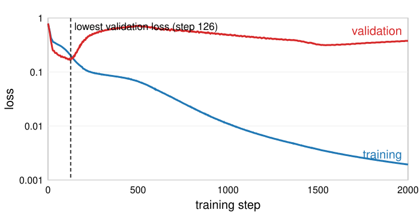

## Goal

By the end of this exercise you should be able to:

- compute a cross-entropy loss and say why a confident wrong answer is expensive,
- take gradient-descent steps by hand and say what the learning rate and the mini-batch size do,
- run **backpropagation** by hand on a two-neuron network: forward values, gradients, one update,
- read **learning curves**, choose where to stop, and name three defences against overfitting.

The questions under **By hand** and **Explore** are for everyone. The **Math questions** (derive, prove) are for students who want the full treatment.

## Background

| Word | Meaning |
|---|---|
| Loss $\mathcal L$ | squared error $(\hat y - y)^2$ for numbers; cross-entropy $-\ln p_\text{true class}$ for classes; averaged over the examples |
| Gradient step | $w \leftarrow w - \eta\,\partial\mathcal L/\partial w$ for every weight; $\eta$ = learning rate |
| Mini-batch, epoch | the gradient is computed on a random batch of examples; an epoch is one pass over all of them |
| Forward pass | compute every node's value, from the input to the loss |
| Backward pass | compute $\partial\mathcal L/\partial(\text{node})$ from the loss back: each node's gradient = sum over the nodes it feeds of (their gradient × the local derivative) |
| Local derivatives | $z = wx + b$: $\partial z/\partial w = x$, $\partial z/\partial x = w$, $\partial z/\partial b = 1$; ReLU: 1 if $z > 0$, else 0; $(\hat y - y)^2$: $2(\hat y - y)$ |
| Learning curves | training and validation loss against the training step |

## By hand

**B1.** Cross-entropy.
(a) The network gives the true class the probability 0.9, 0.5 and 0.01. Compute the loss for each.
(b) Three classes, probabilities $(0.7, 0.2, 0.1)$. What is the loss if the true class is the first? The second?

**B2.** One weight, one data point: $\mathcal L(w) = (y - wx)^2$ with $x = 2$, $y = 3$ (the example of the previous unit). Start at $w = 0$ and take **two** steps with $\eta = 0.1$. Give $w$ and $\mathcal L$ after each step.

**B3.** **Backpropagation by hand.** The network $z = w_1x + b_1$, $h = \text{ReLU}(z)$, $\hat y = w_2h + b_2$, $\mathcal L = (\hat y - y)^2$, with $x = 2$, $y = 1$, $w_1 = 0.5$, $b_1 = 0$, $w_2 = 1.5$, $b_2 = 0$.
(a) Forward: compute $z$, $h$, $\hat y$ and $\mathcal L$.
(b) Backward: compute $\partial\mathcal L/\partial\hat y$, then $\partial\mathcal L/\partial w_2$, $\partial\mathcal L/\partial b_2$, $\partial\mathcal L/\partial h$, $\partial\mathcal L/\partial z$, $\partial\mathcal L/\partial w_1$ and $\partial\mathcal L/\partial b_1$.
(c) Update all four weights with $\eta = 0.1$ and compute the new loss. Did it go down? Repeat with $\eta = 0.05$.
(d) Now $x = -1$ (the rest unchanged). Forward and backward again. Which gradients are zero, and why? What does one update with $\eta = 0.1$ change?

**B4.** Learning curves of a small network (8 + 8 hidden units, 30 training and 30 validation points):

{width="80%"}

(a) Which curve is which, and how can you tell without the labels?
(b) At which step would you stop? What happens after it?
(c) The validation set was used to choose the step. Which number do you report as the expected performance on new data, and on which data is it computed?

**B5.** 60,000 training images, mini-batches of 32.
(a) How many gradient steps is one epoch? How many after 10 epochs?
(b) Why not use all 60,000 images for every step?

**B6.** A sigmoid's local derivative $\varphi'(z) = \varphi(z)(1 - \varphi(z))$ is at most 0.25 (at $z = 0$).
(a) What is $\varphi'(8)$? Compare with ReLU's local derivative for $z = 8$.
(b) A gradient passes back through 10 sigmoid units in a chain (ignore the weights). By at most what factor is it multiplied? What does this mean for the first layers of a deep sigmoid network?

::: {.callout-note collapse="true" title="Solutions"}
**B1.** (a) $-\ln 0.9 = 0.105$, $-\ln 0.5 = 0.693$, $-\ln 0.01 = 4.605$. (b) $-\ln 0.7 = 0.357$; $-\ln 0.2 = 1.609$.

**B2.** $\mathcal L'(w) = -2x(y - wx) = -4(3 - 2w)$. Step 1: $\mathcal L'(0) = -12$, $w = 1.2$, $\mathcal L = (3 - 2.4)^2 = 0.36$. Step 2: $\mathcal L'(1.2) = -2.4$, $w = 1.44$, $\mathcal L = (3 - 2.88)^2 = 0.0144$. Each step removes 80 % of the remaining distance to $w = 1.5$ (the factor $1 - 8\eta = 0.2$).

**B3.** (a) $z = 0.5 \cdot 2 + 0 = 1$, $h = 1$, $\hat y = 1.5$, $\mathcal L = 0.5^2 = 0.25$.
(b) $\partial\mathcal L/\partial\hat y = 2(1.5 - 1) = 1$. $\partial\mathcal L/\partial w_2 = 1 \cdot h = 1$, $\partial\mathcal L/\partial b_2 = 1$, $\partial\mathcal L/\partial h = 1 \cdot w_2 = 1.5$. The ReLU is on ($z > 0$): $\partial\mathcal L/\partial z = 1.5$. $\partial\mathcal L/\partial w_1 = 1.5 \cdot x = 3$, $\partial\mathcal L/\partial b_1 = 1.5$.
(c) $\eta = 0.1$: $w_1 = 0.5 - 0.3 = 0.2$, $b_1 = -0.15$, $w_2 = 1.4$, $b_2 = -0.1$. New forward pass: $z = 0.25$, $h = 0.25$, $\hat y = 0.35 - 0.1 = 0.25$, $\mathcal L = 0.75^2 = 0.5625$: **worse**. Every weight moved downhill on its own, but together they overshoot: $\hat y$ went from 1.5 past the target 1 to 0.25. With $\eta = 0.05$: $w_1 = 0.35$, $b_1 = -0.075$, $w_2 = 1.45$, $b_2 = -0.05$, $z = 0.625$, $\hat y = 0.856$, $\mathcal L = 0.021$.
(d) $z = -0.5$, $h = 0$, $\hat y = 0$, $\mathcal L = 1$. $\partial\mathcal L/\partial\hat y = -2$, $\partial\mathcal L/\partial b_2 = -2$, $\partial\mathcal L/\partial w_2 = -2 \cdot h = 0$, $\partial\mathcal L/\partial h = -2 \cdot 1.5 = -3$, but the ReLU is off, so $\partial\mathcal L/\partial z = 0$ and $\partial\mathcal L/\partial w_1 = \partial\mathcal L/\partial b_1 = 0$. Only $b_2$ changes: $b_2 = 0.2$, $\hat y = 0.2$, $\mathcal L = 0.64$. The hidden unit learns nothing from this example.

**B4.** (a) The blue curve is the training loss: it keeps falling, towards 0.002, because the network is fitted to exactly these points. The red curve is the validation loss: it falls at first, then rises.
(b) At the lowest validation loss, step 126 (validation loss 0.169). After it the network fits the noise of the 30 training points: the training loss goes on falling, but the validation loss rises (0.377 at step 2000).
(c) Neither of these curves: the validation loss at step 126 is optimistic, because the step was chosen on it. Report the loss or accuracy of the chosen network on a separate **test** set that played no part in any choice (as on the random-forest day).

**B5.** (a) $60{,}000/32 = 1875$ steps; 18,750 after 10 epochs. (b) Every step would cost 60,000 forward and backward passes. The gradient of 32 random images points roughly in the same direction for 1/1875 of the cost, so in the same time we take 1875 (noisy) steps instead of one exact one.

**B6.** (a) $\varphi(8) = 0.99966$, $\varphi'(8) = 0.00034$. The ReLU passes the gradient unchanged (derivative 1). (b) At most $0.25^{10} \approx 10^{-6}$. The first layers of a deep sigmoid network get gradients a million times smaller than the last: they hardly learn (**vanishing gradients**). ReLU units that are on pass the gradient with factor 1.
:::

### Math questions

**B7.** *(math)* Softmax $p_k = e^{z_k}/\sum_j e^{z_j}$ and cross-entropy $\mathcal L = -\ln p_c$ for the true class $c$. Show that $\partial\mathcal L/\partial z_k = p_k - y_k$, where $y_k = 1$ if $k = c$ and 0 otherwise.

**B8.** *(math)* A layer $\mathbf z = W\mathbf a + \mathbf b$ followed by $\mathbf a' = \varphi(\mathbf z)$. Given $\boldsymbol\delta' = \partial\mathcal L/\partial\mathbf z'$ of the next layer $\mathbf z' = W'\mathbf a' + \mathbf b'$, derive $\boldsymbol\delta = \partial\mathcal L/\partial\mathbf z = (W'^\top\boldsymbol\delta') \odot \varphi'(\mathbf z)$ and $\partial\mathcal L/\partial W = \boldsymbol\delta\,\mathbf a^\top$.

**B9.** *(math)* $\mathcal L = \frac1N\sum_n\ell_n$. A mini-batch $B$ of $m$ examples is drawn uniformly at random (without replacement). Show that $\mathbf g_B = \frac1m\sum_{n\in B}\nabla\ell_n$ is an unbiased estimate of $\nabla\mathcal L$.

**B10.** *(math)* Show that gradient descent on $\mathcal L(\mathbf w) + \lambda\|\mathbf w\|^2$ multiplies the weights by $1 - 2\eta\lambda$ before the usual step ("weight decay"). For the one-weight loss of B2 with $\lambda > 0$, what is the minimiser?

::: {.callout-note collapse="true" title="Solutions (math)"}
**B7.** *(math)* $\mathcal L = -z_c + \ln\sum_j e^{z_j}$. Then $\partial\mathcal L/\partial z_k = -[k = c] + e^{z_k}/\sum_j e^{z_j} = p_k - y_k$.

**B8.** *(math)* $z'_i = \sum_j W'_{ij}a'_j + b'_i$, so $\partial\mathcal L/\partial a'_j = \sum_i \delta'_i W'_{ij} = (W'^\top\boldsymbol\delta')_j$. Since $a'_j = \varphi(z_j)$ depends only on $z_j$: $\delta_j = \partial\mathcal L/\partial z_j = (W'^\top\boldsymbol\delta')_j\,\varphi'(z_j)$. Finally $z_j = \sum_k W_{jk}a_k + b_j$ gives $\partial\mathcal L/\partial W_{jk} = \delta_j a_k$, i.e. the outer product $\boldsymbol\delta\mathbf a^\top$, and $\partial\mathcal L/\partial b_j = \delta_j$.

**B9.** *(math)* Each example is in $B$ with probability $m/N$. So $\mathbb E[\mathbf g_B] = \frac1m\sum_n P(n\in B)\nabla\ell_n = \frac1m\cdot\frac mN\sum_n\nabla\ell_n = \nabla\mathcal L$.

**B10.** *(math)* The gradient is $\nabla\mathcal L + 2\lambda\mathbf w$, so $\mathbf w \leftarrow \mathbf w - \eta\nabla\mathcal L - 2\eta\lambda\mathbf w = (1 - 2\eta\lambda)\mathbf w - \eta\nabla\mathcal L$. For B2: $\frac{d}{dw}[(3 - 2w)^2 + \lambda w^2] = -4(3 - 2w) + 2\lambda w = 0$ gives $w = 12/(8 + 2\lambda) = 6/(4 + \lambda)$: pulled from 1.5 towards 0.
:::

## Explore: backpropagation step by step {#explore-backprop}

The network of B3 as a computational graph: orange boxes are weights, grey boxes are inputs, circles are operations. **forward** fills in every node's value (blue), **backward** fills in $\partial\mathcal L/\partial(\text{node})$ from the loss back (red), with the local derivative on each edge. **update** takes one step with the learning rate $\eta$ and shows the loss before and after. **check** compares each gradient with a finite difference. All numbers can be edited.

```{=html}
<link rel="stylesheet" href="../demos/dist/demo.css">
<div data-demo="backprop" data-preset="byhand"></div>
<script src="../demos/dist/backprop.js"></script>
```

**R1.** Preset **the by-hand exercise**. Press forward, backward, update, and compare with your answers to B3. Press **check**: do backpropagation and finite differences agree?

**R2.** Preset **dead ReLU** ($x = -1$). Press backward. Which edges carry a zero, and where does the gradient stop? Press update a few times: what changes, and what never changes?

**R3.** Preset **sigmoid saturates**. Read the local derivative on the edge from $z$ to $h$, and compare the gradients of $w_1$ and $w_2$. Press update: which weights move noticeably?

**R4.** Preset **learning rate too large** ($\eta = 0.3$). Press update once and read the loss. Then look at $z$: what has happened to the hidden unit? Press update four more times: does the loss go down, and how does the network now fit $y$?

**R5.** Preset **2–2–1 network**. Press backward. Which weight has the largest gradient, and why? Press update with $\eta = 0.05$: what is the new loss?

::: {.callout-note collapse="true" title="Solutions"}
**R1.** The same numbers as B3: $\mathcal L = 0.25$; gradients $w_1$: 3, $b_1$: 1.5, $w_2$: 1, $b_2$: 1; after the update ($\eta = 0.1$) $\mathcal L = 0.5625$. The finite differences agree with backpropagation to many digits.

**R2.** The edge from $z$ into the ReLU has local derivative ×0: $\partial\mathcal L/\partial h = -3$, but $\partial\mathcal L/\partial z = 0$, so $w_1$ and $b_1$ get 0. $w_2$ also gets 0, because its local derivative is $h = 0$. Only $b_2$ moves: $0 \to 0.2$ (loss 0.64), then towards 1 with every further update. $w_1$, $b_1$, $w_2$ never change for this input.

**R3.** The edge $z \to h$ has local derivative ×0.00034 ($z = 8$, the sigmoid is flat). $\partial\mathcal L/\partial w_2 = 3.0$ but $\partial\mathcal L/\partial w_1 = 0.006$, 500 times smaller. After one update with $\eta = 0.1$ the loss drops from 2.25 to 0.81, almost entirely through $w_2$ and $b_2$; $w_1$ moves by 0.0006.

**R4.** The loss goes from 0.25 to 1.69. The update made $w_1 = -0.4$ and $b_1 = -0.45$, so $z = -1.25$: the hidden unit is off (dead for this input). Further updates only change $b_2$: the loss falls (0.27, 0.043, 0.0069, 0.0011) because $b_2$ alone moves towards $y = 1$. The network now outputs a constant; the hidden unit no longer takes part.

**R5.** Loss 2.25 ($\hat y = 3.5$, $y = 2$). The largest gradient is $\partial\mathcal L/\partial w_{22} = 12$: it is $\partial\mathcal L/\partial z_2 \cdot x_2 = 6 \cdot 2$, where $\partial\mathcal L/\partial z_2 = 3 \cdot v_2 = 6$ (the output weight $v_2 = 2$ is the larger one) and $x_2 = 2$ is the larger input. After the update the loss is 1.3225.
:::

## Explore: gradient descent on a landscape {#explore-gdescent}

The colours show a loss over two parameters $(a, b)$ in bands (darker = lower; the white dot is the minimum). Each loss is the average over 40 training examples, so a **mini-batch** gradient is a real noisy estimate. Click to start a path (up to three), then **1 step** or **run 50 steps**. The small plot shows the loss above the minimum, on a log scale.

```{=html}
<link rel="stylesheet" href="../demos/dist/demo.css">
<div data-demo="gdescent" data-preset="small"></div>
<script src="../demos/dist/gdescent.js"></script>
```

**G1.** Presets **too small** and **just right** (the same start). Run each until the loss is within 0.001 of the minimum (0.092). How many steps does each need?

**G2.** Still on the bowl, raise $\eta$ step by step from 0.3 (click the same start, or use **diverges** for $\eta = 0.8$). Above which $\eta$ does the path diverge?

**G3.** Preset **zig-zag across a narrow valley** ($\eta = 0.6$). Describe the path. Then lower $\eta$ to 0.03: what happens? Finally preset **momentum in the valley** ($\eta = 0.03$ with momentum).

**G4.** Preset **SGD noise** (batches of 4, $\eta = 0.1$). Compare the path with the full batch (set the batch size to 40, same $\eta$). Where does the mini-batch path end up after 200 steps? What changes with a smaller $\eta$?

**G5.** Preset **two starts, two minima**. Where does each path end, and with which loss?

**G6.** Preset **one neuron's real loss**: the cross-entropy of one neuron $p = \text{sigmoid}(ax + b)$ on 40 points of two overlapping classes. Describe the landscape. How many steps does $\eta = 2$ need, and $\eta = 0.5$?

::: {.callout-note collapse="true" title="Solutions"}
**G1.** $\eta = 0.02$: 192 steps; $\eta = 0.3$: 11 steps.

**G2.** $\eta = 0.6$ still converges (8 steps, with a small overshoot); at $\eta = 0.8$ the path jumps from side to side further each time and the loss explodes. The limit lies near $\eta = 0.75$: stability needs $\eta < 2/\lambda_\text{max}$, and the steepest curvature of this bowl is $\lambda_\text{max} = 2.67$, so $2/2.67 = 0.75$.

**G3.** With $\eta = 0.6$ the path bounces from one wall of the valley to the other while it creeps along the valley floor; it gets within 0.001 of the minimum after 67 steps. With $\eta = 0.03$ there is no zig-zag, but progress along the flat floor is very slow: after 200 steps the loss is still 0.19 (minimum 0.064). With momentum, the same $\eta = 0.03$ gets there in 115 steps: the velocity builds up along the floor, while the back-and-forth across the valley cancels out. (The valley's curvatures differ by a factor of about 40.)

**G4.** The mini-batch path wanders: each step uses only 4 of the 40 examples. It gets near the minimum about as fast as the full batch (within 0.001 after about 40 steps against 37), but it never settles: after 200 steps it is still jiggling around the minimum (loss 0.0924 against 0.0921). A smaller $\eta$ makes the jiggle smaller but the approach slower (with $\eta = 0.02$ the loss is still 0.096 after 200 steps). In practice $\eta$ is lowered during training for this reason.

**G5.** The left start ($a = -0.3$) ends in the deeper minimum at $a = -1.03$ (loss $-0.254$), the right start ($a = +0.3$) in the shallower one at $a = 0.97$ (loss $+0.246$). Gradient descent finds the bottom of the valley it starts in, not the deepest one.

**G6.** A long, flat, curved valley; the minimum is at $(a, b) = (2.34, -0.61)$ with loss 0.325 (the classes overlap, so the loss cannot reach 0). Far from the minimum it rises steeply on one side and flattens on the other. $\eta = 2$ gets within 0.001 in 21 steps, $\eta = 0.5$ in 89. The real losses of networks have exactly this kind of flat and curved valleys, in millions of dimensions.
:::

## Explore: overfitting and its cures {#explore}

The point classifier of the previous unit, now with the training controls: learning rate, **batch size**, **validation share** (hollow points are held out for validation and never used for training), **weight decay** $\lambda$ and **dropout**. The plot shows the training loss (blue) and the validation loss (red); the readout gives the step with the lowest validation loss.

```{=html}
<link rel="stylesheet" href="../demos/dist/demo.css">
<div data-demo="nnplayground" data-train="full" data-preset="overfit"></div>
<script src="../demos/dist/nnplayground.js"></script>
```

**E1.** Preset **overfitting: 8+8 units, 60 noisy points** (30 for training, 30 for validation). Train for about 2000 steps. Where is the validation loss lowest? What do the two losses do after that? Look at the decision boundary: how does it treat the noisy training points?

**E2.** Preset **weight decay smooths it** ($\lambda = 0.003$). Train again and compare both curves and the boundary with E1.

**E3.** Preset **dropout** (probability 0.4). What does the training curve look like, and why? What happens to the validation loss?

**E4.** Preset **more data cures it** (300 points). Compare the gap between the two curves with E1.

**E5.** Preset **mini-batches of 8** (200 points, 100 for training). How many steps are one epoch? Compare the curves with the full batch (move the batch size slider to "all").

**E6.** Presets **learning rate too large** ($\eta = 1.5$) and **dead network** ($\eta = 5$). Describe the loss curves and the hidden-unit thumbnails. What has happened?

::: {.callout-note collapse="true" title="Solutions"}
**E1.** The validation loss is lowest at step 126 (0.169, validation accuracy 90 %). After that the training loss falls towards zero (0.002 at step 2000) while the validation loss rises (0.72 at step 500, 0.38 at step 2000): the boundary bends around single noisy training points, making small islands that are wrong for new points. Early stopping would keep the step-126 network.

**E2.** The training loss stops at about 0.164 (it cannot go to zero: large weights are penalised), and the validation loss stays near 0.31 instead of climbing to 0.7. The boundary is smooth, without islands. (Its lowest validation loss, 0.185 at step 183, is not better than early stopping here; the gain is that it no longer matters much when you stop.)

**E3.** The training curve is noisy and stays high (about 0.23–0.32): every step trains a different random half-silenced network. The validation loss (computed with all units) stays low much longer: 0.18 after 2000 steps, against 0.38 without dropout.

**E4.** With 150 training points the two curves stay close (at step 1000: training 0.20, validation 0.18; at 4000: 0.13 and 0.24); the network cannot memorise 150 points with its 105 weights as easily as 30. More data is the most reliable cure.

**E5.** 100 training points in batches of 8: 12.5 steps per epoch. The mini-batch curve is jagged, the full-batch curve smooth; per step the full batch gets lower faster (at step 1000: 0.18 against 0.22 training loss), but each mini-batch step costs 1/12 as much.

**E6.** $\eta = 1.5$: the loss jumps up and down during the first steps (0.79, 0.65, 0.55, 0.45, 0.41, 0.44, 0.38, 0.39, 0.47, 0.56, …) and then gets stuck near 0.38; 14 of the 16 hidden units are dead (off for every training point; their thumbnails are blank). $\eta = 5$: after a few huge jumps (up to 6.4) again 14 of the 16 units are dead, the network outputs probability one half everywhere, and the loss sits at 0.693 $= \ln 2$ for ever: almost no gradient reaches the hidden weights any more.
:::

## Where this leads

Everything so far works for any input vector. For images, the next unit replaces the dense first layer by a **convolutional** layer: a bank of small kernels, learned with exactly this backpropagation, shared across the image. Data augmentation, the image-specific cure for overfitting, comes with it. The evaluation day (day 16) returns to the question of what makes a test set honest.
