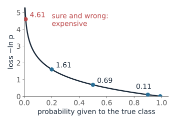
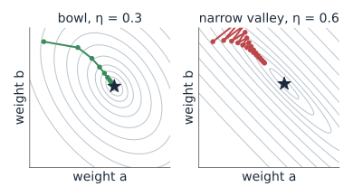
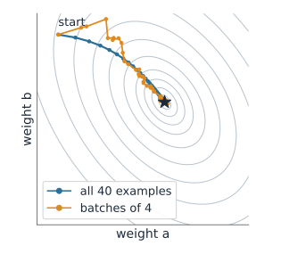
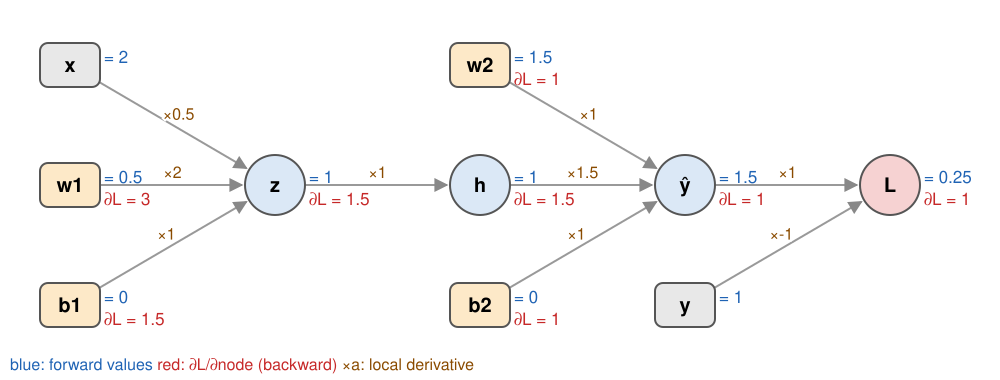
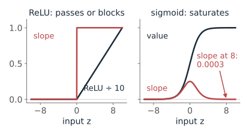
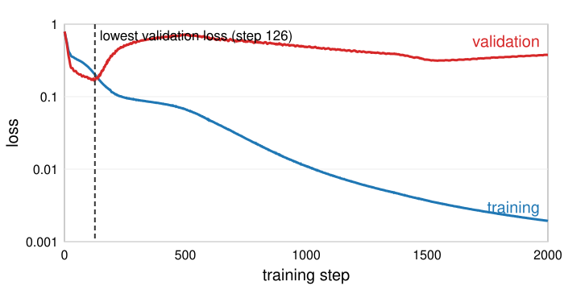
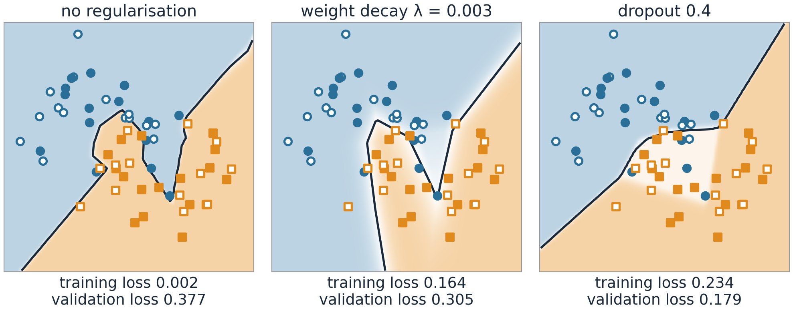

## About this lecture

The [last unit](../neuralnet/lec.qmd) built networks and said "training walks downhill". This unit opens that box.

- A **loss** says how wrong the network is: squared error for numbers, **cross-entropy** for classes.
- **Gradient descent** steps downhill; the **learning rate** sets the step, a random **mini-batch** of examples estimates the slope.
- **Backpropagation** computes the slope for every weight in one backward pass: the chain rule, organised.
- Learning curves show **overfitting**; weight decay, dropout and more data fight it.

*Slides titled **The math** give the formulas and proofs; the ideas are complete without them.*

::: notes
Suggested demo tour: gdescent (presets "just right", "zig-zag", "diverges", "SGD noise", "two starts"), then backprop (the by-hand preset: forward, backward, update, check; then "dead ReLU" and "sigmoid saturates"), then the playground with the training controls (overfitting presets). Adam, used without explanation on the VAE day, gets its one line on the math slide about mini-batches.
:::

## The loss: how wrong is the network?

:::: {.columns}
::: {.column width="58%"}
One number for all training examples, averaged; training makes it small.

- **Numbers** (a brightness, a size): **mean squared error**, $(\hat y - y)^2$ averaged.
- **Classes**: the network gives probabilities; the loss is **cross-entropy**, $-\log p_{\text{true class}}$.
:::
::: {.column width="42%"}
{fig-alt="The curve minus ln p for p from 0 to 1: near 0 at p = 1, rising steeply as p goes to 0. Marked points: 0.01 at p = 0.99, 0.11 at 0.9, 0.69 at 0.5, 1.61 at 0.2 and, in red, 4.61 at p = 0.01, labelled sure and wrong: expensive." width="100%"}
:::
::::

| probability given to the true class | 0.99 | 0.9 | 0.5 | 0.2 | 0.01 |
|---|---|---|---|---|---|
| cross-entropy $-\ln p$ | 0.01 | 0.11 | 0.69 | 1.61 | **4.61** |

A confident **wrong** answer costs far more than a hesitant one. 0.69 = $\ln 2$ is "50 : 50, no idea".

::: notes
Cross-entropy is the negative log-likelihood of the labels under the network's probabilities: minimising it is maximum likelihood. Squared error on probabilities would also work but gives tiny gradients when the network is confidently wrong; cross-entropy gives the largest push exactly there (next math slide).
:::

## The math: softmax and cross-entropy {.math}

Scores $\mathbf z$, probabilities $p_k = e^{z_k}/\sum_j e^{z_j}$, true class $c$ (one-hot $\mathbf y$):

$$\mathcal L = -\log p_c = -z_c + \log\sum_j e^{z_j}, \qquad \frac{\partial\mathcal L}{\partial z_k} = p_k - y_k$$

- The gradient is "predicted minus wanted": no gradient when the network is right and sure, a gradient of almost $-1$ on the true score when it is sure and wrong.
- Two classes with one sigmoid output $p = 1/(1 + e^{-z})$: $\mathcal L = -[y\log p + (1 - y)\log(1 - p)]$, again $\partial\mathcal L/\partial z = p - y$.
- Cross-entropy = negative log-likelihood of the training labels: minimising it is **maximum likelihood**.

## Gradient descent: walk downhill

:::: {.columns}
::: {.column width="55%"}
The loss is a landscape over **all** the weights. From the current weights, step a little in the steepest downhill direction; repeat.

- Step length = **learning rate** $\eta$. Too small: it takes forever. Too large: it jumps across the valley, or out of it.
- Recall the one-weight example of the [last unit](../neuralnet/lec.qmd): $\eta = 0.1, 0.125, 0.25, 0.5$ gave losses $0.36, 0, 9, 81$ after one step from 9.
- A **narrow valley** makes a single $\eta$ awkward: big enough for the gentle direction is too big for the steep one, so the path **zig-zags** (right).
- Different starts can end in different valleys: different networks.
:::
::: {.column width="45%"}
{fig-alt="Two contour maps of a loss over two weights a and b, with the minimum marked by a star. Left, an elongated bowl with learning rate 0.3: the path of dots runs smoothly to the minimum. Right, a long narrow valley with learning rate 0.6: the path bounces from one side of the valley to the other while it creeps along it." width="100%"}
:::
::::

## Try it: walking downhill

```{=html}
<link rel="stylesheet" href="../demos/dist/demo.css">
<div data-demo="gdescent" data-preset="right"></div>
<script src="../demos/dist/gdescent.js"></script>
```

::: notes
"too small" (η = 0.02): 192 steps to get within 0.001 of the minimum. "just right" (0.3): 11 steps. "zig-zag": η = 0.6 in the narrow valley, the path bounces across the valley while it creeps along it. "momentum in the valley": η = 0.03 with momentum gets there in about 115 steps; without momentum it is still far after 200. "diverges": η = 0.8 on the bowl, the loss grows every step. "SGD noise": batches of 4: a wandering path that ends jiggling around the minimum. "two starts, two minima": the left start ends in the deeper minimum (loss −0.25), the right one in the shallower (+0.25). Click anywhere to add a path.
:::

## Mini-batches and epochs

:::: {.columns}
::: {.column width="62%"}
The loss is an average over all training images, say 60,000. Its exact gradient needs all of them for **every** step: too slow.

- Instead, take a random **mini-batch** (32 images), compute the gradient on it, step. A noisy but cheap estimate of the true slope.
- **Stochastic gradient descent (SGD)**: one step per mini-batch. One **epoch** = one pass through all the data: $60{,}000/32 = 1875$ steps.
- The noise is not just tolerated: it shakes the weights out of flat regions and narrow dips.
- **Momentum**: keep part of the previous step, like a ball rolling downhill; it smooths zig-zags.
:::
::: {.column width="38%"}
{fig-alt="Contour map of the elongated bowl with 60 steps of learning rate 0.1 from the same start: the blue path using all 40 examples is smooth; the orange path using random batches of 4 examples wanders around it and ends jiggling near the minimum." width="100%"}
:::
::::

## The math: the update rules {.math}

$$\mathbf w \leftarrow \mathbf w - \eta\,\nabla_{\mathbf w}\mathcal L, \qquad \mathcal L(\mathbf w) = \frac1N\sum_{n=1}^N \ell_n(\mathbf w)$$

- **Mini-batch** $B$ of size $m$ drawn uniformly: $\mathbf g_B = \frac1m\sum_{n\in B}\nabla\ell_n$ has $\mathbb E[\mathbf g_B] = \nabla\mathcal L$ (unbiased); its variance falls like $1/m$.
- Near a minimum the loss is a quadratic bowl with Hessian $H$; plain descent is stable only for $\eta < 2/\lambda_{\max}(H)$, and the slow direction needs $\approx 1/(\eta\lambda_{\min})$ steps: elongated bowls are slow.
- **Momentum**: $\mathbf v \leftarrow \beta\mathbf v + \mathbf g$, $\mathbf w \leftarrow \mathbf w - \eta\mathbf v$ (typically $\beta = 0.9$).
- **Adam**: momentum plus a separate step size per weight, dividing by a running average of $\sqrt{g^2}$ (Kingma and Ba, 2015). The default in practice; the [VAE day](../vae/lec.qmd) uses it.

## Backpropagation: the network as a graph

{width="80%" fig-align="center"}

- **Forward**: values flow left to right (blue): $z = w_1x + b_1$, $h = \text{ReLU}(z)$, $\hat y = w_2h + b_2$, $\mathcal L = (\hat y - y)^2$.
- **Backward**: from the loss, each node passes on its gradient times its **local** derivative (red). Every weight gets $\partial\mathcal L/\partial w$.

::: notes
Every node only needs to know its own local derivative: the multiply node knows ∂(wx)/∂w = x, the ReLU knows it passes or blocks, the loss knows 2(ŷ − y). The chain rule does the rest. The forward values must be kept, because the local derivatives need them.
:::

## Backprop by hand {.smaller}

$x = 2$, $y = 1$, $w_1 = 0.5$, $b_1 = 0$, $w_2 = 1.5$, $b_2 = 0$.

| | forward | backward: $\partial\mathcal L/\partial\,\cdot$ |
|---|---|---|
| $\mathcal L = (\hat y - y)^2$ | $0.25$ | $1$ |
| $\hat y = w_2h + b_2$ | $1.5$ | $2(\hat y - y) = 1$ |
| $w_2$, $b_2$ | | $1 \cdot h = 1$, $\ 1$ |
| $h = \text{ReLU}(z)$ | $1$ | $1 \cdot w_2 = 1.5$ |
| $z = w_1x + b_1$ | $1$ | $1.5 \cdot 1 = 1.5$ (ReLU is on) |
| $w_1$, $b_1$ | | $1.5 \cdot x = 3$, $\ 1.5$ |

Update with $\eta = 0.1$: $w_1 = 0.2$, $b_1 = -0.15$, $w_2 = 1.4$, $b_2 = -0.1$ → $\mathcal L = 0.5625$: **worse**! With $\eta = 0.05$: $\mathcal L = 0.021$.

::: notes
Every weight moved in its own downhill direction, but together they overshoot: ŷ goes from 1.5 to 0.25, past the target 1. A smaller step works. The demo's "update" button shows exactly these numbers.
:::

## The math: backpropagation {.math}

Chain rule on the graph: $\partial\mathcal L/\partial w = \sum_{\text{paths } w \to \mathcal L}\ \prod_{\text{edges}}$ local derivatives. Organised layer by layer, with $\mathbf z^{(l)} = W^{(l)}\mathbf a^{(l-1)} + \mathbf b^{(l)}$, $\mathbf a^{(l)} = \varphi(\mathbf z^{(l)})$ and $\boldsymbol\delta^{(l)} = \partial\mathcal L/\partial\mathbf z^{(l)}$:

$$\boldsymbol\delta^{(l-1)} = \big((W^{(l)})^\top\boldsymbol\delta^{(l)}\big) \odot \varphi'(\mathbf z^{(l-1)}), \qquad \frac{\partial\mathcal L}{\partial W^{(l)}} = \boldsymbol\delta^{(l)}(\mathbf a^{(l-1)})^\top, \qquad \frac{\partial\mathcal L}{\partial\mathbf b^{(l)}} = \boldsymbol\delta^{(l)}$$

- Start: $\boldsymbol\delta^{(L)} = \mathbf p - \mathbf y$ (softmax + cross-entropy) or $2(\hat{\mathbf y} - \mathbf y)$ (squared error).
- The backward pass is one matrix–vector product per layer, like the forward pass: the **cost is about twice a forward pass**, whatever the number of weights (Rumelhart, Hinton and Williams, 1986). Finite differences would need one forward pass per weight.

## Try it: forward, backward, update

```{=html}
<link rel="stylesheet" href="../demos/dist/demo.css">
<div data-demo="backprop" data-preset="byhand"></div>
<script src="../demos/dist/backprop.js"></script>
```

::: notes
Press forward (values appear node by node), backward (gradients, with each edge's local derivative), update (the loss goes from 0.25 to 0.5625 with η = 0.1), check (finite differences agree). Then the presets: "dead ReLU" (x = −1: z < 0, the ReLU blocks, w1 and b1 get zero gradient), "sigmoid saturates" (z = 8: the sigmoid's local derivative is 0.0003, w1 gets almost nothing), "learning rate too large" (η = 0.3: the loss jumps to 1.69). "2–2–1 network" shows the same with two hidden units.
:::

## What the local derivatives tell us

:::: {.columns}
::: {.column width="52%"}
- **ReLU** passes the gradient (derivative 1) or **blocks** it (0). A unit that is off for every training example never gets a gradient again: a **dead unit**. A too large learning rate can kill many at once.
- **Sigmoid** and tanh have derivatives near 0 when the input is large: a **saturated** unit passes almost nothing back. Through many such layers the gradient shrinks layer by layer: **vanishing gradients**.
- That is why deep sigmoid networks were hard to train, and why ReLU took over around 2010.
:::
::: {.column width="48%"}
{fig-alt="Two plots against the input z from −10 to 10. Left: ReLU (scaled by 1/10) and its slope, a step from 0 to 1 at z = 0. Right: the sigmoid and its slope, a bump of height 0.25 at z = 0 that is almost zero beyond ±5; at z = 8 the slope is 0.0003." width="100%"}
:::
::::

## Overfitting: recall, and learning curves

{width="52%" fig-align="right"}

[Day 33](../dtree/lec.qmd) (random forests): fit on **training** data, choose settings on **validation** data, report once on **test** data. A too flexible model fits the noise.

- New here: plot the loss on both sets **during** training: the **learning curves**.
- Training loss keeps falling. Validation loss falls, then **rises**: from there on the network memorises.
- **Early stopping**: keep the weights from the step with the lowest validation loss.

::: notes
The figure is the playground preset "overfitting": 8 + 8 units on 60 noisy points, half of them for validation. The validation loss is lowest at step 126 (0.169); after 2000 steps the training loss is 0.002 and the validation loss 0.377. The test set must not be used for any of these choices, including when to stop.
:::

## Regularisation: making memorising harder

- **Weight decay**: add $\lambda\sum w^2$ to the loss. Large weights make sharp, wiggly boundaries; small weights make smooth ones.
- **Dropout**: during training, silence each hidden unit at random (say with probability 0.4). No unit can rely on a particular other unit; at test time all units are used.
- **More data**, and **data augmentation**: train on shifted, rotated, brightened copies of the images ([next unit](../cnn/lec.qmd)).
- And the simplest: a **smaller** network, or **early stopping**.

{fig-alt="Decision regions of the playground's 8 + 8 network on 60 noisy two-moons points after 2000 steps; filled points are training data, hollow ones validation data. No regularisation: a convoluted boundary around every training point, training loss 0.002, validation loss 0.377. Weight decay 0.003: a smoother boundary, training loss 0.164, validation loss 0.305. Dropout 0.4: a simple boundary, training loss 0.234, validation loss 0.179." width="72%" fig-align="center"}

## The math: weight decay and dropout {.math}

- Weight decay: $\mathcal L_\lambda(\mathbf w) = \mathcal L(\mathbf w) + \lambda\|\mathbf w\|^2$, gradient $\nabla\mathcal L + 2\lambda\mathbf w$: every step also shrinks every weight by the factor $1 - 2\eta\lambda$. The same penalty as ridge regression (Tikhonov regularisation, the [deconvolution day](../deconv/lec.qmd)).
- Dropout: multiply each hidden output by $m/(1 - q)$ with $m \sim \text{Bernoulli}(1 - q)$; the expected output is unchanged, so nothing changes at test time ("inverted dropout"). It acts like averaging over the $2^{\#\text{units}}$ thinned networks (Srivastava et al., 2014).

## Try it: overfitting and its cures

```{=html}
<link rel="stylesheet" href="../demos/dist/demo.css">
<div data-demo="nnplayground" data-train="full" data-preset="overfit"></div>
<script src="../demos/dist/nnplayground.js"></script>
```

::: notes
Hollow points are the validation set. "overfitting": lowest validation loss 0.169 at step 126, then it rises while the training loss goes to 0.001. "weight decay smooths it": the training loss stalls at 0.164 and the validation loss stays near 0.31: a smoother boundary. "dropout": noisy training curve, the validation loss stays low much longer (0.18 at step 2000). "more data cures it": 300 points, training and validation curves stay together. "mini-batches of 8": a noisy curve. "learning rate too large": the loss jumps, and 14 of the 16 hidden units die. "dead network": η = 5, the loss sits at 0.693 = ln 2 for ever.
:::

## Summary

| Idea | In one line |
|---|---|
| Loss | squared error for numbers, cross-entropy $-\log p_\text{true}$ for classes |
| Gradient descent | $\mathbf w \leftarrow \mathbf w - \eta\nabla\mathcal L$; $\eta$ too small is slow, too large diverges |
| Mini-batch SGD | the gradient on 32 random examples; an epoch is one pass over the data |
| Backpropagation | forward values, then gradients backward, each node times its local derivative |
| Dead / saturated units | ReLU blocks, saturated sigmoids pass almost nothing: vanishing gradients |
| Learning curves | training loss falls, validation loss turns up: stop there |
| Regularisation | weight decay, dropout, more data, augmentation |

Next: networks for images, where the first layer is a bank of learned convolution kernels.
