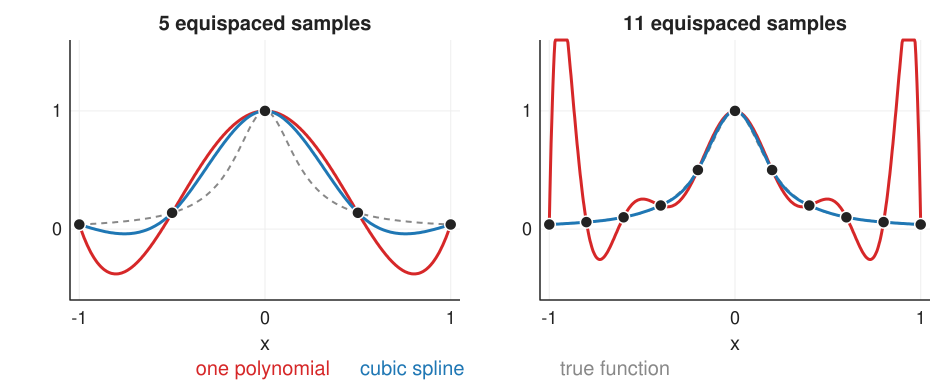

## Goal

By the end of this exercise you should be able to:

- explain with numbers why one polynomial through many points wiggles, and why piecewise pieces do not,
- name the continuity of a join (C⁰, G¹, C¹, C²) and read it from a curvature comb,
- evaluate and split a Bézier curve by hand with **de Casteljau**,
- place control points so that two Bézier pieces join with C¹ or G¹,
- *(math)* derive the Bernstein form, the end derivatives and the curvature of a Bézier curve.

Do the pen-and-paper part first, then the two demos.

## Background

| Idea | What it means |
|---|---|
| Interpolating polynomial | the one polynomial of degree $n - 1$ through $n$ points |
| Runge's phenomenon | with many equispaced points it swings wildly near the ends |
| Piecewise cubic | one cubic per interval; 4 numbers per piece to match values and slopes |
| C⁰ · G¹ · C¹ · C² | no gap · same tangent direction · same tangent vector · same second derivative |
| Curvature | 1/radius of the touching circle; $\kappa = (x'y'' - y'x'')/(x'^2 + y'^2)^{3/2}$ |
| Bézier curve | $\mathbf{B}(t) = \sum_i b_{i,n}(t)\mathbf{P}_i$, $t \in [0, 1]$, Bernstein weights $b_{i,n}(t) = \binom{n}{i}t^i(1-t)^{n-i}$ |
| De Casteljau | at $t$: move a fraction $t$ along each leg, repeat on the new polygon until one point is left |
| C¹ join of cubics | $\mathbf{Q}_0 = \mathbf{P}_3$ and $\mathbf{Q}_1 = 2\mathbf{P}_3 - \mathbf{P}_2$ |

::: {.callout-note collapse="true" title="The math: Bernstein form and derivatives"}
De Casteljau unrolled: $\mathbf{B}(t) = \sum_{i=0}^n \binom{n}{i}t^i(1-t)^{n-i}\mathbf{P}_i$. The weights are non-negative and sum to $(t + 1 - t)^n = 1$, so the curve lies in the convex hull of the control points and transforms with them under any affine map. Derivative: $\mathbf{B}'(t) = n\sum_{i=0}^{n-1}b_{i,n-1}(t)(\mathbf{P}_{i+1} - \mathbf{P}_i)$; in particular $\mathbf{B}'(0) = n(\mathbf{P}_1 - \mathbf{P}_0)$, $\mathbf{B}''(0) = n(n-1)(\mathbf{P}_2 - 2\mathbf{P}_1 + \mathbf{P}_0)$.
:::

## By hand

**B1.** **Runge with five points.** The samples $(-2, 0), (-1, 0), (0, 1), (1, 0), (2, 0)$.
(a) Check that $p(x) = \tfrac14(x^2 - 1)(x^2 - 4)$ passes through all five points.
(b) Compute $p(0.5)$ and $p(1.5)$. What does piecewise linear interpolation give at the same two places?
(c) The samples come from a smooth bump that is 0 outside $[-1, 1]$. Which of the two curves would you trust at $x = 1.5$, and why?

**B2.** **De Casteljau by hand.** Control points $\mathbf{P}_0 = (0, 0)$, $\mathbf{P}_1 = (1, 2)$, $\mathbf{P}_2 = (3, 2)$, $\mathbf{P}_3 = (4, 0)$.
(a) Evaluate $\mathbf{B}(\tfrac12)$ with de Casteljau; write down all intermediate points.
(b) Do the same for $t = \tfrac14$.
(c) From (a), write down the control points of the two halves $t \in [0, \tfrac12]$ and $t \in [\tfrac12, 1]$.
(d) Check (b) with the Bernstein weights at $t = \tfrac14$.

**B3.** **Joining pieces.** A second cubic piece $\mathbf{Q}_0, \dots, \mathbf{Q}_3$ follows the curve of B2, with $\mathbf{Q}_3 = (8, 1)$.
(a) Where must $\mathbf{Q}_0$ and $\mathbf{Q}_1$ be for a C¹ join?
(b) Give all positions of $\mathbf{Q}_1$ that give G¹ but not C¹.
(c) With $\mathbf{Q}_1 = (4.5, 2)$, which continuity does the join have?

**B4.** **Shapes from the polygon.** Which of these cubic control polygons gives (i) an arch, (ii) a loop, (iii) a cusp (a point where the curve stops and turns back)? Sketch the polygon first.
(a) $(0, 0), (5, 3), (-1, 3), (4, 0)$; (b) $(0, 0), (1, 2), (3, 2), (4, 0)$; (c) $(0, 0), (4, 2.5), (0, 2.5), (4, 0)$.

**B5.** **From end points and tangents to control points.** A cubic piece must start at $(0, 0)$ with velocity $(3, 6)$ and end at $(4, 0)$ with velocity $(3, -6)$ (cubic Hermite data). Using $\mathbf{B}'(0) = 3(\mathbf{P}_1 - \mathbf{P}_0)$ and $\mathbf{B}'(1) = 3(\mathbf{P}_3 - \mathbf{P}_2)$, find its Bézier control points. Do you recognise the curve?

**B6.** **Predict: locality.** Nine equispaced samples of a smooth bump on $[-1, 1]$. The sample at $x = 0.5$ is raised by 0.3. How much changes (roughly) at $x = 0.875$ and at $x = -0.875$ for (a) piecewise linear interpolation, (b) the polynomial of degree 8, (c) a chain of cubics that is C² at the samples (the natural spline of unit 3)?

::: {.callout-note collapse="true" title="Solutions"}
**B1.** (a) At $x = 0$: $\tfrac14(-1)(-4) = 1$; at $x = \pm1$ the first factor is 0; at $\pm 2$ the second. (b) $p(0.5) = \tfrac14(-0.75)(-3.75) = 0.703$ and $p(1.5) = \tfrac14(1.25)(-1.75) = -0.547$. Piecewise linear gives 0.5 (halfway between 1 and 0) and 0. (c) Piecewise linear: the polynomial dips to −0.55 where the bump is 0 and every nearby sample is 0; the dip comes from forcing one polynomial through all points, not from the data.

**B2.** (a) Legs: $(0.5, 1), (2, 2), (3.5, 1)$; next: $(1.25, 1.5), (2.75, 1.5)$; point $(2, 1.5)$. (b) Legs: $(0.25, 0.5), (1.5, 2), (3.25, 1.5)$; next: $(0.5625, 0.875), (1.9375, 1.875)$; point $(0.90625, 1.125)$. (c) Left half: $(0, 0), (0.5, 1), (1.25, 1.5), (2, 1.5)$; right half: $(2, 1.5), (2.75, 1.5), (3.5, 1), (4, 0)$. (d) Weights at $t = \tfrac14$: $\tfrac{27}{64}, \tfrac{27}{64}, \tfrac{9}{64}, \tfrac{1}{64}$ (0.421875, 0.421875, 0.140625, 0.015625). $x = \tfrac{27}{64}\cdot 1 + \tfrac{9}{64}\cdot 3 + \tfrac{1}{64}\cdot 4 = \tfrac{58}{64} = 0.90625$, $y = \tfrac{27}{64}\cdot 2 + \tfrac{9}{64}\cdot 2 = \tfrac{72}{64} = 1.125$.

**B3.** (a) $\mathbf{Q}_0 = (4, 0)$ and $\mathbf{Q}_1 = 2(4, 0) - (3, 2) = (5, -2)$. (b) $\mathbf{Q}_1 = (4, 0) + s(1, -2)$ for any $s > 0$ except $s = 1$. (c) $(4.5, 2) - (4, 0) = (0.5, 2)$ does not point along $(1, -2)$: only C⁰, a kink (the demo's "C⁰ join" preset: the end tangents differ by 139°).

**B4.** (b) is the arch (the worked example). (a) has the inner points crossed far beyond each other: the curve runs right, back left and right again, a **loop** (at $t = \tfrac12$ the velocity is $(-1.5, 0)$, pointing backwards). (c) is a **cusp**: the velocity at $t = \tfrac12$ is $3[\tfrac14(4, 2.5) + \tfrac12(-4, 0) + \tfrac14(4, -2.5)] = (0, 0)$; the curve stops and turns.

**B5.** $\mathbf{P}_0 = (0, 0)$, $\mathbf{P}_1 = (0, 0) + \tfrac13(3, 6) = (1, 2)$, $\mathbf{P}_2 = (4, 0) - \tfrac13(3, -6) = (3, 2)$, $\mathbf{P}_3 = (4, 0)$: the worked curve of B2.

**B6.** (a) Piecewise linear: only the two pieces next to $x = 0.5$ change; nothing at $\pm 0.875$ (0 change). (b) The polynomial changes everywhere: −0.55 at $x = 0.875$ and −0.15 at $x = -0.875$, on the far side. (c) The cubic spline changes mostly near the moved sample: −0.05 at $x = 0.875$, 0.0002 at $x = -0.875$ (the influence decays by a factor of about 4 per sample). (Numbers from the runge demo's "one point moved" preset.)
:::

### Math questions

**B7.** *(math)* Derive the Bernstein form of a quadratic Bézier curve from de Casteljau, and show that the weights sum to 1 and are non-negative on $[0, 1]$. Why does this put the curve inside the convex hull of $\mathbf{P}_0, \mathbf{P}_1, \mathbf{P}_2$?

**B8.** *(math)* (a) Show that $\sum_{i=0}^n b_{i,n}(t) = 1$ for every $n$. (b) Show that applying an affine map $\mathbf{x} \mapsto A\mathbf{x} + \mathbf{t}$ to the control points applies it to every curve point. Would this hold for a perspective map?

**B9.** *(math)* (a) Show $\mathbf{B}'(0) = n(\mathbf{P}_1 - \mathbf{P}_0)$ and $\mathbf{B}''(0) = n(n-1)(\mathbf{P}_2 - 2\mathbf{P}_1 + \mathbf{P}_0)$ for a Bézier curve of degree $n$. (b) Derive the C¹ condition for two cubic pieces. (c) What extra condition gives C²?

**B10.** *(math)* Compute the curvature of the worked curve of B2 at $t = 0$ and at $t = \tfrac12$. Where does the curve bend most?

**B11.** *(math)* For the five equispaced nodes $-2, \dots, 2$, compute the node product $\omega(x) = \prod_i (x - x_i)$ at $x = 0.5$ and $x = 1.5$. What does the error formula $f(x) - p(x) = \frac{f^{(5)}(\xi)}{5!}\omega(x)$ say about where the interpolation error is largest?

::: {.callout-note collapse="true" title="Solutions (math)"}
**B7.** Level 1: $(1-t)\mathbf{P}_0 + t\mathbf{P}_1$ and $(1-t)\mathbf{P}_1 + t\mathbf{P}_2$. Level 2: $(1-t)[(1-t)\mathbf{P}_0 + t\mathbf{P}_1] + t[(1-t)\mathbf{P}_1 + t\mathbf{P}_2] = (1-t)^2\mathbf{P}_0 + 2t(1-t)\mathbf{P}_1 + t^2\mathbf{P}_2$. Sum: $(1-t)^2 + 2t(1-t) + t^2 = ((1-t) + t)^2 = 1$; each term is a product of non-negative numbers for $t \in [0, 1]$. A weighted average with non-negative weights summing to 1 is a convex combination, which by definition lies in the convex hull.

**B8.** (a) Binomial theorem: $\sum_i \binom{n}{i}t^i(1-t)^{n-i} = (t + (1-t))^n = 1$. (b) $\sum_i b_i(A\mathbf{P}_i + \mathbf{t}) = A\sum_i b_i\mathbf{P}_i + \mathbf{t}\sum_i b_i = A\mathbf{B}(t) + \mathbf{t}$, using $\sum_i b_i = 1$. A perspective map divides by a coordinate that depends on the point, so it is not of this form: transforming control points does not transform the polynomial curve exactly (it does for rational curves, next unit).

**B9.** (a) Differentiate $b_{i,n}$: $b'_{i,n} = n(b_{i-1,n-1} - b_{i,n-1})$, so $\mathbf{B}' = n\sum_{i=0}^{n-1}b_{i,n-1}(\mathbf{P}_{i+1} - \mathbf{P}_i)$; at $t = 0$ only $b_{0,n-1} = 1$ survives: $n(\mathbf{P}_1 - \mathbf{P}_0)$. Applying the rule once more to the derivative curve (degree $n - 1$, control points $n(\mathbf{P}_{i+1} - \mathbf{P}_i)$): $\mathbf{B}''(0) = (n-1)\,n[(\mathbf{P}_2 - \mathbf{P}_1) - (\mathbf{P}_1 - \mathbf{P}_0)]$. (b) C⁰: $\mathbf{Q}_0 = \mathbf{P}_3$. C¹: $3(\mathbf{Q}_1 - \mathbf{Q}_0) = 3(\mathbf{P}_3 - \mathbf{P}_2)$, i.e. $\mathbf{Q}_1 = 2\mathbf{P}_3 - \mathbf{P}_2$. (c) C²: also $6(\mathbf{Q}_2 - 2\mathbf{Q}_1 + \mathbf{Q}_0) = 6(\mathbf{P}_3 - 2\mathbf{P}_2 + \mathbf{P}_1)$, which fixes $\mathbf{Q}_2 = \mathbf{P}_1 + 4(\mathbf{P}_3 - \mathbf{P}_2)$: the next piece has only one free control point left. This is what B-splines organise.

**B10.** $t = 0$: $\mathbf{B}' = (3, 6)$, $\mathbf{B}'' = 6[(3, 2) - 2(1, 2) + (0, 0)] = (6, -12)$, $\kappa = \frac{3\cdot(-12) - 6\cdot 6}{(9 + 36)^{3/2}} = \frac{-72}{301.9} = -0.239$. $t = \tfrac12$: $\mathbf{B}' = 3[\tfrac14(1, 2) + \tfrac12(2, 0) + \tfrac14(1, -2)] = (4.5, 0)$, $\mathbf{B}'' = 6[\tfrac12((3,2) - 2(1,2) + (0,0)) + \tfrac12((4,0) - 2(3,2) + (1,2))] = (0, -12)$, $\kappa = \frac{4.5\cdot(-12)}{4.5^3} = -0.593$. The curve bends most at the top (radius $1/0.593 = 1.7$), less at the ends (radius 4.2); negative = turning clockwise (to the right) in a $y$-up frame.

**B11.** $\omega(0.5) = 2.5 \cdot 1.5 \cdot 0.5 \cdot (-0.5) \cdot (-1.5) = 1.41$; $\omega(1.5) = 3.5 \cdot 2.5 \cdot 1.5 \cdot 0.5 \cdot (-0.5) = -3.28$. On $[-2, 2]$ the largest $|\omega|$ is 3.63 at $x = \pm 1.64$, between the last two nodes; on $[-1, 1]$ it stays below 1.42. For the same $f^{(5)}$, the error bound is about 2.5 times larger near the ends than in the middle; with more equispaced nodes this ratio grows quickly. Chebyshev nodes make $|\omega|$ equally small everywhere.
:::

## Explore: Runge's phenomenon {#explore-runge}

{width="85%" fig-align="center"}

Samples of a function on $[-1, 1]$ (the bump $1/(1 + 25x^2)$, a step, or a profile across the cell micrograph) at $n$ points, equispaced or Chebyshev. Red: the one polynomial through all of them; green: piecewise linear; blue: the natural cubic spline (unit 3); dashed: the true function. The readout gives each curve's largest error. Drag a sample up or down.

```{=html}
<link rel="stylesheet" href="../demos/dist/demo.css">
<div data-demo="runge" data-preset="five"></div>
<script src="../demos/dist/runge.js"></script>
```

**D1.** Preset **5 points are fine**, then increase $n$ step by step to 21 (equispaced, bump). Write down the polynomial's largest error at $n = 5, 7, 9, 11, 15, 21$. Where on the axis does it occur?

**D2.** Same values of $n$ with the spline. What happens to its error? Why does it behave so differently?

**D3.** Preset **Chebyshev fixes the ends**. Compare the polynomial's error at $n = 11$ with the equispaced case. Where are the nodes denser? Why is this not a general fix for image data?

**D4.** Preset **one point moved**, then drag other samples. Which curve changes everywhere, which only nearby?

**D5.** Preset **the step**. Which curve rings, and how far from the jump?

::: {.callout-note collapse="true" title="Solutions"}
**D1.** 0.44, 0.62, 1.05, 1.92, 7.2, 60: it grows quickly, always between the outermost samples (near $x = \pm 0.95$).

**D2.** Spline: 0.28, 0.13, 0.056, 0.022, 0.002, 0.003: it shrinks as the samples get denser. Each cubic piece only has to follow the bump over one short interval, and the pieces are tied together only by smoothness at the joins; no single high-degree polynomial has to bend through all points.

**D3.** 0.109 instead of 1.92. Chebyshev nodes are bunched towards the ends, exactly where the equispaced node product is large. Image samples are equispaced (pixels): we cannot choose where to sample, so we change the curve (piecewise) instead.

**D4.** The polynomial changes everywhere (by −0.55 at $x = 0.875$ and −0.15 at $x = -0.875$ in the preset); piecewise linear only on the two neighbouring intervals; the spline mostly near the moved sample, with quickly decaying ripples (−0.05 next door, 0.0002 on the far side).

**D5.** The polynomial rings over the whole interval (error 5.6 at $n = 12$, largest near the ends); piecewise linear and the spline only next to the jump (errors 0.84 and 0.87 come from the interval that contains the jump, where nobody knows where exactly it is). The spline overshoots a little on both sides of the jump.
:::

## Explore: de Casteljau, Bézier curves and joins {#explore}

A Bézier curve of degree 2–6 with draggable control points; the slider $t$ shows the de Casteljau construction (one colour per level) and, on the right, the Bernstein weight of each control point at $t$. Toggles: convex hull, curvature comb (bristles along the normal, length proportional to the curvature), tangent at $t$. A second cubic piece (purple) can be attached with a join rule; handles that follow the rule are dashed. "Transform" rotates by 30° and scales by 0.8 about the centre.

```{=html}
<link rel="stylesheet" href="../demos/dist/demo.css">
<div data-demo="casteljau" data-preset="worked"></div>
<script src="../demos/dist/casteljau.js"></script>
```

**E1.** Preset **the worked example**. Set $t = 0.25$ and check your construction from B2(b) against the readout. Read the four weights and their sum.

**E2.** Tick **convex hull** and drag the control points around. Can you make the curve leave the hull? Press **transform**: where are the orange dots, and what does this show?

**E3.** Presets **loop** and **cusp**, with the comb on. What happens to the curvature at the cusp, and why?

**E4.** Presets **C⁰ join**, **G¹ but not C¹** and **C¹ join** (comb on). For each, read the angle between the end tangents, the speeds and the curvatures at the join. Which one would look smooth in a drawing? Which one is smooth in the curvature?

**E5.** In the G¹ preset, drag $\mathbf{Q}_1$ along its ray. Can you find a position where the curvature does not jump? What happens to the second piece's curvature at the join as $\mathbf{Q}_1$ moves out?

**E6.** Switch the degree to 6 and move one inner control point. How much of the curve moves?

::: {.callout-note collapse="true" title="Solutions"}
**E1.** Point $(0.906, 1.125)$; weights 0.422, 0.422, 0.141, 0.016; sum 1.000.

**E2.** No: every curve point is a weighted average of the control points with non-negative weights summing to 1. The orange dots (the old curve, transformed point by point) lie exactly on the new curve drawn from the transformed control points: affine invariance.

**E3.** At the cusp the velocity is zero, so the curvature formula divides by a speed that goes to 0: the comb shoots up to infinity at $t = \tfrac12$. The curve stops, turns and goes back.

**E4.** C⁰: angle 139.4°: a visible kink. G¹: angle 0°, speeds 6.71 → 2.68, curvature −0.239 → +1.677: smooth to the eye, but the comb jumps. C¹: angle 0°, speeds 6.71 → 6.71, curvature −0.239 → +0.268: still a jump in curvature (it changes sign, an inflection at the join). Only a C² (or G²) join would make the comb continuous.

**E5.** No. Moving $\mathbf{Q}_1$ along the ray only changes the size of the second piece's curvature at the join, not its sign: with $\mathbf{Q}_1 = \mathbf{Q}_0 + s(1, -2)$ it is $0.268/s^2$ (1.677 at $s = 0.4$, the preset; 0.268 at $s = 1$, the C¹ position). Its sign is set by the side of the tangent line on which $\mathbf{Q}_2$ lies; to match the first piece's −0.239 (G²), $\mathbf{Q}_2$ must move to the other side. Matching curvature is a condition on $\mathbf{Q}_2$ as well, which is exactly what C² continuity (B9c) fixes.

**E6.** The whole curve moves (less near the end points): every Bernstein weight is non-zero inside $(0, 1)$. This is the global control that motivates B-splines.
:::

## Where this leads

Bézier pieces must be joined by hand, and one high-degree Bézier is global. The next unit builds a **basis of bumps** (B-splines) in which smoothness and locality are automatic, and adds **weights** (NURBS) so that circles become exact.
