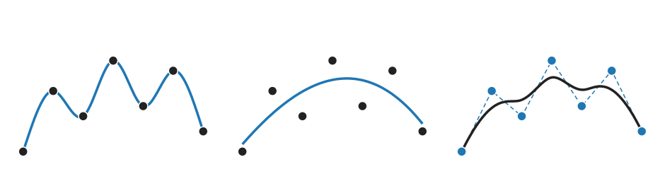
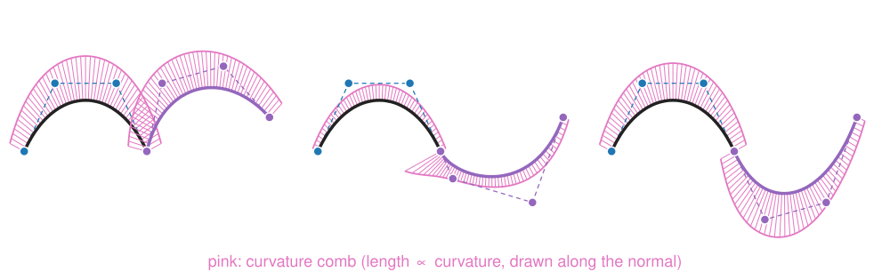
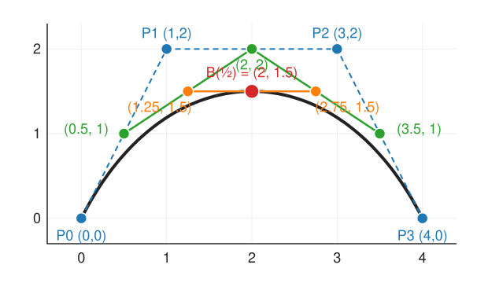

## About this lecture

We have points (clicks on a cell outline, samples of an intensity profile, boundary pixels) and want a **smooth curve**. This unit starts the splines day.

- Why **one polynomial through many points** wiggles (Runge), and why a chain of **low-degree pieces** does not.
- How smooth a join is: **C⁰, C¹, G¹, C²**, seen in a **curvature comb**.
- **Parametric curves** $(x(t), y(t))$ for outlines that fold back.
- **Bézier curves** and **de Casteljau**: linear interpolation of linear interpolations.
- What the **control polygon** tells you, and how to join pieces smoothly.

*Slides titled **The math** give the formulas and proofs; the ideas are complete without them.*

::: notes
This day owns spline theory for the course: the snakes elective (spline snakes), the optical flow day (B-spline free-form deformation) and outline measurements recall it. Unit order: wiggles and Bézier (here), the B-spline basis and NURBS (unit 2), fitting noisy data (unit 3), splines on images (unit 4).
:::

## Three ways to draw a curve through points

{width="95%" fig-align="center"}

- **Through** the points: clean data, few points (an interpolating curve).
- **Near** the points: noisy data; the curve should not follow the noise (unit 3).
- **Controlled by** the points: the points are handles that steer a shape, as in a drawing program (this unit and the next).

The rest of the day returns to these three.

## One polynomial through all the points

$n$ points with different $x$ fix exactly one polynomial of degree $n - 1$. For 3 to 5 points that is fine. For many points it is not.

By hand: five samples of a bump, $(-2, 0), (-1, 0), (0, 1), (1, 0), (2, 0)$. The degree-4 polynomial through them is

$$p(x) = \tfrac14 (x^2 - 1)(x^2 - 4).$$

- Check: $p(0) = 1$, $p(\pm1) = p(\pm2) = 0$.
- Between the last two samples: $p(1.5) = \tfrac14 \cdot 1.25 \cdot (-1.75) = -0.55$, although every sample nearby is 0.

With 11 equally spaced samples of the bump $1/(1 + 25x^2)$ the swings near the ends reach 1.9; with 21 samples, 60 (**Runge's phenomenon**, 1901). More points make it **worse**.

## The math: the interpolation polynomial {.math}

**Lagrange form.** With nodes $x_0, \dots, x_{n-1}$,
$$p(x) = \sum_i y_i L_i(x), \qquad L_i(x) = \prod_{j \ne i}\frac{x - x_j}{x_i - x_j} \quad (L_i(x_k) = 1 \text{ if } k = i, \text{ else } 0).$$
Equivalently, solve the Vandermonde system $\sum_k a_k x_i^k = y_i$.

**Error.** For a smooth $f$, at every $x$ there is a $\xi$ in the node range with
$$f(x) - p(x) = \frac{f^{(n)}(\xi)}{n!}\,\prod_{i}(x - x_i).$$

- For equispaced nodes the node product is **largest near the ends** (five nodes $-2, \dots, 2$: 1.4 at $x = 0.5$, 3.3 at $x = 1.5$), and for the bump the derivatives $f^{(n)}$ grow faster than $n!$: the error explodes at the ends.
- **Chebyshev nodes** $x_i = -\cos\frac{(2i + 1)\pi}{2n}$ (bunched at the ends) minimise the largest node product. They fix Runge, but we rarely choose where our samples lie.

## Try it: Runge's phenomenon

```{=html}
<link rel="stylesheet" href="../demos/dist/demo.css">
<div data-demo="runge" data-preset="runge"></div>
<script src="../demos/dist/runge.js"></script>
```

::: notes
Red: the one polynomial; green: piecewise linear; blue: the natural cubic spline (built in unit 3; here just "a chain of cubics"). Tour, with the readout of the largest error: "5 points are fine": polynomial 0.44, linear 0.18, spline 0.28 (5 samples cannot show the bump well, whatever you do). "11 points: Runge": polynomial 1.92 at the ends, linear 0.067, spline 0.022. Slide n to 21: the polynomial's error is 60. "Chebyshev fixes the ends": 0.109 at n = 11. "The step" (n = 12): the polynomial misses by 5.6; piecewise linear and the spline miss by 0.84 and 0.87, both only next to the jump (the samples cannot say where exactly the jump is). "One point moved" (n = 9, the sample at x = 0.5 raised by 0.3): the polynomial changes by −0.55 at x = 0.875 and −0.15 at x = −0.875, on the other side; the spline changes by −0.05 next door and by 0.0002 on the other side. Drag a sample yourself.
:::

## Recall: piecewise linear is 1D bilinear

Joining neighbouring samples with straight lines is the 1D version of **bilinear interpolation** from the [images unit](../images/lec.qmd).

- Continuous, local (moving one sample changes only its two neighbouring pieces), never overshoots.
- But it has a **kink** at every sample: the slope jumps. Derivatives (edges, curvature, velocities) of the result are steps and spikes.

The fix that keeps locality and removes the kinks: **piecewise low-degree polynomials** that agree in slope (and curvature) where they meet. A cubic has 4 numbers per piece: enough to match value and slope at both ends (**cubic Hermite** pieces).

## How smooth is a join?

{width="95%" fig-align="center"}

- **C⁰**: the pieces meet (no gap), but may form a kink.
- **G¹**: same tangent **direction**, possibly different speed; looks smooth.
- **C¹**: same tangent **vector** (direction and speed).
- **C²**: also the same second derivative; for curves drawn at constant speed, the same **curvature**.

**Curvature** = 1 / radius of the touching circle. The **curvature comb** draws it as a bristle along the normal at every point: a jump in the comb is what the eye sees as a "bump" at a join that is only G¹ or C¹.

## The math: curvature of a parametric curve {.math}

For a curve $\mathbf{C}(t) = (x(t), y(t))$:
$$\kappa = \frac{x'y'' - y'x''}{(x'^2 + y'^2)^{3/2}}.$$

- Positive: turning left (counter-clockwise, $y$ up); negative: turning right. $|\kappa| = 1/r$ of the osculating circle.
- A circle of radius $r$, $\mathbf{C}(t) = (r\cos t, r\sin t)$: $x'y'' - y'x'' = r^2$, speed $r$, so $\kappa = r^2/r^3 = 1/r$.
- Curvature does not depend on the speed (reparametrising $t$ changes $x', x''$ but not $\kappa$), while $\mathbf{C}''$ does: that is why **G²** (same curvature) is the geometric condition, C² the parametric one.

## Parametric curves

A cell outline folds back on itself and closes: it is not the graph $y = f(x)$ of any function.

- Write the curve as $\mathbf{C}(t) = (x(t), y(t))$, a moving point; $t$ is "time" along the curve.
- Every construction of this day is applied **to each coordinate separately**: a curve through points $\mathbf{P}_i$ is a function through the $x_i$ and one through the $y_i$, with the same $t$.
- The speed $\|\mathbf{C}'(t)\|$ need not be constant; arc length is the integral of the speed (unit 3).

## Bézier curves

A cubic **Bézier curve** has four **control points** $\mathbf{P}_0, \dots, \mathbf{P}_3$.

- It **starts** at $\mathbf{P}_0$ and **ends** at $\mathbf{P}_3$.
- It **leaves** along the leg $\mathbf{P}_0\mathbf{P}_1$ and **arrives** along $\mathbf{P}_2\mathbf{P}_3$.
- The middle points **pull** the curve but are not passed through.

This is how vector drawing programs and fonts store outlines (one-line pointer): a chain of cubic Bézier pieces, each with two end points and two "handles".

How to compute a point of the curve? Only with linear interpolation.

## De Casteljau: interpolate, then interpolate again

{width="52%" fig-align="center"}

At a fraction $t$, move $t$ of the way along each leg; connect the new points and repeat until one point is left. $\mathbf{P} = (0,0), (1,2), (3,2), (4,0)$, $t = \tfrac12$:

- legs: $(0.5, 1)$, $(2, 2)$, $(3.5, 1)$ → $(1.25, 1.5)$, $(2.75, 1.5)$ → **$\mathbf{B}(\tfrac12) = (2, 1.5)$**.

Linear interpolation of linear interpolations: the same trick as bilinear interpolation (lerp in $x$, then lerp in $y$).

## The math: the Bernstein form {.math}

Unrolling de Casteljau gives a weighted sum of the control points:
$$\mathbf{B}(t) = \sum_{i=0}^{n}\binom{n}{i}t^i(1 - t)^{n - i}\,\mathbf{P}_i = \sum_i b_{i,n}(t)\,\mathbf{P}_i.$$

- $n = 2$: $(1-t)\big[(1-t)\mathbf{P}_0 + t\mathbf{P}_1\big] + t\big[(1-t)\mathbf{P}_1 + t\mathbf{P}_2\big] = (1-t)^2\mathbf{P}_0 + 2t(1-t)\mathbf{P}_1 + t^2\mathbf{P}_2$.
- **Partition of unity**: $\sum_i b_{i,n}(t) = (t + (1 - t))^n = 1$ (binomial theorem); and $b_{i,n} \ge 0$ on $[0, 1]$. So every curve point is a **convex combination** of the control points: the curve lies in their **convex hull**.
- Cubic at $t = \tfrac12$: weights $\tfrac18, \tfrac38, \tfrac38, \tfrac18$, giving $(2, 1.5)$ again.
- Affine invariance: $A\big(\sum_i b_i\mathbf{P}_i\big) + \mathbf{t} = \sum_i b_i(A\mathbf{P}_i + \mathbf{t})$ because the weights sum to 1.

## Try it: de Casteljau and the Bernstein weights

```{=html}
<link rel="stylesheet" href="../demos/dist/demo.css">
<div data-demo="casteljau" data-preset="worked"></div>
<script src="../demos/dist/casteljau.js"></script>
```

::: notes
The worked example: at t = 0.5 the readout shows the point (2, 1.5) and the weights 0.125 0.375 0.375 0.125 (sum 1), curvature −0.593 at the top. The Bernstein plot (right) shows the four weights as functions of t; the dots are their values at t. Slide t: the construction lines move, each level in its own colour. Tick "convex hull": the curve never leaves it. "Transform" rotates by 30° and scales by 0.8: the orange dots (the old curve, transformed point by point) lie on the new curve drawn from the transformed control points. Degree buttons 2–6: the same construction with more levels. Presets "S-curve", "loop" (inner legs crossed far out), "cusp" (inner points crossed so the speed passes through 0: the comb shoots up).
:::

## What the control polygon tells you

- **End points and end tangents**: $\mathbf{B}(0) = \mathbf{P}_0$, $\mathbf{B}'(0) = 3(\mathbf{P}_1 - \mathbf{P}_0)$; same at the other end.
- **Convex hull**: the curve stays inside the polygon's convex hull (useful for quick overlap tests).
- **Affine invariance**: to rotate, scale or shear a curve, transform its 4 control points instead of 1000 curve points.
- **Subdivision**: de Casteljau at $t$ also **splits** the curve. The outer points of the construction are the control points of the two halves: $(0,0), (0.5,1), (1.25,1.5), (2,1.5)$ and $(2,1.5), (2.75,1.5), (3.5,1), (4,0)$.
- **Shape from the legs**: inner legs crossing far out give a **loop**; crossed so the speed passes through zero give a **cusp**.

## Joining Bézier pieces

A second piece $\mathbf{Q}_0, \dots, \mathbf{Q}_3$ after $\mathbf{P}_0, \dots, \mathbf{P}_3$:

| Join | Rule |
|---|---|
| C⁰ | $\mathbf{Q}_0 = \mathbf{P}_3$ |
| G¹ | also: $\mathbf{Q}_1$ on the ray from $\mathbf{P}_3$ in the direction $\mathbf{P}_3 - \mathbf{P}_2$ |
| C¹ | also: $\mathbf{Q}_1 = 2\mathbf{P}_3 - \mathbf{P}_2$ (the mirror image of $\mathbf{P}_2$) |

With $\mathbf{P}_2 = (3, 2)$, $\mathbf{P}_3 = (4, 0)$: C¹ needs $\mathbf{Q}_1 = (5, -2)$; G¹ allows any $(4, 0) + s(1, -2)$, $s > 0$.

Even C¹ is not C²: the curvature can still jump (the comb shows it). In a drawing program the user keeps these rules by hand, handle by handle.

## The math: derivatives and the C¹ condition {.math}

Differentiating the Bernstein form gives a Bézier curve of degree $n - 1$ whose control points are the scaled legs:
$$\mathbf{B}'(t) = n\sum_{i=0}^{n-1} b_{i,n-1}(t)\,(\mathbf{P}_{i+1} - \mathbf{P}_i), \qquad \mathbf{B}'(0) = n(\mathbf{P}_1 - \mathbf{P}_0),\ \ \mathbf{B}'(1) = n(\mathbf{P}_n - \mathbf{P}_{n-1}).$$

- C¹ between two cubics: $3(\mathbf{Q}_1 - \mathbf{Q}_0) = 3(\mathbf{P}_3 - \mathbf{P}_2)$ with $\mathbf{Q}_0 = \mathbf{P}_3$, so $\mathbf{Q}_1 = 2\mathbf{P}_3 - \mathbf{P}_2$.
- $\mathbf{B}''(0) = n(n-1)(\mathbf{P}_2 - 2\mathbf{P}_1 + \mathbf{P}_0)$. Worked curve: $\mathbf{B}'(0) = (3, 6)$, $\mathbf{B}''(0) = (6, -12)$, $\kappa(0) = \frac{3\cdot(-12) - 6\cdot 6}{45^{3/2}} = -0.24$.
- **Hermite ↔ Bézier**: a cubic with end points $\mathbf{P}_0, \mathbf{P}_3$ and end tangents $\mathbf{T}_0, \mathbf{T}_3$ has $\mathbf{P}_1 = \mathbf{P}_0 + \mathbf{T}_0/3$, $\mathbf{P}_2 = \mathbf{P}_3 - \mathbf{T}_3/3$.

## Try it: joins and the curvature comb

```{=html}
<link rel="stylesheet" href="../demos/dist/demo.css">
<div data-demo="casteljau" data-preset="g1"></div>
<script src="../demos/dist/casteljau.js"></script>
```

::: notes
The second piece (purple) with a join rule; dashed handles follow the rule. "C⁰ join: a kink": angle 139.4° between the end tangents. "G¹ but not C¹": angle 0°, but speed 6.71 → 2.68 and curvature −0.239 → +1.677: the comb jumps. Drag Q1 along its ray: only its distance changes. "C¹ join": Q1 = (5, −2), speeds 6.71 = 6.71, but curvature still −0.239 → +0.268 (an inflection at the join): C¹ is not C². Switch the join to "free" and drag Q0 away to see a gap (not even C⁰).
:::

## What Bézier pieces do not give us

- **Continuity by hand**: every join must be kept C¹ (or G¹) by moving handles in pairs; C² is even harder.
- **Global control** in one high-degree Bézier: every control point moves the whole curve (all Bernstein weights are non-zero for $0 < t < 1$), and high degree brings back the wiggles.

What we want: a **basis of bump functions** in which each control point affects only a few pieces, and the smoothness of every join is **built in**. That is the B-spline basis (next unit).

## Summary

- One polynomial through many equispaced points **wiggles** near the ends (Runge); more points make it worse.
- Use **piecewise low-degree** pieces; name the smoothness of a join: **C⁰** (no gap), **G¹** (same direction), **C¹** (same tangent vector), **C²** (same curvature for constant speed). The **curvature comb** shows the difference.
- Outlines are **parametric** curves; every construction acts per coordinate.
- A **Bézier** curve is steered by its control polygon: it starts and ends at the end points, along the end legs, inside the convex hull. **De Casteljau** evaluates it with repeated linear interpolation, and splits it.
- Joining pieces smoothly is a rule on the handles ($\mathbf{Q}_1 = 2\mathbf{P}_3 - \mathbf{P}_2$ for C¹), kept by hand.
