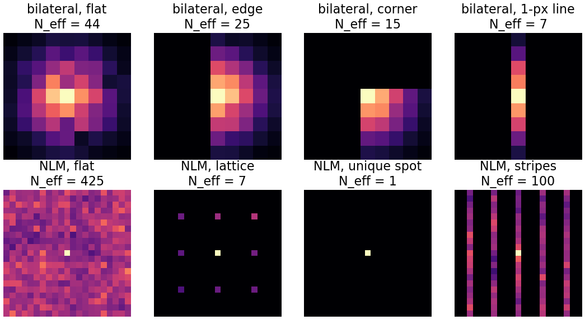
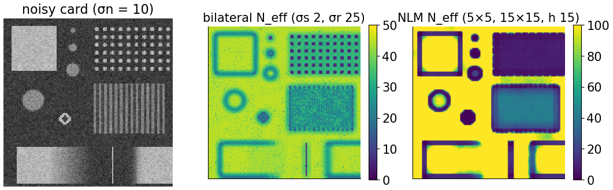
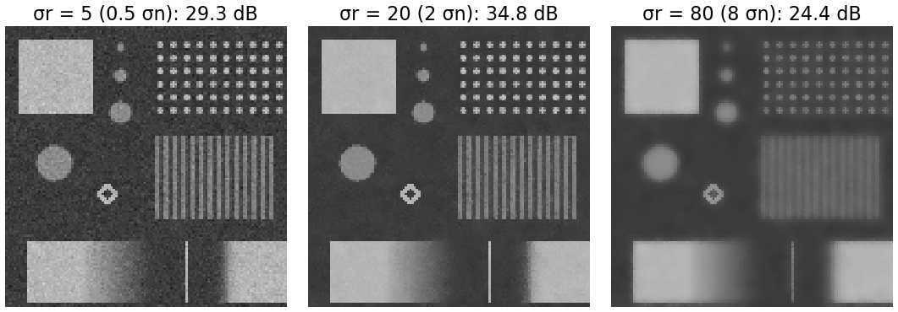
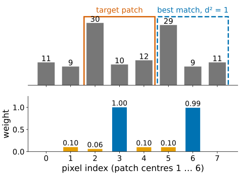
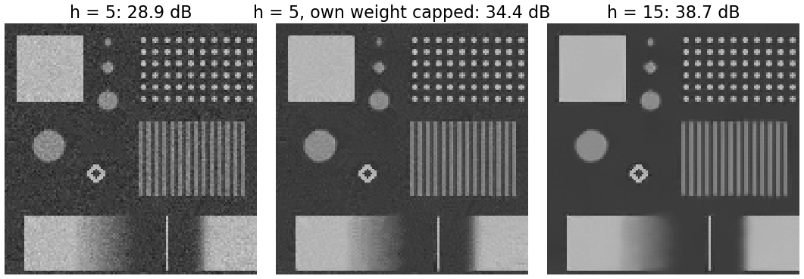
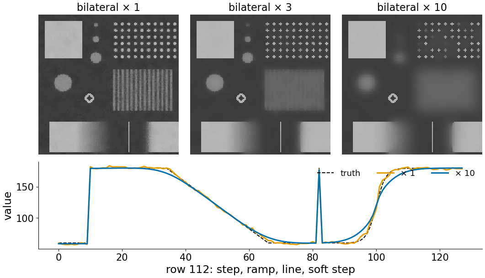
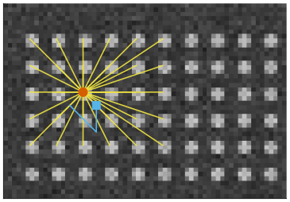
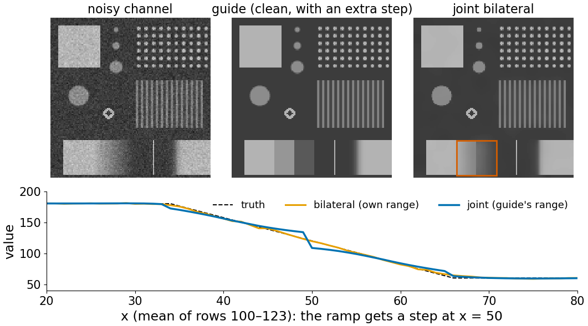

## About this lecture

The deconvolution day ([denoise](../denoise/lec.qmd)) introduced the bilateral filter and non-local means in one slide each. Both are **weighted means**: each output pixel is an average of other pixels, with weights that depend on the image. This unit opens the box.

- **Weight maps**: which pixels does one output pixel actually average?
- The **effective number of averaged pixels**, and why edges and unique details stay noisy.
- Choosing the **range** parameter (σr, h) against the noise level, and the **self-weight** problem.
- The bilateral filter is one step of an **edge-stopping diffusion**; non-local means is a diffusion on a **graph of patches**.
- **Joint** bilateral: borrow the edges from a cleaner channel.

Slides titled **The math** give the formulas and proofs; the ideas are complete without them.

::: notes
Recalled, not re-taught: the first introduction of both filters, method noise and "a restored image is an estimate" ([denoise](../denoise/lec.qmd), deconvolution day). Earlier today: Perona–Malik's edge-stopping function ([perona-malik](../perona-malik/lec.qmd)) and the heat step ([heat-equation](../heat-equation/lec.qmd)).
:::

## Recall: close and similar, similar patches

From [denoising and what you may measure](../denoise/lec.qmd):

- **Bilateral filter**: average the neighbours that are **close** (spatial weight, width σs) **and similar in value** (range weight, width σr):
$$w_{pq} = e^{-|p - q|^2/2\sigma_s^2}\;e^{-(I_p - I_q)^2/2\sigma_r^2}.$$
- **Non-local means** (NLM): average the pixels in a search window whose **surrounding patch** looks like the patch around $p$:
$$w_{pq} = e^{-d^2(P_p, P_q)/h^2},\quad d^2 = \text{mean squared difference of the two patches}.$$
- The output is $\hat u_p = \sum_q w_{pq}I_q / \sum_q w_{pq}$, for every pixel.

Same structure as a Gaussian blur, except that the weights now depend on the image.

## The weight map

:::: {.columns}
::: {.column width="40%"}
Pick one pixel and paint the weight of every other pixel:

- **bilateral, flat region**: a round Gaussian blob. There, the filter *is* a Gaussian blur.
- **bilateral, at an edge**: a **half-moon**, only its own side. At a corner, a **quarter**. On a 1-pixel line, only the line.
- **NLM, flat region**: weight everywhere in the search window.
- **NLM, lattice**: bright spots at every **copy** of the dot, even far away; nothing in between.
- **NLM, unique spot**: only the pixel itself.
:::
::: {.column width="60%"}
{width="100%" fig-alt="Top row: bilateral weight maps (9 × 9) at a flat point (a round blob, N_eff 44), at the edge of the square (a half-moon, 25), at its corner (a quarter, 15) and on the 1-pixel line (a single column, 7). Bottom row: NLM weight maps (21 × 21): flat region (weight everywhere, N_eff 425), lattice (bright spots at the copies, 7), unique spot (only the centre, 1), stripes (bright columns at every stripe, 100)."}
:::
::::

## How many pixels are averaged?

:::: {.columns}
::: {.column width="40%"}
A weighted mean of $N$ equal weights reduces independent noise by $\sqrt N$. For unequal weights the same holds with the **effective number**

$$N_{\text{eff}} = \frac{(\sum w)^2}{\sum w^2}.$$

- (1, 1, 1, 1): $N_{\text{eff}} = 4$, noise ÷ 2.
- (1, 0.1, 0.1, 0.1): $N_{\text{eff}} = 1.64$, noise ÷ 1.28: one dominant weight means little averaging.

The maps: the bilateral filter averages about 44 pixels in flat regions but only 5–25 along edges, so a **noisy rim** stays at every edge. NLM averages hundreds in flat regions, 7 on the lattice, **1** on the unique spot.
:::
::: {.column width="60%"}
{width="100%" fig-alt="The noisy test card and two maps of the effective number of averaged pixels: bilateral (yellow, about 45, in flat regions; low along every edge and on the lattice); NLM (very high in flat regions and the stripes, low on the lattice, the discs' rims and the unique spot)."}
:::
::::

## The math: the variance of a weighted mean {.math}

- With independent noise of variance $\sigma_n^2$ in each $I_q$ and weights $w_q$ that do not depend on the noise, $\mathrm{Var}\big(\sum_q w_q I_q/\sum_q w_q\big) = \sigma_n^2\,\dfrac{\sum_q w_q^2}{(\sum_q w_q)^2} = \dfrac{\sigma_n^2}{N_{\text{eff}}}$.
- $1 \le N_{\text{eff}} \le$ number of nonzero weights, equality for equal weights (Cauchy–Schwarz).
- For the bilateral and NLM filters the weights **do** depend on the noise (they are computed from the noisy image), so this is an approximation; it is good when the weights are dominated by the clean structure.

## Choosing the range parameter

:::: {.columns}
::: {.column width="40%"}
Bilateral, noise $\sigma_n = 10$, edges of height 120:

- **σr ≪ σn** (5): neighbours differ by about $\sqrt2\,\sigma_n$ from noise alone, so almost every neighbour looks "different": almost nothing is averaged (29.3 dB).
- **σr ≈ 2σn** (20): noise differences get weight, edges do not: 34.8 dB.
- **σr ≫ edge height** (80): edges get weight too, the filter becomes a plain Gaussian (24.4 dB).

The rule of thumb σr ≈ 2σn works when the edges are much higher than the noise. When an edge is about as high as the noise, **no** σr separates them.
:::
::: {.column width="60%"}
{width="100%" fig-alt="The noisy test card after the bilateral filter with sigma_r = 5, 20 and 80 (noise 10): still noisy (29.3 dB), clean with sharp edges (34.8 dB), and blurred like a Gaussian (24.4 dB)."}
:::
::::

## Choosing $h$ for non-local means

- Two patches of the **same** clean structure still differ by the noise: their mean squared difference is about $2\sigma_n^2$, not 0.
- So $h$ must be at least about $\sigma_n$: with $h = \sigma_n$, an identical copy gets weight $e^{-2} \approx 0.14$; with $h = 1.5\sigma_n$, $e^{-0.9} \approx 0.41$.
- **$h$ too small**: no copy gets weight, only the pixel itself (where $d = 0$): no averaging.
- **$h$ too large**: different patches get weight too: blur.
- Larger patches make the distance more reliable (more pixels averaged in $d^2$) but find fewer exact copies; 5 × 5 to 7 × 7 is common. The **search window** must be large enough to contain copies (on the lattice: larger than the period).

## The math: the expected patch distance {.math}

- Let $P_p = C_p + E_p$, clean patch plus noise, the noise independent with variance $\sigma_n^2$ per pixel. For two non-overlapping patches,
$$\mathbb E\,d^2(P_p, P_q) = \frac{1}{m}\sum_{k=1}^m \mathbb E\,(C_{pk} - C_{qk} + E_{pk} - E_{qk})^2 = d^2(C_p, C_q) + 2\sigma_n^2.$$
- Hence the variant $w = e^{-\max(d^2 - 2\sigma_n^2,\,0)/h^2}$: identical clean patches get weight close to 1.
- The spread of $d^2$ around its mean shrinks like $1/\sqrt m$ with the number $m$ of patch pixels: bigger patches give a sharper test of similarity.

## Non-local means by hand

:::: {.columns}
::: {.column width="45%"}
$x = (11, 9, 30, 10, 12, 29, 9, 11)$, patches of 3, target pixel 3 (value 10, patch (30, 10, 12)), $h = 10$:

| centre | 1 | 2 | 3 | 4 | 5 | 6 |
|---|---|---|---|---|---|---|
| $d^2$ | 228.7 | 281.7 | 0 | 231 | 231.3 | **1** |
| weight | 0.10 | 0.06 | 1 | 0.10 | 0.10 | **0.99** |

Estimate: $\sum w x/\sum w = 10.93$. The pixel 6 patch (29, 9, 11) is a copy of the target's; a plain 3-pixel mean would give $(30 + 10 + 12)/3 = 17.3$.
:::
::: {.column width="55%"}
{width="100%" fig-alt="Top: the signal 11 9 30 10 12 29 9 11 as bars; the target patch around pixel 3 and the best-matching patch around pixel 6 are outlined. Bottom: the NLM weights of patch centres 1 to 6: 0.10, 0.06, 1.00, 0.10, 0.10, 0.99."}
:::
::::

## Try it: weight maps

```{=html}
<link rel="stylesheet" href="../demos/dist/demo.css">
<div data-demo="patchweights" data-preset="edge"></div>
<script src="../demos/dist/patchweights.js"></script>
```

::: notes
Click any pixel of the noisy card: bilateral spatial, range and product maps (9 × 9 for σs = 2), and the NLM weights over the search window (yellow boxes: the five best patches). Readout: estimates, N_eff, own weight. Tour: "flat" (22, 22): bilateral N_eff 44, NLM 216. "edge" (6, 22): half-moon, bilateral N_eff 25. "corner": a quarter, 15; NLM finds no copy of this corner nearby: N_eff 1. "noise ≈ edge height" (noise 60, σr 120): the range map is random; the bilateral estimate 142 is pulled into the dark side (truth 180). "NLM, lattice" (search 21 × 21): N_eff 7, own weight 27 %. "h too small" (h = 5): own weight 100 %; tick the self-weight fix: N_eff 2.7. "search window too small" (5 × 5): the period is 6, no copy in reach: N_eff 1.
:::

## The self-weight problem

:::: {.columns}
::: {.column width="40%"}
The pixel's own patch always matches itself perfectly ($d = 0$, weight 1). When good matches are rare (small $h$, a unique detail), the own weight **dominates** and the pixel is hardly changed: the noise stays.

Fix: give the own pixel the weight of its **best other** match instead of 1.

- $h = 5$ (half the noise): 28.9 dB, barely better than the input (28.1).
- the same with the fix: 34.4 dB.
- $h = 15$: 38.7 dB.

The fix also exposes the risk: on a unique spot, the "best other match" is a poor one, and the estimate borrows from patches that are not copies.
:::
::: {.column width="60%"}
{width="100%" fig-alt="NLM on the noisy test card: with h = 5 the result is almost as noisy as the input (28.9 dB); with h = 5 and the own weight capped at the best other weight it is much cleaner (34.4 dB); with h = 15, 38.7 dB."}
:::
::::

## The bilateral filter is an edge-stopping diffusion

:::: {.columns}
::: {.column width="40%"}
The range weight $e^{-d^2/2\sigma_r^2}$ is an **edge-stopping function** of the difference $d$, exactly like $g_1$ in [Perona–Malik](../perona-malik/lec.qmd) (with σr in the role of $K$). One bilateral pass is like one big Perona–Malik step over a whole window.

**Iterate** it and you get what Perona–Malik gives when run long:

- flat **cartoon** regions with sharp edges (3 passes);
- faint structures (the stripes, contrast 80 against a range of 30) **merged** into flat grey;
- the PSNR falls: 33.0 → 26.1 → 23.3 dB for 1, 3, 10 passes.
:::
::: {.column width="60%"}
{width="100%" fig-alt="The noisy test card after 1, 3 and 10 bilateral passes (sigma_s 2, sigma_r 30): one pass is clean; after 3 the stripes are flattened; after 10 the image is a cartoon of flat regions with sharp edges. Below: row 112 after 1 and 10 passes against the truth; the step and the line are kept."}
:::
::::

## The math: the bilateral filter as a robust estimator {.math}

- Fix pixel $p$ and look for the value $m$ that minimises $\sum_q w^s_{pq}\,\rho(I_q - m)$ with $w^s$ the spatial weights and a robust penalty $\rho$ (Elad, 2002; Durand & Dorsey, 2002).
- Setting the derivative to zero: $\sum_q w^s_{pq}\,\rho'(I_q - m) = 0$. With $\psi(d) = \rho'(d)/d$ this is $m = \sum_q w^s_{pq}\psi(I_q - m)\,I_q / \sum_q w^s_{pq}\psi(I_q - m)$.
- One step of this fixed-point iteration, started at $m = I_p$, with $\psi(d) = e^{-d^2/2\sigma_r^2}$ (i.e. $\rho(d) = \sigma_r^2(1 - e^{-d^2/2\sigma_r^2})$, a penalty that flattens out) **is** the bilateral filter.
- Same picture as in the [TV-flow unit](../tv-flow/lec.qmd): a quadratic $\rho$ gives the plain mean (Gaussian blur); a flattening $\rho$ ignores outliers and keeps edges.

## Non-local means is a diffusion on a graph

:::: {.columns}
::: {.column width="45%"}
Build a **graph**: every pixel is a node; the NLM weight $w_{pq}$ is an edge between $p$ and $q$. "Non-local" means: the graph connects pixels that **look alike**, not pixels that are close.

One NLM pass replaces every pixel by the weighted mean of its graph neighbours: **one step of heat flow on this graph** (the heat step of the first unit, on a different grid).

- On the lattice, every dot centre is linked to every other dot centre in reach, and to nothing else.
- Repeating NLM diffuses further along the graph.
- Weights between pixels as a graph: the same idea as [normalised cuts](../ncut/lec.qmd).
:::
::: {.column width="55%"}
{width="100%" fig-alt="A crop of the noisy dot lattice. One dot centre (red) is joined by yellow lines to the centres of all the other dots in its search window; a pixel between dots (cyan) is joined only to the corresponding between-dot pixels."}

Red: a dot centre, linked to its look-alikes. Cyan: a pixel between dots, linked to its own kind.
:::
::::

## The math: NLM as graph diffusion {.math}

- $W = (w_{pq})$, $D = \mathrm{diag}(\sum_q w_{pq})$. One NLM pass: $u \leftarrow D^{-1}W u$.
- Rewrite: $D^{-1}Wu = u - D^{-1}(D - W)\,u = u - L_{\text{rw}}u$, with $L_{\text{rw}} = I - D^{-1}W$ the **random-walk graph Laplacian**.
- That is the explicit heat step $u \leftarrow u - \Delta t\,L u$ with $\Delta t = 1$ and the graph Laplacian in place of the grid Laplacian (Gilboa & Osher, 2008).
- $D^{-1}W$ is a stochastic matrix (rows sum to 1): a random walk that jumps between similar patches. The averaging is a convex combination: no new extrema.

## Joint (cross) bilateral

:::: {.columns}
::: {.column width="40%"}
Take the **range** weights from a different, cleaner image, the **guide**, and the values from the noisy one:

$$w_{pq} = e^{-|p-q|^2/2\sigma_s^2}\,e^{-(G_p - G_q)^2/2\sigma_r^2}.$$

- A bright-field image or a strong second channel can guide the smoothing of a weak fluorescence channel: the noisy channel is averaged within regions defined by the clean one.
- **Risk**: edges of the guide are **copied** into the result, even where the noisy channel has none. Here the guide has a step at $x = 50$ across a smooth ramp; the result gets a jump of about 25 grey levels there (134 to 109; truth 124 to 120).
:::
::: {.column width="60%"}
{width="100%" fig-alt="The noisy channel, a guide image that is clean but has an extra step across the ramp at x = 50, and the joint bilateral result. Below: the mean profile across the ramp: the plain bilateral filter follows the ramp; the joint one has a step of about 25 grey levels at x = 50."}
:::
::::

## Try it: iterate, guide

```{=html}
<div data-demo="patchweights" data-preset="joint"></div>
<script src="../demos/dist/patchweights.js"></script>
```

::: notes
Preset "joint": the large image is the joint bilateral result (σs 4, σr 20) guided by a clean second channel with an extra step across the ramp; pixel (50, 112) sits on that step. The range map is a sharp half-plane; N_eff 96; the result has a visible step in the ramp (134 → 109 across x = 49/50, averaged over rows 100–123). Then "iterated: cartoon": 10 bilateral passes: the stripes vanish (their SD falls from 19 to about 2), the 1-px line survives. Switch "show" to NLM: 38.7 dB against 34.2 for one bilateral pass (noisy 28.1): the card is full of repeats.
:::

## What it costs, and what comes next

- **Bilateral**: about (pixels × window) operations; a 9 × 9 window at σs = 2. Fast approximations exist (e.g. lifting the image to (x, y, value) and blurring there).
- **NLM**: for each offset in the search window, one image of squared differences and its box sums (the integral image of the [box-filter unit](../box-filters/lec.qmd)): about (pixels × search window), independent of the patch size. 15 × 15 search = 225 passes.
- **Next steps** (pointers): methods that collect the matching patches into a **group** and denoise the group jointly ("collaborative" filtering); and **learned** denoisers, trained on pairs of noisy and clean images ([denoise](../denoise/lec.qmd), learned restoration).
- The measurement rules of the deconvolution day hold unchanged: intensities are measured on the raw image.

## Summary

- Bilateral and NLM are **weighted means** with image-dependent weights; the **weight map** shows what each output pixel averages.
- $N_{\text{eff}} = (\sum w)^2/\sum w^2$: noise falls by $\sqrt{N_{\text{eff}}}$. Edges (bilateral) and unique details (NLM) average few pixels and stay noisy.
- Range parameters scale with the noise: σr ≈ 2σn, $h \gtrsim \sigma_n$ (identical patches differ by $2\sigma_n^2$). Too small: no averaging (self-weight); too large: blur.
- The bilateral range weight is an **edge-stopping function**: iterated, it gives Perona–Malik's cartoon. NLM is one **heat step on a graph** of similar patches.
- **Joint** bilateral borrows edges from a guide, including edges that are not there.
