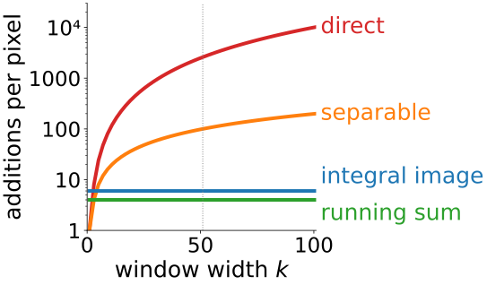
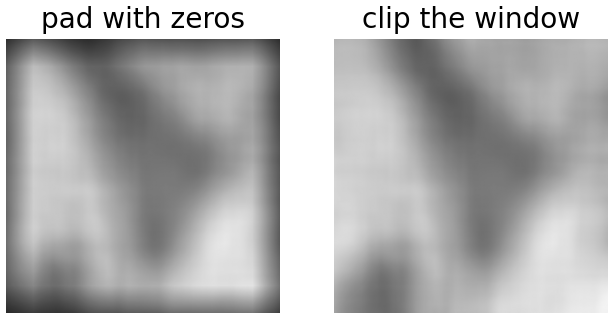
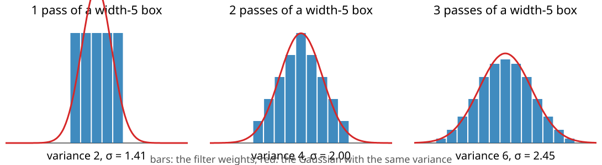
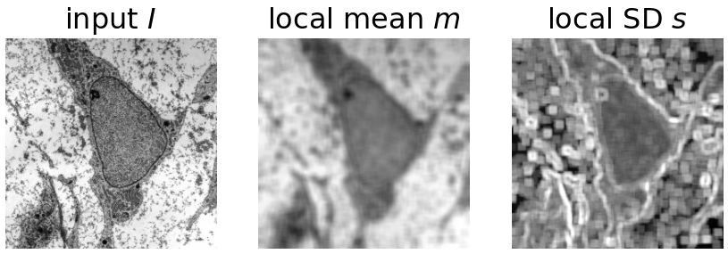
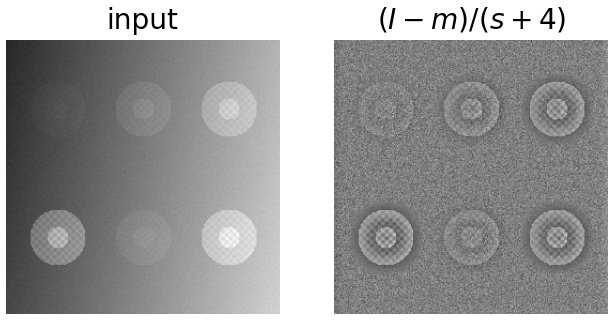
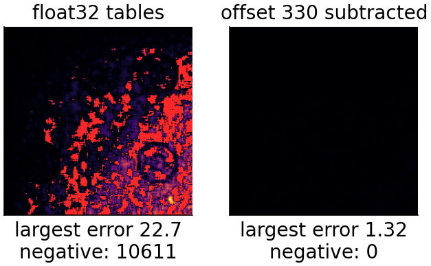

## About this lecture

Last unit: the integral image gives the sum over any rectangle from four lookups. Now we ask for it **at every pixel**.

- **Box filters of any size** at the same cost per pixel, and four ways to compute them.
- **Repeated boxes look like a Gaussian**: smoothing of any width at constant cost.
- **Local mean and standard deviation** from two tables, and **local contrast normalisation**.
- **Numbers that get too big**: how many bits the table needs, float32 rounding, and the trap in "mean of squares minus square of mean".

*Slides titled **The math** give the formulas and proofs; the ideas are complete without them.*

::: notes
Recalled, not re-taught: the box blur and border rules from the filtering unit (day 1); integer types, wrap-around, float32 and cancellation from the bit-depth day (day 3); the Gaussian from the edges day. The local thresholds that use the same mean and SD maps belong to the thresholding day.
:::

## The box filter, recalled

From the filtering unit: the **box blur** replaces each pixel by the **mean** of the $k \times k$ window around it (kernel "all ones $\div\, k^2$").

Four ways to compute it, for a window of width $k$:

:::: {.columns}
::: {.column width="62%"}
| method | idea | additions per pixel |
|---|---|---|
| direct | add the $k^2$ pixels | $k^2 - 1$ |
| separable | box along rows, then along columns | $2(k-1)$ |
| running sum | slide along a row: add the pixel entering, subtract the one leaving; then the same down columns | 4 |
| integral image | build the table (3), then four lookups (3) | 6 |

$k = 51$: 2600, 100, 4 and 6 additions per pixel.
:::
::: {.column width="38%"}
{width="100%" fig-alt="Additions per pixel against the window width k, log scale: direct grows as k squared, separable linearly, running sum (4) and integral image (6) stay flat. Dotted line: k = 51."}
:::
::::

## Why the integral image wins anyway

:::: {.columns}
::: {.column width="58%"}
The running sum is a little cheaper, but only for **one fixed square** window. The integral image is built **once** and then gives:

- **every window size** at the same cost: all scales of a feature stack from one table,
- **windows that change from pixel to pixel** (larger in flat regions, smaller near edges),
- **rectangles of any shape**, at any position, in any order (a detector asks for them at random),
- a **natural border rule**: clip the window to the image and divide by the number of pixels actually inside. No dark frame (unlike padding with zeros), no copied edge pixels.
:::
::: {.column width="42%"}
{width="100%" fig-alt="The micrograph blurred with a 51 × 51 box. Left: padding with zeros darkens a wide frame at the border. Right: clipping the window to the image and dividing by the pixels inside leaves no frame."}

[51 × 51 box mean. Micrograph: Robert M. Hunt, CC BY 3.0, via Wikimedia Commons.]{style="font-size: 0.7em; color: #666"}
:::
::::

## Try it: four ways to blur

```{=html}
<link rel="stylesheet" href="../demos/dist/demo.css">
<div data-demo="boxspeed" data-preset="slow"></div>
<script src="../demos/dist/boxspeed.js"></script>
```

::: notes
Left: the micrograph blurred with a k × k box (window clipped at the border). Middle: additions per pixel against k, log scale; the dots are the current k. The readout times all four methods on this computer (median of three runs, after the slider rests; direct is skipped above k = 51). Tour: preset "direct at k = 51": direct is two orders of magnitude slower than the others. Move k: red and orange grow, green and blue stay flat. "integral image: flat line" at k = 101. Point out that the timings are machine-dependent, the counts are not, and that all four images are identical.
:::

## Repeated boxes look Gaussian

{width="95%"}

- Box ∗ box = a **triangle** (width 3: weights $1, 2, 3, 2, 1$, divided by 9). Three boxes: already a smooth **bell**.
- Each pass adds the box's **variance**; the shape tends to a Gaussian (the central limit theorem: a sum of independent uniform shifts).
- Three passes are usually enough. In 2D, the square box becomes **nearly round** after 2–3 passes.
- So: a Gaussian blur of **any** width at constant cost per pixel ($3 \times 6$ additions).

## The math: variance of repeated boxes {.math}

A box of odd width $k$ is the uniform distribution on $\{-\tfrac{k-1}{2}, \dots, \tfrac{k-1}{2}\}$: mean 0, variance
$$\sigma_1^2 = \frac1k\sum_{j=-(k-1)/2}^{(k-1)/2} j^2 = \frac{k^2 - 1}{12}.$$

Convolving filters = adding independent random shifts, so **variances add**: $n$ passes have $\sigma^2 = n\,\frac{k^2-1}{12}$. To approximate a Gaussian of a given $\sigma$ with $n$ boxes, choose $k \approx \sqrt{12\sigma^2/n + 1}$ (Wells, 1986); e.g. $\sigma = 3$, $n = 3$: $k \approx 6.1$.

Fourier picture: the box's transform is a sinc, $n$ passes give $\text{sinc}^n$: close to a Gaussian near zero, with side lobes that shrink with $n$ (the edges day's Gaussian has none).

## Try it: repeated boxes

```{=html}
<div data-demo="boxspeed" data-preset="gauss"></div>
<script src="../demos/dist/boxspeed.js"></script>
```

::: notes
Tab "repeated boxes". Bars: the 1D weights of n passes of a width-k box; red: the Gaussian with the same variance. Lower left: the 2D weights in 8 bands, with a red contour of that Gaussian; upper left: the points image after n passes (each point becomes the 2D weights). Tour: "one box: square artefacts": each point becomes a square, difference to the Gaussian 45 %. n = 2: a pyramid (tent), 8 %. "three boxes": 6 %, the bands are nearly circles. n = 4: 3.5 %.
:::

## Local mean and local standard deviation

Two tables: one of $I$, one of $I^2$. For any window, four lookups each give

- the **local mean** $m$ = (sum of $I$) / (number of pixels): a blur;
- the **mean of the squares** $\overline{I^2}$ = (sum of $I^2$) / (number of pixels);
- the **local variance** $s^2 = \overline{I^2} - m^2$ and the **local standard deviation** $s$.

$s$ is small in flat regions and large at **edges** and in **textured** regions: a simple texture feature for every pixel. (Its counterpart for whole segmented objects is on the measurements day.)

::: {style="text-align: center"}
{width="62%" fig-align="center" fig-alt="The micrograph, its local mean (a blur) and its local standard deviation in a 9 × 9 window: the SD is bright along membranes and in the textured cytoplasm, dark inside the smooth nucleus."}
:::

[9 × 9 window. Transmission electron micrograph of a mesenchymal stem cell, Robert M. Hunt, CC BY 3.0, via Wikimedia Commons.]{style="font-size: 0.7em; color: #666; display: block; text-align: center"}

## The math: the variance identity {.math}

For the $n$ values in a window, with mean $m = \frac1n\sum I$:
$$s^2 = \frac1n\sum (I - m)^2 = \frac1n\sum I^2 - 2m\cdot\frac1n\sum I + m^2 = \overline{I^2} - m^2.$$

**Shift invariance**: for any constant $c$, $\operatorname{Var}(I - c) = \operatorname{Var}(I)$, so the tables can be built from $I - c$ instead of $I$ (useful below).

Exact two-pass alternative (no tables): compute $m$ first, then $\frac1n\sum (I - m)^2$. It never goes negative, but costs $O(k^2)$ per pixel.

## Local contrast normalisation

:::: {.columns}
::: {.column width="58%"}
$$\frac{I - m}{s + \varepsilon}$$

- Subtract the local mean, divide by the local standard deviation: a faint region and a bright, contrasty region look **alike**.
- The **window size** decides what counts as "local": larger than the objects, smaller than the illumination changes.
- $\varepsilon$ stops the **noise** in flat background from being blown up (there $s$ is just the noise level).
- The same two maps $m$ and $s$ give the local thresholds of Niblack and Sauvola: **the thresholding day**. The detector of unit 4 normalises every window by its $s$ in the same way.
:::
::: {.column width="42%"}
{width="100%" fig-alt="Synthetic image: six cells with contrasts from faint to strong on a brightness gradient. After contrast normalisation with a 17 × 17 window and epsilon 4, all six cells look about equally strong and the gradient is gone."}

[Synthetic image of the demo, 17 × 17 window.]{style="font-size: 0.7em; color: #666"}
:::
::::

## Try it: local statistics

```{=html}
<div data-demo="localstats" data-preset="equalise"></div>
<script src="../demos/dist/localstats.js"></script>
```

::: notes
Synthetic image: six "cells" with contrasts 6 to 60 grey levels on a gradient, noise SD 3. Panels: input (orange line = the profile row; click to move it), local mean, local SD, contrast-normalised. Right: the profile with I, m and the band m ± s. Tour: "normalisation equalises the cells": in the normalised image the faint cells look as strong as the bright ones. Window r: small windows make s follow the noise; large ones blur m. "ε = 0": the flat background turns into amplified noise. "micrograph": the SD map highlights membranes and texture.
:::

## Numbers that get too big

The last table entry is the **sum of the whole image**. Bits needed: bit depth + $\log_2$(number of pixels).

- 8-bit, $1024 \times 1024$: $8 + 20 = 28$ bits; fits a 32-bit integer. The table of $I^2$: $16 + 20 = 36$ bits; does not.
- 16-bit, $2048 \times 2048$: $16 + 22 = 38$ bits already for $I$.
- **Wrap-around can be fine** (bit-depth day: unsigned integers wrap modulo $2^{32}$): the table entries are wrong, but $D - B - C + A$ is still the **right rectangle sum** as long as the **rectangle's** sum fits in 32 bits. The errors cancel.
- **float32** stores integers exactly only up to $2^{24} \approx 1.7 \cdot 10^7$. The sum of a $256 \times 256$ 8-bit image ($\le 16\,711\,680$) just fits; $512 \times 512$ does not. Far from the top-left corner the entries are large and a small difference of two large rounded numbers is noisy.

## The cancellation trap

:::: {.columns}
::: {.column width="58%"}
$s^2 = \overline{I^2} - m^2$ subtracts two **large, nearly equal** numbers (bit-depth day: catastrophic cancellation).

- Bright, flat region: values 199, 200, 201. $\overline{I^2} = 40\,000.67$, $m^2 = 40\,000$: the answer, $0.67$, is in the fifth digit.
- With 4 significant digits: $40\,000 - 40\,000 = 0$. With float32 tables over a large image: wrong, even **negative** variances.
- Fixes:
  - **subtract an offset** (the global mean or mid-grey) before building the tables: the variance does not change, the numbers get small;
  - **integer** tables (exact, wrap-around allowed);
  - **float64**.
:::
::: {.column width="42%"}
{width="100%" fig-alt="Error of the local standard deviation from float32 tables, synthetic image plus 200, 7 × 7 window. Without an offset: errors up to 22.7 growing towards the bottom right, and 10 611 negative variances in red. With the mean 330 subtracted first: largest error 1.32, none negative."}

[Error of the local SD (black: 0, yellow: 22.7; red: variance < 0). Synthetic image + 200, 7 × 7 window, as in the demo.]{style="font-size: 0.7em; color: #666"}
:::
::::

## Try it: precision

```{=html}
<div data-demo="localstats" data-preset="negative"></div>
<script src="../demos/dist/localstats.js"></script>
```

::: notes
Tab "precision": the same image plus 200 (bright), window 7 × 7. Panels: the SD from tables in the chosen number type, the exact SD, and the error (red = negative variance). Tour: float32, +200: largest error 22.7, 10 611 negative variances; errors grow towards the bottom right, where the table entries are largest. "subtract the offset": largest error 1.32, none negative. Then 1024 × 1024 with the offset: errors again (the sum of squares exceeds 2^24 even after the shift). "32-bit integers": the stored last entry has wrapped (4.26e9 instead of 1.16e11), yet the SD is exact.
:::

## The math: why wrapped sums are right {.math}

Unsigned 32-bit arithmetic computes everything **modulo** $2^{32}$. Each stored entry is $\tilde S = S \bmod 2^{32}$, and
$$\tilde D - \tilde B - \tilde C + \tilde A \equiv D - B - C + A \pmod{2^{32}}.$$
If the true rectangle sum $R = D - B - C + A$ satisfies $0 \le R < 2^{32}$, the residue **is** $R$.

Rough float error bound: each float32 entry carries a rounding error of about $2^{-24}\times$ its size. An entry at $(x, y)$ is about $x\,y\,\bar I$, so the error of a window mean is about $2^{-24}\,x\,y\,\bar I / k^2$: it **grows** with the distance from the origin and **shrinks** with the window area. The variance error is that of $\overline{I^2}$, about $2^{-24}\,x\,y\,\overline{I^2}/k^2$, compared with $s^2$ itself.

## Summary

- Box filters of **any size** cost 6 additions per pixel with the integral image (direct: $k^2 - 1$); any window size, shape or position, with a natural border rule.
- **Repeated boxes** ≈ Gaussian: variances add, $n(k^2 - 1)/12$; three passes are usually enough.
- Two tables ($I$ and $I^2$) give the **local mean and standard deviation** anywhere; $(I - m)/(s + \varepsilon)$ **normalises contrast**.
- The table needs **bit depth + $\log_2$(pixels)** bits; wrapped integer sums are still right; float32 rounds above $2^{24}$.
- $\overline{I^2} - m^2$ **cancels**: subtract an offset, or use integers or float64.
