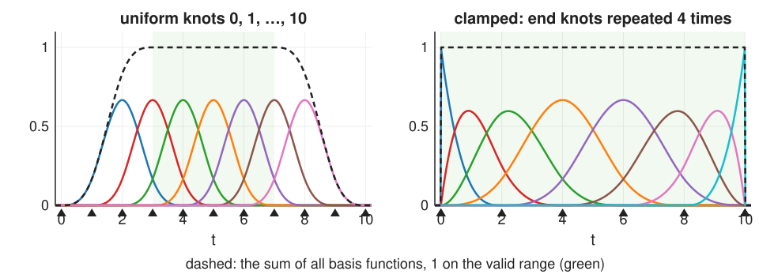
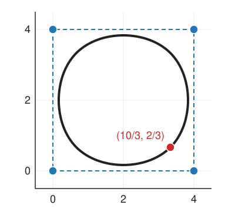
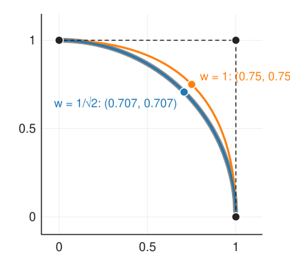

## Goal

By the end of this exercise you should be able to:

- explain B-splines as a **basis of bumps** (convolutions of boxes on uniform knots) and evaluate a uniform cubic B-spline curve at a knot,
- predict which part of a curve moves when one control point moves (**local control**),
- use knot multiplicity, clamped and closed knot vectors on purpose,
- compute a point of a **rational** (NURBS) curve and check that a quadratic with weights $1, \tfrac{1}{\sqrt2}, 1$ is an exact quarter circle,
- *(math)* apply Cox–de Boor by hand and prove partition of unity and the circle property.

Do the pen-and-paper part first, then the two demos.

## Background

| Idea | What it means |
|---|---|
| B-spline curve | $\mathbf{C}(t) = \sum_i \mathbf{P}_i N_{i,p}(t)$, degree $p$, knots $t_0 \le t_1 \le \dots$ |
| Uniform cubic bump | $\beta^3$: values $\tfrac16, \tfrac46, \tfrac16$ at the integers, support 4 intervals |
| Partition of unity | $N_{i,p} \ge 0$, $\sum_i N_{i,p}(t) = 1$ on the valid range |
| Local control | $\mathbf{P}_i$ affects only $[t_i, t_{i+p+1})$: $p + 1$ spans |
| Knot multiplicity $m$ | continuity $C^{p-m}$ at that knot |
| Clamped | end knots repeated $p + 1$ times: curve starts/ends at the end control points |
| NURBS | $\mathbf{C}(t) = \sum_i w_i\mathbf{P}_iN_i(t) / \sum_i w_iN_i(t)$: lift to $(wx, wy, w)$, B-spline, divide |
| Cox–de Boor | $N_{i,p} = \frac{t - t_i}{t_{i+p} - t_i}N_{i,p-1} + \frac{t_{i+p+1} - t}{t_{i+p+1} - t_{i+1}}N_{i+1,p-1}$ |

## By hand

**B1.** **Corner cutting.** A closed uniform cubic B-spline with control points $(0, 0), (4, 0), (4, 4), (0, 4)$.
(a) Compute the curve point at the knot of each control point.
(b) Halfway between two knots the weights of the 4 active control points are $\tfrac{1}{48}, \tfrac{23}{48}, \tfrac{23}{48}, \tfrac{1}{48}$. Compute the curve point halfway between the knots of $(4, 0)$ and $(4, 4)$.
(c) Is the curve inside the square? Does it touch the sides? Is it a circle?

**B2.** **Local control.** An open cubic B-spline with control points $\mathbf{P}_0, \dots, \mathbf{P}_9$ on uniform knots $0, 1, \dots, 13$; the curve is defined for $t \in [3, 10]$.
(a) On which parameter interval is $N_{5,3}$ non-zero? Which spans change when $\mathbf{P}_5$ moves?
(b) Which control points influence the curve point at $t = 6.5$?
(c) Which part of the curve does $\mathbf{P}_0$ influence?

**B3.** **Interpolators as B-splines.** Samples $f_0, f_1, f_2, \dots$ at the integers are used directly as control values: $f(x) = \sum_k f_k\beta^p(x - k)$.
(a) Which $p$ gives nearest-neighbour, which linear interpolation?
(b) For $p = 3$ and the samples $0, 0, 6, 0, 0$ (the 6 at $k = 2$): compute $f(1), f(2), f(3)$ and $f(2.5)$. Does the curve pass through the samples?
(c) What does this mean for using the cubic B-spline to interpolate an image directly?

**B4.** **The quarter circle.** Control points $(1, 0), (1, 1), (0, 1)$, a quadratic clamped B-spline (here the same as a quadratic Bézier, weights at $t$: $(1-t)^2, 2t(1-t), t^2$).
(a) With all weights 1, compute $\mathbf{C}(\tfrac12)$ and its distance from the origin.
(b) With weights $1, \tfrac{1}{\sqrt2}, 1$: lift, evaluate at $t = \tfrac12$, divide. Distance from the origin?
(c) With weight $w$ on the middle point, find $\mathbf{C}(\tfrac12)$ as a function of $w$. Which $w$ pulls the curve through $(0.8, 0.8)$?

**B5.** **Knots on purpose.** For each task, choose a knot vector property (uniform, double knot, triple knot, clamped, closed):
(a) a smooth cell outline; (b) a profile that must start and end exactly at the first and last measured point; (c) an outline with one sharp corner (a cut edge); (d) a path whose direction must stay continuous everywhere, but whose curvature may jump at one junction.

::: {.callout-note collapse="true" title="Solutions"}
**B1.** (a) $\tfrac16[\mathbf{P}_{i-1} + 4\mathbf{P}_i + \mathbf{P}_{i+1}]$: at $(0,0)$: $\tfrac16[(0,4) + 4(0,0) + (4,0)] = (\tfrac23, \tfrac23)$; at $(4, 0)$: $(\tfrac{10}{3}, \tfrac23)$; at $(4,4)$: $(\tfrac{10}{3}, \tfrac{10}{3})$; at $(0, 4)$: $(\tfrac23, \tfrac{10}{3})$. (b) Active points $(0,0), (4,0), (4,4), (0,4)$ with weights $\tfrac1{48}, \tfrac{23}{48}, \tfrac{23}{48}, \tfrac1{48}$: $x = \tfrac{1}{48}(0 + 92 + 92 + 0) = 3.833$, $y = \tfrac{1}{48}(0 + 0 + 92 + 4) = 2$: $(3.833, 2)$. (c) Inside (convex hull), never touching the sides (the closest is 0.167 from each side at the midpoints); not a circle: the distance from the centre $(2, 2)$ is 1.886 at the knots and 1.833 at the midpoints.

**B2.** (a) $[t_5, t_9) = [5, 9)$: the 4 spans $[5,6], [6,7], [7,8], [8,9]$. (b) In the span $[6, 7)$ the non-zero functions are $N_{3,3}, \dots, N_{6,3}$: control points $\mathbf{P}_3, \mathbf{P}_4, \mathbf{P}_5, \mathbf{P}_6$. (c) $N_{0,3}$ lives on $[0, 4)$, of which only $[3, 4)$ is in the valid range: only the first span.

**B3.** (a) $p = 0$: nearest neighbour; $p = 1$: linear. (b) $f(1) = 6 \cdot \tfrac16 = 1$, $f(2) = 6 \cdot \tfrac46 = 4$, $f(3) = 1$, $f(2.5) = 6\beta^3(0.5) = 6 \cdot \tfrac{23}{48} = 2.875$. It does not pass through the samples: the peak 6 becomes 4. (c) Used directly, the cubic B-spline blurs the image (like a $\tfrac16[1\;4\;1]$ filter); to interpolate, the control values must first be computed from the samples (unit 4's prefilter).

**B4.** (a) $\tfrac14(1, 0) + \tfrac12(1, 1) + \tfrac14(0, 1) = (0.75, 0.75)$; distance $0.75\sqrt2 = 1.061$. (b) Lifted points $(1, 0, 1)$, $(0.7071, 0.7071, 0.7071)$, $(0, 1, 1)$; sum with weights $\tfrac14, \tfrac12, \tfrac14$: $(0.6036, 0.6036, 0.8536)$; divide: $(0.7071, 0.7071)$, distance 1.000. (c) $\mathbf{C}(\tfrac12) = \frac{\frac14(1, 0) + \frac{w}{2}(1, 1) + \frac14(0, 1)}{\frac12 + \frac{w}{2}} = \frac{(1 + 2w)}{2(1 + w)}(1, 1)$. Through $(0.8, 0.8)$: $\frac{1 + 2w}{2 + 2w} = 0.8$, so $1 + 2w = 1.6 + 1.6w$, $w = 1.5$.

**B5.** (a) Closed, uniform. (b) Clamped. (c) Closed with a triple knot at the corner (C⁰ there). (d) A double knot at the junction: C¹ there (direction continuous, curvature may jump), C² elsewhere.
:::

### Math questions

**B6.** *(math)* **Cox–de Boor by hand** on uniform knots $0, 1, 2, 3$: compute $N_{0,1}$ and $N_{0,2}$ as formulas on each interval, and check $N_{0,2}(1) = \tfrac12$, $N_{0,2}(1.5) = \tfrac34$.

**B7.** *(math)* Prove the partition of unity $\sum_i N_{i,1}(t) = 1$ and $\sum_i N_{i,2}(t) = 1$ on the valid range for uniform knots. Sketch the induction step for general $p$.

**B8.** *(math)* Show that $\beta^1 = \beta^0 * \beta^0$ (the box convolved with itself is the hat). What is $\beta^1 * \beta^0$ on $[-\tfrac12, \tfrac12]$?

**B9.** *(math)* Show that the rational quadratic with control points $(1,0), (1,1), (0,1)$ and weights $1, \tfrac{1}{\sqrt2}, 1$ satisfies $x(t)^2 + y(t)^2 = 1$ for all $t \in [0, 1]$.

**B10.** *(math)* Show that a clamped cubic B-spline with exactly 4 control points (knots $0,0,0,0,1,1,1,1$) is the cubic Bézier curve of the same points.

::: {.callout-note collapse="true" title="Solutions (math)"}
**B6.** $N_{0,0} = 1$ on $[0,1)$, $N_{1,0}$ on $[1, 2)$, $N_{2,0}$ on $[2, 3)$. $N_{0,1} = t\,N_{0,0} + (2 - t)N_{1,0}$: $t$ on $[0, 1)$, $2 - t$ on $[1, 2)$ (the hat). $N_{1,1}$: $t - 1$ on $[1, 2)$, $3 - t$ on $[2, 3)$. $N_{0,2} = \frac{t}{2}N_{0,1} + \frac{3 - t}{2}N_{1,1}$: $\tfrac12 t^2$ on $[0,1)$; $\tfrac12 t(2 - t) + \tfrac12(3 - t)(t - 1)$ on $[1, 2)$; $\tfrac12(3 - t)^2$ on $[2, 3)$. At $t = 1$: $\tfrac12$. At $t = 1.5$: $\tfrac12(1.5)(0.5) + \tfrac12(1.5)(0.5) = 0.75$.

**B7.** Degree 1: on $[k, k+1)$ only $N_{k-1,1} = k + 1 - t$ and $N_{k,1} = t - k$ are non-zero; they sum to 1. Degree 2 on uniform knots: on $[k, k+1)$ with $u = t - k$, the three non-zero functions are $\tfrac12(1 - u)^2$, $\tfrac12 + u - u^2$ (the middle piece above, shifted), $\tfrac12 u^2$: sum $\tfrac12(1 - 2u + u^2) + \tfrac12 + u - u^2 + \tfrac12u^2 = 1$. Induction: write $\sum_i N_{i,p}$ with Cox–de Boor; collect the two terms that contain the same $N_{j,p-1}$: the factor is $\frac{t - t_j}{t_{j+p} - t_j} + \frac{t_{j+p} - t}{t_{j+p} - t_j} = 1$, so $\sum_i N_{i,p} = \sum_j N_{j,p-1} = 1$.

**B8.** $(\beta^0 * \beta^0)(x) = \int \beta^0(u)\beta^0(x - u)\,du$ = the length of the overlap of $[-\tfrac12, \tfrac12]$ and $[x - \tfrac12, x + \tfrac12]$ = $1 - |x|$ for $|x| \le 1$, 0 otherwise: the hat. $(\beta^1 * \beta^0)(x) = \int_{x - 1/2}^{x + 1/2}(1 - |u|)\,du$; for $|x| \le \tfrac12$: $1 - \int_{x-1/2}^{x+1/2}|u|\,du = 1 - \tfrac12[(x + \tfrac12)^2 + (\tfrac12 - x)^2] = \tfrac34 - x^2$, the middle piece of $\beta^2$.

**B9.** With $a = 1 - t$, $b = t$, $c = \sqrt2\,ab$: numerator $a^2(1, 0) + 2ab\frac{1}{\sqrt2}(1, 1) + b^2(0, 1) = (a^2 + c, c + b^2)$, denominator $D = a^2 + c + b^2$. $(a^2 + c)^2 + (b^2 + c)^2 = a^4 + b^4 + 2c(a^2 + b^2) + 2c^2$ and $D^2 = a^4 + b^4 + 2a^2b^2 + 2c(a^2 + b^2) + c^2$. The difference is $c^2 - 2a^2b^2 = 2a^2b^2 - 2a^2b^2 = 0$, so $x^2 + y^2 = 1$.

**B10.** With knots $0,0,0,0,1,1,1,1$ Cox–de Boor gives, on $[0, 1)$: $N_{3,0} = 1$; then $N_{2,1} = 1 - t$, $N_{3,1} = t$ (the other ramps have $0/0$); then $N_{1,2} = (1-t)^2$, $N_{2,2} = 2t(1 - t)$, $N_{3,2} = t^2$; and $N_{i,3} = \binom{3}{i}t^i(1 - t)^{3 - i}$: the Bernstein polynomials. (Equivalently: de Boor's fractions all equal $t$, which is de Casteljau.)
:::

## Explore: the basis functions {#explore-bsplinebasis}

{width="85%" fig-align="center"}

All basis functions $N_{i,p}$ of a knot vector (triangles, draggable along the axis; drop one on its neighbour to make a double knot). The selected function is thick; the dashed line is the sum of all functions, 1 on the green valid range. The lower panel shows the **Cox–de Boor tower** of the selected function at level $q$; "boxes" overlays the uniform kernel $\beta^p$.

```{=html}
<link rel="stylesheet" href="../demos/dist/demo.css">
<div data-demo="bsplinebasis" data-preset="deg0"></div>
<script src="../demos/dist/bsplinebasis.js"></script>
```

**D1.** Preset **degree 0 → 3: boxes**. Step the degree from 0 to 3. How many intervals does each function cover at each degree? Does the dotted kernel always lie on the selected function?

**D2.** Preset **uniform cubic**. Set the tower level $q$ to 0, 1, 2, 3 and describe how the selected function is built.

**D3.** Preset **double knot**, then **triple knot**. What happens to the selected function at $t = 5$? Read the continuity in the readout.

**D4.** Preset **uneven knots**. Do the functions still sum to 1? Does the dotted kernel ("boxes") still match the selected function?

**D5.** Preset **clamped ends**. What is special about the first and last function at the ends? Why does this make the curve start at $\mathbf{P}_0$?

::: {.callout-note collapse="true" title="Solutions"}
**D1.** Degree $p$ covers $p + 1$ intervals: 1, 2, 3, 4. On uniform knots the dotted $\beta^p$ (a box convolved $p$ times) lies exactly on the selected function at every degree.

**D2.** Level 0: four boxes, one per interval of the support. Level 1: three hats, each the blend of two neighbouring boxes with a rising and a falling ramp (dashed). Level 2: two quadratics. Level 3: the cubic itself. Each level blends neighbours with ramps and widens the support by one interval.

**D3.** Double knot: the function has a kink in the slope at $t = 5$ (C¹ for degree 3; readout "knot 5 ×2: C¹"). Triple knot: a corner (C⁰), the function reaches its peak at the knot with a sharp tip. Other functions also change; the sum stays 1.

**D4.** Yes, the sum is still 1 on the valid range. The kernel no longer matches: on uneven knots the bumps have different widths and heights and are not shifted copies of one bell.

**D5.** The first function is 1 at $t = 0$ and all others are 0 there, so $\mathbf{C}(0) = \mathbf{P}_0$ (likewise at the end). Uniform (open) knots never reach 1 at the end of the valid range.
:::

## Explore: B-spline and NURBS curves {#explore}

{width="32%"} {width="34%"}

One control polygon (drag points; add and delete), drawn as a B-spline of degree 1–5 (open, clamped or closed knots) and, in the small panel, as one Bézier curve through the same points. While you drag, the orange part of each curve is what changes (dashed: before). Select a point to change its **weight** (NURBS). Toggles: curvature comb, knots (red squares), convex hulls of the spans. Circle presets show the radius error.

```{=html}
<link rel="stylesheet" href="../demos/dist/demo.css">
<div data-demo="bsplinecurve" data-preset="local"></div>
<script src="../demos/dist/bsplinecurve.js"></script>
```

**E1.** Preset **local vs global**. Drag $\mathbf{P}_4$. How many spans change in the B-spline, and how much of the Bézier? Change the degree to 1, 2, 5 and drag again.

**E2.** Preset **corner cutting on a square**. Check B1(a) with the readout (select each point). Tick **convex hulls of spans**: which hull contains each piece?

**E3.** Preset **closed outline**, comb on. Where is the curvature largest? Drag one point outwards: does the comb change on the far side?

**E4.** Preset **triple knot: corner**. Where is the corner? Move $\mathbf{P}_2$ and $\mathbf{P}_4$: does the corner stay sharp? Now press "clamped" (which replaces the knots by simple ones): what happens?

**E5.** Preset **weight 1: not a circle**, then move the weight slider of $\mathbf{P}_1$ until the radius error is smallest. Which weight do you find? Then preset **full circle from 9 points**: what is the radius error?

**E6.** The three conic presets ($w = 0.4, 1, 2.5$). Read the curve point at the bump centre of $\mathbf{P}_1$ in each. Which curve is closest to $\mathbf{P}_1$?

::: {.callout-note collapse="true" title="Solutions"}
**E1.** B-spline (clamped cubic): 4 spans ($\mathbf{P}_4$'s bump covers $t \in [1, 5]$); the ends stay. Bézier: the whole curve. Degree 1: the B-spline is the polygon itself, 2 spans move; degree 2: 3 spans; degree 5: 6 spans (with only 8 points, almost everything).

**E2.** At the bump centres: $(\tfrac{10}{3}, \tfrac23)$, $(\tfrac{10}{3}, \tfrac{10}{3})$, $(\tfrac23, \tfrac{10}{3})$, $(\tfrac23, \tfrac23)$ (readout (3.333, 0.667) etc.). Each span lies in the convex hull of its 4 control points, which for a 4-point closed curve is the whole square.

**E3.** At the bends where the polygon turns most sharply: largest near $\mathbf{P}_4 = (3, 4)$ (curvature 1.62 at its bump centre), then $\mathbf{P}_2$ (0.80); near $\mathbf{P}_3 = (2, 1.5)$ the curve bends the other way (−1.00, the comb flips to the other side: a dent). Dragging one point changes the comb only on the 4 spans around it; the far side is unchanged. (The total curvature stays $2\pi$ while the curve does not cross itself.)

**E4.** At $\mathbf{P}_3 = (0.5, 0)$, which the curve passes through (with tangents $(4.5, -9)$ and $(4.5, 9)$ on either side). Moving $\mathbf{P}_2$ and $\mathbf{P}_4$ changes the angle of the corner, but it stays a corner. With simple clamped knots the corner disappears: the curve is C² again and no longer touches $\mathbf{P}_3$.

**E5.** About $w = 0.71$: on the slider's steps the best is 0.708 (error 0.02 %; 0.700 and 0.716 give 0.18 % and 0.22 %); exactly $1/\sqrt2 = 0.7071$ (the preset "quarter circle: weight 1/√2") gives 0.00 %. The full circle has radius 3.0000 … 3.0000: error 0.00 %.

**E6.** $w = 0.4$: $(0, -0.571)$; $w = 1$: $(0, 0.5)$; $w = 2.5$: $(0, 1.571)$. The larger the weight, the closer the curve is pulled to $\mathbf{P}_1 = (0, 3)$. (The curve point at $t = \tfrac12$ is $\frac{w}{1 + w}\mathbf{P}_1 + \frac{1}{1 + w}\cdot\frac{\mathbf{P}_0 + \mathbf{P}_2}{2}$.)
:::

## Where this leads

So far the control points were given. Unit 3 asks where they should be when we have **data**: through noisy points, near them, or smoothly in between, and uses closed B-splines to measure **outlines**. Unit 4 uses the tensor-product cubic B-spline on **images** (interpolation and free-form deformation).
