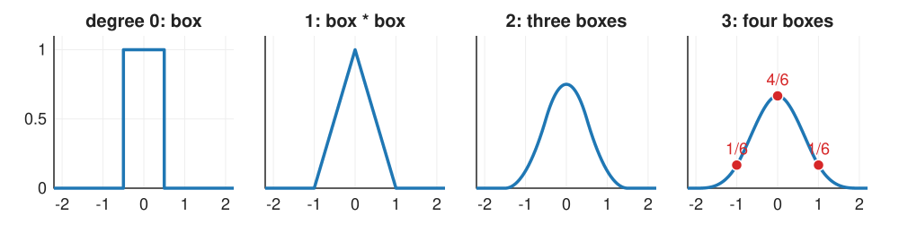
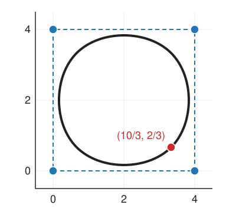
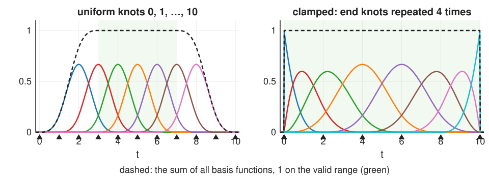
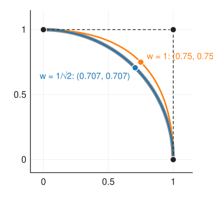

## About this lecture

The [previous unit](../bezier/lec.qmd) ended with a wish: smoothness and local control **built in**, not kept by hand. B-splines deliver both.

- A curve as a **sum of bump functions** times control points: the B-spline **basis**.
- Bumps by **convolution**: box, hat, smooth bell (nearest, linear, cubic).
- **Knots**: where pieces join; **partition of unity**, **local control**, corner cutting.
- **Knot multiplicity**, clamped and closed curves; **Cox–de Boor** as a picture.
- **NURBS**: weights, homogeneous coordinates, and **exact circles**.
- Spline **surfaces**, briefly.

*Slides titled **The math** give the formulas and proofs; the ideas are complete without them.*

::: notes
Convention for the whole day: degree p (cubic = 3), n control points, knot vector t_0 ≤ t_1 ≤ …; uniform knots are 0, 1, 2, …. The cubic B-spline β³ centred at 0 is the kernel used again in unit 4 (image interpolation, free-form deformation).
:::

## A basis of bumps

Write the curve as control points times **basis functions**:
$$\mathbf{C}(t) = \sum_i \mathbf{P}_i\,N_i(t).$$

- Bézier did this too, with the Bernstein polynomials, but each of them is non-zero on the **whole** curve.
- Now choose bump-shaped $N_i$ that are non-zero only on a **short interval** and overlap only with their neighbours. Then $\mathbf{P}_i$ moves only the part of the curve under its bump.
- The control points are the **coordinates** of the curve in this basis, like the Fourier coefficients of a signal in the basis of waves ([Fourier unit](../fourier/lec.qmd)).

Which bumps? Ones that are smooth, sum to 1, and are cheap to evaluate.

## Bumps by convolution

{width="100%" fig-align="center"}

Recall from the [filtering unit](../kernels/lec.qmd): convolving two kernels gives a new kernel.

- Degree 0: a **box** of width 1. As an interpolator: **nearest neighbour**.
- Degree 1: box * box = a **hat** (triangle). As an interpolator: **linear**.
- Degree 3: four boxes = a smooth **bell** of width 4, the **cubic B-spline** β³. Its values at the integers: $\tfrac16, \tfrac46, \tfrac16$.

Each extra box makes the bump one order smoother: the hat is continuous, the quadratic has a continuous slope, the cubic a continuous second derivative (C²).

## The math: uniform B-splines {.math}

$\beta^0$ = the box on $[-\tfrac12, \tfrac12)$, and $\beta^p = \beta^0 * \beta^{p-1}$. The cubic in closed form:
$$\beta^3(x) = \begin{cases} \tfrac23 - x^2 + \tfrac12|x|^3, & |x| \le 1,\\ \tfrac16(2 - |x|)^3, & 1 \le |x| \le 2,\\ 0 & \text{otherwise.}\end{cases}$$

- Each piece is a cubic polynomial; at $|x| = 1$ and $2$ the value, slope and second derivative agree (C²). $\beta^3(0) = \tfrac23$, $\beta^3(\pm1) = \tfrac16$, $\beta^3(\pm\tfrac12) = \tfrac{23}{48}$.
- Fourier transform (convolution → product): $\hat\beta^p(\omega) = \operatorname{sinc}^{p+1}(\omega/2\pi)$, a better and better low-pass as $p$ grows (unit 4).
- Shifted copies sum to 1: $\sum_k \beta^p(x - k) = 1$ for all $x$ (true for the box, and convolution with $\beta^0$, which has integral 1, keeps it).

## Uniform cubic B-spline curves

With uniform knots every basis function is a shifted copy of the same bell: $N_i(t) = \beta^3(t - i)$ (up to a shift of the parameter).

- At any $t$, only **4 bells** are non-zero: each curve point is a **weighted average of 4 neighbouring control points**.
- At a knot the weights are $\tfrac16, \tfrac46, \tfrac16$: the curve point is $(\mathbf{P}_{i-1} + 4\mathbf{P}_i + \mathbf{P}_{i+1})/6$.

:::: {.columns}
::: {.column width="62%"}
**Corner cutting** by hand: a closed cubic on the square $(0,0), (4,0), (4,4), (0,4)$. At the knot of $(4, 0)$:
$$\tfrac16\big[(0,0) + 4\,(4,0) + (4,4)\big] = (\tfrac{10}{3}, \tfrac23).$$
Inside the square: the curve does **not** pass through its control points; it cuts the corners.
:::
::: {.column width="38%"}
{width="100%"}
:::
::::

## Partition of unity and local control

{width="88%" fig-align="center"}

- The bumps are **non-negative** and **sum to 1** (dashed): every curve point is a convex combination of nearby control points; the curve lies in the union of the convex hulls of each 4 neighbours; moving all points by the same vector moves the curve by it.
- **Local control**: a cubic $N_i$ is non-zero on 4 knot intervals (**spans**). Moving $\mathbf{P}_i$ changes those 4 spans only, however many control points there are.
- **Smoothness for free**: the curve is as smooth as the bumps (C² for cubics), whatever the control points do.

## Try it: the basis functions

```{=html}
<link rel="stylesheet" href="../demos/dist/demo.css">
<div data-demo="bsplinebasis" data-preset="uniform"></div>
<script src="../demos/dist/bsplinebasis.js"></script>
```

::: notes
Top: all basis functions N_i,p for the knots (triangles; drag them); the selected one is thick; dashed: their sum, 1 on the valid range (green). Bottom: the Cox–de Boor tower of the selected function at level q. Tour: "uniform cubic": 7 cubic bumps on knots 0…10, each spanning 4 intervals, sum 1 on [3, 7]. "degree 0 → 3: boxes": step the degree buttons 0, 1, 2, 3 with "boxes" on: the dotted kernel β^p (box convolved p times) lies exactly on the selected function. "clamped ends": first and last functions reach 1 at the ends. "double knot": at t = 5 the selected function has a kink (C¹); "triple knot": a corner (C⁰). "uneven knots": the bumps get different widths and heights, the sum stays 1. Drag a knot onto its neighbour to double it.
:::

## Knots: multiplicity, clamped and closed curves

The **knot vector** lists where the pieces join, in order: $t_0 \le t_1 \le \dots$. Uniform: $0, 1, 2, \dots$

- **Repeating a knot** reduces the smoothness there: a cubic is C² at a simple knot, C¹ at a double knot, C⁰ (a possible corner) at a triple knot. Corners where you want them, smooth elsewhere.
- **Clamped** (end knots repeated $p + 1$ times): the curve starts at the first and ends at the last control point, tangent to the end legs, like Bézier. A clamped cubic with **4** control points **is** the cubic Bézier curve.
- **Closed** (periodic): wrap the control polygon around; every point has a full set of neighbours. This is the natural representation of an **outline** (unit 3).

## Cox–de Boor as a picture

How to compute a basis function on any knot vector: build it from the degree below.

- Degree 0: $N_{i,0}$ is 1 on the interval $[t_i, t_{i+1})$, 0 elsewhere (a box).
- Degree $p$: blend two neighbouring degree-$(p-1)$ functions with **ramps**: the left one times a ramp rising from 0 to 1 across its support, the right one times a ramp falling from 1 to 0.
- Each level widens the support by one interval and adds one order of smoothness.

The demo's lower panel shows this tower for one function: boxes → hats → quadratics → the cubic, with the ramps dashed. On uniform knots, the blend of two shifted copies with ramps is the same as convolving with one more box.

## The math: Cox–de Boor and continuity {.math}

$$N_{i,0}(t) = \begin{cases}1 & t_i \le t < t_{i+1}\\ 0 & \text{otherwise}\end{cases},\qquad N_{i,p}(t) = \frac{t - t_i}{t_{i+p} - t_i}N_{i,p-1}(t) + \frac{t_{i+p+1} - t}{t_{i+p+1} - t_{i+1}}N_{i+1,p-1}(t)$$
with $0/0 := 0$.

- **Support** $[t_i, t_{i+p+1})$: $p + 1$ intervals. **Non-negative** by induction (both ramps are ≥ 0 on the support).
- **Partition of unity** on $[t_p, t_{n}]$: by induction; the two ramps belonging to the same $N_{j,p-1}$ (one from $N_{j-1,p}$, one from $N_{j,p}$) add up to 1.
- By hand on knots $0, 1, 2, 3$: $N_{0,1}(t)$ is the hat on $[0, 2]$; $N_{0,2}(1) = \tfrac12$, $N_{0,2}(1.5) = \tfrac34$.
- **Continuity**: at a knot of multiplicity $m$ the curve is $C^{p - m}$.

## The math: derivatives and de Boor's algorithm {.math}

**Derivative.** The derivative of a B-spline curve of degree $p$ is a B-spline curve of degree $p - 1$ on the same knots (without the end ones), with control points
$$\mathbf{Q}_i = p\,\frac{\mathbf{P}_{i+1} - \mathbf{P}_i}{t_{i+p+1} - t_{i+1}}.$$
Uniform knots: $\mathbf{Q}_i = p(\mathbf{P}_{i+1} - \mathbf{P}_i)$, the scaled legs, as for Bézier.

**De Boor's algorithm** evaluates $\mathbf{C}(t)$ in the span $[t_s, t_{s+1})$ by repeated linear interpolation of the $p + 1$ control points $\mathbf{P}_{s-p}, \dots, \mathbf{P}_s$, like de Casteljau, but with knot-dependent fractions:
$$\mathbf{P}^{(r)}_j = (1 - \alpha)\,\mathbf{P}^{(r-1)}_{j-1} + \alpha\,\mathbf{P}^{(r-1)}_j,\qquad \alpha = \frac{t - t_j}{t_{j+p+1-r} - t_j}.$$
On clamped knots with $p + 1$ control points all fractions are $t$: de Casteljau.

## Try it: local and global

```{=html}
<link rel="stylesheet" href="../demos/dist/demo.css">
<div data-demo="bsplinecurve" data-preset="local"></div>
<script src="../demos/dist/bsplinecurve.js"></script>
```

::: notes
Left: the B-spline (clamped cubic, 8 points); right: one Bézier of degree 7 through the same polygon. Drag P4: in orange, the part that changes; dashed grey, the curve before the drag. B-spline: the 4 spans of P4 (the readout says "P4 moves 4 spans"; knots 0 0 0 0 1 2 3 4 5 5 5 5, P4's bump covers [1, 5]); Bézier: everything. Degree buttons: p = 1 is the control polygon itself, higher p gives smoother curves further from the polygon and wider bumps (p + 1 spans each). "open" knots: the curve no longer reaches the end points. "closed": an outline. "corner cutting on a square" with knots shown: the readout gives C at the centre of P1's bump = (3.333, 0.667). "triple knot: corner": a sharp corner at P3 = (0.5, 0) with smooth curve elsewhere.
:::

## What polynomials cannot do: circles

No polynomial curve is an exact circle (a parametrisation by polynomials of $x^2 + y^2 = 1$ is impossible).

- The best cubic Bézier quarter circle (inner handles at $0.552$) is off by 0.027 % of the radius: fine for drawing, wrong for "is this outline a circle?" or for machining a part.
- A quadratic Bézier through $(1,0)$ and $(0,1)$ with corner point $(1,1)$: at $t = \tfrac12$ it is at $(0.75, 0.75)$, radius 1.06, 6 % off.

The fix is one more number per control point.

## NURBS: weights in homogeneous coordinates

Give each control point a **weight** $w_i$: a larger weight pulls the curve towards that point. Mechanism, in three steps:

1. **Lift** each control point to 3D: $(w_ix_i,\ w_iy_i,\ w_i)$.
2. Run the **ordinary B-spline** on the lifted points (each coordinate separately).
3. **Divide** the result by its last coordinate.

These are the **homogeneous coordinates** of the [images unit](../images/lec.qmd), but now the extra coordinate is not 1, so the division matters. (The same division is the perspective divide of the [3D graphics elective](../pipeline3d/lec.qmd).)

All weights equal: the division cancels and we are back to the B-spline. Non-uniform rational B-splines = **NURBS**.

## An exact quarter circle

:::: {.columns}
::: {.column width="58%"}
Control points $(1, 0), (1, 1), (0, 1)$, quadratic, weights $1, \tfrac{1}{\sqrt2}, 1$. At $t = \tfrac12$ the B-spline weights are $\tfrac14, \tfrac12, \tfrac14$:

- lifted sum: $\tfrac14(1,0,1) + \tfrac12(\tfrac{1}{\sqrt2}, \tfrac{1}{\sqrt2}, \tfrac{1}{\sqrt2}) + \tfrac14(0,1,1)$ $= (0.6036,\ 0.6036,\ 0.8536)$;
- divide: $(0.7071, 0.7071)$: **radius 1**.

With all weights 1: $(0.75, 0.75)$, radius 1.061.

A full circle: 9 control points (square corners with weight $\tfrac{1}{\sqrt2}$, edge midpoints with weight 1). Weight $< 1$ at the corner gives an ellipse arc, $= 1$ a parabola, $> 1$ a hyperbola: all **conics** are exact.
:::
::: {.column width="42%"}
{width="100%"}
:::
::::

## The math: rational curves {.math}

$$\mathbf{C}(t) = \frac{\sum_i w_i\,\mathbf{P}_i\,N_i(t)}{\sum_i w_i\,N_i(t)} = \sum_i \mathbf{P}_i\,R_i(t),\qquad R_i = \frac{w_iN_i}{\sum_j w_jN_j}.$$

- The $R_i$ are again non-negative, sum to 1 and have the same support: convex hull and local control survive.
- **Quarter circle**: with $a = 1 - t$, $b = t$, $c = \sqrt2\,ab$: $x = (a^2 + c)/D$, $y = (b^2 + c)/D$, $D = a^2 + b^2 + c$. Then $(a^2 + c)^2 + (b^2 + c)^2 - D^2 = c^2 - 2a^2b^2 = 0$, so $x^2 + y^2 = 1$ for every $t$.
- **Projective invariance**: a $3\times3$ homogeneous (perspective) matrix applied to the lifted control points gives exactly the transformed curve: NURBS survive perspective projection; polynomial curves do not.
- The parameter does not run at constant speed along the circle ($t = \tfrac14$ is at 21.6°, not 22.5°).

## Try it: weights and circles

```{=html}
<link rel="stylesheet" href="../demos/dist/demo.css">
<div data-demo="bsplinecurve" data-preset="quarter"></div>
<script src="../demos/dist/bsplinecurve.js"></script>
```

::: notes
"quarter circle: weight 1/√2": radius 4.0000 … 4.0000, max error 0.00 %. Move the weight slider of P1: at 1 the error is 6.07 % (preset "weight 1: not a circle"); larger weights pull the curve towards P1, smaller push it away (the handle size shows the weight). "full circle from 9 points": radius exactly 3 all around (custom knots 0 0 0 1 1 2 2 3 3 4 4 4: double knots at the edge midpoints). Conic presets: w = 0.4 gives an ellipse arc (C(½) = (0, −0.57)), w = 1 a parabola (C(½) = (0, 0.5)), w = 2.5 a hyperbola (C(½) = (0, 1.57)).
:::

## Where NURBS are used, and spline surfaces

- **NURBS**: the standard for exact geometry in engineering design and 3D modelling (circles, cylinders, cones are exact; invariance under perspective). In image analysis they are rarely needed: our data are noisy samples (unit 3). The homogeneous trick is the part worth keeping.
- **Spline surfaces**: a grid of control points $\mathbf{P}_{ij}$ and products of bumps,
$$\mathbf{S}(u, v) = \sum_{i,j}\mathbf{P}_{ij}\,N_i(u)\,N_j(v)\quad\text{(a **tensor product**)}.$$
Each surface point depends on a 4 × 4 patch of control points (cubic). Unit 4 uses exactly this with an **image** as the grid: the pixel values (after a prefilter) are the control values of a smooth surface.

## Summary

- A B-spline curve is $\sum_i \mathbf{P}_i N_i(t)$ with **bump** basis functions: box, hat, …, the cubic bell, each a **convolution** of boxes on uniform knots.
- Bumps are non-negative and **sum to 1**: convex hull, translation invariance. Each covers $p + 1$ spans: **local control**. Smoothness is built in: **C²** for cubics.
- The uniform cubic weights at a knot are $\tfrac16, \tfrac46, \tfrac16$: the curve **cuts the corners**.
- **Knot multiplicity** lowers continuity where you want corners; **clamped** knots reach the end points (4 points = Bézier); **closed** knots make outlines.
- **NURBS** add weights: lift to homogeneous coordinates, B-spline, divide. Circles and all conics become **exact**.
- **Tensor products** of bumps give spline surfaces (next: images).
