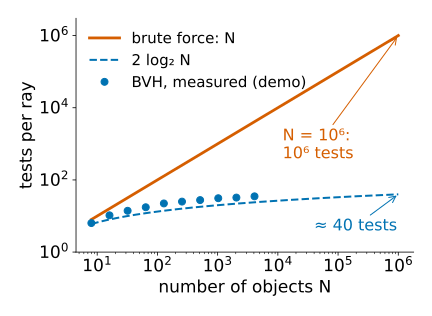
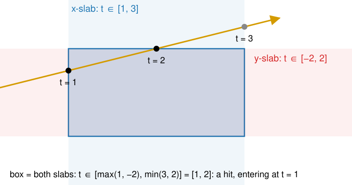
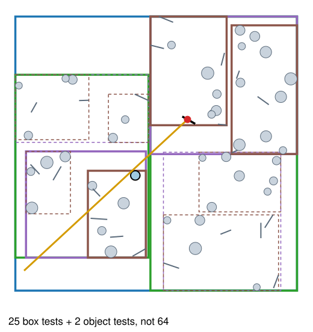
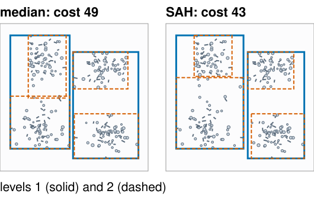
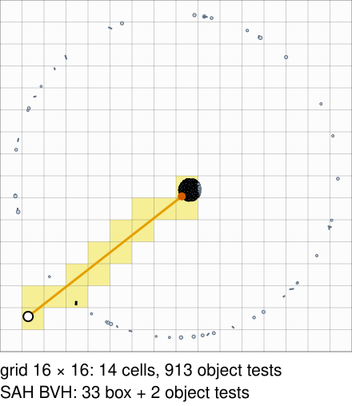
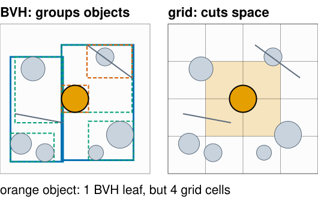

## About this lecture

A ray caster tests every object for every ray: [pixels × objects](../raycast/lec.qmd). This unit makes a ray cost about $\log_2(\text{objects})$ tests instead, and then compares ray tracing with rasterisation.

- **Bounding boxes** and the **slab test**: is the ray anywhere near these objects?
- **Bounding-volume hierarchies** (BVH): boxes inside boxes, a binary tree; how to traverse it, and how to build a good one (the **surface area heuristic**).
- **Uniform grids**: walking the ray through cells; when they fail.
- **Rasterisation or ray tracing?** What each is good at, and what GPUs now do in hardware.

*Slides titled **The math** give the formulas and proofs; the ideas are complete without them.*

::: notes
This unit owns acceleration structures (BVH, grids, the slab test, the surface area heuristic) and the one slide on hardware ray tracing; the volume renderer of the 3D graphics day used the slab test (rayBox) without derivation, the GPU day owns warps, divergence and memory coherence. The demo bvhstep is in 2D: the idea is the same in any dimension and much easier to see.
:::

## Most tests miss

:::: {.columns}
::: {.column width="56%"}
1920 × 1080 pixels, 4 rays per pixel, a mesh of $10^6$ triangles:

- Brute force: $1920 \cdot 1080 \cdot 4 \cdot 10^6 = 8.3 \cdot 10^{12}$ ray–triangle tests.
- Almost all of them miss: a ray hits at most a handful of triangles, the nearest one counts.
- Idea: put a cheap **bounding volume** around a group of objects. If the ray misses the box, it misses **everything inside**: one test instead of thousands.
- Nest the boxes, and a ray needs roughly $2\log_2 N$ box tests: about 40 for $N = 10^6$, $3.3 \cdot 10^8$ in total: **25 000 times** fewer.
:::
::: {.column width="44%"}
{width="100%" fig-alt="Log–log plot of tests per ray against the number of objects N. Brute force grows as N, reaching a million tests at N = 10^6. The curve 2 log2 N reaches only about 40 tests there. The demo's measured BVH costs, from 6 tests at N = 8 to 35 at N = 4096, follow the logarithmic curve."}
:::
::::

The same trick as a binary search in a sorted list, or a quadtree in an image.

## The slab test

{width="58%" fig-align="center"}

An axis-aligned **box** is the overlap of three **slabs** ($x$ between two values, $y$ between two, $z$ between two).

- For each slab, find the interval of $t$ where the ray is inside it.
- The ray is inside the box where it is inside **all** slabs: intersect the intervals. Empty = miss.
- Example (2D): box $[0, 2] \times [0, 1]$, ray from $(-1, 0.5)$ along $(1, 0.25)$: $x$-slab $t \in [1, 3]$, $y$-slab $t \in [-2, 2]$, together $[1, 2]$: a hit.

## The math: the slab test {.math}

Per axis $k$: the ray crosses the two planes at $t_{k,\pm} = (\text{min}_k - o_k)/d_k$ and $(\text{max}_k - o_k)/d_k$.

$$t_\text{near} = \max_k \min(t_{k,-}, t_{k,+}), \qquad t_\text{far} = \min_k \max(t_{k,-}, t_{k,+}),$$

hit iff $t_\text{near} \le t_\text{far}$ and $t_\text{far} > 0$.

- Six subtractions, three divisions (or multiplications by precomputed $1/d_k$), a few comparisons: much cheaper than a triangle test.
- $d_k = 0$ (a ray parallel to a slab): $1/d_k = \pm\infty$ in floating point, so the slab's interval is $(-\infty, \infty)$ if the origin is inside it and empty otherwise. No special case needed (recall [Floating point](../floatingpoint/lec.qmd), "Special values").
- Origin exactly on a slab plane with $d_k = 0$: $0 \cdot \infty = \text{NaN}$; write the comparisons so that a NaN never wins a max or min.

## Bounding-volume hierarchy

{width="40%" fig-align="right"}

Boxes inside boxes: a **binary tree**. The root box holds everything; each node splits its objects into two children with their own boxes; leaves hold a few objects.

- **Traverse**: if the ray hits a node's box, look at both children; visit the **nearer** child first.
- Keep the best hit so far; **skip** any box that starts farther away than it.
- A ray that misses the root costs **one** box test.
- In the figure: 64 objects; the ray needs 25 box tests and 2 object tests.

Each object is in exactly one leaf; the boxes of two children **may overlap**.

## Building the tree: where to split?

:::: {.columns}
::: {.column width="58%"}
- **Median split**: split the objects at the median of the longest axis of their centres. Balanced, simple, but blind to empty space.
- **Surface area heuristic (SAH)**: try several split positions; estimate the cost of each and take the cheapest:
  - the chance that a random ray that hits the parent also hits a child is (about) the child's **surface area** ÷ the parent's;
  - cost = 1 box test + (area ratio × objects) on the left + (area ratio × objects) on the right;
  - do not split when a leaf is cheaper.
- SAH puts **tight** boxes around clusters and leaves empty space out of the boxes, so rays through empty space are rejected early.
- Example: parent area 10, 12 objects. Split A: left area 4 with 6 objects, right area 5 with 6: cost $1 + 0.4\cdot6 + 0.5\cdot6 = 6.4$. Split B: left 7 with 10, right 2 with 2: $1 + 7 + 0.4 = 8.4$. Leaf: 12. Take A.
:::
::: {.column width="42%"}
{width="100%" fig-alt="The demo's clustered scene of 256 objects in four clusters, with the first two levels of boxes of a median-split BVH (estimated cost 49) and of an SAH BVH (cost 43). The SAH boxes hug the clusters more tightly and leave more empty space outside."}
:::
::::

## The math: the surface area heuristic {.math}

- **Cauchy's formula**: for a convex body, the average projected area over all directions is a quarter of its surface area. So random lines hit a convex $B'$ inside a convex $B$ with conditional probability $A(B')/A(B)$. In 2D the same holds with **perimeters** (Cauchy–Crofton).
- Expected cost of a node split into $L$ and $R$:
$$C = C_\text{trav} + \frac{A_L}{A}N_L\,C_\text{isect} + \frac{A_R}{A}N_R\,C_\text{isect},$$
compared with $N\,C_\text{isect}$ for a leaf. Choose the split minimising $C$; stop when no split beats the leaf.
- In practice the candidate splits are bin boundaries along each axis (16 bins), evaluated in one sweep. It is a greedy heuristic: each level assumes its children will be leaves.

## The math: why logarithmic {.math}

- A balanced binary tree over $N$ objects with leaves of size $\le 2$ has depth $\lceil\log_2(N/2)\rceil$.
- A ray that hits only a few leaves visits a few root-to-leaf paths: about $2\log_2 N$ box tests (each visited node tests both children).
- Not guaranteed: overlapping boxes, long thin objects (one long wall in every box) and rays that graze many boxes can visit many paths. Worst case: all $\approx 2N$ nodes, worse than brute force.
- Building costs $O(N \log N)$ (sorting at each level) once; refitting the boxes after objects move costs $O(N)$.

## Uniform grids

:::: {.columns}
::: {.column width="60%"}
Cut space into equal **cells**; list each object in every cell it overlaps.

- Walk the ray from cell to cell in order, like drawing a line on a pixel grid (Bresenham, 3D DDA). Test the objects listed in the current cell.
- Stop at the first cell whose **own** part of the ray contains a hit.
- Fast when objects are spread **evenly** (the cell size matches the object size).
- Fails for "**a teapot in a stadium**": a small detailed object in a big empty scene. Most cells are empty, the few cells around the teapot hold everything. In the demo, a ray into the teapot of 1024 objects tests 913 of them in a 16 × 16 grid; the BVH needs 35 tests.
- **Octrees** and **k-d trees** adapt the cell size to the content.
:::
::: {.column width="40%"}
{width="100%" fig-alt="The demo's teapot in a stadium: 1024 objects, most of them packed into one tiny cluster near the centre, a few spread on a ring. A 16 × 16 grid; the ray walks 14 cells and its last cell holds the cluster, so it tests 913 objects. An SAH BVH needs 33 box tests and 2 object tests."}
:::
::::

## Objects or space?

:::: {.columns}
::: {.column width="55%"}
| | BVH | grid, octree, k-d tree |
|---|---|---|
| splits | the **objects** into groups | **space** into cells |
| each object is in | exactly one leaf | every cell it overlaps |
| boxes/cells | may overlap | never overlap |
| empty space | cut away by tight boxes | still has cells |
:::
::: {.column width="45%"}
{width="100%" fig-alt="One small scene of nine objects, twice. Left: a BVH groups the objects into nested boxes that may overlap. Right: a 4 × 4 grid; the large orange disc in the middle is in one BVH leaf but is listed in four grid cells."}
:::
::::

- **Moving objects**: a BVH can **refit** its boxes bottom-up (keep the tree, recompute the boxes, $O(N)$) and rebuild only now and then; a grid re-lists the moved objects.
- Real-time renderers rebuild or refit every frame for animated characters.

## Try it: boxes, grids and tests

```{=html}
<link rel="stylesheet" href="../demos/dist/demo.css">
<div data-demo="bvhstep" data-preset="median"></div>
<script src="../demos/dist/bvhstep.js"></script>
```

::: notes
A 2D scene of N discs and segments. Structure: none, BVH (median), BVH (SAH), grid. Drag O and the aim ◆; "step" walks the traversal: orange boxes = hit, red dashed = missed; tested objects outlined. The plot: tests per ray against N for 1000 random rays per point (brute force N, grid, SAH BVH, and 4 log₂ N). Tour: "median BVH" (64 objects): step through; the ray needs 21 box tests and 6 object tests instead of 64. "SAH vs median, clustered" (256): SAH tree cost 43 against 49 for the median; same nearest hit. "Grid on a uniform scene": 3 cells, 7 object tests. "Teapot in a stadium": grid 14 cells and 913 object tests; switch to BVH SAH: 33 box tests + 2 objects. "A ray that misses": it starts in the empty corner and points away; one box test (the root), against 256 object tests for brute force. "Near-first stops early": 1024 objects, 19 box tests and 1 object test. The plot for a uniform scene: at N = 1024 the BVH needs 31 tests per ray, the grid 16, brute force 1024; for the stadium the grid grows to 47 while the BVH stays at 18.
:::

## Tracing a real mesh

The marching-cubes surface of the synthetic nuclei stack (from [Marching cubes](../marchingcubes/lec.qmd)): 6728 triangles.

- SAH BVH: 7291 nodes, depth 15, built in under a second.
- Rays aimed at the stack: on average 12.9 box tests and 0.9 triangle tests per ray, instead of 6728 triangle tests. $\log_2 6728 = 12.7$.
- Every triangle is tested in the same way as before (barycentric coordinates); only the **number** of tests changed.
- The same structure answers other questions: which triangle is under the mouse (picking), is a point inside the surface (count crossings along a ray), the distance to the surface.

## Rasterisation or ray tracing?

| | rasterisation | ray tracing |
|---|---|---|
| loops | for each triangle, for each pixel | for each pixel, for each object (through a tree) |
| memory | streams triangles one at a time | random access to the whole scene |
| primary visibility | same result, cheaper per pixel | same result |
| shadows, mirrors, glass, indirect light | tricks: shadow maps, environment maps, screen-space reflections | natural: send another ray |
| cost growth | about linear in triangles | about logarithmic, after building the tree |

**Hybrid** renderers rasterise what the camera sees and trace rays for shadows, reflections and indirect light. Choose by scenario: a wireframe CAD view or a game at 60 frames per second: rasterise; a mirror room or a physically correct image: trace.

## Hardware ray tracing

- Recent GPUs have fixed-function units for the two inner loops of this unit: **box tests while walking a BVH**, and **ray–triangle tests**. The programmer supplies the triangles and says what happens at a hit; the hardware builds and walks the tree.
- Why it is still hard: rays that bounce in different directions want **different** parts of the scene at the same time. GPUs run threads in lock-step groups that like to read neighbouring memory; scattered rays break both (branch divergence and incoherent memory access: the GPU day).
- Real-time ray tracing therefore uses **few rays per pixel** and a **denoiser** (unit 4).

## Summary

- Most ray–object tests miss; test a **bounding box** first, and skip everything inside it.
- **Slab test**: intersect the ray's $t$-intervals in the slabs of a box; IEEE infinities handle parallel rays.
- **BVH**: a tree of boxes; traverse nearest child first and skip boxes beyond the best hit; about $2\log_2 N$ tests per ray.
- Build by the **median** (balanced) or by the **surface area heuristic** (tight boxes, cheaper rays).
- **Grids**: walk the cells along the ray; fine for evenly spread objects, bad for a teapot in a stadium.
- **Rasterisation** vs **ray tracing**: the same primary visibility; rays are natural for everything secondary. GPUs now accelerate BVH and triangle tests in hardware.
