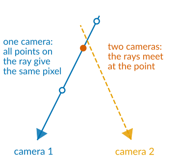
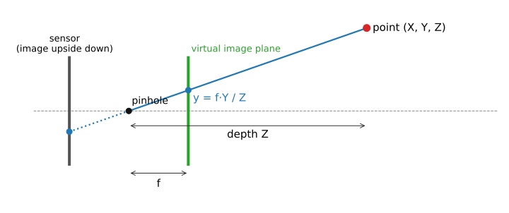
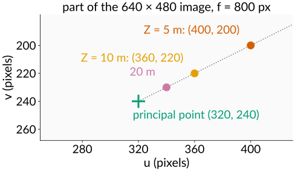
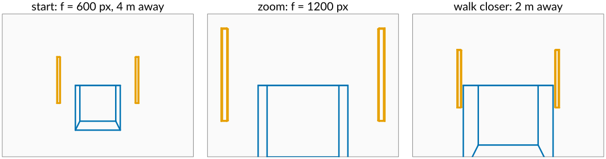
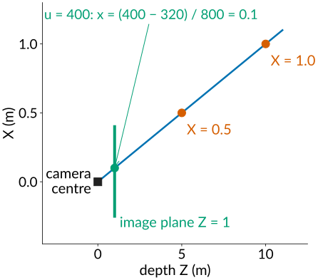
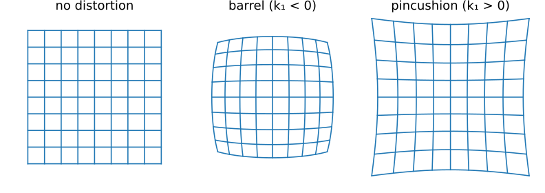
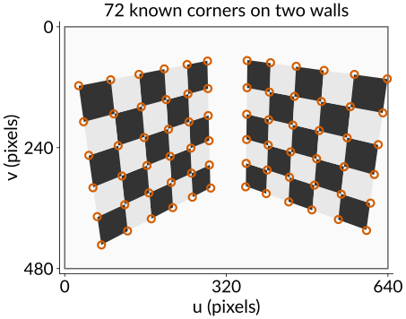
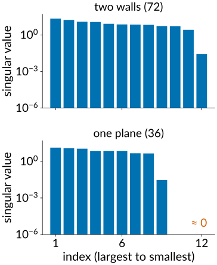
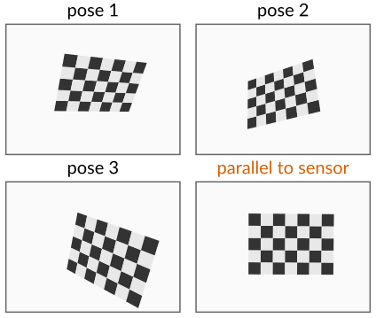
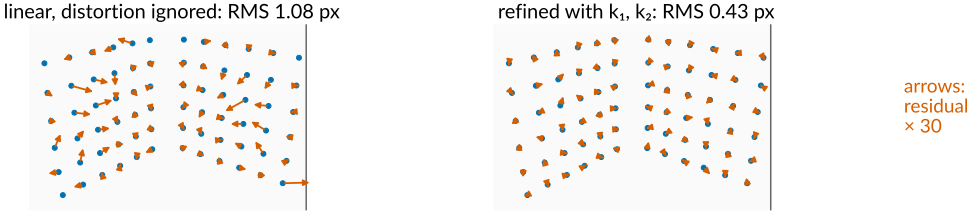

## About this lecture

One photograph loses depth: every pixel is a ray. Today's day gets the geometry back from **several** images. This first unit is about the instrument itself: the camera, described exactly enough to **measure** with it.

- The **pinhole camera**: similar triangles, focal length **in pixels**.
- **Intrinsics** $K$ (the camera and lens) and **extrinsics** $R$, $\mathbf t$ (where it stands and looks).
- From a pixel back to its **ray**.
- **Lens distortion**: why straight lines bend.
- **Calibration**: photograph an object you know, solve for the camera, then minimise the **reprojection error**.

*Slides titled **The math** give the formulas and proofs; the ideas are complete without them.*

::: notes
This unit owns the pinhole model, intrinsics/extrinsics, lens distortion, calibration (DLT and planar) and the homography for the course; the two-view, stereo and structure-from-motion units build on it. Notation for the whole day: K intrinsics, R rotation, t translation, P = K[R | t] (3 × 4), "≃" for equal up to scale. Vision axes: the camera looks down +z, image y points down, pixel centres at integers. The graphics day's camera looks down −z with y up; the comparison slide makes the flip explicit.
:::

## Recall: a pixel is a ray

:::: {.columns}
::: {.column width="60%"}
The 3D graphics day ran the camera chain forwards (model → world → view → clip → screen) and ended by running it **backwards**: [from pixels back to rays](../pipeline3d/lec.qmd).

- A pixel does not see a point, it sees everything on a **ray** from the camera centre through that pixel.
- One camera cannot tell how far along the ray a point is: **depth is lost**.
- Two cameras that see the same point give two rays; where they meet is the point. That is the whole day in one sentence.

To use this for measuring we need the camera as a **known** function from 3D points to pixels, with numbers we can trust to a fraction of a pixel.
:::
::: {.column width="40%"}
{fig-alt="Top view: camera 1's ray carries three points that all land on the same pixel, so their depth is unknown. A ray from camera 2 crosses it at one of them: where the two rays meet is the point." width="100%"}
:::
::::

## The pinhole camera

{width="78%" fig-align="center"}

Light from a point passes through one small hole and lands on the sensor. Similar triangles: a point at height $Y$ and depth $Z$ lands at height $y = f\,Y/Z$. Half as far away, twice as large.

- We draw the image plane **in front** of the hole (the "virtual" image): same triangles, but the picture is not upside down.
- Everything divides by **depth** $Z$: that is what perspective is.

## Focal length in pixels, principal point

Measured in **pixels** the camera needs only a few numbers, the **intrinsics**:

- **Focal length in pixels** $f$ = focal length / pixel pitch. An 8 mm lens on 10 µm pixels: $f = 800$ px. Twice as long a lens or half the pixel size: twice the $f$.
- **Principal point** $(c_x, c_y)$: where the optical axis meets the sensor. Near, but not exactly at, the image centre.
- **Aspect ratio** ($f_x / f_y$) and **skew**: about 1 and 0 for modern sensors.

::::: {.columns}
::: {.column width="52%"}
A point at camera coordinates $(X, Y, Z)$ lands on the pixel
$$u = f\,\frac{X}{Z} + c_x, \qquad v = f\,\frac{Y}{Z} + c_y.$$
Example: $f = 800$, $(c_x, c_y) = (320, 240)$, the point $(0.5, -0.25, 5)$ m lands at $(400, 200)$; twice as far, at $(360, 220)$. Only the principal point stays put when $Z$ changes.

The intrinsics belong to camera **and** lens: they stay fixed as long as zoom and focus stay fixed.
:::
::: {.column width="48%"}
{fig-alt="Part of a 640 by 480 image with f = 800 pixels: the point (0.5, −0.25, Z) lands at (400, 200) for Z = 5 m, at (360, 220) for Z = 10 m and at (340, 230) for Z = 20 m, sliding along a line towards the principal point (320, 240)." width="100%"}
:::
:::::

## The math: the camera matrix {.math}

With homogeneous coordinates (images day: a point gets an extra 1, a scale factor is divided out at the end):

$$\mathbf x \simeq K\,[R \mid \mathbf t]\,\mathbf X, \qquad K = \begin{bmatrix} f_x & s & c_x \\ 0 & f_y & c_y \\ 0 & 0 & 1 \end{bmatrix}, \qquad P = K[R \mid \mathbf t] \in \mathbb R^{3 \times 4}.$$

- $\mathbf X = (X, Y, Z, 1)^\top$ in world coordinates; $R\mathbf X + \mathbf t$ are the camera coordinates; $K$ maps them to pixels; "$\simeq$" means equal up to a scale factor (divide by the third entry).
- Degrees of freedom: 5 in $K$, 3 in $R$, 3 in $\mathbf t$: **11**, which matches a $3 \times 4$ matrix up to scale ($12 - 1$).
- The **camera centre** $\mathbf c$ is the one point that does not project: $P\binom{\mathbf c}{1} = 0$, so $\mathbf c = -R^\top \mathbf t$.

## Where the camera is: extrinsics

The **extrinsics** say where the camera stands and where it looks: a **rotation** $R$ and a **translation** $\mathbf t$ from world to camera coordinates.

- This is the graphics day's look-at matrix, with one difference: there we **chose** the camera; here it is **unknown** and must be measured.
- The camera centre in world coordinates is $\mathbf c = -R^\top \mathbf t$ (not $\mathbf t$: $\mathbf t$ is where the world origin lands in camera coordinates).
- 6 numbers per camera position: 3 for the rotation, 3 for the position.

Moving the camera changes $R$ and $\mathbf t$; zooming changes $K$. Both change the picture, but differently: zooming in scales everything equally; walking closer makes near things grow faster than far things.

{fig-alt="Three wireframe images of a box 4 m away with two posts 10 m away. Start: f = 600 px. Zoom to f = 1200 px: box and posts both twice as large. Walk 2 m closer instead: the box doubles but the posts grow only by a quarter." width="100%"}

## Vision and graphics cameras

The same similar triangles, written for two different jobs:

| | graphics (3D graphics day) | vision (today) |
|---|---|---|
| matrix | $P_\text{GL}\,V\,M$, $4 \times 4$ | $P = K[R \mid \mathbf t]$, $3 \times 4$ |
| output | clip space → $[-1, 1]^3$, keeps a depth for the z-buffer | pixels directly, depth divided away |
| axes | looks down $-z$, $y$ up | looks down $+z$, $y$ **down** |
| camera | chosen by the programmer | unknown, **measured** |

- The two view spaces differ by $\mathrm{diag}(1, -1, -1)$ (flip $y$ and $z$).
- The first two rows of $P_\text{GL}$ are $K$'s, rescaled from pixels to $[-1, 1]$; the third row is the depth the z-buffer needs and vision throws away.

## Try it: the pinhole camera

```{=html}
<link rel="stylesheet" href="../demos/dist/demo.css">
<div data-demo="pinhole"></div>
<script src="../demos/dist/pinhole.js"></script>
```

::: notes
Left: the scene from outside (drag to turn), the camera as a pink pyramid, the yellow ray of the clicked pixel. Right: the camera's 640 × 480 image with the principal point. Default f = 600 px: horizontal field of view 56.1°; the clicked pixel (400, 300) has K⁻¹(u, v, 1) = (0.133, 0.100, 1) and its ray meets the floor at (0.42, 0.00, −0.09). Tour: change f (zoom) and then the distance (walk): the box and the posts behave differently. Preset "long lens from far away": f = 1500, distance 7.5, the board has the same size but the posts no longer lean outwards (the dolly-zoom effect). "Principal point off centre": the image shifts, nothing else changes. "Barrel"/"pincushion": the board's edges bow. "A point behind the camera": tick the box to see corners behind the camera projected anyway (red crosses), on the wrong side: always test Z > 0. "Nearly orthographic": f = 8000 at distance 40, the perspective almost disappears (a telecentric lens, common in microscopy). The graphics-convention checkbox shows V and P_GL for the same camera.
:::

## From a pixel back to a ray

:::: {.columns}
::: {.column width="56%"}
Run the camera backwards: pixel $(u, v)$ → direction in camera coordinates → world.

- Remove the intrinsics: $\big((u - c_x)/f,\ (v - c_y)/f,\ 1\big)$. For $f = 800$, $(c_x, c_y) = (320, 240)$, the pixel $(400, 200)$ gives $(0.1, -0.05, 1)$: a little right and up of straight ahead.
- Rotate into world axes with $R^\top$ and start the ray at the camera centre $\mathbf c$.
- Every point $\mathbf c + s\,R^\top K^{-1}(u, v, 1)^\top$, $s > 0$, lands on that pixel.

This is the starting point of everything that follows: two-view geometry intersects such rays, stereo measures where they meet, bundle adjustment moves cameras until they do.
:::
::: {.column width="44%"}
{fig-alt="Top view, X against depth Z: the pixel u = 400 gives x = (400 − 320) / 800 = 0.1 on the normalised image plane Z = 1; its ray from the camera centre passes X = 0.5 at Z = 5 and X = 1.0 at Z = 10." width="100%"}
:::
::::

## Lens distortion

{width="80%" fig-align="center"}

Real lenses are not pinholes: straight lines bend, more so towards the image corners.

- **Barrel** (lines bulge outwards; wide-angle lenses) and **pincushion** (lines pinch inwards; telephoto).
- Modelled as a stretch that depends only on the distance $r$ from the image centre (in normalised coordinates): $r \to r(1 + k_1 r^2 + k_2 r^4)$, applied **after** the division by depth and **before** $K$.
- $k_1 = -0.1$ at $r = 0.4$: the point moves to $0.4 \cdot (1 - 0.016) = 0.3936$, inwards: barrel. With $f = 800$ that is 5 pixels.
- **Undistorting** an image is an inverse mapping with interpolation (images day): for every output pixel, ask where it came from.

## The math: radial distortion {.math}

In normalised camera coordinates $(x, y) = (X/Z, Y/Z)$, with $r^2 = x^2 + y^2$:

$$\begin{pmatrix} x_d \\ y_d \end{pmatrix} = \big(1 + k_1 r^2 + k_2 r^4\big)\begin{pmatrix} x \\ y \end{pmatrix}, \qquad \begin{pmatrix} u \\ v \end{pmatrix} = \begin{pmatrix} f_x x_d + s\,y_d + c_x \\ f_y y_d + c_y \end{pmatrix}.$$

- The map is not linear, so the camera is no longer a single matrix: calibration estimates $K$, $R$, $\mathbf t$ **and** $k_1, k_2$.
- Undistorting a point inverts $r_d = r(1 + k_1 r^2 + k_2 r^4)$ for $r$; a few fixed-point steps $r \leftarrow r_d / (1 + k_1 r^2 + k_2 r^4)$ suffice for moderate distortion.
- Other terms exist (tangential distortion when the lens is tilted, more radial terms for fisheye lenses); the idea is the same.

## Calibration: photograph something you know

:::: {.columns}
::: {.column width="58%"}
To find the camera's numbers, photograph an object whose geometry we know exactly:

- a **checkerboard** (corners are easy to find to a fraction of a pixel), a grid of dots, or in microscopy beads and fiducials at known positions;
- find the known points in the image (corner detection, structure tensor unit);
- solve for $K$, $R$, $\mathbf t$ and the distortion such that the camera maps the known points onto the found pixels.

Two ways, depending on the object:

- a **3D object** (two checkerboard walls at right angles) in **one** photograph: the **direct linear transform**;
- a **flat** board in **several** poses: one **homography** per pose, then $K$ from all of them.
:::
::: {.column width="42%"}
{fig-alt="A 640 by 480 image of two checkerboard walls at right angles, with the 72 inner corners found in the image circled." width="100%"}
:::
::::

## From a 3D object: the direct linear transform

:::: {.columns}
::: {.column width="64%"}
Each known point $\mathbf X_i$ seen at pixel $(u_i, v_i)$ gives **two** equations, and they are **linear** in the 12 entries of $P$.

- $P$ has 11 unknowns (12 numbers up to scale), so **6 points** are enough (12 equations); 5 are not.
- Collect the equations in a matrix $A$ ($2n \times 12$): we look for the $\mathbf p$ with $A\mathbf p = 0$, the **null space** of $A$. With noise: the $\mathbf p$ of length 1 that makes $A\mathbf p$ smallest.
- Then split $P$ into $K$ (upper triangular) and $R$ (a rotation): the left $3 \times 3$ block of $P$ is $KR$.
- The points must **not all lie on one plane**: then more than one $P$ fits, and $A$ has a larger null space.
- **Normalise first**: pixel coordinates (hundreds) next to 1 make the problem badly conditioned. Shift and scale the points to mean 0 and size about 1 before solving, undo afterwards (Hartley).
:::
::: {.column width="36%"}
{fig-alt="Singular values of the DLT matrix A on a log scale, with 0.5 px noise. Two walls, 72 points: one small singular value (the solution direction). One plane, 36 points: three singular values are exactly zero and a fourth is small: a family of solutions." width="100%"}
:::
::::

## The math: the DLT {.math}

$\mathbf x_i \simeq P\mathbf X_i$ means the two 3-vectors are parallel: $\mathbf x_i \times P\mathbf X_i = 0$. With $\mathbf p_k^\top$ the rows of $P$, two independent rows per point:

$$\begin{bmatrix} \mathbf 0^\top & -\mathbf X_i^\top & v_i\mathbf X_i^\top \\ \mathbf X_i^\top & \mathbf 0^\top & -u_i\mathbf X_i^\top \end{bmatrix}\begin{pmatrix}\mathbf p_1 \\ \mathbf p_2 \\ \mathbf p_3\end{pmatrix} = \mathbf 0 \quad\Longrightarrow\quad A\mathbf p = 0,\ A \in \mathbb R^{2n \times 12}.$$

- $\min \lVert A\mathbf p\rVert$ subject to $\lVert\mathbf p\rVert = 1$: the right singular vector of the **smallest** singular value of $A$ (SVD). Exact data: that singular value is 0.
- **Normalisation**: $\hat{\mathbf x} = T\mathbf x$, $\hat{\mathbf X} = U\mathbf X$ (mean 0, RMS distance $\sqrt 2$ and $\sqrt 3$); solve for $\hat P$; $P = T^{-1}\hat P U$.
- **RQ decomposition** of the left $3 \times 3$ block $M = KR$: Gram–Schmidt from the last row upwards; then $\mathbf t = K^{-1}\mathbf p_4$.
- Coplanar points ($Z = 0$): the three columns of $A$ that multiply $Z$ vanish, so the third column of $P$ is free: the null space grows from 1 to 4 dimensions.

## From a flat board: homographies

:::: {.columns}
::: {.column width="60%"}
The image of a **plane** is a simpler map: a $3 \times 3$ **homography** $H$ (8 numbers up to scale), found from **4** points by the same null-space trick.

- One pose of a flat checkerboard gives one $H$; it mixes $K$ with that pose.
- But the board's two axes are **perpendicular** and have the **same length** in 3D. That gives 2 equations on $K$ per pose.
- $K$ has 5 unknowns: **3 poses** (or 2, if we assume zero skew) determine it (Zhang, 2000).
- The poses must differ in **tilt**: boards that are all parallel to the sensor give the same constraint over and over, and the focal length trades off against the distance.
- Practical, because a flat printed board is easy to make accurately.

The homography comes back in stereo (rectification) and multi-view stereo (sweeping planes).
:::
::: {.column width="40%"}
{fig-alt="Images of a flat 8 by 6 checkerboard: three poses tilted in different directions, which calibrate the camera, and one pose nearly parallel to the sensor, which does not fix the focal length." width="100%"}
:::
::::

## The math: homographies and planar calibration {.math}

For points on the plane $Z = 0$: $\mathbf x \simeq K[\mathbf r_1\ \mathbf r_2\ \mathbf r_3\ \mathbf t](X, Y, 0, 1)^\top = \underbrace{K[\mathbf r_1\ \mathbf r_2\ \mathbf t]}_{H}(X, Y, 1)^\top$.

- Write $H = [\mathbf h_1\ \mathbf h_2\ \mathbf h_3]$, so $\mathbf r_1 \propto K^{-1}\mathbf h_1$, $\mathbf r_2 \propto K^{-1}\mathbf h_2$ (same factor). With $\omega = K^{-\top}K^{-1}$ (symmetric, 6 entries up to scale):
$$\mathbf r_1^\top\mathbf r_2 = 0 \;\Rightarrow\; \mathbf h_1^\top\omega\,\mathbf h_2 = 0, \qquad \lVert\mathbf r_1\rVert = \lVert\mathbf r_2\rVert \;\Rightarrow\; \mathbf h_1^\top\omega\,\mathbf h_1 = \mathbf h_2^\top\omega\,\mathbf h_2.$$
- Both are **linear** in the entries of $\omega$: stack 2 rows per view, take the null vector, then $K$ from $\omega$ (Cholesky of $\omega$ gives $K^{-1}$).
- Each pose's $R$, $\mathbf t$ then follow from $K^{-1}H$.

## Linear first, then refine

The linear solutions minimise an **algebraic** quantity, not the error we care about, and they ignore distortion. So they are a **starting point**.

- **Reprojection error**: for every known point, the pixel distance between where it was **seen** and where the camera model **puts** it. Minimise the sum of squares over all parameters, distortion included.
- That is nonlinear least squares, solved by Gauss–Newton steps (the bundle adjustment unit does this in detail).
- A good calibration: RMS reprojection error of **a few tenths of a pixel**.
- Read the **residual arrows**: random directions = noise (fine); a **pattern** (all pointing outwards at the corners, or all one way) = a **missing model term** (distortion, a wrong point), not noise.

{fig-alt="Residual arrows, magnified 30 times, for a lens with barrel distortion k1 = −0.3 and 0.3 px noise. Top: linear DLT without distortion, RMS 1.08 px, long arrows growing towards the image edges. Bottom: refined with k1 and k2, RMS 0.43 px, short arrows in random directions." width="92%"}

## The math: the reprojection error {.math}

With $\pi(\cdot)$ the full camera model (rotation, translation, division by depth, distortion, $K$) and $\boldsymbol\theta = (f_x, f_y, c_x, c_y, k_1, k_2, \text{and per view } \mathbf w_j, \mathbf t_j)$:

$$\min_{\boldsymbol\theta}\ \sum_j\sum_i \big\lVert \mathbf x_{ij} - \pi(\boldsymbol\theta; \mathbf X_i)\big\rVert^2 .$$

- Rotations as **axis–angle** vectors $\mathbf w$ (3 numbers, direction = axis, length = angle), so every parameter vector is a valid camera.
- If the pixel noise is Gaussian and independent, this is the **maximum-likelihood** estimate (the same argument as for least squares fits in general).
- With $n$ points and pixel noise $\sigma$, the RMS of the residual vectors approaches $\sigma\sqrt 2$ from below (fewer degrees of freedom than measurements): about 0.7 px for $\sigma = 0.5$ px.

## Try it: calibrating a camera

```{=html}
<link rel="stylesheet" href="../demos/dist/demo.css">
<div data-demo="dltcalib" data-preset="distortion"></div>
<script src="../demos/dist/dltcalib.js"></script>
```

::: notes
A hidden camera with f = 820 px and principal point (335, 245) photographs two checkerboard walls (72 corners). Red arrows: residuals, magnified (slider). The table compares the estimate with the truth; the bars are the 12 singular values of A. Tour: "6 points, no noise": exact K, the twelfth singular value is 0. Add 0.5 px noise with the same 6 points: fx = 759 instead of 820 — six points fit the noise exactly. "Noise 0.5 px, all 72 points": fx 819.7, RMS 0.72 px, a nice random arrow pattern. "Unnormalised DLT": the same K here, but the condition number jumps from 8.3 to 2.9e4. "All points on one plane": two singular values are 0, K is meaningless. This preset ("distortion ignored", k1 = −0.3, σ = 0.3 px): linear fx = 955, RMS 1.08 px, arrows point systematically inwards/outwards; refine without k1: still 957; tick "refine k1, k2 too" and refine ×20: fx 819.8, k1 = −0.275, RMS 0.43 px. Flat board: 1 view gives 3 equations for 5 unknowns; 2 views fx 840 (zero skew assumed), 3 views 833. "Parallel views": no valid K with 3 views; 2 views give fx ≈ 3100.
:::

## Weak and degenerate setups

| Setup | What goes wrong |
|---|---|
| all 3D points on one plane (DLT) | more than one $P$ fits: a family of solutions |
| fewer than 6 points (DLT) or 4 per homography | too few equations |
| flat board, all poses parallel to the sensor | focal length and distance trade off: $f$ undetermined |
| points only in the image centre | distortion (which grows towards the edges) unconstrained |
| zoom or focus changed after calibrating | $K$ (and distortion) changed too |

Microscopes are often close to **orthographic** (telecentric): the "divide by depth" disappears and the camera becomes **affine**. SEM tilt series and multi-view light-sheet data are calibrated and aligned with the same ideas, using the affine camera.

## Summary

- A camera is a function from 3D points to pixels: **similar triangles** plus a few numbers. Intrinsics $K$: focal length **in pixels**, principal point (skew, aspect). Extrinsics: rotation and position.
- A pixel is a **ray** from the camera centre; distance along it is lost.
- **Lens distortion** bends straight lines; modelled radially and estimated along with the rest.
- **Calibration**: photograph a known object. 3D object: the DLT from $\ge 6$ non-coplanar points. Flat board: one homography per pose, $\ge 3$ tilted poses.
- Linear solution first, then minimise the **reprojection error**; patterns in the residuals reveal a missing model term.
