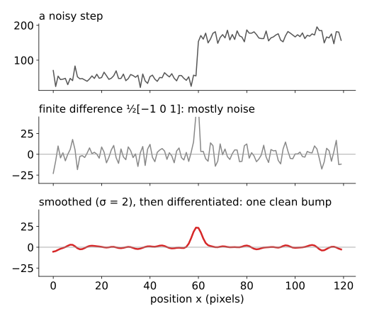
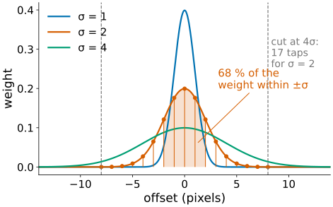
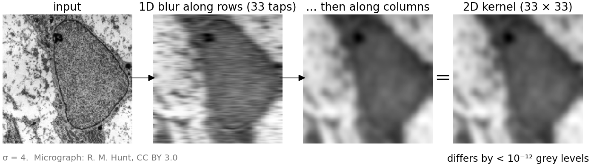
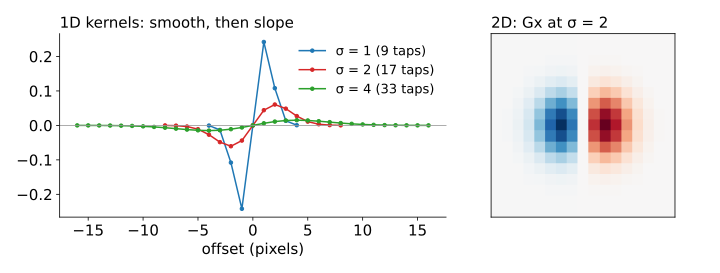
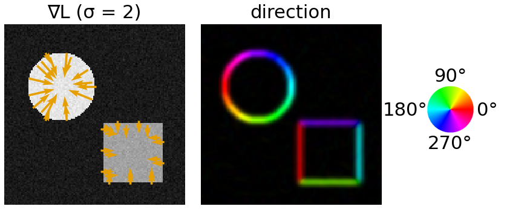
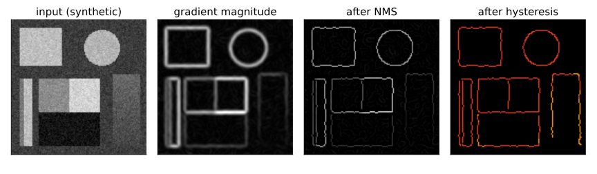
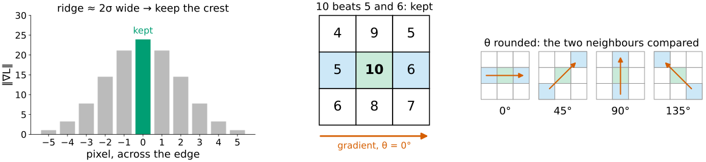
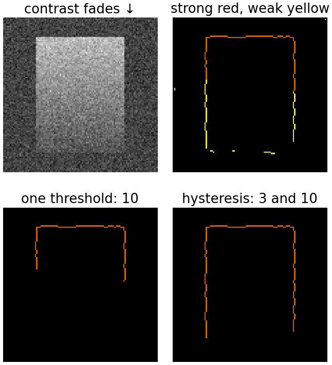
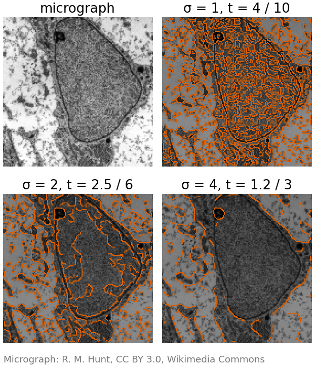

## About this lecture

The filtering unit ended with "smooth first, then differentiate". Today we make that precise, and build the classic edge detector on top of it (Canny, 1986).

- The **Gaussian of width σ**: one knob for how much to smooth.
- **Separable**: a 2D Gaussian is two 1D passes.
- **Derivative of a Gaussian**: smoothing and differentiating in one kernel.
- **Gradient magnitude and direction** at every pixel.
- **Canny** in four steps: smooth, gradient, **non-maximum suppression**, **hysteresis**.
- How to choose σ and the two thresholds.

*Slides titled **The math** give the formulas and proofs; the ideas are complete without them.*

::: notes
This unit owns Gaussian derivatives, the gradient direction convention and Canny for the whole course; the Hough elective recalls the edge list from here, the thresholding day recalls hysteresis. Convention throughout: x to the right, y down (rows), Ly = change going down; angles are counted counter-clockwise as seen on the screen.
:::

## Recall: derivatives amplify noise

{width="62%" fig-align="center" fig-alt="A noisy step edge; its finite difference ½[−1 0 1], mostly noise with a peak at the edge; and its derivative after smoothing with σ = 2, one clean bump at the edge."}

From the filtering unit: a derivative is a difference of neighbours, and noise is exactly "a pixel that differs from its neighbours". **Smooth first, then differentiate**: one clean bump at the edge.

::: notes
The synthetic step goes from 50 to 170 with noise of standard deviation 10. The finite difference has noise of about ±7 everywhere and a peak of 60 at the edge; after a Gaussian of σ = 2 the noise almost disappears and the peak is still about 24. The rest of the unit makes the "how much smoothing" precise.
:::

## The Gaussian of width σ

:::: {.columns}
::: {.column width="56%"}
The bell curve as a kernel: weights $\propto e^{-x^2/2\sigma^2}$, scaled to sum to 1.

- **σ in pixels** sets how far the averaging reaches. About 68 % of the weight lies within ±σ, 99.7 % within ±3σ.
- So the kernel can be **cut** at 3σ to 4σ (our demos: 4σ). σ = 2 needs $2 \cdot 8 + 1 = 17$ taps.
- The 3×3 Gaussian of the filtering unit ($[1\;2\;1]/4$ in each direction) is a Gaussian with σ ≈ 0.85.
- Larger σ: **less noise**, but edges get **wider**, corners **round off**, and edges that are close together **merge**.
:::
::: {.column width="44%"}
{width="100%" fig-alt="Gaussian kernels for σ = 1, 2 and 4: wider and lower as σ grows. For σ = 2 the 17 sampled taps are marked, the area within ±σ is shaded (68 % of the weight) and dashed lines mark the cut at ±4σ = ±8 pixels."}
:::
::::

There is no free lunch: every σ trades noise against detail. Choosing σ is choosing the **scale** of the edges you want (next unit: scale space).

## Separability: two 1D passes

A 2D Gaussian is a product: $G_\sigma(x, y) = g_\sigma(x)\,g_\sigma(y)$.

- Blur every **row** with the 1D kernel, then every **column** of the result. Same answer as the 2D kernel.
- Cost per pixel with $k$ taps: $k^2$ multiplications directly, $2k$ separably.
- σ = 4: $k = 33$, so 1089 against 66.
- Recall Sobel: a smoothing column $[1\;2\;1]^\top$ times a derivative row $[-1\;0\;1]$. Also separable.

{width="100%" fig-alt="A micrograph blurred with σ = 4: first along rows only (horizontal smearing), then along columns; the result equals blurring with the full 33 × 33 kernel."}

::: notes
Ask: which other kernels are separable? The box filter (a row of ones times a column of ones), Sobel, all Gaussian derivatives. The Laplacian is not a single outer product, but a sum of two separable kernels (Lxx + Lyy).
:::

## Derivative of a Gaussian

Smoothing then differentiating is **one** kernel (convolutions combine): the derivative of the Gaussian.

{width="85%" fig-align="center" fig-alt="Derivative-of-Gaussian kernels in 1D for σ = 1, 2 and 4 (9, 17 and 33 taps), each with a negative and a positive lobe, and the 2D kernel Gx at σ = 2."}

- Shape: a **positive and a negative lobe**: "right side minus left side, with Gaussian weights".
- In 2D, $G_x$ = a Gaussian derivative along $x$ times a plain Gaussian along $y$: **Sobel's big brother**, with a tunable σ.
- Weights are scaled so that a ramp of slope 1 gives exactly 1: the response is the **slope** of the smoothed image, in grey levels per pixel.

## The math: the derivative of a Gaussian {.math}

Smoothing is a convolution, $L = G_\sigma * I$. Differentiate under the integral:

$$\partial_x L(x) = \partial_x \int G_\sigma(x - u)\,I(u)\,du = \int \partial_x G_\sigma(x - u)\,I(u)\,du = (\partial_x G_\sigma) * I.$$

- So the slope of the smoothed image is the image filtered with $\partial_x G_\sigma$; we never need $\partial_x I$ itself (which does not exist for a noisy, sampled image).
- With $G_\sigma(x) = \frac{1}{\sqrt{2\pi}\,\sigma}e^{-x^2/2\sigma^2}$: $\quad\partial_x G_\sigma(x) = -\dfrac{x}{\sigma^2}\,G_\sigma(x)$.
- Separability: $G_\sigma(x, y) = g_\sigma(x)\,g_\sigma(y)$, hence $\partial_x G_\sigma = g'_\sigma(x)\,g_\sigma(y)$: a 1D derivative kernel along rows, a 1D Gaussian along columns.
- Same for any order: $\partial_x^m\partial_y^n G_\sigma = g^{(m)}_\sigma(x)\,g^{(n)}_\sigma(y)$ (the Hessian unit uses $m + n = 2$).

## The math: how much noise survives? {.math}

White noise of variance $s^2$ (independent pixels) through a kernel $w$ has variance $s^2\sum_k w_k^2$.

- $\tfrac12[-1\;0\;1]$: $s^2(\tfrac14 + \tfrac14) = s^2/2$, while a ramp of slope 1 still gives 1.
- Derivative of a Gaussian (1D, normalised to slope 1): $\sum_k w_k^2 \approx \dfrac{1}{4\sqrt\pi\,\sigma^3}$: 0.14 at σ = 1, 0.018 at σ = 2. Doubling σ cuts the noise variance 8-fold.
- In frequency (recall the Fourier unit): differentiating multiplies by $i\omega$, which **boosts** high frequencies, where white noise lives; the Gaussian multiplies by $e^{-\sigma^2\omega^2/2}$. The product $i\omega\,e^{-\sigma^2\omega^2/2}$ is a **band-pass**: it peaks at $\omega = 1/\sigma$.

## Try it: smoothing before differentiating

```{=html}
<link rel="stylesheet" href="../demos/dist/demo.css">
<div data-demo="gaussderiv" data-preset="noise"></div>
<script src="../demos/dist/gaussderiv.js"></script>
```

::: notes
Rows: the signal and its blur; the finite difference of the raw signal; the derivative-of-Gaussian response; the kernel itself, to scale, at the position you click. Tour: "finite difference on noise" (σ = 0.5): rows 2 and 3 look alike, noise everywhere. "σ = 2 cleans it": the step at x = 48 is a clean bump of about 24 (the step of 120 spread over a Gaussian of σ = 2: 120/(2·√(2π)) ≈ 24). Slide σ up to 8: the two steps at 200 and 206 merge into one bump ("two close steps merge"). "A thin line gives two lobes": a line is two edges, one up and one down. "Curvature": order 2, the zero crossing sits exactly at the edge (next unit). The readout gives the taps and the cost of a 2D filter, direct against separable.
:::

## Gradient: magnitude and direction

:::: {.columns}
::: {.column width="52%"}
At every pixel, the two slopes $L_x$ and $L_y$ of the smoothed image form the **gradient** $\nabla L = (L_x, L_y)$.

- **Magnitude** $\|\nabla L\| = \sqrt{L_x^2 + L_y^2}$: the edge strength.
- **Direction** θ: where brightness increases fastest. It points **across** the edge, from dark to bright.
- Convention: $x$ to the right, $y$ **down** (rows), so $L_y$ is the change going down; θ is counted **counter-clockwise on the screen** from the $x$ axis.

Example: $L_x = 3$, $L_y = -4$ (brighter to the right and **up**): strength $\sqrt{9 + 16} = 5$, direction $\operatorname{atan2}(4, 3) = 53°$.
:::
::: {.column width="48%"}
{width="100%" fig-alt="A bright disc and a grey square on a dark background. Left: gradient arrows on the outlines all point into the bright shapes, across the edge. Right: direction as hue and magnitude as brightness; the hue goes once around the colour wheel along the circle, and each side of the square has one colour."}

Right: the direction as a colour (hue), the magnitude as its brightness, as in the demos.
:::
::::

## The math: why look along the gradient? {.math}

The slope of $L$ in a direction given by a unit vector $\mathbf u$ is the **directional derivative**

$$\partial_{\mathbf u} L = \nabla L \cdot \mathbf u = \|\nabla L\|\cos\angle(\nabla L, \mathbf u).$$

- It is largest for $\mathbf u \parallel \nabla L$, with value $\|\nabla L\|$; it is zero along the edge ($\mathbf u \perp \nabla L$).
- So the profile **across** an edge is the profile along $\nabla L$. Non-maximum suppression (next slides) looks for the peak of $\|\nabla L\|$ along exactly this line.
- With $y$ down, the angle counter-clockwise on the screen is $\theta = \operatorname{atan2}(-L_y, L_x)$.

## A gradient image is not yet "the edges"

:::: {.columns}
::: {.column width="55%"}
- The magnitude is a **ridge** several pixels wide (about 2σ): where exactly is the edge?
- Noise and texture give small magnitudes **everywhere**.
- A low-contrast edge can be weaker than the noise somewhere along it.

Canny's answer (1986): **thin** the ridge to one pixel, then keep pixels by a **two-threshold** rule that uses connectivity.
:::
::: {.column width="45%"}
**Canny in four steps**

1. Smooth with $G_\sigma$.
2. Gradient: magnitude and direction.
3. **Non-maximum suppression** (NMS): keep only the crest of the ridge.
4. **Hysteresis**: strong pixels seed, weak pixels survive only if connected to a seed.
:::
::::

{width="100%" fig-alt="Canny on a synthetic scene: input, gradient magnitude (wide ridges), after non-maximum suppression (thin lines), after hysteresis (the kept edges)."}

## Non-maximum suppression

Keep a pixel only if its magnitude is **at least as large as its two neighbours along the gradient direction**.

- Round θ to 0°, 45°, 90° or 135°: then the two neighbours are pixels (left/right, the diagonals, up/down).
- The ridge becomes **one pixel wide**, at its crest: the best estimate of where the edge is.

{width="100%" fig-alt="Left: the gradient magnitude across a step edge (σ = 2) is a ridge about 2σ wide; only its crest pixel is kept. Middle: a 3 × 3 piece of a magnitude image with values 4 9 5 / 5 10 6 / 6 8 7 and a horizontal gradient; the centre 10 is compared with its left and right neighbours 5 and 6 and kept. Right: for the rounded directions 0°, 45°, 90° and 135°, the two neighbours compared."}

Middle: a vertical edge, gradient horizontal (θ = 0°). Compare 10 with its left and right neighbours, 5 and 6: **kept**. The pixel left of it (5) would be compared with 10 and something smaller: **removed**.

## Hysteresis: two thresholds and connectivity

:::: {.columns}
::: {.column width="60%"}
One threshold cannot work for a faint edge in noise: high enough to remove the noise is too high for the faint part of the edge.

- **Strong** pixels ($\ge t_\text{high}$) are certainly edges: they are the **seeds**.
- **Weak** pixels ($t_\text{low} \le$ value $< t_\text{high}$) are kept only if they are **connected** (through other weak or strong pixels, 8 neighbours) to a seed.
- Everything below $t_\text{low}$ goes.

Picture it as a flood: start at the seeds and grow, one ring of neighbours at a time, through pixels above $t_\text{low}$. Faint stretches of a real edge hang on to its strong parts; isolated noise has nothing to hang on to.

The same idea comes back on the thresholding day, for faint filaments in any image.
:::
::: {.column width="40%"}
{width="100%" fig-alt="A rectangle whose contrast fades from top to bottom, with noise, after Canny's first three steps (σ = 2). Strong crest pixels (red) cover the top, weak ones (yellow) the fainter sides. A single threshold of 10 keeps only the top part; hysteresis with 3 and 10 follows the sides much further down."}
:::
::::

## Try it: Canny step by step

```{=html}
<link rel="stylesheet" href="../demos/dist/demo.css">
<div data-demo="canny" data-preset="hyst"></div>
<script src="../demos/dist/canny.js"></script>
```

::: notes
Synthetic 128 × 128 scene with noise 12: a rectangle, a disc, a staircase (two upward steps 4 pixels apart), a T-junction, and on the right a faint rectangle whose contrast fades from 45 (top) to 8 (bottom). Tabs show each stage; click a pixel to see its 3 × 3 magnitudes, the two neighbours NMS compares (cyan) and the verdict. Tour: "hysteresis closes the gap": seeds only (red); press "grow 1 ring" a few times, then "play": the flood creeps down the faint edge (pixel (96, 100) joins at ring 34). Default thresholds 3 and 10: 824 seeds, 338 weak pixels of which 128 are kept, 952 edge pixels. "One threshold" (10 and 10): only 824 pixels, the faint edge mostly gone; set both to 3: 1162 pixels, noise chains appear. "NMS thins the ridge": the magnitude tab, pixel (46, 30): 20.99 against its neighbour 32.38: removed. "σ too small" (0.7): 4755 edge pixels, mostly noise. "σ too large" (4): the staircase's two steps merge into one edge and the corners round off.
:::

## The math: Canny's criteria, sub-pixel NMS {.math}

Canny asked for the filter that best finds a **step edge in white noise**, with three criteria:

1. **Good detection**: high signal-to-noise ratio at the edge.
2. **Good localisation**: the response peaks close to the true edge.
3. **One response per edge**: few spurious maxima nearby.

Maximising the product of the first two under the third gives a filter that is very close to the **derivative of a Gaussian** (within about 20 % of the optimum), which is why it is used.

**Sub-pixel NMS**: instead of rounding θ, compare $\|\nabla L\|(\mathbf p)$ with the magnitude interpolated **bilinearly** (images unit) at $\mathbf p \pm \nabla L / \|\nabla L\|$. Fitting a parabola through the three values even gives the edge position to a fraction of a pixel.

## Choosing σ and the thresholds

:::: {.columns}
::: {.column width="58%"}
| If … | you see … |
|---|---|
| σ too small | noise edges, ragged contours |
| σ too large | corners cut, close edges merge, T-junctions break, small objects vanish |
| $t_\text{high}$ too high | gaps: whole faint edges lost |
| $t_\text{low}$ too low | noise chains attached to real edges |

- Rule of thumb: $t_\text{high}/t_\text{low} \approx 2$ to 3.
- The thresholds are in units of slope (grey levels per pixel) and depend on σ: larger σ, smaller magnitudes.
- Image libraries call the whole pipeline "Canny".
:::
::: {.column width="42%"}
{width="100%" fig-alt="Canny edges (orange) on an electron micrograph at σ = 1, 2 and 4, with thresholds lowered as σ grows: at σ = 1 the texture inside the nucleus gives a mesh of noise edges; at σ = 4 the nuclear envelope and the large structures remain, with rounded corners."}
:::
::::

## Where this leads

- **Hough transform** (detection elective): every edge pixel, with its direction θ, votes for the lines and circles it could belong to. Canny's output is the edge list $\{x, y, \theta, \text{strength}\}$.
- **Morphological gradient** (morphology day): dilation minus erosion, an edge strength without derivatives.
- **Snakes** (curves elective): the edge strength is the force that pulls a contour onto the boundary.
- Next unit: what "the right σ" means when an image has structures of many sizes: **scale space**.

## Summary

- Smooth with a **Gaussian of width σ**, then differentiate: one kernel, the **derivative of a Gaussian**; separable, so cheap.
- **Gradient**: magnitude = edge strength, direction = across the edge (counter-clockwise on the screen, $y$ down).
- **Canny**: smooth, gradient, **non-maximum suppression** (one-pixel crest along the gradient), **hysteresis** (strong seeds, weak pixels kept if connected).
- σ trades noise against detail; $t_\text{high}$ against gaps, $t_\text{low}$ against noise chains.
