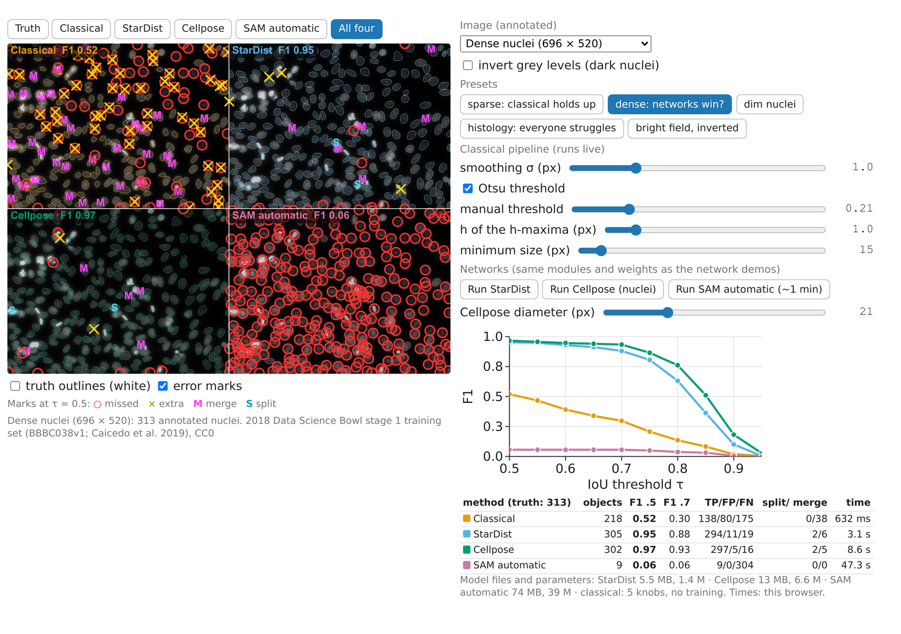

## Goal

By the end of this exercise you should be able to:

- **score** several segmentation methods on the same annotated images: matching at τ, TP/FP/FN, F1 at more than one τ, merges and splits,
- **read** F1(τ) curves: finding objects versus outlining them,
- **weigh** accuracy against cost: time per image, download, parameters, annotation,
- **choose** a method for a kind of image, and say how you would check the choice,
- *(math)* say with a bootstrap over images whether a difference between two methods is real.

Do the pen-and-paper part first, then the demo, which runs the classical pipeline and the real networks on seven annotated images.

## Background

| Idea | What it means |
|---|---|
| IoU | overlap / union of a true and a predicted object |
| Match at τ | a true and a predicted object with IoU ≥ τ, each object used at most once |
| TP, FP, FN | matched pairs; predicted objects without a partner (extra); true objects without a partner (missed) |
| F1 | $2\,\mathrm{TP}/(N_P + N_T)$ = $2\,\mathrm{TP}/(2\,\mathrm{TP} + \mathrm{FP} + \mathrm{FN})$ |
| F1(τ) | F1 as a function of τ; τ = 0.5 measures finding, τ = 0.7 and above outlining |
| Merge / split | one prediction covering two (or more) true objects / one true object cut into two (or more) predictions |
| Images per hour | $3600 / t$ with $t$ the seconds per image |
| Classical pipeline | smooth (σ), threshold (Otsu or manual), fill holes, distance transform, h-maxima as seeds, watershed, minimum size |

Times for one 512 × 512 image on one laptop core in the browser (measured with the course demos): StarDist 2.13 s, Cellpose 7.7 s (with 4 workers), SAM automatic with an 8 × 8 grid of prompts 48.3 s.

## By hand

**B1.** An image has 20 annotated nuclei. Method A reports 21 objects, of which 18 match a true nucleus at τ = 0.5 but only 12 at τ = 0.7. Method B reports 17 objects; 16 match at 0.5 and 15 at 0.7.
(a) Give TP, FP and FN of both methods at both thresholds, and the four F1 values.
(b) Which method would you use to count nuclei, and which to measure their areas? Why?

**B2.** A crop of the stained-tissue image (grey levels inverted), segmented with the classical pipeline, holds 4 annotated nuclei (T1–T4) and 5 predicted objects (P1–P5). Their IoU values:

| | P1 | P2 | P3 | P4 | P5 |
|---|---|---|---|---|---|
| **T1** | 0 | 0 | 0.40 | 0 | 0 |
| **T2** | 0 | 0 | 0.47 | 0.07 | 0 |
| **T3** | 0 | 0 | 0 | 0 | 0.75 |
| **T4** | 0 | 0 | 0 | 0.78 | 0 |

Areas in pixels: T1–T4 = 345, 488, 658, 478; P1–P5 = 47, 69, 783, 565, 492.

(a) Match at τ = 0.5. Give TP, FP, FN and F1.
(b) Which prediction is a **merge**, and of which nuclei? How can you see it in the table alone, and what extra information would confirm it?
(c) Which knob of the classical pipeline would you change to remove the merge, in which direction, and what could go wrong elsewhere?

**B3.** Cost.
(a) Compute images per hour for StarDist, Cellpose and SAM automatic from the times above.
(b) A screen of 10 000 images of 512 × 512 pixels runs on one laptop. How many hours does each network take?
(c) The classical pipeline needs about 0.5 s per 512 × 512 image. How long does it take for the same screen?

**B4.** Choose a method, and say how you would check that it works, for:
(a) 50 000 images of sparse, bright Hoechst-stained nuclei;
(b) 30 phase-contrast images of irregular, touching cells;
(c) 5 tissue sections in which a pathologist wants 200 specific cells outlined;
(d) a time-lapse of dividing yeast cells (fluorescence), where every cell must be found in every frame.

**B5.** A network scores F1 = 0.95 on a public image that turns out to be part of its training set. What does this number tell you about your own images? What number would you trust instead, and how would you get it?

::: {.callout-note collapse="true" title="Solutions"}
**B1.** (a) A: at 0.5, TP 18, FP 21 − 18 = 3, FN 20 − 18 = 2, F1 = 36/41 = 0.88; at 0.7, TP 12, FP 9, FN 8, F1 = 24/41 = 0.59. B: at 0.5, TP 16, FP 1, FN 4, F1 = 32/37 = 0.86; at 0.7, TP 15, FP 2, FN 5, F1 = 30/37 = 0.81.
(b) Counting: A, which finds more nuclei (higher F1 at 0.5, higher recall 18/20). Areas: B, whose objects still match at 0.7, so their outlines are close to the true ones; A's outlines are sloppy (6 of its matches fall below 0.7), which biases areas.

**B2.** (a) Pairs with IoU ≥ 0.5: T3–P5 (0.75) and T4–P4 (0.78). TP 2, FP 3 (P1, P2, P3), FN 2 (T1, T2); F1 = 4/9 = 0.44.
(b) P3: it overlaps both T1 (0.40) and T2 (0.47), and neither overlap reaches 0.5, so both nuclei count as missed **and** P3 as extra; one merge costs two FN and one FP. In the table a merge shows as one column with two substantial entries; its area (783) is close to the sum of T1 and T2 (833). To confirm it, compute the fraction of each true object inside P3: 0.94 of T1 and 0.83 of T2 lie inside it (this is how the demo marks merges). P1 and P2 are small extras (47 and 69 pixels) overlapping no nucleus.
(c) Give the watershed more seeds: a **smaller h** (or less smoothing σ), so that the two nuclei get one distance-transform peak each. Risk: elongated or irregular nuclei get two peaks and are split elsewhere. A **minimum size** of about 75 pixels removes P1 and P2, but also any real small nucleus.

**B3.** (a) StarDist 3600/2.13 ≈ 1690 per hour; Cellpose 3600/7.7 ≈ 470; SAM automatic 3600/48.3 ≈ 75.
(b) StarDist 10 000 × 2.13 s = 21 300 s ≈ 5.9 h; Cellpose ≈ 21 h; SAM automatic ≈ 134 h (more than five days).
(c) About 0.5 s per 512 × 512 image (measured in node and scaled; it depends on the image): 10 000 × 0.5 s ≈ 5000 s ≈ 1.4 h, about 7500 images per hour, four times StarDist's throughput.

**B4.** (a) Classical: sparse, bright, round nuclei are where it is competitive, and at milliseconds per image the screen takes minutes instead of hours; tune it on a few images, then check on a held-out annotated subset (a few hundred nuclei) at τ = 0.5 and 0.7. If it merges too many, StarDist (about 30 h on one core, much less on a GPU). (b) Cellpose with a cell model: irregular, touching cells need flows rather than polygons or a distance transform; check on a few annotated images, looking at splits and merges; fine-tune if phase contrast is far from its training images. (c) Promptable segmentation with clicks (or graph-cut seeds): the objects are chosen by a person, so an interactive tool with one or two clicks per cell is faster than training anything; the pathologist checks each outline. (d) A nuclei or cell network (StarDist for round fluorescence nuclei, Cellpose otherwise), checked on annotated frames, especially frames with dividing cells (merges of daughters, splits of a mother); the time-lapse also lets you check consistency over frames (tracking day).

**B5.** Almost nothing: the image was seen during training, so 0.95 measures how well the network reproduces its training data (leakage). Your images may differ in microscope, staining, magnification and cell type. Trust a score on a held-out, annotated subset of **your** images that the network never saw, ideally compared with the agreement of a second annotator and with a simple baseline.
:::

### Math questions

**B6.** *(math)* Per-image F1 at τ = 0.5 of StarDist and of the classical pipeline on the seven images of the lecture (sparse, dim, dense, U2OS 1, U2OS 2, histology, bright field):

| | sparse | dim | dense | U2OS 1 | U2OS 2 | histology | bright field |
|---|---|---|---|---|---|---|---|
| StarDist | 1.000 | 0.978 | 0.951 | 0.915 | 0.940 | 0 | 0 |
| classical | 0.958 | 0.957 | 0.520 | 0.862 | 0.955 | 0 | 0 |

(a) Compute the per-image differences and their mean.
(b) Describe how a bootstrap over images gives a 95 % interval for the mean difference. Why resample images and not nuclei?
(c) The interval from 10 000 resamples is [0.004, 0.199]. Is StarDist better on this benchmark? What changes if you leave out the two non-fluorescence images?

**B7.** *(math)* Show that for the same pair of label images F1 at τ = 0.5 is at least F1 at τ = 0.7, when matching is done at each threshold (one partner per object). Does the same hold for τ = 0.3 versus 0.5 with an optimal one-to-one matching?

::: {.callout-note collapse="true" title="Solutions (math)"}
**B6.** (a) $d = 0.042,\ 0.021,\ 0.431,\ 0.053,\ -0.015,\ 0,\ 0$; mean $0.532/7 = 0.076$.
(b) Draw 7 images with replacement from the 7 (some appear twice, some not at all), compute the mean of their $d_i$; repeat 10 000 times; the 2.5th and 97.5th percentiles of these means form the interval. Images, not nuclei, are the independent units: nuclei of one image share staining, focus and density, so resampling nuclei would pretend there is far more independent information than there is (replicates and leakage, evaluation day).
(c) The interval [0.004, 0.199] lies just above 0: on this benchmark StarDist is better, but barely, and most of the difference comes from one image (dense: 0.431). Without the dense image the mean drops to 0.017 with interval [−0.001, 0.038], which touches 0. The two non-fluorescence images contribute $d = 0$ (both methods fail); leaving them out raises the mean to 0.107 (interval [0.008, 0.272]) without making the comparison more informative. With seven images, one hard image decides the answer: collect more images of the kind you care about.

**B7.** Above τ = 0.5 every object has at most one partner with IoU ≥ τ (two predictions each covering more than half of a true object would overlap, impossible in a label image), so the matching at τ is simply the set of pairs with IoU ≥ τ. Every pair with IoU ≥ 0.7 also has IoU ≥ 0.5, so TP(0.7) ≤ TP(0.5); the denominator $N_P + N_T$ does not depend on τ, so F1(0.5) ≥ F1(0.7). Below 0.5 the pairs are no longer unique, and an optimal one-to-one matching at τ = 0.3 may pick different partners than at 0.5; but every matching at 0.5 is also a valid matching at 0.3 (IoU ≥ 0.5 ≥ 0.3), so the **maximum** number of pairs at 0.3 is at least that at 0.5: the inequality still holds for a matching that maximises the number of pairs.
:::

## Explore {#explore}

The demo runs four methods on seven public images of nuclei with a full annotation: five fluorescence images (sparse, dim, dense, two U2OS fields) and two that are not fluorescence (stained tissue, bright field). The **classical pipeline** runs live (sliders: σ, threshold, h, minimum size). Three buttons run the **real networks**, with the same modules and weights as the network demos of this day: StarDist (5.5 MB, about a second), Cellpose with its nuclei model (13 MB, a few seconds; its **diameter** slider is set to the median nucleus size), and SAM in automatic mode (78 MB, about a minute: run it last). Every result is scored against the annotation: outlines and error marks (○ missed, × extra, M merge, S split, at τ = 0.5), the F1(τ) curves of all methods on one plot, and a table with F1 at 0.5 and 0.7, TP/FP/FN, splits/merges and the time in your browser. **invert grey levels** turns dark nuclei bright. The presets choose an image and reset the classical knobs. On this site the networks and images load from the course server; opened as a local file the demo cannot run (the figure below shows it).

```{=html}
<link rel="stylesheet" href="../demos/dist/demo.css">
<div data-demo="cellcompare" data-preset="sparse"></div>
<script src="../demos/dist/cellcompare.js"></script>
```

{fig-alt="Screenshot of the comparison demo on the dense image: four panels with outlines and error marks, the F1 curves of the four methods, and the table of scores and times."}

Before each run, **write down your prediction**.

**E1.** Preset **sparse: classical holds up**. Note F1 at 0.5 and 0.7 of the classical pipeline. Try to improve it with the sliders. Then predict whether StarDist beats it, and run StarDist and Cellpose.

**E2.** Preset **dense: networks win?** Where are the classical merges (M marks)? Raise and lower h: what happens to merges, splits and F1? Then run StarDist and Cellpose: how many merges do they make?

**E3.** Still on **dense**, compare the F1(τ) curves of all methods you ran. Which method has the best outlines (the flattest curve)? Which one would you use for counting, which for measuring areas?

**E4.** Preset **histology: everyone struggles**. Run the classical pipeline, StarDist and Cellpose. Then tick **invert grey levels** and run them again. Do the same on the **bright field** image (preset **bright field, inverted**, then without inverting). Which method is least bad, and why do all of them struggle?

**E5.** Fill in a cost table from the readouts: time per image in **your** browser for each method on the U2OS 1 image (696 × 520), the download size and the number of parameters. How many such images per hour would each method process on your laptop?

**E6.** Pick one image type of the seven and the method you would use for it. Write the two-sentence argument with numbers (F1 at two thresholds, merges or splits, time).

::: {.callout-note collapse="true" title="Solutions"}
All numbers were measured with the same code as the demo (tools/figs/cellnets-compare/); the times are for one laptop and differ on yours.

**E1.** Default knobs: 35 objects for 36 nuclei, F1 0.96 at both 0.5 and 0.7 (TP/FP/FN 34/1/2, one merge). Smoothing σ = 0 gives 36 objects and F1 1.00 / 1.00; a manual threshold of 0.35 also finds all 36 (F1 1.00 at 0.5) but makes the outlines too small (0.86 at 0.7); h = 2 or σ = 2 merges two pairs (0.91). StarDist: 36 objects, F1 1.00 / 1.00; Cellpose 33 objects (3 nuclei missed), 0.96 / 0.96. On sparse, bright, round nuclei the classical pipeline is as good as the networks once σ is right. SAM automatic: 5 objects (F1 0.24): few of its 64 grid points hit a nucleus.

**E2.** The M marks sit where nuclei touch in clumps, and many dim nuclei are missed or cut small: one global Otsu threshold (0.21 of the range) has to serve both the very bright and the dim nuclei. 218 objects for 313 nuclei, 38 merges, F1 0.52 / 0.30. h = 0.5: 35 merges, F1 0.56; h = 2: 44 merges, 0.45; h = 4: 47 merges, 0.36; σ = 0 with h = 0.5: 28 merges and now 8 splits, 0.57 / 0.33. No setting comes close to the networks: StarDist 305 objects, 6 merges, 2 splits, F1 0.95 / 0.88; Cellpose 302 objects, 5 merges, 2 splits, 0.97 / 0.93.

**E3.** F1 at τ = 0.5, 0.7, 0.8: Cellpose 0.97, 0.93, 0.76; StarDist 0.95, 0.88, 0.63; classical 0.52, 0.30, 0.14; SAM automatic 0.06 throughout. Cellpose has the flattest curve and the best outlines (StarDist's polygons of 32 rays round off the outlines a little); both are fine for counting, Cellpose is the better choice for measuring areas. The classical curve falls fast: its objects are found roughly and outlined too small.

**E4.** As is, every method scores 0 on the histology image (classical 16 objects, StarDist 37, Cellpose 23, none matching a nucleus): the nuclei are dark, the methods look for bright objects and outline background or cytoplasm instead. Inverted: classical 0.61 / 0.46 (11 merges), StarDist 0.85 / 0.68, Cellpose 0.87 / 0.81. On the bright-field image (inverted): classical 0.06, StarDist 0.43 (161 objects: it outlines whole cells, now bright, as well as nuclei), Cellpose 0.87 / 0.76 (81 objects), SAM 0; without inverting all score 0. Least bad: Cellpose, because its diameter setting tells it to look for nucleus-sized objects. All struggle because they were trained on (or, for the classical pipeline, designed for) bright nuclei on a dark background: these images are outside the training domain. Inversion is a trick; fine-tuning on annotated images of the kind is the fix.

**E5.** Our headless-browser run on the dense image (696 × 520, same size as U2OS 1): classical 0.7 s, StarDist 3.2 s, Cellpose 8.8 s (with workers), SAM automatic 49.5 s, i.e. about 5100, 1100, 410 and 73 images per hour; downloads 5.5, 13 and 74 MB (StarDist, Cellpose, SAM; the demo lists them), parameters 1.4 M, 6.6 M and 39 M; the classical pipeline has 5 knobs and nothing to download. The first run of each network also downloads its weights once (cached afterwards).

**E6.** For example: "For dense fluorescence nuclei like the dense image I would use Cellpose (nuclei): F1 0.97 at τ = 0.5 and 0.93 at 0.7 with 5 merges in 313 nuclei, against 0.52 / 0.30 and 38 merges for the classical pipeline; at about 9 s per image a screen of 1000 images takes under 3 hours. I would check it on a held-out annotated subset of my own images." Or: "For sparse bright nuclei I would use the classical pipeline with σ = 0: F1 1.00 / 1.00 on the sparse image, like StarDist, in well under a second per image and without downloading anything."
:::

## Where this leads

This unit closes the day on networks for cells and objects: you can now open each of four networks, decode its output by hand, find its failures, and measure on your own annotated images whether it beats a classical pipeline and at what cost. The [next day](../score-matching/lec.qmd) turns from finding objects to **generating images**: diffusion models, which learn to remove noise step by step, and what they can and cannot restore in a micrograph. The nuclei and cells found here come back whenever a pipeline needs objects: [**tracking**](../track-linking/lec.qmd) them over time and [**measuring**](../intensity-features/lec.qmd) them.
