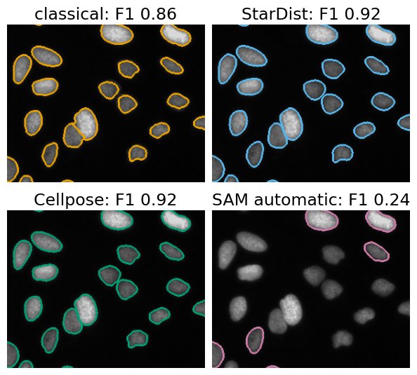
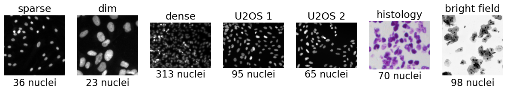
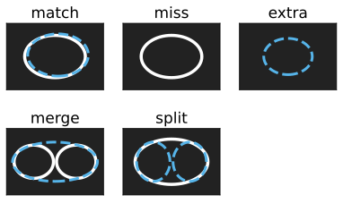
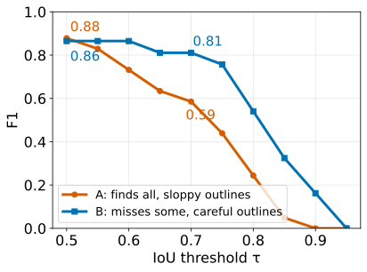
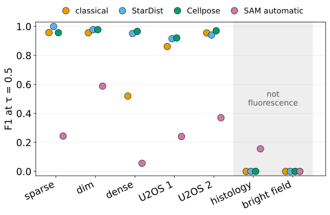
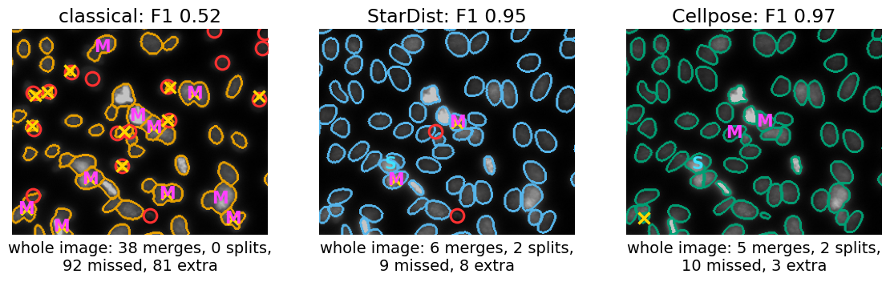
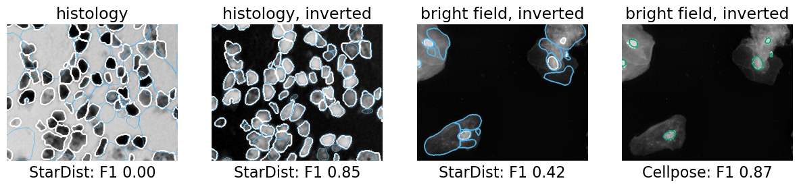
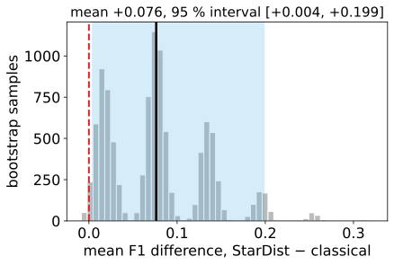
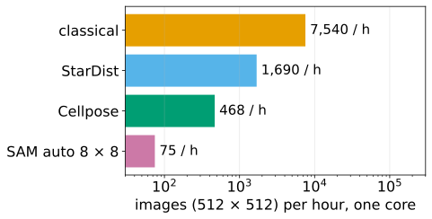
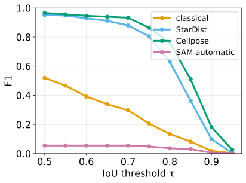

## About this lecture

The last four units opened four networks and showed how each one turns its output into objects. This unit asks the practical question: **on my images, is a network better than a classical pipeline, by how much, and at what cost?**

- The **contestants**: the distance-transform watershed of the [watershed day](../ws-distance/lec.qmd), StarDist, Cellpose, and the automatic mode of SAM, on the **same seven annotated images**.
- **Scoring** with the [evaluation day](../object-eval/lec.qmd)'s object matching: F1 at more than one IoU threshold, splits and merges.
- **Results**, read honestly: where each method wins, where everyone fails, and why.
- **Cost**: parameters, download, time per image, annotation.
- **When to choose what**, and a checklist before you trust a network on your data.

*Slides titled **The math** give the formulas and proofs; the ideas are complete without them.*

::: notes
This is the closing unit of the day "Networks for cells and objects". It uses, but does not re-teach, the object matching of [object-eval/](../object-eval/lec.qmd) (day 37), the [leakage unit](../leakage/lec.qmd) (day 37) and the classical pipeline of [ws-distance/](../ws-distance/lec.qmd) (day 15). All numbers on the slides were measured with tools/figs/cellnets-compare/measure.ts (node, the same Wasm modules and weights as the demos); the demo cellcompare reproduces them in the browser. Demo tour for this deck: the "Try it" slide near the end; the full exploration is in the exercise.
:::

## The question

:::: {.columns}
::: {.column width="52%"}
"The network looks great" is a statement about **pictures**. The question needs **numbers**:

- Run every method on the **same** images.
- Compare each result with an **annotation** (a person outlined every nucleus).
- Count found, missed, extra, merged and split objects with the **object matching** of the [evaluation day](../object-eval/lec.qmd).
- Weigh the difference against the **cost**.

The answer depends on the images: there is no "best method", only a best method **for this kind of image**.
:::
::: {.column width="48%"}
{fig-alt="One field of U2OS nuclei (fluorescence) segmented by four methods, outlines in four colours: the classical pipeline (orange), StarDist (light blue), Cellpose (green) and SAM automatic (pink), each with its F1 at IoU 0.5."}
:::
::::

::: notes
Ask first: "Which of the four would you trust?" Most students pick by eye. The rest of the lecture replaces that impression by numbers. Image: BBBC039 field A02_s1 (U2OS nuclei, Hoechst; Caicedo et al. 2019, CC0), a crop.
:::

## The contestants

:::: {.columns}
::: {.column width="55%"}
- **Classical**: smooth (σ = 1), threshold (Otsu), fill holes, distance transform, h-maxima (h = 1) as seeds, watershed, drop objects below 15 pixels. From the [watershed day](../ws-distance/lec.qmd). Five knobs, no training.
- **StarDist** (fluorescence nuclei model): rays → polygons → polygon suppression, trained thresholds.
- **Cellpose** (nuclei model): flows → follow the arrows → masks; diameter set to the median nucleus size.
- **SAM automatic**: an 8 × 8 grid of point prompts, then the score, stability and overlap filters.
- **YOLO** only as a reminder: a detector trained on photographs has no "nucleus" class, so its F1 is 0 out of the box.
:::
::: {.column width="45%"}
| method | what it needs from you |
|---|---|
| classical | 5 knobs per image type |
| StarDist | nothing (fluorescence) |
| Cellpose | the cell diameter |
| SAM automatic | grid density, filters |
| YOLO | a fine-tuned nucleus class |
:::
::::

The interactive counterpart of SAM's clicks is the graph cut with seeds ([graph-cut day](../graphcut-seg/lec.qmd)): both need a person per object.

::: notes
Same colours on every figure and in the demo: classical orange, StarDist light blue, Cellpose green, SAM pink. Everything here is "out of the box": pretrained weights, default settings; the only per-image setting is Cellpose's diameter, which a user would measure on a few nuclei (we took the median of the annotation, rounded). Software packages with the same names implement these methods.
:::

## The images

{fig-alt="Seven grey-level thumbnails with their numbers of annotated nuclei: sparse (36), dim (23), dense (313), U2OS 1 (95), U2OS 2 (65), histology (70, a colour image of stained tissue) and bright field (98)."}

- Five **fluorescence** images of nuclei, from sparse and bright to dense and dim; two images that are **not** fluorescence (stained tissue, bright field), where the nuclei are dark.
- Public sets with a full annotation: 2018 Data Science Bowl (BBBC038) and BBBC039 (Caicedo et al. 2019, CC0). 700 annotated nuclei in all.

::: notes
The dim image has a maximum grey level of 50 out of 255. The bright-field image is 1024 × 1024, the others between 256 × 256 and 696 × 520. The annotation of the bright-field image marks only the nuclei (dark dots inside the cells), not the cells.
:::

## Recall: scoring objects

:::: {.columns}
::: {.column width="55%"}
From the [evaluation day](../object-eval/lec.qmd):

- **IoU** of a true and a predicted object: overlap / union.
- **Matching** at a threshold τ: pairs with IoU ≥ τ, each object used at most once → TP, FP (extra predictions), FN (missed nuclei).
- **F1** = 2 TP / (number predicted + number true).
- **Merges** (one prediction holds two nuclei) and **splits** (one nucleus cut in two) are the typical errors of instance segmentation.

**One rule**: compare methods on the same images with the same τ, and report F1 at **more than one τ**.
:::
::: {.column width="45%"}
{fig-alt="Four small sketches of a true nucleus (white outline) and predictions (coloured): a match, a miss (no prediction), an extra prediction on background, a merge (one prediction covering two nuclei) and a split (two predictions inside one nucleus)."}
:::
::::

::: notes
F1 at τ = 0.5 is about counting: an object counts as found when it overlaps its partner by more than half. F1 at 0.7 or higher asks for good outlines, which you need for measuring areas or shapes. Above τ = 0.5 a match is unique, so no assignment problem needs solving (object-eval).
:::

## Reading F1(τ) curves

:::: {.columns}
::: {.column width="48%"}
20 nuclei, two methods:

- **A** reports 21 objects; 18 match at τ = 0.5 (F1 **0.88**), only 12 at τ = 0.7 (**0.59**).
- **B** reports 17 objects; 16 match at 0.5 (**0.86**), 15 at 0.7 (**0.81**).

A **finds** more, B **outlines** better. For counting nuclei: A. For measuring their areas: B.

A curve that stays high and flat means good outlines; a curve that drops early means objects found roughly.
:::
::: {.column width="52%"}
{fig-alt="F1 against the IoU threshold from 0.5 to 0.95 for two methods: A starts at 0.88 and falls steeply (0.59 at 0.7), B starts at 0.86 and stays near 0.8 up to 0.7 before falling."}
:::
::::

::: notes
These are the numbers of exercise B1. Every curve falls to 0 near τ = 1: no outline matches a hand-drawn one pixel for pixel, and two annotators do not agree that well either (object-eval, second annotator). So the interesting part of the curve is between 0.5 and about 0.8.
:::

## The math: F1(τ) and its averages {.math}

For a fixed pair of label images, let $\mathrm{TP}(\tau)$ be the number of matched pairs at threshold $\tau$, $N_P$ and $N_T$ the numbers of predicted and true objects:
$$F_1(\tau) = \frac{2\,\mathrm{TP}(\tau)}{N_P + N_T}.$$

- For $\tau \ge 0.5$ the pairs with $\mathrm{IoU} \ge \tau$ are disjoint (each object has at most one partner above one half), so $\mathrm{TP}(\tau) = \#\{\text{pairs with IoU} \ge \tau\}$, which **cannot increase** with $\tau$. Since $N_P + N_T$ does not depend on $\tau$, neither can $F_1(\tau)$.
- One number for a whole curve: the **average over τ** = 0.5, 0.55, …, 0.95 (the averaged "AP" of detection benchmarks is the same idea applied to precision–recall curves). It rewards good outlines; F1(0.5) rewards finding.
- Matching accuracy $\mathrm{TP}/(\mathrm{TP}+\mathrm{FP}+\mathrm{FN})$, often called "AP at τ" in cell-segmentation papers, is a monotone function of $F_1$: $\mathrm{AP}_\tau = F_1/(2 - F_1)$.

::: notes
Proof that pairs above 0.5 are disjoint (object-eval): if T overlapped two predictions with IoU > 0.5 each, each would cover more than half of T, so they would overlap each other, impossible for a label image. The relation AP = F1/(2 − F1): with t = TP, d = FP + FN, F1 = 2t/(2t + d) and AP = t/(t + d); solve.
:::

## Results on seven images {.smaller}

F1 at τ = 0.5 / at τ = 0.7, every method out of the box (measured; the demo reproduces every number):

| | sparse | dim | dense | U2OS 1 | U2OS 2 | histology | bright field |
|---|---|---|---|---|---|---|---|
| nuclei | 36 | 23 | 313 | 95 | 65 | 70 | 98 |
| classical | 0.96 / 0.96 | 0.96 / 0.83 | 0.52 / 0.30 | 0.86 / 0.80 | 0.96 / 0.90 | 0 / 0 | 0 / 0 |
| StarDist | **1.00** / 1.00 | 0.98 / **0.98** | 0.95 / 0.88 | 0.92 / 0.83 | 0.94 / 0.90 | 0 / 0 | 0 / 0 |
| Cellpose | 0.96 / 0.96 | 0.98 / 0.93 | **0.97** / **0.93** | 0.92 / 0.81 | **0.97** / 0.91 | 0 / 0 | 0 / 0 |
| SAM automatic | 0.24 / 0.24 | 0.59 / 0.59 | 0.06 / 0.06 | 0.24 / 0.22 | 0.37 / 0.35 | 0.16 / 0.13 | 0 / 0 |

- **Sparse, bright nuclei**: the classical pipeline is within a few hundredths of the networks.
- **Dense nuclei**: the classical pipeline collapses (38 merges); both networks stay above 0.95.
- **Not fluorescence**: everything scores 0 (next slides).
- **SAM automatic** finds only the few nuclei that a grid point happens to hit.

::: notes
Measured with tools/figs/cellnets-compare/measure.ts (results.json next to it): the classical pipeline with its default knobs (σ 1, Otsu, h 1, minimum size 15), StarDist with its trained thresholds, Cellpose (nuclei) with the diameter set to the median nucleus diameter of the annotation (13, 44, 21, 30, 30, 24, 18 px), SAM automatic with an 8 × 8 grid and the default filters (predicted IoU 0.8, stability 0.95, box overlap 0.7). Ask before revealing: on which images would you expect the classical pipeline to hold up? On U2OS 1 all methods "split" about ten annotated objects (classical 9, StarDist 10, Cellpose 11): most of these are two touching nuclei that the annotator outlined as one object, so part of the "error" is in the annotation.
:::

## Results: a picture

:::: {.columns}
::: {.column width="58%"}
{fig-alt="Dot plot of F1 at IoU 0.5 for the seven images (sparse, dim, dense, U2OS 1, U2OS 2, histology, bright field) and the four methods; the two non-fluorescence images are shaded."}
:::
::: {.column width="42%"}
- Over the five fluorescence images, mean F1 at 0.5: classical **0.85**, StarDist **0.96**, Cellpose **0.96**, SAM automatic **0.30**.
- Most of the networks' advantage comes from **one** image (dense: +0.43); on the other four the differences are a few hundredths, in both directions.
- StarDist and Cellpose are **indistinguishable** here (mean difference 0.00).
- The two networks are not better at everything: on U2OS 2 the classical pipeline beats StarDist (0.96 vs 0.94).
:::
::::

::: notes
The shaded images are not fluorescence: every method fails there out of the box. The averages hide the structure: a method comparison is a table of images × methods, and the interesting rows are the hard images. The math slide "is a difference real?" quantifies how much seven images can tell.
:::

## Where the errors are

{fig-alt="A crop of the dense fluorescence image with outlines of the classical pipeline, StarDist and Cellpose, and error marks: M for merges, S for splits, red circles for missed nuclei, yellow crosses for extra objects."}

On the dense image (313 nuclei, a crop shown): one global threshold has to serve bright and dim nuclei alike: dim nuclei are left out or cut small (missed ○, extra ×), and touching nuclei share one distance-transform peak (**M**). The networks have learned what a nucleus looks like next to another nucleus: 6 and 5 merges in the whole image, against 38.

::: notes
Marks at τ = 0.5: M = merge (a prediction containing two or more annotated nuclei), S = split, red circle = missed nucleus (not part of a merge), yellow cross = extra object. The classical counts for the whole image: 218 objects for 313 nuclei, TP 138, FP 80, FN 175. Turning the knobs helps only a little: h = 0.5 gives F1 0.56, and the best setting of a grid search on this very image 0.65 (exercise E2, and "Honest caveats").
:::

## Out of the training domain

{fig-alt="StarDist outlines (blue) and the annotation (white) on the histology image and a crop of the bright-field image, each as is and with the grey levels inverted, with the F1 values."}

- As is, **every** method scores 0 on both images: nuclei are **dark** on a bright background, the opposite of fluorescence.
- **Inverting** the grey levels helps: on histology StarDist reaches 0.85 and Cellpose 0.87; on bright field Cellpose 0.87, while StarDist (0.42) outlines whole cells as well as nuclei: after inversion the cytoplasm is bright too.
- A network knows only its **training domain**. Inverting is a trick, not a fix: retrain or fine-tune on annotated images of your kind.

::: notes
Inverted runs: histology classical 0.61, StarDist 0.85, Cellpose 0.87, SAM 0.11; bright field classical 0.06, StarDist 0.42, Cellpose 0.87, SAM 0. The Cellpose diameter (18 px) tells it to look for nucleus-sized objects, which is why it ignores the cells; StarDist has no size knob. The stained tissue is a colour image; all methods here see the mean of the three channels.
:::

## Honest caveats

:::: {.columns}
::: {.column width="55%"}
- **One small benchmark**: seven images, 700 nuclei. A different image can change the order.
- **Leakage**: the networks were trained on public nuclei sets, including the Data Science Bowl images or their relatives. Their scores here can be **optimistic** ([leakage](../leakage/lec.qmd), evaluation day).
- **Tuning is training too**: the classical knobs tuned on the very image they are scored on are optimistic as well. Tuned by a grid search on each image, its mean F1 over the fluorescence images rises from 0.85 to **0.92**, but the knobs differ from image to image.
- The **annotation** is one person's opinion; two annotators disagree too (object-eval).
:::
::: {.column width="45%"}
F1 at 0.5 of the classical pipeline:

| image | default knobs | tuned on the image |
|---|---|---|
| sparse | 0.96 | 1.00 |
| dim | 0.96 | 0.98 |
| dense | 0.52 | 0.65 |
| U2OS 1 | 0.86 | 0.96 |
| U2OS 2 | 0.96 | 1.00 |

The tuned numbers are **optimistic**: they would need to be checked on other images.
:::
::::

::: notes
The grid: σ ∈ {0, 1, 2}, h ∈ {0.5, 1, 2, 4}, minimum size ∈ {0, 15, 50}, Otsu or a manual threshold ∈ {0.1, 0.2, 0.35}, 144 settings per image, chosen by F1 at 0.5 on the same image. Choosing the best of 144 on the test image is selection on the test set (the best-of-k problem of the [leakage unit](../leakage/lec.qmd)). Honest procedure: tune on some annotated images, report on others. The same holds for the networks' authors: thresholds were tuned on their validation sets, and some of these public images may have been in their training sets.
:::

## The math: is a difference real? {.math}

:::: {.columns}
::: {.column width="52%"}
Per-image differences $d_i = F_1^{A}(i) - F_1^{B}(i)$, $i = 1 \dots n$; the mean $\bar d$ estimates the difference.

**Bootstrap over images**: draw $n$ images with replacement, recompute $\bar d^{*}$; repeat 10 000 times. The 2.5th and 97.5th percentiles of $\bar d^{*}$ give a 95 % interval.

- Resample **images**, not nuclei: nuclei of one image share staining and focus, so they are not independent ([replicates](../replicates/lec.qmd), evaluation day).
- With $n = 7$ and per-image differences spread by tenths, two methods 0.02 apart are **not distinguishable**: the interval contains 0.
:::
::: {.column width="48%"}
{fig-alt="Histogram of 10 000 bootstrap means of the per-image F1 difference between StarDist and the classical pipeline, with the observed mean and the 95 % interval shaded."}
:::
::::

::: notes
Our seven images: differences StarDist − classical 0.04, 0.02, 0.43, 0.05, −0.01, 0, 0; mean 0.076, bootstrap 95 % interval [0.004, 0.199] (10 000 resamples, seed 1): just above 0, and most of the effect comes from one image (without the dense image the mean difference is 0.02). StarDist − Cellpose: mean −0.001, interval [−0.015, 0.017]: not distinguishable. A percentile bootstrap with n = 7 is itself rough; the message is the order of magnitude. Exercise B6.
:::

## Cost

:::: {.columns}
::: {.column width="50%"}
For one 512 × 512 image on one laptop core, in the browser:

| | parameters | download | time |
|---|---|---|---|
| classical | 5 knobs | none | about 0.5 s |
| StarDist | 1.4 M | 5.5 MB | 2.1 s |
| Cellpose | 6.6 M | 13 MB | 7.7 s (4 workers) |
| SAM automatic 8 × 8 | 39 M | 78 MB | 48 s |

**Annotation** cost: classical none (but tuning); a pretrained network none **if your images look like its training images**; fine-tuning needs hundreds of annotated objects. Checking **any** method needs an annotated subset of your images.
:::
::: {.column width="50%"}
{fig-alt="Images per hour on one core, log scale: the classical pipeline several thousand, StarDist about 1690, Cellpose about 470, SAM automatic about 75."}
:::
::::

::: notes
Network times from the measurements in demos/wasm/*/README.md (StarDist 2.0 s network + 0.13 s decoding; Cellpose 6.3 s + 1.4 s with four workers; SAM 26.6 s encoder + 21.7 s for 64 prompts). Classical: measured in node on the seven images and scaled to 512 × 512. A GPU makes the networks much faster (GPU day); the cost of downloading and annotating stays. Exercise B3: a screen of 10 000 images.
:::

## The math: throughput {.math}

- Images per hour on one worker: $\dfrac{3600}{t_\text{net} + t_\text{decode}}$ (seconds). StarDist: $3600/2.13 \approx 1690$; Cellpose $3600/7.7 \approx 470$; SAM automatic $3600/48.3 \approx 75$.
- $k$ workers on independent **images**: up to $k$ times as many (an image is a natural unit of parallel work).
- $k$ workers on the tiles of **one** image (as Cellpose in the browser): if a fraction $p$ of the time parallelises, the speed-up is at most
$$S(k) = \frac{1}{(1 - p) + p/k} \;\le\; \frac{1}{1 - p} \qquad\text{(Amdahl's law)}.$$
  Cellpose: network 6.3 s of 7.7 s runs in tiles, so even infinitely many workers leave the 1.4 s of flow following: $S \le 7.7/1.4 = 5.5$.

::: notes
The decoding (following the flows, polygon suppression, the automatic-mask filters) is serial in these implementations, which is why it matters more as the network gets faster. Details of parallel hardware: the [GPU day](../gpu-parallel/lec.qmd).
:::

## When to choose what

| your images | first choice | check with |
|---|---|---|
| sparse, bright, round nuclei | classical (fast, explainable) | an annotated subset; F1 at 0.5 and 0.7 |
| dense or dim nuclei | StarDist or Cellpose | same, look at merges |
| irregular cells, cytoplasm | Cellpose (a cell model) | same, look at splits |
| a few odd objects to outline | SAM clicks, or graph-cut seeds | a person, per object |
| counting a known class in video | a fine-tuned detector | boxes vs. annotated boxes |
| anything not like the training images | fine-tune, or classical | a held-out annotated subset |

**Always**: score on a held-out annotated subset of **your** images, and compare with the agreement of a second annotator: a method cannot be expected to beat that.

::: notes
The second-annotator agreement (object-eval exercise E7) is the ceiling: if two people agree at F1 0.85 at τ = 0.7, a method at 0.83 is as good as a person at outlining. Fine-tuning: the [attention unit](../attention/lec.qmd) (pretrained models) and the [leakage unit](../leakage/lec.qmd) (keep the test images apart).
:::

## Try it: all four on one image

```{=html}
<link rel="stylesheet" href="../demos/dist/demo.css">
<div data-demo="cellcompare" data-preset="dense"></div>
<script src="../demos/dist/cellcompare.js"></script>
```

::: notes
Demo tour (cellcompare, preset "dense: networks win?"). 1. The classical result appears at once (orange, top left of "All four") with its error marks: count the M marks (merges). 2. Ask for a prediction, then press "Run StarDist" (about a second after the first download of 5.5 MB): the F1 curve and the table update. 3. "Run Cellpose (nuclei)" (a few seconds, workers in parallel). 4. Compare the F1(τ) curves: which is flattest? 5. Move the h slider of the classical pipeline: fewer merges, more splits. 6. Switch to the preset "histology: everyone struggles", run StarDist; tick "invert grey levels" and run again. SAM automatic takes about a minute: run it last, or skip it on slides. Fallback without the network files: fig-demo.png (exercise).
:::

## Before you trust a segmentation network

:::: {.columns}
::: {.column width="55%"}
1. Do my images look like the **training images** (modality, magnification, staining, cell type)?
2. Did I **annotate** a held-out subset of my own images (a few hundred objects)?
3. Did I score at **two τ** (finding and outlines) and look at **merges and splits**?
4. Did I compare with a **simple baseline** (classical) and with a **second annotator**?
5. Is the difference larger than the **spread over images**?
6. Can I afford it: **time per image** × number of images, download, hardware?
:::
::: {.column width="45%"}
{fig-alt="Measured F1 against IoU threshold on the dense image for the four methods."}
:::
::::

::: notes
The figure: measured F1(τ) on the dense image. Cellpose is flattest (0.97 at 0.5, 0.93 at 0.7), StarDist close (0.95, 0.88), the classical pipeline low and falling (0.52, 0.30), SAM automatic near 0 (it found 9 of 313 nuclei). Use the checklist as the exit ticket of the day.
:::

## Summary

- Compare methods with **numbers on the same annotated images**: F1 at τ = 0.5 (finding) and at 0.7 (outlines), merges and splits, not with pictures.
- On **sparse, bright** fluorescence nuclei a classical pipeline is within a few hundredths of the networks; on **dense** nuclei the networks win clearly (0.95–0.97 against 0.52), mainly by avoiding merges. StarDist and Cellpose are indistinguishable on this benchmark.
- **Out of domain**, everything trained on fluorescence fails; inverting the grey levels helps only partly. Retrain or fine-tune, or use a classical pipeline tuned to the image type.
- **Cost** is more than time: download, parameters, annotation, tuning. Classical: well under a second; networks: seconds; SAM automatic: about a minute per image.
- Small benchmarks, leakage and tuning on the test images all make scores **optimistic**; a bootstrap over images says whether a difference is real.

::: notes
Where this leads: the [next day](../score-matching/lec.qmd) turns from finding objects to generating images (diffusion models); the cell networks return whenever a pipeline needs objects ([tracking](../track-linking/lec.qmd), [measurements](../intensity-features/lec.qmd)).
:::
