## About this lecture

The [previous day](../instances/lec.qmd) ended with four maps a network can predict to separate touching cells. Today the fourth one in full: **flow fields**, the representation of the Cellpose family of networks (Stringer et al., 2021).

- The **training target**: heat spread inside each cell, and arrows that point uphill.
- What the network **predicts**: two arrow components and a cell probability per pixel.
- **Decoding**: every pixel follows the arrows; pixels that meet at the same **sink** form one cell.
- The **flow check**: drop masks whose arrows do not look like the arrows of a cell.
- The **cell diameter**: why the image is rescaled, and what a wrong diameter does.
- What goes wrong, on simulated arrows and on the real network in the browser.

*Slides titled **The math** give the formulas and proofs; the ideas are complete without them.*

::: notes
This unit owns flow fields for the course: the heat target, following the flow, sinks, the flow check, the diameter. The instances unit (previous day) has one pointer slide on flows; StarDist (previous unit) is the polygon route, YOLO and SAM come next, and the comparison unit puts Cellpose next to the classical pipeline on annotated images. Name: Cellpose is a method (like Canny), so its name is used; software packages with the same name implement it.
:::

## Recall: arrows that lead to one point

:::: {.columns}
::: {.column width="58%"}
From the [day on modern deep learning](../instances/lec.qmd) (route 4 of "instances from a pixel map"):

- For every cell pixel the network predicts a small **arrow**.
- Inside each cell the arrows lead, along a path **inside the cell**, to one point.
- Follow the arrows from every pixel: pixels that end at the **same point** belong to the **same cell**.
- This follows bends: a C-shaped or bent cell is no problem.

Today: **where the arrows come from**, **how they are followed**, and **what decides how many cells come out**.
:::
::: {.column width="42%"}
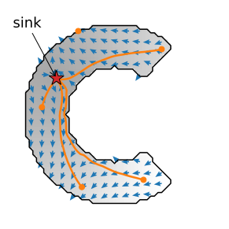{fig-alt="A C-shaped cell with its flow target: blue arrows along the gradient of heat diffused from a source in the cell (red star). Five particle paths (orange) start at the two ends and the middle of the C, follow the arrows around the bend inside the cell, and all end at the star." width="100%"}
:::
::::

## Try it: flows on many cells (simulated)

```{=html}
<link rel="stylesheet" href="../demos/dist/demo.css">
<div data-demo="instancemaps" data-preset="flows"></div>
<script src="../demos/dist/instancemaps.js"></script>
```

::: notes
Warm-up with the [demo of the previous day](../instances/exercise.qmd#explore) (simulated network output: the exact target plus errors). "flows follow the bend": all 14 cells, including the C-shape and the bent cell, are found. Press "animate": the particles (white) run to their sinks. Click a pixel of the C on the map: its path bends around the arc. Then "noisy flows: many sinks": noise 0.7 gives 22 objects, splits in the rod, the C and a round cell. The rest of the lecture explains each part of this pipeline.
:::

## The training target, step by step

Put **heat** at the cell's centre and let it spread **inside the cell only**, as on the [heat-equation day](../heat-equation/lec.qmd): repeatedly replace every pixel by the **average of itself and its neighbours that belong to the cell**.

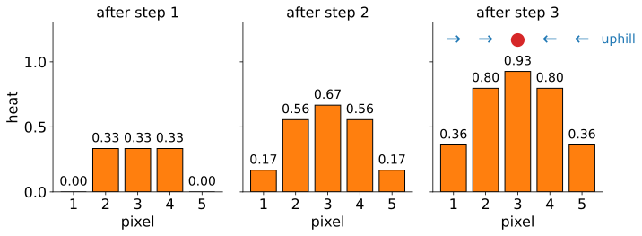{fig-alt="Bar charts of the heat in a cell of 5 pixels with the source at pixel 3, after one, two and three steps of 'add 1 at the source, then average with the neighbours inside the cell': 0, 0.33, 0.33, 0.33, 0; then 0.17, 0.56, 0.67, 0.56, 0.17; then 0.36, 0.80, 0.93, 0.80, 0.36. Above the last chart the arrows: right, right, sink, left, left." width="80%" fig-align="center" .nostretch}

- 5 pixels, source at pixel 3. Each step: add 1 at the source, then average over the in-cell neighbours (the end pixels have only one neighbour inside).
- After 3 steps: (0.36, 0.80, 0.93, 0.80, 0.36). The **arrows point uphill**: →, →, **sink**, ←, ←.
- Arrow = direction of the heat difference between the two neighbours, **length 1**: only the direction matters.

::: notes
Numbers from tools/figs/cellpose/numbers.py. Step 1: the source gets 1, then pixels 2, 3, 4 average to 1/3 each (pixel 2 averages 0, 0, 1; pixel 3 averages 0, 1, 0; …). Step 2: add 1 at pixel 3 (1.33), then average: pixel 1 averages its own 0 and pixel 2's 1/3 = 1/6. The end pixel has only one neighbour inside the cell: there is no "outside" heat. Ask: on a cell of 11 pixels, after 3 steps, which pixels have an arrow? (Exercise B1.)
:::

## Heat in a C-shaped cell

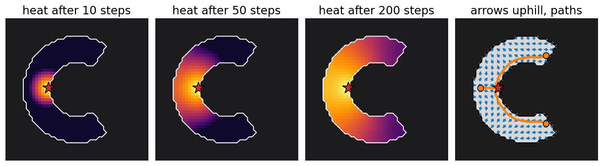{fig-alt="A C-shaped cell of 528 pixels, source (red star) on the back of the C. Heat on a log colour scale after 10 steps: only a small spot around the source is warm. After 50 steps the warm region has crept about halfway along both arms. After 200 steps the whole C is warm, hottest at the source and coolest at the two tips. Right: the arrows (blue) and three paths (orange) from the two tips and the back, all following the arc to the star." width="100%"}

- The source: the cell pixel **nearest the median** of the cell's x and y coordinates (for a C, on its back, not in the hole).
- The heat creeps along the arms; it needs about as many steps as the longest path in the cell to reach the tips (here about 23). The training target uses **2 × (width + height)** of the cell's box: 128 steps here.
- The arrows follow the **arc**, because heat only travels inside the cell.

::: notes
Colour: log scale over 2.5 decades of the heat divided by its maximum, so the creeping front is visible. Numbers from tools/figs/cellpose/demo_numbers.txt: after 10 steps 220 of the 528 pixels have heat; after 20, 513; from 23 steps all. The default number of steps (two times width plus height of the bounding box, as in the Cellpose code) is generous on purpose.
:::

## Why heat, not straight lines to the centre?

:::: {.columns}
::: {.column width="52%"}
Why not let every arrow point **straight at the centre**?

- In a C-shape the straight line from a tip to the centre **crosses the hole**: following it would leave the cell (74 of 101 points on that line lie outside).
- That is the star-convex limitation of the [previous unit](../stardist/lec.qmd) in another guise: straight rays need a star-shaped cell.
- Heat spreads **only through the cell**, so "uphill" **bends around corners**: the path from the tip follows the arc and arrives in 24 steps.

One word of warning: this "diffusion" is the **heat equation** (a PDE), not the generative "diffusion models" of a [later day](../score-matching/lec.qmd).
:::
::: {.column width="48%"}
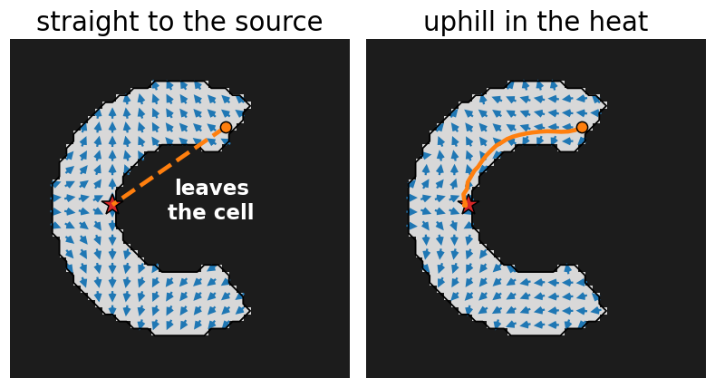{fig-alt="The same C-shaped cell twice. Left: arrows pointing straight at the source; the dashed line from the upper tip to the source runs through the hole of the C, outside the cell. Right: arrows uphill in the heat; the path from the same tip follows the upper arm and the back of the C to the source." width="100%"}
:::
::::

## The math: the heat target {.math}

For a cell $O$ with source $c$, the heat $h$ solves the heat equation with a source, and **no flow across the border**:

$$\partial_t h = \Delta h + \delta_c \ \text{ in } O, \qquad \partial_n h = 0 \ \text{ on } \partial O .$$

- Discretely (recall the [heat-equation day](../heat-equation/lec.qmd)): $h(p) \leftarrow \operatorname{mean}_{q \in N(p) \cap O} h(q)$, after adding 1 at $c$; $N(p)$ is the $3 \times 3$ neighbourhood. Averaging only over in-cell neighbours **is** the no-flux condition.
- The arrows are the **normalised gradient** $\mathbf v = \nabla h / \|\nabla h\|$, with central differences $\partial_x h \approx h(x+1, y) - h(x-1, y)$ (0 outside the cell).
- While heat is fed in at $c$, a pixel away from the source is at most the mean of its in-cell neighbourhood (**discrete subharmonic**; the 8 neighbours of $c$ are the exception, but $c$ itself is warmer). So (maximum principle) every pixel except $c$ has a warmer neighbour: one maximum, one sink per cell (exercise B8).
- Practical versions use $\log(1 + h)$ before the gradient: same direction, better-scaled differences far from the source.

## Try it: heat and arrows

```{=html}
<link rel="stylesheet" href="../demos/dist/demo.css">
<div data-demo="flowtrack" data-preset="heat"></div>
<script src="../demos/dist/flowtrack.js"></script>
```

::: notes
48 × 48 grid. Panel 1: the target's heat after k steps (log scale) and the source (star); panel 2: the arrows ("predicted": the exact target plus the errors you set), colour wheel as in the real demo; panel 3: particles after a chosen number of Euler steps; panel 4: end points (red dots, size = count), seeds (+), masks, flow error per mask. Tour: preset "heat spreads" (k = 10): only 247 of the 528 pixels have an arrow, the decoded mask covers 247 pixels, so the C is missed (FP 1, FN 1). Press "play" next to k: the heat creeps along the arms; from about k = 20 the C is found (522 pixels with an arrow). Then "arrows follow the bend": the clicked tip pixel (30, 12) follows the arc and ends at (13.5, 23.0), the source is (14, 23).
:::

## What the network predicts

:::: {.columns}
::: {.column width="44%"}
A U-Net (the [U-Net unit](../unet/lec.qmd) of the neural networks day) with **three output channels** per pixel:

- **two arrow components** (left–right, up–down): shown as a colour (hue = direction, brightness = length);
- a **cell probability** (as a logit; above the threshold = "inside a cell").

Trained on images with hand-drawn masks: the targets are the heat arrows of each mask, so the network learns to predict them **from the image alone**.

Every cell becomes a small **colour wheel**: each colour points to the cell's centre.
:::
::: {.column width="56%"}
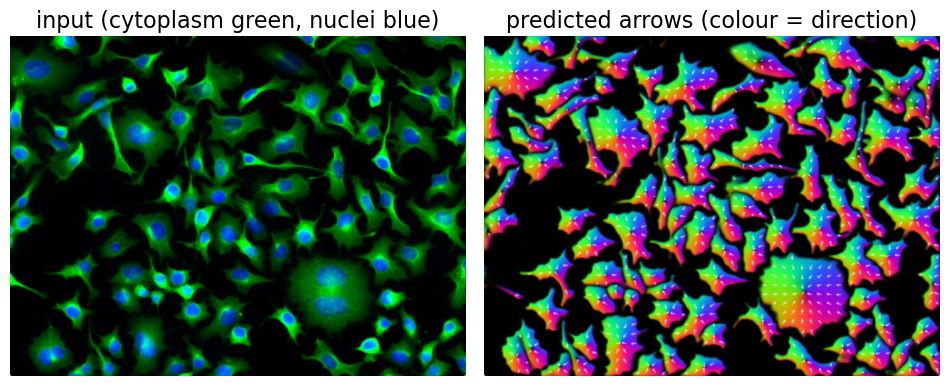{fig-alt="Left: a fluorescence micrograph of about 100 cultured cells, cytoplasm in green and nuclei in blue. Right: the network's predicted arrows for the same image as colours: every cell is a small colour wheel whose colours run around its centre, with white arrows pointing inwards; the background is black." width="100%"}

[Image: Cellpose demo images (cellpose.org), BSD-3-Clause; the real network running in the browser.]{style="font-size: 0.6em; color: #666;"}
:::
::::

::: notes
This is the cyto3 network ("cells") on the 467 × 349 sample, run by the cellposenet demo (Rust compiled to WebAssembly): 6 tiles of 224 × 224, about 5 s on 4 workers. Ask: in one cell, which colour is at the top? Every pixel's arrow points to the centre, so the pixels above the centre point down and share one colour; the colour wheel turns once around each cell.
:::

## Decoding: follow the arrows

:::: {.columns}
::: {.column width="55%"}
1. Every pixel with cell probability above the threshold is a **particle**.
2. Each particle moves **one pixel along the arrow** at its position (interpolated between pixels), again and again: a fixed number of **steps** (default 200 for cells of 30 pixels, scaled with the diameter).
3. Particles gather at **sinks**. Count the end points per pixel (a histogram); its local peaks with more than 10 particles are the **seeds**.
4. Each seed region collects the pixels whose particle arrived there: one **mask** per sink.

No threshold on a distance, no markers to tune: the arrows do the grouping.
:::
::: {.column width="45%"}
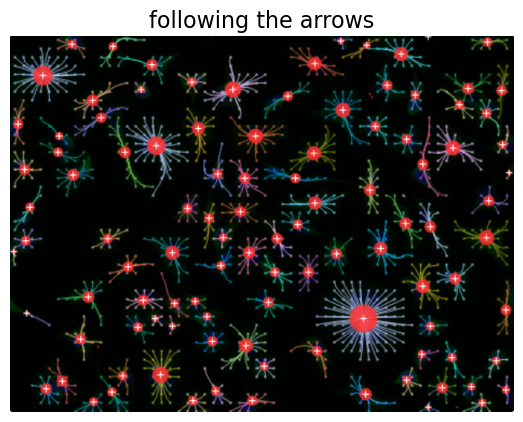{fig-alt="The same micrograph darkened, with the paths of a sample of pixels drawn as thin coloured lines; they converge like the spokes of a wheel on red dots (the sinks, larger where more particles arrived) with white plus signs (the seeds), one per cell." width="100%"}
:::
::::

::: notes
Readout of the cellposenet demo on the cells sample, defaults: 82 806 pixels tracked for 200 steps, 105 sinks with seeds, 105 masks, the flow check removes 3, 102 cells, median diameter 29.1 px; decoding about 0.1–1 s. The seeds are grown a few pixels inside the region where at least 3 particles ended; a pixel whose particle stopped elsewhere gets no label.
:::

## By hand on a grid

:::: {.columns}
::: {.column width="52%"}
A $5 \times 5$ field, one cell per step (· = no movement):

- From (4, 0): → (3, 1) → (2, 1) → (2, 2), and stays: the **sink** in the middle.
- From (3, 3): → (4, 4), and stays: a **second sink**.
- From (0, 0): → (0, 1) → (0, 0) → …: two arrows **point at each other**, the particle goes back and forth: a **spurious sink**.

Group all 25 pixels by where they end: 19 at (2, 2), 4 at (4, 4), 2 stuck in the corner. Three objects: which ones are errors? (Exercise B2.)
:::
::: {.column width="48%"}
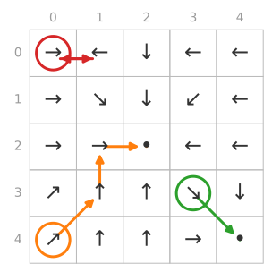{fig-alt="A 5 by 5 grid of arrows. Three paths are drawn: orange from the bottom-left cell up to the centre cell, which has no arrow; green from cell (3, 3) diagonally to the bottom-right cell, which has no arrow; red between the two top-left cells, whose arrows point at each other." width="100%"}
:::
::::

## The math: following the flow {.math}

Following the arrows is the **Euler method** for the ODE $\dot{\mathbf x} = \mathbf v(\mathbf x)$:

$$\mathbf x_{j+1} = \mathbf x_j + \eta\,\mathbf v(\mathbf x_j), \qquad \eta = 1 \text{ pixel},$$

with $\mathbf v$ **bilinearly interpolated** between pixel centres.

- Along an exact path, $\frac{d}{dt}h(\mathbf x(t)) = \nabla h \cdot \mathbf v = \|\nabla h\| > 0$: $h$ only increases, so a path can only end at a maximum of $h$, the source (exercise B7).
- A **sink** is a point where nearby arrows point inwards: $\mathbf v = 0$ and $\nabla\!\cdot\mathbf v < 0$.
- Noise breaks the gradient structure: where noisy arrows point at each other, a new zero of $\mathbf v$ appears, a **spurious sink**. With step 1 a particle between two opposite arrows jumps back and forth; with interpolation and shorter steps it settles at the zero between them (exercise B9).
- The number of steps must exceed the **longest path** in a cell: about the radius for a disc, half the arc length for a C (exercise B10).

## Try it: following the arrows

```{=html}
<link rel="stylesheet" href="../demos/dist/demo.css">
<div data-demo="flowtrack" data-preset="bend"></div>
<script src="../demos/dist/flowtrack.js"></script>
```

::: notes
Preset "arrows follow the bend": press "play" next to "show step": all 528 particles of the C run to one sink. Click any pixel on panel 2 or 3 to draw its path. "too few steps" (10 steps): the particles of the arms are still on their way; only 262 of the 528 pixels end in the seed region, so the mask is the back of the C only (IoU below 0.5: FP 1, FN 1). At 15 steps 382 pixels, at 30 steps all 528 (the longest path in this C is 28 steps). "noise: extra sink" (noise 0.35, flow check off): two sinks, the C comes out in two pieces of 168 and 358 pixels (TP 1 for the large piece, FP 1). "shared field: merge": two touching cells with one smooth field: one sink, one object (FN 1). "B2 grid": the 5 × 5 field of the exercise; click a cell to follow it, "where does every cell end?" groups them.
:::

## The flow check

:::: {.columns}
::: {.column width="52%"}
A mask can come out of the decoding even where the arrows are nonsense (debris, noise, a piece of a split cell). Test each mask:

1. Compute the arrows the mask **should** have: its own heat target.
2. Compare with the **predicted** arrows on its pixels: the **mean squared difference**, the **flow error**.
3. Above the **flow threshold** (default 0.4): drop the mask as implausible.

Four pixels, predicted (1, 0), (0.8, 0.6), (0, 1), (−1, 0), the mask's own (1, 0), (1, 0), (0, 1), (1, 0): squared differences 0, 0.4, 0, 4; mean **1.1 > 0.4**: dropped.
:::
::: {.column width="48%"}
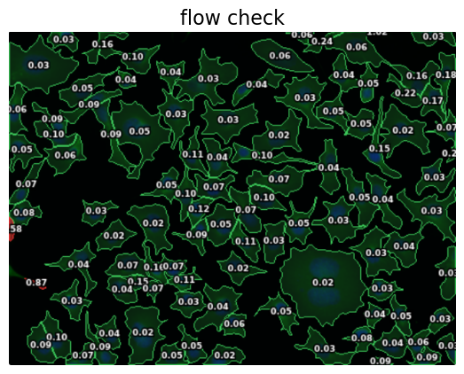{fig-alt="The cells micrograph darkened, each mask outlined: green for kept masks, red for masks whose flow error is above the threshold; the flow error of each mask is printed on it, most values below 0.2." width="100%"}
:::
::::

::: notes
On the cells sample (defaults) the flow errors have median 0.05, 90 % below 0.16, maximum 1.02; the check removes 3 of 105 masks. Threshold 0.2: 6 removed; 0.8: 2 removed. In the flowtrack demo: preset "flow check drops a bad mask": the debris blob in the corner gets random arrows and forms a mask with flow error 1.30 (dropped, hatched); the disc has error 0.00. Ask: if the last predicted arrow were (0.6, 0.8), would the mask be kept? (Mean 0.3: yes.)
:::

## The math: loss and flow check {.math}

**Training loss** per image, with predicted arrows $\hat{\mathbf v}$, target arrows $\mathbf v$ (scaled by 5) and cell probability $\hat p$ (logit $\hat z$):

$$L = \frac{1}{|\Omega|}\sum_{p \in \Omega} \Big( \lambda\,\|\hat{\mathbf v}(p) - 5\,\mathbf v(p)\|^2 \;+\; \operatorname{BCE}\big(\sigma(\hat z(p)),\, [p \in \text{cell}]\big) \Big),$$

with a fixed weight $\lambda$: the arrows are learned by regression (squared error, $\mathbf v = 0$ outside cells), the cell probability by classification (binary cross-entropy, the [neural-networks day](../backprop/lec.qmd)).

**Flow check** of a mask $M$, with $\mathbf v_M$ the arrows of the heat target of $M$ alone:

$$\operatorname{err}(M) = \frac{1}{|M|}\sum_{p \in M} \big\|\hat{\mathbf v}(p)/5 - \mathbf v_M(p)\big\|^2, \qquad \text{keep } M \text{ if } \operatorname{err}(M) \le \tau \ (= 0.4).$$

- $\operatorname{err} = 0$ for exact arrows; two unit arrows at angle $\theta$ differ by $2 - 2\cos\theta$: 0.4 means about 37° on average.
- Pixels only: the check needs no ground truth, so it works on new images.

## Cell diameter and rescaling

The network was trained on cells of **one size**: about 30 pixels across for the cell network, 17 for the nuclei network. So the image is **rescaled** until its cells have that size: cells of 45 px → factor 30/45 = 0.667, and a 600 × 450 image becomes 400 × 300.

:::: {.columns}
::: {.column width="50%"}
- **Too small** a diameter: the image is enlarged too much, each cell looks like a cluster → **splits**; and 4× the pixels for half the diameter.
- **Too large**: cells shrink to a few pixels → **misses**.
:::
::: {.column width="50%"}
- The diameter can be **estimated**: a small regression from the network's internal summary of the image (its "style" vector) to the cell size.
:::
::::

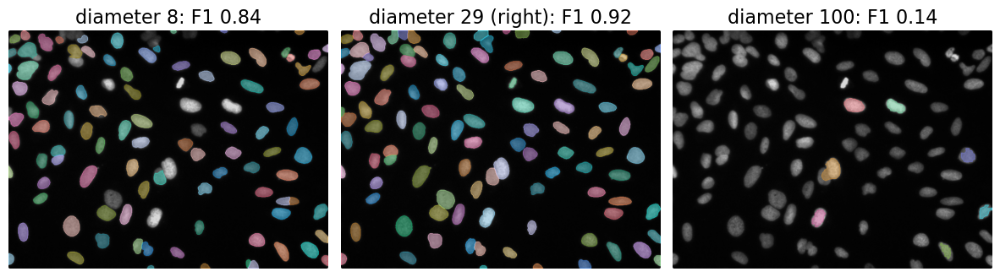{fig-alt="Masks of the nuclei network on a fluorescence image of about 95 nuclei, run with three diameters. Diameter 8: most nuclei found, some split, and several bright nuclei missed; F1 0.84. Diameter 29, the right value: almost every nucleus has one mask; F1 0.92. Diameter 100: only seven masks; F1 0.14." width="88%" fig-align="center" .nostretch}

[Image: BBBC039 (U2OS nuclei), Broad Bioimage Benchmark Collection, CC0.]{style="font-size: 0.6em; color: #666;"}

::: notes
Measured with the real nuclei network (tools/figs/cellpose/measure-sweep.txt, same pipeline as the demo): diameter 8 (image enlarged 2.1×, 63 tiles): 143 masks, the flow check removes 49, 94 cells, F1 0.836 (TP 79, FP 15, FN 16). Diameter 29: 107 cells, F1 0.921. Diameter 100 (image shrunk to 118 × 88): 23 masks, 16 removed, 7 cells, F1 0.137. Between about 20 and 58 the F1 stays between 0.91 and 0.95: the network tolerates a factor of about 2 (its training images were randomly rescaled), not more. The size model of the cell network gives 30.4 px on the cells sample (slider default 30).
:::

## The math: why the scale matters {.math}

- Convolutions are **translation-equivariant** (shift the image, the output shifts) but **not scale-equivariant**: a filter of fixed size sees a different pattern when the cell is twice as large.
- Rescaling by $s = d_\text{train} / d$ maps cells of diameter $d$ to $d_\text{train}$, the size range the filters were trained on. Cost: the number of pixels scales with $s^2$.
- The predicted arrows are resized back to the original image, and the particles move there; the longest path in a disc is about $d/2$, so the number of steps is scaled with the diameter: $n = 200\, d / d_\text{train}$.
- Size model: the network's style vector $\mathbf s$ (a global average of its deepest features) predicts $\log d$ linearly: $\log \hat d = \mathbf a^\top(\mathbf s - \bar{\mathbf s}) + b$, fitted on the training images.

## One network for many kinds of images

:::: {.columns}
::: {.column width="45%"}
Cellpose's networks are **generalists**: trained on many kinds of cells and microscopes at once.

- Each image is **normalised by percentiles** (1st → 0, 99th → 1), so brightness and exposure do not matter.
- Up to **two channels**: the one to segment (cytoplasm, membrane) and an optional nuclear channel.
- Why it generalises: the flow representation is the same for every cell shape, and many different images teach the network what "a cell" is beyond one dataset.
- Where it still fails: images unlike any in training. Stained tissue has **dark** nuclei on a bright background; the nuclei network expects bright nuclei: inverted, F1 0.87; not inverted, **F1 0**.
:::
::: {.column width="55%"}
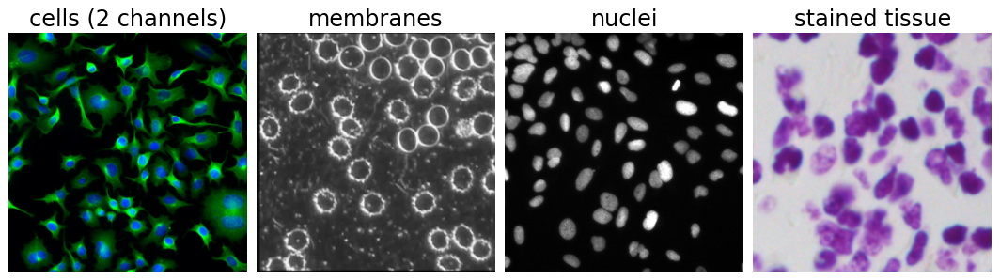{fig-alt="Four sample images: cultured cells with green cytoplasm and blue nuclei; a phase image of cells with bright ring-shaped membranes; grey fluorescent nuclei; a purple-stained tissue section with dark nuclei on a light background." width="100%"}

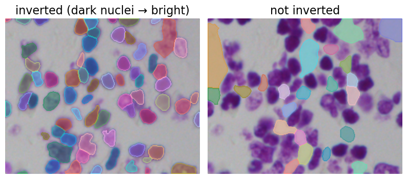{fig-alt="The tissue section with the nuclei network's masks. Left, image inverted: one mask on almost every dark nucleus. Right, not inverted: the masks cover the light gaps between the nuclei instead." width="85%" fig-align="center"}

[Images: Cellpose demo images (BSD-3-Clause); BBBC039 and the 2018 Data Science Bowl (BBBC038), CC0.]{style="font-size: 0.6em; color: #666;"}
:::
::::

::: notes
Measured: tissue sample (70 annotated nuclei), nuclei network, diameter 24: inverted 70 cells, F1 0.871 (TP 61, FP 9, FN 9); not inverted, 48 masks of which the flow check removes 25: 23 cells, all on the background between nuclei, F1 0.000. A generalist still has a domain: polarity is something the user must get right.
:::

## Failures by construction

:::: {.columns}
::: {.column width="45%"}
| Cause | Result |
|---|---|
| noisy arrows | extra sinks: **splits** (often dropped by the flow check) |
| touching cells with one smooth field | one sink: **merge** |
| too few steps | particles not yet arrived: masks **shrink** or break up |
| dim cells below the probability threshold | **misses** |
| wrong diameter | splits (too small) or misses (too large) |
:::
::: {.column width="55%"}
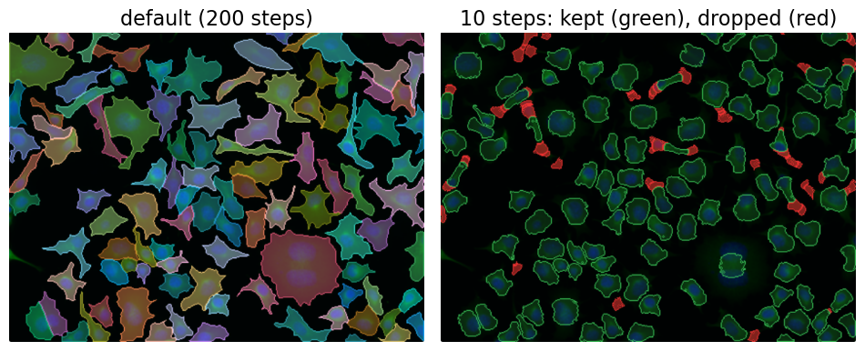{fig-alt="The cells micrograph segmented twice. Left, default 200 steps: one mask per cell, including the long protrusions. Right, only 10 steps, flow-check view: the kept masks (green) cover only the cell bodies around the nuclei, and many small pieces of protrusions are outlined in red as dropped." width="100%"}

Only 10 steps on the cells: 164 sinks instead of 105, the flow check drops 59 of 160 masks, and the 101 kept are smaller (median diameter 24.5 instead of 29.1 px).
:::
::::

::: notes
Real network, cells sample, preset "Only 10 steps" (cellposenet readout): sinks with seeds 164; masks 160, flow check removes 59, 101 cells; median diameter 24.5 px. The particles of the protrusions stop halfway and pile up in many places; those piles become extra seeds and small masks with arrows unlike their own heat target, so most are dropped, and the protrusions are lost. In flowtrack the same on the C: 10 steps keep 262 of 528 pixels.
:::

## Try it: Cellpose in the browser

```{=html}
<link rel="stylesheet" href="../demos/dist/demo.css">
<div data-demo="cellposenet" data-sample="cells" data-view="flows"></div>
<script src="../demos/dist/cellposenet.js"></script>
```

::: notes
The real network (Cellpose 3, cyto3 and nuclei weights, about 13 MB each, loaded once and cached) runs in the browser in Web Workers; a page opened as a local file shows a message instead (static views: fig-cp-flows.png, fig-cp-track.png, fig-cp-check.png). Press "Run Cellpose" (about 5 s on 4 workers for the 467 × 349 cells image). Tour: Flows (colour wheels), Cell probability (white line = threshold), Tracking (click pixels to follow them), Masks, Flow check. Presets: "Only 10 steps" (164 sinks, 101 cells), "No flow check" (104 cells). Then the Nuclei sample (with ground truth: F1 0.921) and the diameter slider: 8 gives F1 0.836, 100 gives 0.137. "Estimate diameter" works with the cell network (30.4 px here).
:::

## Newer versions

:::: {.columns}
::: {.column width="55%"}
- The **flow representation and the decoding stay the same** in later versions; the network around them changes.
- Image restoration in front (denoising, deblurring) for noisy images.
- The latest version replaces the U-Net encoder by the large pretrained image encoder of promptable segmentation (the [SAM unit](../sam/lec.qmd), two units on) and no longer needs a diameter: it was trained to handle cells of very different sizes.
- Too large for this site: about 620 MB of weights even at half precision, against 13 MB for the U-Net.
:::
::: {.column width="45%"}
{fig-alt="The cells image and its predicted arrows as colour wheels, as on the earlier slide." width="100%"}
:::
::::

::: notes
Pointer only (plan/cellnets-day.md, open question 3). Cellpose 2 added training a model on a few of your own images (human in the loop); Cellpose 3 added restoration; Cellpose-SAM (2025) uses the SAM ViT encoder. Software packages with the same name implement all of these.
:::

## Summary

- **Target**: heat spread inside each cell from a source; the arrows point **uphill** and bend with the cell.
- **Network**: a U-Net that predicts two arrow components and a cell probability per pixel.
- **Decoding**: every cell pixel follows the arrows for a fixed number of steps; pixels that meet at the same **sink** are one cell.
- **Flow check**: a mask whose arrows differ from its own target arrows (mean squared difference above 0.4) is dropped.
- **Diameter**: the image is rescaled so that cells have the training size; a factor of about 2 off is tolerated, more is not.
- **Failures**: noisy arrows split, shared fields merge, too few steps shrink, wrong polarity or size fails.
