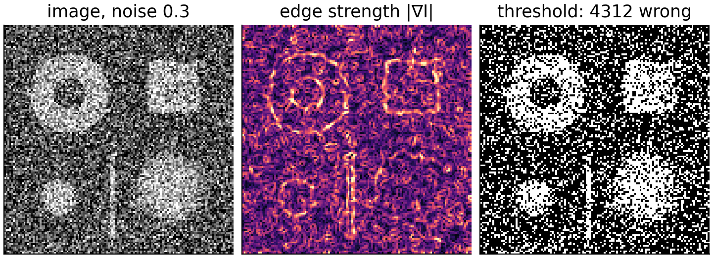
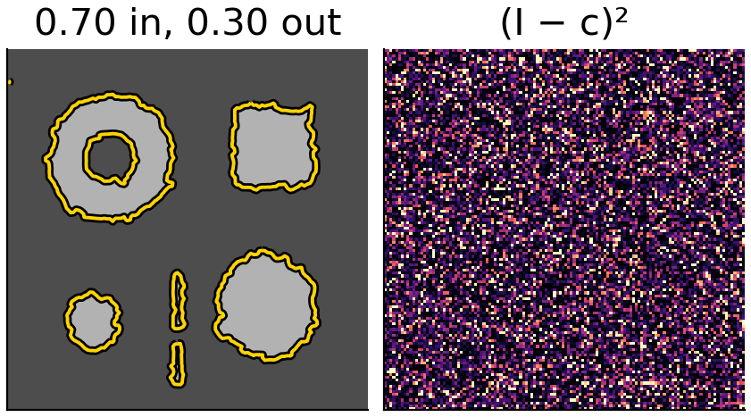
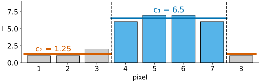
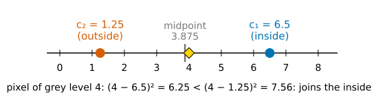
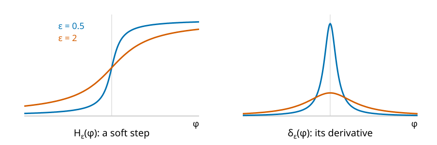
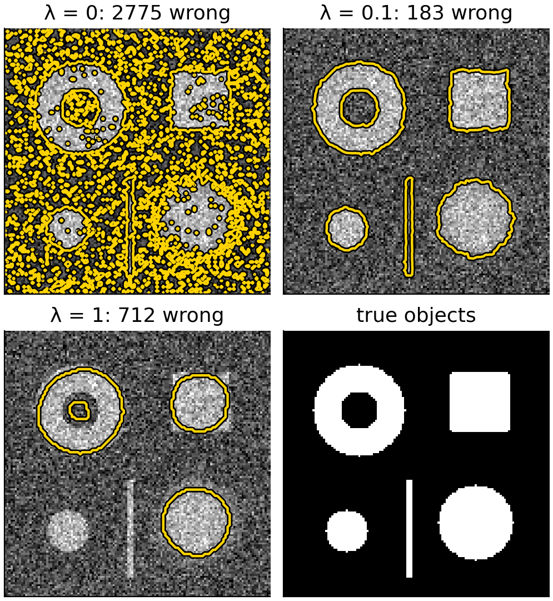
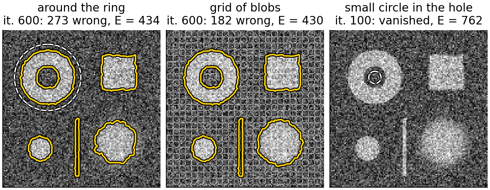
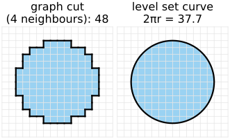

## About this lecture

Edge-based contours stop where the image changes **locally**. In noisy or blurred images there may be no clean edge at all, yet the inside and the outside clearly differ **on average**. Chan & Vese (2001) move the curve to make both regions as uniform as possible: "active contours without edges".

- The **energy**: fit one grey level inside, one outside, and keep the boundary short.
- 8 pixels by hand.
- Alternate: **means** for a fixed curve, then **move** the curve.
- $\lambda = 0$ is **thresholding**; large $\lambda$ loses detail.
- **Holes** appear by themselves; **local minima** and the start.
- The same energy as **graph cuts**, solved differently.

*Slides titled **The math** give the formulas and proofs; the ideas are complete without them.*

::: notes
Prerequisites: the level set units of this day; thresholding and isodata (thresholding day, `otsu/`); the energy data + λ·smoothness (graph cuts day, `seg-energy/`), which owns the energy vocabulary and is only recalled. Grey levels in the demo run from 0 to 1, so the numbers for λ are small.
:::

## When edges are not enough

- Noise: the gradient of a noisy image is large everywhere. Smoothing helps, but also blurs the edges we want.
- Blur: a soft edge spread over 10 pixels has a small gradient: $g$ hardly drops, the front leaks.
- Yet in both cases the **mean** grey level inside an object differs clearly from the mean outside.
- **Thresholding** (the [thresholding day](../histogram/lec.qmd)) uses exactly this, pixel by pixel, and gives a speckled result in noise. The [graph cuts day](../seg-energy/lec.qmd) added a **smoothness** term: data + $\lambda$ · boundary. Chan–Vese is that energy for a **curve**.

{width="72%" fig-align="center" fig-alt="The test image (objects at 0.7 on a background of 0.3) with noise of standard deviation 0.3; its edge strength, bright speckle everywhere with the object outlines barely visible; and the image thresholded at 0.50, heavily speckled: 4312 wrong pixels."}

## The Chan–Vese energy

For a curve $C$ that splits the image into inside and outside, and two grey levels $c_1$ (inside) and $c_2$ (outside):
$$E = \sum_{\text{inside}} (I - c_1)^2 + \sum_{\text{outside}} (I - c_2)^2 + \lambda\cdot\text{Length}(C) + \nu\cdot\text{Area}_{\text{inside}}.$$

- The two sums: how badly a **two-tone** picture (inside $c_1$, outside $c_2$) fits the image. Zero only if each region is perfectly uniform.
- $\lambda\cdot$Length: a short, smooth boundary; $\lambda$ is the weight of the prior, as on the graph cuts day.
- $\nu\cdot$Area: an optional push to make the inside smaller ($\nu > 0$) or larger ($\nu < 0$); usually 0.
- No gradient anywhere: the curve is judged by the **regions** it creates. (This is the piecewise-constant case of the Mumford–Shah model.)

{width="46%" fig-align="center" fig-alt="For the noisy test image after 300 Chan–Vese iterations (λ = 0.2): the two-tone picture with the curve, 0.70 inside and 0.30 outside, and the squared differences between image and two-tone picture, which look like pure noise: a good fit leaves only the noise."}

## Eight pixels by hand

$I = (1, 1, 2, 6, 7, 7, 6, 1)$. Inside = pixels 4–7: $c_1 = 6.5$, $c_2 = 1.25$.

| inside | $c_1$ | $c_2$ | data in | data out | boundary points | $E$, $\lambda = 0$ | $E$, $\lambda = 1$ |
|---|---|---|---|---|---|---|---|
| 4–7 | 6.5 | 1.25 | 1 | 0.75 | 2 | **1.75** | **3.75** |
| 3–7 | 5.6 | 1 | 17.2 | 0 | 2 | 17.2 | 19.2 |
| 4–6 | 6.67 | 2.2 | 0.67 | 18.8 | 2 | 19.47 | 21.47 |
| all | 3.875 | – | 56.875 | – | 0 | 56.875 | 56.875 |

{width="58%" fig-align="center" fig-alt="Bar chart of the eight grey levels 1, 1, 2, 6, 7, 7, 6, 1. Pixels 4 to 7 (inside) are blue, with their mean c1 = 6.5 drawn as a blue line; the others are grey, with their mean c2 = 1.25 as an orange line."}

Moving the boundary by one pixel either way costs a lot: pixel 3 (grey level 2) does not belong with the 6s and 7s, and pixel 7 (grey level 6) does not belong with the 1s.

## Alternate: means, then move

Minimise over the curve and the two grey levels, one at a time:

1. **Fix the curve**: the best $c_1$ and $c_2$ are the **means** of the image inside and outside (the mean minimises a sum of squared differences).
2. **Fix $c_1$, $c_2$**: move the curve a little downhill on $E$. Each pixel near the curve compares its grey level with both means; $\phi$ there changes in proportion to
$$(I - c_1)^2 - (I - c_2)^2 \;+\; \lambda\kappa \;+\; \nu .$$
Negative: $\phi$ decreases, the pixel is **closer to $c_1$** and joins the inside; positive: it leaves. $\lambda\kappa$ keeps the curve short (curvature flow, [unit 2](../levelset-eq/lec.qmd)).
3. Repeat until nothing changes.

In the example, a pixel of grey level 4: $(4 - 6.5)^2 - (4 - 1.25)^2 = 6.25 - 7.56 = -1.31$: it joins the inside.

{width="62%" fig-align="center" fig-alt="A number line from 0 to 8 with c2 = 1.25 (outside, orange), c1 = 6.5 (inside, blue) and their midpoint 3.875. A pixel of grey level 4 lies just above the midpoint: (4 − 6.5)² = 6.25 is smaller than (4 − 1.25)² = 7.56, so it joins the inside."}

## The math: the energy in level set form {.math}

With $\phi < 0$ inside and the Heaviside step $H(\phi)$ (1 outside, 0 inside), $\delta = H'$:
$$E(\phi, c_1, c_2) = \!\int\!(I - c_1)^2(1 - H(\phi)) + \!\int\!(I - c_2)^2 H(\phi) + \lambda\!\int\!\delta(\phi)|\nabla\phi| + \nu\!\int\!(1 - H(\phi)).$$

- $\int\delta(\phi)|\nabla\phi|$ is the length of the zero contour (the co-area formula).
- For fixed $\phi$: $\partial E/\partial c_1 = -2\int(I - c_1)(1 - H) = 0$ gives $c_1 = \int I(1 - H)/\int(1 - H)$, the mean inside; likewise $c_2$.
- The literature writes $\mu$ for the length weight and $\lambda_1, \lambda_2$ for weights on the two data sums; here $\lambda_1 = \lambda_2 = 1$ and $\lambda$ is the length weight, as everywhere in this course.

## The math: gradient descent on φ {.math}

The derivative of $E$ with respect to $\phi$ at a point (Euler–Lagrange; $\nabla\cdot(\nabla\phi/|\nabla\phi|) = \kappa$):
$$\frac{\delta E}{\delta\phi} = \delta(\phi)\Big[-\lambda_1(I - c_1)^2 + \lambda_2(I - c_2)^2 - \lambda\kappa - \nu\Big].$$
Gradient descent, $\phi_t = -\delta E/\delta\phi$:
$$\phi_t = \delta_\varepsilon(\phi)\Big[\lambda\kappa + \nu + \lambda_1(I - c_1)^2 - \lambda_2(I - c_2)^2\Big]$$
(with the convention $\phi > 0$ inside, used by Chan & Vese, every sign in the bracket flips).

- Unequal weights $\lambda_1 \ne \lambda_2$ shift the decision: with $\lambda_1 > \lambda_2$ a pixel must be closer to $c_1$ to join the inside.
- Numerically the curvature term is taken implicitly (Chan & Vese's semi-implicit scheme), so large time steps are stable.

## A soft step and its derivative

{width="75%"}

- The sharp step $H$ has a spike for a derivative. In practice both are **smoothed** with a width $\varepsilon$: $H_\varepsilon$ (left) and $\delta_\varepsilon$ (right).
- The update of each pixel is weighted by $\delta_\varepsilon(\phi)$: pixels near the curve ($\phi \approx 0$) change fast, pixels far away slowly.
- Narrow $\delta_\varepsilon$: only the curve itself moves, like a front. **Wide** $\delta_\varepsilon$: pixels far from the curve can also change sign: **new pieces and holes** appear where the data want them.

## Try it: regions, not edges

```{=html}
<link rel="stylesheet" href="../demos/dist/demo.css">
<div data-demo="chanvese" data-preset="noise"></div>
<script src="../demos/dist/chanvese.js"></script>
```

::: notes
Test image, grey levels 0 to 1: objects at 0.7 on 0.3 (a ring, a square, a disk with a blurred edge, a small disk, a bar 3 pixels wide). Noise 0.3, start: a grid of small blobs, λ = 0.2. Middle: thresholding at (c1 + c2)/2 with the current means, φ, the histogram with c1 (inside), c2 and the threshold, and E against the iteration. Tour: play: after 300 iterations c1 = 0.70, c2 = 0.30, 371 wrong pixels, against 4312 for the threshold at (c1 + c2)/2. Switch to "edge-based" (the gac flow, shrink-wrap from a box, σ = 2, k = 8, c = −0.3, a = 5): the front sticks in the noise (still one ragged curve after 2000 steps, 3966 wrong): noise kills the edges. Then "λ = 0 is thresholding" (noise 0.15): after a while the "≠ threshold" count goes towards 0; "large λ" (λ = 1) drops the bar and the small disk.
:::

## λ: from thresholding to smooth shapes

:::: {.columns}
::: {.column width="56%"}
- **$\lambda = 0$**: no length term. Each pixel joins the side whose mean is closer, i.e. the image is **thresholded at $(c_1 + c_2)/2$**, and the means are recomputed: exactly the **isodata** iteration of the [thresholding day](../otsu/lec.qmd). ("$\lambda = 0$ is thresholding", as on the graph cuts day.)
- **Small $\lambda$**: isolated noise pixels cost more boundary than they save in data: they disappear. The boundary follows the objects.
- **Large $\lambda$**: thin and small objects have much boundary for little area: they are dropped (the shrinking bias of the [graph cuts day](../graphcut-seg/lec.qmd)). Corners are rounded.
- In the 8 pixels $I = (1, 1, 1, 6, 6, 3, 6, 1)$: with $\lambda = 0$ the best split leaves the "3" outside ($E = 3.2$, four boundary points); for $\lambda > 1.775$ filling it in (two boundary points, $E = 6.75 + 2\lambda$) is cheaper.
:::
::: {.column width="44%"}
{width="100%" fig-alt="Chan–Vese after 300 iterations from a grid of blobs on the test image with noise 0.15. λ = 0: hundreds of small contours around single noise pixels, 2775 wrong pixels. λ = 0.1: one clean contour per object including the thin bar, 183 wrong. λ = 1: smooth round shapes, the thin bar and the small disk are lost, 712 wrong. Fourth panel: the true objects."}
:::
::::

## New pieces, holes, and local minima

- With a wide $\delta_\varepsilon$, a hole inside an object (or a second object) can **appear** anywhere, far from the start curve. Topology for free, again.
- But $E$ is minimised **locally**: the curve slides downhill from where it starts and stops in the first valley.
- A bad start: a small circle in a region of one grey level only. Inside and outside then have nearly the same mean, the data barely push, and the length term shrinks the curve to nothing.
- The classic robust start is a **grid of small blobs** over the whole image: every region is sampled from the beginning, and the two means separate quickly.

{width="70%" fig-align="center" fig-alt="Three starts on the same image (noise 0.15, λ = 0.1). A circle around the ring (dashed): after 600 iterations the ring's hole has opened and all objects are found, 273 wrong pixels, E = 434. A grid of small blobs: 182 wrong, E = 430. A small circle in the ring's hole (ε = 0.1): it vanishes within 100 iterations and E stays at 762."}

## Try it: holes and bad starts

```{=html}
<link rel="stylesheet" href="../demos/dist/demo.css">
<div data-demo="chanvese" data-preset="hole"></div>
<script src="../demos/dist/chanvese.js"></script>
```

::: notes
"a hole appears": one circle around the ring (its hole is 18 pixels inside the start curve), δ width ε = 1. The ring's hole opens around iteration 200; by iteration 600 all objects are found (273 wrong pixels). With ε = 0.1 the hole opens only after about 350 iterations: the far pixels hardly move. "bad start": a small circle in the ring's hole, ε = 0.1: the curve vanishes within 100 iterations and E stays at 762, against 430 from the grid start. "gradient background": the background rises from 0.05 to 0.6 left to right: two means cannot describe it, and the right part of the background is labelled object (about 4370 wrong pixels, as many as thresholding). Edge-based on the same image: 1463 wrong; the ramp is no edge.
:::

## Regions or edges?

| | edge-based (geodesic) | region-based (Chan–Vese) |
|---|---|---|
| looks at | local differences, $\lvert\nabla I_\sigma\rvert$ | means of whole regions |
| noise | needs smoothing; stops on noise or leaks | averages it out |
| blurred or weak edges | leaks | fine, if the means differ |
| uneven background, shading | fine (edges are local) | fails: one mean per region |
| objects of several grey levels | fine | needs more phases |
| start | near the objects, balloon direction | anywhere; grid of blobs |

Both are local minimisers; both give a smooth, sub-pixel curve; both change topology freely.

## The same energy as graph cuts

:::: {.columns}
::: {.column width="62%"}
The [graph cuts day](../seg-energy/lec.qmd) minimised data + $\lambda\cdot$(number of neighbouring pairs with different labels). For fixed $c_1$, $c_2$ the Chan–Vese energy is the same thing: data $(I - c_\ell)^2$ per pixel plus $\lambda\cdot$boundary length.

- **Graph cuts**: labels on a pixel graph; for fixed means the **global** minimum in one max-flow. Boundaries are measured along the grid (metrication: blocky with 4 neighbours).
- **Level sets**: a continuous curve, sub-pixel, smooth, true Euclidean length; any differentiable energy can be added (shape priors, more terms); but only a **local** minimum, and the result depends on the start.
- Alternating "means, then a graph cut" is also possible: the same model, a different optimiser.
:::
::: {.column width="38%"}
{width="100%" fig-alt="Boundary length of a disk of radius 6 pixels. Left: as pixel labels, its boundary along the grid, counted with 4 neighbours, is 48. Right: as a level set curve, a smooth circle of length 2πr = 37.7."}
:::
::::

## Beyond two grey levels

Pointers, not covered:

- **Several phases**: two level set functions give four regions (inside/outside of each), Vese & Chan's multiphase model.
- **Colour or multichannel** images: a mean **vector** per region, squared distances summed over channels.
- **Shading**: allow the grey level to vary smoothly inside a region (piecewise-smooth Mumford–Shah), or fit local means in a window around each pixel.
- **Shape priors**: an extra energy that prefers a known shape, such as the [shape models](../shape-models/lec.qmd) of the snakes day.

## Summary

- **Chan–Vese energy**: $\sum_{\text{in}}(I - c_1)^2 + \sum_{\text{out}}(I - c_2)^2 + \lambda\cdot$Length $+ \nu\cdot$Area.
- **Alternate**: $c_1$, $c_2$ = means inside and outside; then each pixel near the curve moves towards the region whose mean it is closer to, while $\lambda\kappa$ keeps the curve short.
- $\lambda = 0$: thresholding at $(c_1 + c_2)/2$, the isodata fixed point; large $\lambda$: smooth, small and thin objects lost.
- No gradients: robust to noise and blur; fails when one mean per region does not fit (shading).
- A wide $\delta_\varepsilon$ lets holes and new pieces appear; local minima: start from a grid of blobs.
- The same energy as graph cuts on the pixel graph: global and discrete there, local and continuous here.
