## About this lecture

The first unit of the day on **support vector machines**. Before margins and kernel functions, the object they improve: a **straight line** (a plane, a hyperplane) that splits a feature space in two.

- Pixels, objects and windows all become **points with labels**.
- A threshold is already a **linear classifier**; in 2D it is a line, $f(\mathbf x) = \mathbf w \cdot \mathbf x + b$.
- **Geometry**: $\mathbf w$ is the normal, $b$ shifts the line, $f/\|\mathbf w\|$ is the signed distance.
- Many lines separate the training points: **which one?** Nearest class mean is one answer.
- When **no** line works: XOR, a ring around a blob.

*Slides titled **The math** give the formulas and proofs; the ideas are complete without them.*

::: notes
Elective day after the random forests day. Unit 1 recalls that day's vocabulary in one slide and spends the time on the geometry of a line, which units 2 and 3 build on: the max-margin line (unit 2) and lines in a lifted space (unit 3). Unit 4 brings the SVM back to pixels.
:::

## Recall: classification (the random forests day)

:::: {.columns}
::: {.column width="58%"}
- A pixel, an object or an image window is a **point in a feature space**, with a **label** that someone painted or typed.
- A classifier **colours the feature space**: every point gets a class.
- Fit on **training** data; choose settings on **validation** data; report on **test** data, touched once.
- **Overfitting**: perfect on the training points, wrong on new ones. **Cross-validation** rotates the validation part.

All of this is taught on the random forests day; here we only use it.
:::
::: {.column width="42%"}
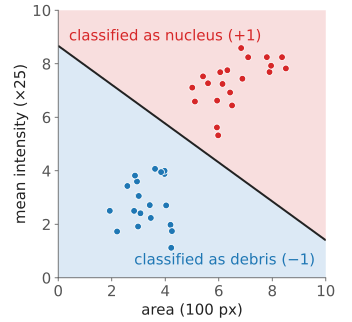{width="100%" fig-alt="Scatter plot of 40 objects, area against mean intensity; the plane is shaded red above a line and blue below it."}
:::
::::

## Three ways image analysis becomes classification

:::: {.columns}
::: {.column width="62%"}
- **Pixels**: each pixel gets a vector from a stack of filtered images (intensity, smoothed at several scales, edges, blobs, texture). Label: nucleus / cytoplasm / background.
- **Objects**: each segmented object is a row of the measurement table (area, mean intensity, form factor, texture). Label: dividing / not dividing, cell / debris.
- **Windows**: a patch around each position is described by a vector (e.g. histograms of gradient directions). Label: "cell here" / "no cell".

In all three: **a point in a feature space, with a label**. The rest of the day works on such points; the pictures are 2D, the real spaces have tens or hundreds of axes.
:::
::: {.column width="38%"}
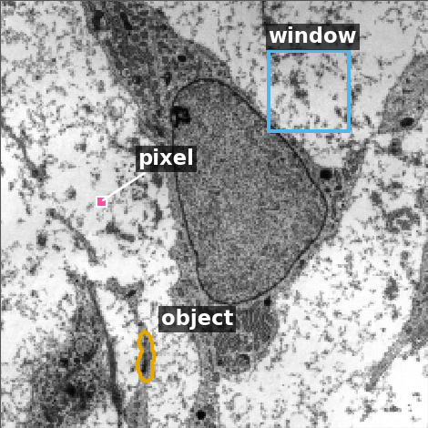{width="100%" fig-alt="Electron micrograph of a cell with one pixel, one segmented dark object and one square window marked."}

::: {style="font-size: 0.6em; color: #666;"}
Micrograph: Robert M. Hunt, CC BY 3.0, via Wikimedia Commons.
:::
:::
::::

::: notes
The micrograph: transmission electron micrograph of a mesenchymal stem cell, Robert M. Hunt, CC BY 3.0, via Wikimedia Commons.
:::

## A threshold is a linear classifier

:::: {.columns}
::: {.column width="60%"}
The thresholding day: a pixel is object if its intensity $x > t$.

- Write it as $f(x) = x - t$ and **decide by the sign**: $f > 0$ → object, $f < 0$ → background.
- Two features: $f(\mathbf x) = w_1x_1 + w_2x_2 + b$. The boundary $f = 0$ is a **line**.
- $d$ features: $f(\mathbf x) = \mathbf w \cdot \mathbf x + b$, the boundary is a **hyperplane** (a flat surface of dimension $d - 1$).

Labels on this day are $y = +1$ and $y = -1$, so "correct" means $y\,f(\mathbf x) > 0$.
:::
::: {.column width="40%"}
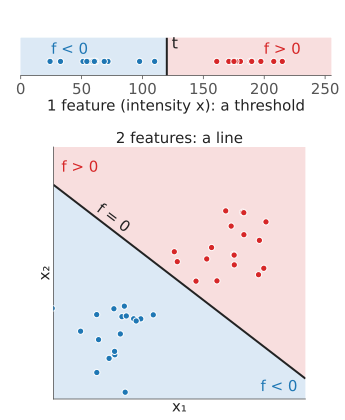{width="100%" fig-alt="Top: intensities on an axis split by a threshold t into f below 0 and f above 0. Bottom: two features, the two classes split by the line f = 0."}
:::
::::

## The geometry of a line

:::: {.columns}
::: {.column width="45%"}
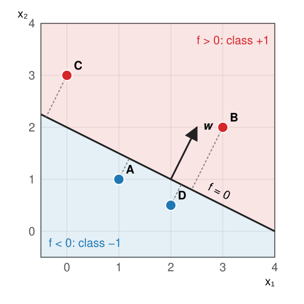{width="100%"}
:::
::: {.column width="55%"}
$f(\mathbf x) = x_1 + 2x_2 - 4$, so $\mathbf w = (1, 2)$, $b = -4$.

- $\mathbf w$ is **perpendicular** to the line and points to the $+$ side.
- $b$ **shifts** the line along $\mathbf w$.
- $f(\mathbf x)/\|\mathbf w\|$ is the **signed distance** to the line.
- Point A $= (1, 1)$: $f = -1$, distance $-1/\sqrt5 = -0.45$. B $= (3, 2)$: $f = 3$, distance $+1.34$.
:::
::::

## Scaling changes nothing

:::: {.columns}
::: {.column width="45%"}
Multiply $\mathbf w$ and $b$ by the same $c > 0$: $f$ is multiplied by $c$.

- The **sign** of $f$ is unchanged: the same line, the same decisions.
- The **distance** $f/\|\mathbf w\|$ is unchanged: $c$ cancels.
- Only the **value** of $f$ changes. So "$f = 1$" means nothing until we fix the scale.

:::
::: {.column width="55%"}
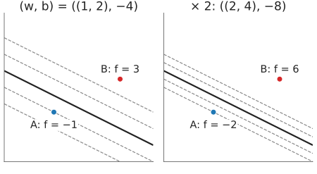{width="100%" fig-alt="Two panels with the same line x1 + 2 x2 = 4 and dashed level lines of f; after doubling w and b the level lines f = ±1, ±2 move twice as close to the line, and the values at A and B double."}

Dashed: the level lines $f = \pm1, \pm2$. Doubling moves them closer; the line stays.
:::
::::

The next unit uses exactly this freedom: it fixes the scale so that the closest points have $f = \pm 1$.

## The math: distance to a hyperplane {.math}

:::: {.columns}
::: {.column width="64%"}
Let $\mathbf x_0$ be any point on the hyperplane, $\mathbf w\cdot\mathbf x_0 + b = 0$. The distance of $\mathbf x$ is the length of the projection of $\mathbf x - \mathbf x_0$ on the unit normal $\mathbf w/\|\mathbf w\|$:

$$\text{dist}(\mathbf x) = \frac{\mathbf w\cdot(\mathbf x - \mathbf x_0)}{\|\mathbf w\|} = \frac{\mathbf w\cdot\mathbf x + b}{\|\mathbf w\|} = \frac{f(\mathbf x)}{\|\mathbf w\|}.$$

- Signed: positive on the side $\mathbf w$ points to. The absolute value is the usual distance.
- The distance of the origin is $b/\|\mathbf w\|$: $b$ is the offset, measured in units of $\|\mathbf w\|$.
- $(c\mathbf w, cb)$ gives $c f / (c\|\mathbf w\|)$: the same distance.
:::
::: {.column width="36%"}
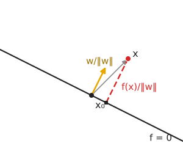{width="100%" fig-alt="A line with a point x0 on it, the unit normal, a point x and the dashed perpendicular from x to the line, labelled f(x)/‖w‖."}
:::
::::

## Try it: a line in a feature space

```{=html}
<link rel="stylesheet" href="../demos/dist/demo.css">
<div data-demo="linclass" data-preset="byhand" data-labels="1" data-presets="byhand,many,mean,outlier,xor,ring"></div>
<script src="../demos/dist/linclass.js"></script>
```

::: notes
Drag the arrow's tip (w) and foot (b). Tour: "by hand": the four exercise points with their signed distances (A and D at −0.45, B at +1.34, C at +0.89). Press "(w, b) × 2": the line does not move, f doubles (readout), the distances stay. "Many lines are perfect": turn w and shift the line: many lines have 0 errors; which do you trust? Their smallest distance (the readout) differs. Then "nearest class mean" (the dashed segment joins the two means).
:::

## Which line? The error rate is not enough

:::: {.columns}
::: {.column width="58%"}
- **0–1 loss**: count the training points on the wrong side. On separable data, infinitely many lines have **zero** errors.
- A line that just grazes a training point will misclassify a new point that lies a little further: we want the line **far from all points**.
- Three answers:
  - **nearest class mean**: the perpendicular bisector of the two class means;
  - **1-nearest neighbour**: no line at all, a boundary of many pieces;
  - the **max-margin** line (next unit): as far as possible from the closest points of both classes.
:::
::: {.column width="42%"}
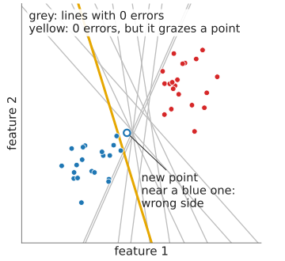{width="100%" fig-alt="Two clouds of points with many grey separating lines; a yellow separating line passes right next to a blue point, and a new point just beyond it lands on the wrong side."}
:::
::::

## Nearest class mean is a line

:::: {.columns}
::: {.column width="60%"}
Assign $\mathbf x$ to the class whose **mean** is closer: $\boldsymbol\mu_+$ or $\boldsymbol\mu_-$.

- The boundary is where both are equally far: the **perpendicular bisector** of $\boldsymbol\mu_+$ and $\boldsymbol\mu_-$.
- So $\mathbf w = \boldsymbol\mu_+ - \boldsymbol\mu_-$, and the line passes through the midpoint $(\boldsymbol\mu_+ + \boldsymbol\mu_-)/2$.
- Example: $\boldsymbol\mu_+ = (4, 3)$, $\boldsymbol\mu_- = (1, 1)$: $\mathbf w = (3, 2)$, midpoint $(2.5, 2)$, $b = -(3 \cdot 2.5 + 2 \cdot 2) = -11.5$.
- It uses only two numbers per class; it ignores the **shape** of the clouds. Long, slanted clouds defeat it.
:::
::: {.column width="40%"}
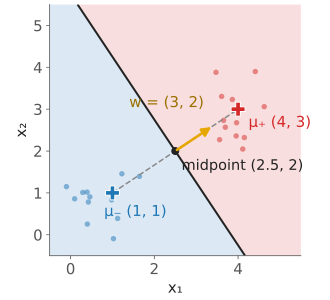{width="100%" fig-alt="The class means (1, 1) and (4, 3), the segment between them, its midpoint (2.5, 2), the arrow w = (3, 2), and the perpendicular bisector as boundary."}
:::
::::

## The math: nearest class mean is linear {.math}

$$\|\mathbf x - \boldsymbol\mu_-\|^2 - \|\mathbf x - \boldsymbol\mu_+\|^2 = 2(\boldsymbol\mu_+ - \boldsymbol\mu_-)\cdot\mathbf x - \left(\|\boldsymbol\mu_+\|^2 - \|\boldsymbol\mu_-\|^2\right).$$

The squares $\|\mathbf x\|^2$ cancel. Half of this is $f(\mathbf x) = \mathbf w\cdot\mathbf x + b$ with

$$\mathbf w = \boldsymbol\mu_+ - \boldsymbol\mu_-, \qquad b = -\tfrac12\left(\|\boldsymbol\mu_+\|^2 - \|\boldsymbol\mu_-\|^2\right) = -\mathbf w\cdot\frac{\boldsymbol\mu_+ + \boldsymbol\mu_-}{2}.$$

$f > 0$ exactly when $\boldsymbol\mu_+$ is the closer mean. With a shared covariance matrix $\Sigma$ in the distance ($\mathbf w = \Sigma^{-1}(\boldsymbol\mu_+ - \boldsymbol\mu_-)$) the rule is still linear: that is linear discriminant analysis.

## Try it: nearest mean is not the best line

```{=html}
<link rel="stylesheet" href="../demos/dist/demo.css">
<div data-demo="linclass" data-preset="mean" data-presets="byhand,many,mean,outlier,xor,ring"></div>
<script src="../demos/dist/linclass.js"></script>
```

::: notes
"Nearest mean is not the best line": two long parallel clouds, shifted along their length. Press "nearest class mean": 9 errors of 60. Drag the arrow so that the line runs along the clouds: 0 errors. The means carry no information about the shape. "One outlier": every line makes at least one error; the nearest-mean line too. Tick "shade the 1-NN regions": 1-NN follows every point, including the outlier (an island around it).
:::

## Generative or discriminative?

:::: {.columns}
::: {.column width="50%"}
Two ways to get a classifier from labelled points:

- **Generative**: describe each class by a probability model (e.g. a Gaussian per class), then ask which class makes $\mathbf x$ more likely. The thresholding day's minimum-error threshold is the 1D case; the Gaussian mixtures day fits such models, even without labels.
- **Discriminative**: never describe the classes, only look for a **boundary** that separates them. Nearest-mean is in between; the SVM is purely discriminative.

:::
::: {.column width="50%"}
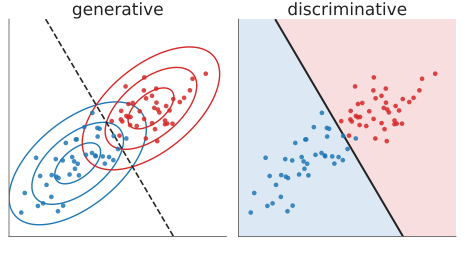{width="100%" fig-alt="Left: the same two classes with a Gaussian contour model per class and the boundary where they are equally likely (dashed). Right: only the boundary line, with the two sides shaded."}
:::
::::

A discriminative method spends its effort near the boundary, where the decisions are made, not in the middle of the clouds.

## One neuron is a linear classifier

The neural networks day: a neuron computes $\mathbf w\cdot\mathbf x + b$ and passes it through a bend.

- With a **sign** output it is exactly our $f$: a linear classifier.
- The **perceptron** rule moves the line one point at a time: for a wrong point, $\mathbf w \leftarrow \mathbf w + y\,\mathbf x$, $b \leftarrow b + y$. It stops at **some** separating line, whichever it hits first.
- An SVM and a logistic neuron differ only in **what they minimise** (next unit: the hinge loss and the margin).

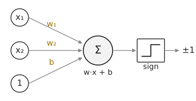{width="42%" fig-alt="A neuron: inputs x1, x2 and 1 with weights w1, w2 and b feed a sum w·x + b, followed by a sign step that outputs ±1."}

## When no line works

:::: {.columns}
::: {.column width="55%"}
- **XOR**: opposite corners share a class. Any line makes at least about a quarter of errors (in the demo, the best line still has 14 of 60 wrong).
- **A ring around a blob**: a nucleus (inside) and its cytoplasm (around), in two intensity features: the inside cannot be cut out by a line.
- Options: **more features** (unit 3: add $x_1x_2$, or $x_1^2 + x_2^2$, and a line works again), a non-linear method (1-NN, trees, networks), or the SVM's **kernel functions** (unit 3).
:::
::: {.column width="45%"}
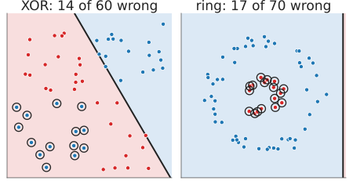{width="100%" fig-alt="Left: XOR data with the best line, 14 of 60 points wrong (circled). Right: a ring around a blob; the best line puts everything on one side, 17 of 70 wrong."}

The best line (circled: wrong). For the ring it gives up the inner class.
:::
::::

## Summary

- Pixels, objects and windows become **points with labels** in a feature space.
- A **linear classifier** decides by the sign of $f(\mathbf x) = \mathbf w\cdot\mathbf x + b$: a threshold in 1D, a line in 2D, a hyperplane in $d$ dimensions.
- $\mathbf w$ = normal, $b$ = offset, $f/\|\mathbf w\|$ = **signed distance**; scaling $(\mathbf w, b)$ changes nothing.
- Many lines separate the training data. **Nearest class mean** is a line through the midpoint, perpendicular to $\boldsymbol\mu_+ - \boldsymbol\mu_-$; it ignores the shape of the clouds.
- Some problems (XOR, rings) need **more than a line**.
