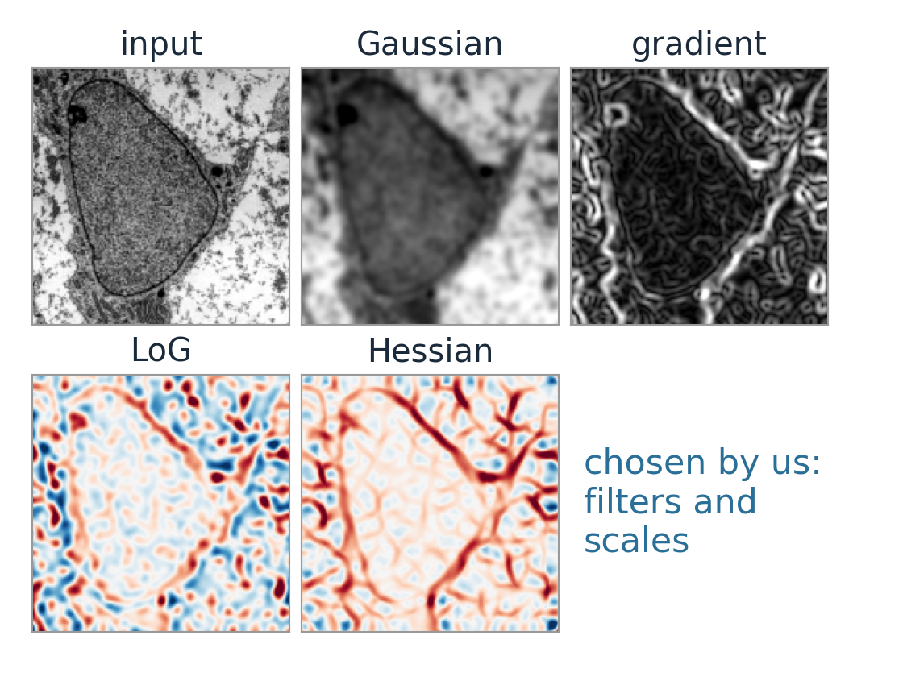
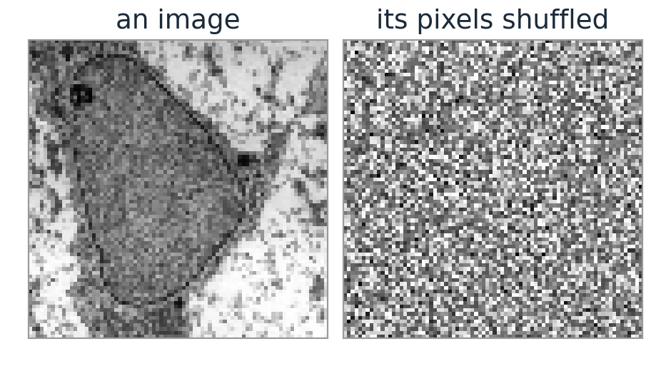
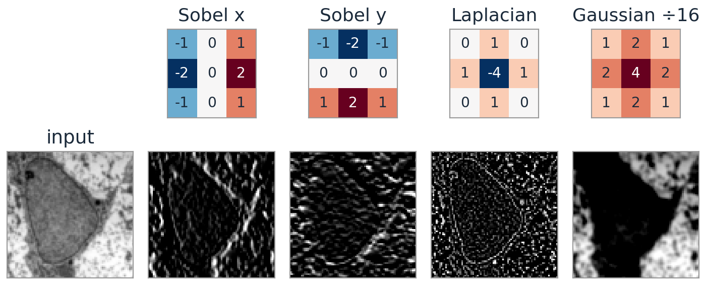
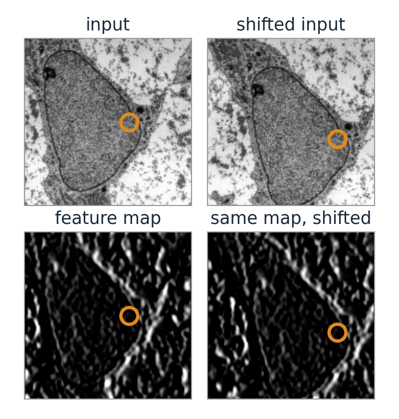
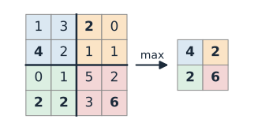
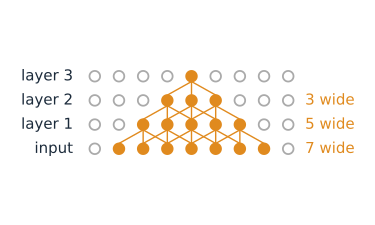
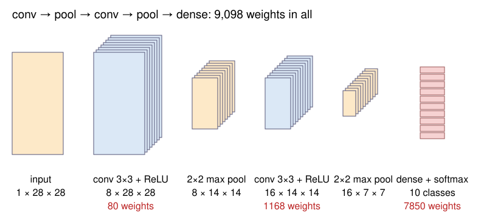
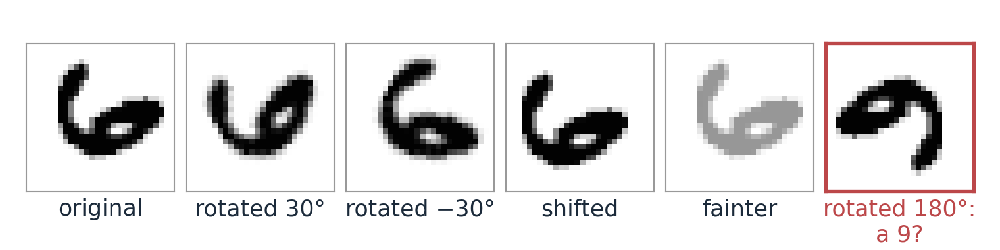

## About this lecture

A network for images should know two things about images: neighbouring pixels belong together, and a nucleus is a nucleus wherever it is. A **convolutional layer** builds in both.

- A convolutional layer = a **bank of small kernels**, learned instead of designed. Each gives a **feature map**.
- The same kernel everywhere (**weight sharing**): few weights, and shifting the input shifts the maps.
- **Pooling** shrinks the maps; stacked layers see ever larger parts of the image (the **receptive field**).
- Early layers find edges, later ones parts and objects. **Augmentation** teaches the invariances we want.

*Slides titled **The math** give the formulas and proofs; the ideas are complete without them.*

::: notes
Suggested demo tour: convlayer (hand-made vs learned bank, shift, pooling), receptive (presets "three 3×3 = 7", "with pooling", "how deep to see a whole nucleus?"), cnnviewer (a digit through the trained network; "a 6 rotated to a 9", rotation with and without augmentation, occlusion). Convolution itself is from the kernels unit of day 1: recall it in one sentence, do not re-teach it.
:::

## From hand-made features to learned ones

:::: {.columns}
::: {.column width="54%"}
[Day 33](../pixelclass/lec.qmd) (random forests) gave every pixel a **feature stack**: Gaussian, derivative, LoG, Hessian filters at chosen scales (the [edges day](../canny/lec.qmd)), then a classifier on top.

- The filters were **designed** by us: interpretable, no training data needed.
- A convolutional network **learns** the filters, and further layers that combine them, from labelled examples.
- The trade-off: learned features adapt to the task, but they need examples (and checking).
:::
::: {.column width="46%"}
{fig-alt="A piece of the electron micrograph around the nucleus and four hand-made features of it: Gaussian blur (σ = 2), gradient size at σ = 2 (bright on edges), Laplacian of Gaussian (σ = 3) and the largest Hessian eigenvalue at σ = 3 (red ridges along the nuclear envelope)." width="100%"}
:::
::::

::: notes
Micrograph: transmission electron micrograph of a mesenchymal stem cell, Robert M. Hunt, CC BY 3.0, via Wikimedia Commons.
:::

## Dense layers do not suit images

:::: {.columns}
::: {.column width="60%"}
A $64 \times 64$ grey image into a dense layer of 100 units: $4096 \times 100 + 100 = 409{,}700$ weights.

- **Too many weights**: each unit has a separate weight for every pixel.
- **No neighbourhood**: the pixel order could be shuffled and the layer would not notice (right: for a dense layer both are equally easy to learn from).
- **No shift**: a nucleus in the top-left corner and the same nucleus in the bottom-right use completely different weights. Every position has to be learned separately.
:::
::: {.column width="40%"}
{fig-alt="Left: an 80 by 80 piece of the micrograph showing the nucleus. Right: the same pixels in a fixed random order, which looks like noise." width="100%"}
:::
::::

::: notes
Shuffle every training image with the same fixed permutation and a dense network learns exactly as well: it never used the neighbourhood. A convolutional layer would be lost. Micrograph: transmission electron micrograph of a mesenchymal stem cell, Robert M. Hunt, CC BY 3.0, via Wikimedia Commons.
:::

## A convolutional layer: a bank of kernels {.smaller}

Recall (the [kernels unit](../kernels/lec.qmd), day 1): a $3 \times 3$ kernel slides over the image; each output pixel is the weighted sum of the $3 \times 3$ neighbourhood.

- A convolutional layer applies **several** kernels, say 8, each giving one output image: a **feature map**.
- Then a bias and the ReLU, as in any layer: each map says "my pattern is here, this strongly".
- The **kernel values are weights**, learned by backpropagation like any others.
- Networks actually compute the correlation (no flip); with learned kernels the flip does not matter.

{fig-alt="An 80 by 80 piece of the micrograph and four 3 by 3 kernels with their numbers (Sobel x, Sobel y, Laplacian, Gaussian), each above its feature map after ReLU: the Sobel maps light up one side of the nuclear envelope each, the Laplacian map thin lines and specks, the Gaussian map (with a negative bias) the bright regions outside the cell." width="66%" fig-align="center"}

::: notes
The figure is a hand-made bank of four kernels on a smoothed, half-size piece of the micrograph; the Gaussian map has a bias of −128, so only bright regions survive the ReLU. Micrograph: transmission electron micrograph of a mesenchymal stem cell, Robert M. Hunt, CC BY 3.0, via Wikimedia Commons.
Show the convlayer demo next. The hand-made bank has Sobel x and y, two diagonals, the Laplacian, a Gaussian, and two line detectors. The learned bank is layer 1 of the small digit network of cnnviewer: several of its kernels look like edge or stroke detectors in some direction.
:::

## Try it: one convolutional layer

```{=html}
<link rel="stylesheet" href="../demos/dist/demo.css">
<div data-demo="convlayer" data-input="digit" data-bank="learned"></div>
<script src="../demos/dist/convlayer.js"></script>
```

::: notes
Start with the learned bank on a digit; switch to the hand-made bank and compare. Then "shift the input" (micrograph): every map shifts by the same amount. Then "pooling": the maps at half size, still recognisable. Click a kernel and edit it (e.g. turn Sobel x into its negative: the other edge of each stroke lights up).
:::

## Weight sharing

:::: {.columns}
::: {.column width="62%"}
**The same 9 weights at every position.**

- Weights per layer: $3 \cdot 3 \cdot C_\text{in} \cdot C_\text{out} + C_\text{out}$, **independent of the image size**. One grey input, 8 kernels: 80 weights, for a $28 \times 28$ or a $1000 \times 1000$ image alike.
- **Translation equivariance**: shift the input, and every feature map shifts the same way. A detector learned at one position works at all of them.
- Compare: the dense layer of the last slide has 409,700 weights and no equivariance.
:::
::: {.column width="38%"}
{fig-alt="Top: a piece of the micrograph and the same piece shifted 24 pixels right and 16 down. Bottom: their edge feature maps (Sobel x after slight smoothing, then ReLU); the map of the shifted input is the first map shifted by the same amount. An orange circle marks the same spot of the nuclear envelope in all four." width="100%"}
:::
::::

::: notes
Away from the borders the two maps agree exactly after shifting (checked in the figure script). Micrograph: transmission electron micrograph of a mesenchymal stem cell, Robert M. Hunt, CC BY 3.0, via Wikimedia Commons.
:::

## The math: a convolutional layer {.math .smaller}

With input channels $x_c$ and output channels $y_{c'}$:

$$y_{c'}[i, j] = b_{c'} + \sum_{c}\sum_{u,v} w_{c',c}[u, v]\; x_c[i + u,\ j + v]$$

- It is a dense layer whose matrix is **sparse** (each output depends on a $k \times k$ patch) and **repeated** (every row is the same kernel, shifted): a banded Toeplitz matrix in 1D.
- Equivariance: with $T_s$ = shift by $s$, $\text{conv}(T_sx) = T_s\,\text{conv}(x)$ (up to borders). The ReLU acts pixel by pixel, so it keeps this. Stride and pooling break it for shifts that are not multiples of the stride.
- Backprop through a convolution is again a correlation: $\partial\mathcal L/\partial w_{c',c}[u, v] = \sum_{i,j}\delta_{c'}[i, j]\,x_c[i + u, j + v]$.

## Channels

- A colour image has **3 channels**; the output of a layer with 8 kernels has **8 channels**.
- A kernel of the next layer covers **all** input channels: it is $3 \times 3 \times 8$, with 72 weights.
- So layer 2 combines features: "a vertical edge here **and** a bright blob next to it". Each output channel has its own kernel stack.
- Counting: layer 2 with 16 output channels on 8 input channels: $3 \cdot 3 \cdot 8 \cdot 16 + 16 = 1168$ weights.

## Pooling and stride

:::: {.columns}
::: {.column width="64%"}
- **2×2 max pooling**: keep the largest value of each $2 \times 2$ block. The map shrinks to half width and height and keeps "the feature is somewhere here", with a little tolerance to small shifts.
- **Stride 2**: evaluate the kernel only at every second position: also halves the size.
:::
::: {.column width="36%"}
{fig-alt="A 4 by 4 grid of numbers split into four coloured 2 by 2 blocks; max pooling keeps the largest of each block: 4, 2, 2 and 6, a 2 by 2 result." width="100%"}
:::
::::

- Output size of a layer with kernel $k$, padding $p$, stride $s$ on $n$ pixels:

$$n_\text{out} = \left\lfloor\frac{n + 2p - k}{s}\right\rfloor + 1$$

- $n = 28$, $k = 3$, $p = 1$, $s = 1$: 28 (padding keeps the size). $k = 5$, $p = 0$: 24. $n = 64$, $k = 3$, $p = 1$, $s = 2$: 32.

## The receptive field

:::: {.columns}
::: {.column width="55%"}
The part of the **input** that one unit can see.

- One $3 \times 3$ layer: 3 pixels wide. Two: 5. Three: **7**.
- Three $3 \times 3$ layers see as much as one $7 \times 7$ layer, with $27$ instead of $49$ weights per channel pair, and two more nonlinearities.
- **Pooling multiplies the growth**: after a $2 \times 2$ pool, each further $3 \times 3$ layer adds 4 input pixels instead of 2.
- Deep layers see whole objects: that is where "nucleus" or "digit 6" can be decided.
:::
::: {.column width="45%"}
{fig-alt="Four rows of units, input at the bottom and layer 3 at the top, drawn in one dimension. One unit of layer 3 is connected to 3 units of layer 2, which together see 5 units of layer 1 and 7 input pixels; the units involved are orange." width="100%"}
:::
::::

## Try it: receptive fields

```{=html}
<link rel="stylesheet" href="../demos/dist/demo.css">
<div data-demo="receptive" data-preset="three"></div>
<script src="../demos/dist/receptive.js"></script>
```

::: notes
"three 3×3 layers = 7", then "one 7×7 layer" (same field, readout shows 2320 weights per layer pair with 16 channels for 3×3, 12560 for 7×7: 6960 vs 12560). "with pooling": conv, pool, conv, pool, conv sees 18 pixels (3, 4, 8, 10, 18). "how deep to see a whole nucleus?": 8 layers with two pools see 32 pixels, more than a 20-pixel nucleus. "dilated: 1, 2, 4": 15 pixels with only three layers. Click units in middle layers too.
:::

## The math: receptive field recursion {.math}

Layer $l$ with kernel $k_l$, stride $s_l$ (pooling: $k = s = 2$), dilation $d_l$. Let $r_l$ be the receptive field and $j_l$ the **jump**: the distance in input pixels between neighbouring units of layer $l$.

$$r_l = r_{l-1} + d_l(k_l - 1)\,j_{l-1}, \qquad j_l = j_{l-1}\,s_l, \qquad r_0 = j_0 = 1$$

- Conv 3, conv 3, pool, conv 3, conv 3: $r = 3, 5, 6, 10, 14$; $j = 1, 1, 2, 2, 2$.
- Without pooling or stride, the field grows only linearly: $r = 1 + 2L$ for $L$ layers of $3 \times 3$.

## What the layers learn

{width="78%" fig-align="center"}

- **Layer 1** kernels: edges, lines, blobs in different directions. The only layer whose kernels can be looked at as pictures.
- **Deeper layers**: corners and textures, then parts (a loop, a stroke ending), then whole objects (Zeiler and Fergus, 2014).
- Ways to look inside: the **feature maps** for an input; the **image patches** that excite a unit most; **occlusion**: cover part of the image and watch the class probability.

## A classification network, end to end

conv 3×3 (8) → ReLU → pool → conv 3×3 (16) → ReLU → pool → flatten → dense → softmax, trained with cross-entropy ([previous unit](../backprop/lec.qmd)).

| layer | output | weights |
|---|---|---|
| conv, 1 → 8 | $8 \times 28 \times 28$ | 80 |
| conv, 8 → 16 | $16 \times 14 \times 14$ | 1,168 |
| dense, $16 \cdot 7 \cdot 7 = 784$ → 10 | 10 scores | 7,850 |

**9,098** weights, 98.7 % correct on 10,000 test digits. A dense 784 → 100 → 10 network has 79,510.

## Try it: inside a trained network

```{=html}
<link rel="stylesheet" href="../demos/dist/demo.css">
<div data-demo="cnnviewer" data-weights="digits" data-example="12"></div>
<script src="../demos/dist/cnnviewer.js"></script>
```

::: notes
Draw a digit or pick one; look at the layer-1 maps (strokes in different directions) and layer-2 maps; click a layer-2 map to see its 9 favourite test patches. "shifted digit": maps shift, the prediction stays 6. "a 6 rotated to a 9": at 180° the network says 9, correctly! "rotation 30°": without augmentation it says 4 (0.55), with rotation augmentation 6 (1.00). Weight sets epoch 0, 1, 3: random kernels and 10 % accuracy at epoch 0, 94 % after one epoch. "what is the network looking at?": occlusion map of a 2.
:::

## Data augmentation

Train on **modified copies**: shifted, rotated, flipped, brighter, darker, slightly deformed. The label stays the same.

{fig-alt="A handwritten 6 and five modified copies: rotated by 30 degrees, by minus 30 degrees, shifted, fainter, and rotated by 180 degrees, where it looks like a 9 (framed in red)." width="62%" fig-align="center"}

- The network learns the **invariances we can name**: "a rotated 2 is still a 2".
- Our digit network: on test digits rotated by 45°, **46.9 %** correct without augmentation, **92.9 %** with random rotations up to ±45° during training (and 97.2 % instead of 98.7 % on upright digits).
- Choose with care: with full rotations a 6 and a 9 become the same class. For cells, rotations and flips are usually safe.
- Compare the [moments day](../moment-invariants/lec.qmd): there invariance is **built into the features**; here it is **taught by examples**.

## Summary

| Idea | In one line |
|---|---|
| Convolutional layer | a bank of learned $k \times k$ kernels, each giving a feature map; bias, ReLU |
| Weight sharing | same kernel everywhere: $k^2C_\text{in}C_\text{out} + C_\text{out}$ weights, any image size |
| Equivariance | shift the input, the maps shift; pooling adds a little invariance |
| Output size | $\lfloor(n + 2p - k)/s\rfloor + 1$ |
| Receptive field | grows by $k - 1$ per layer, faster after pooling |
| Hierarchy | edges → textures → parts → objects |
| Augmentation | teach invariances by training on modified copies |

Next: from "what is in the image" to "which pixels belong to it": segmentation networks.
