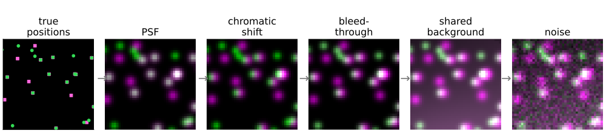
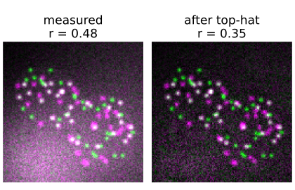
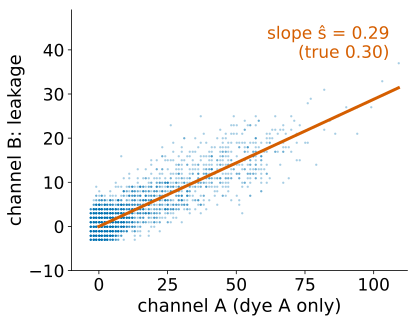
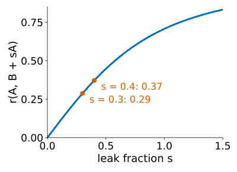
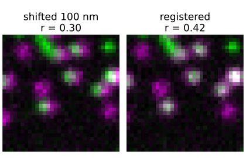
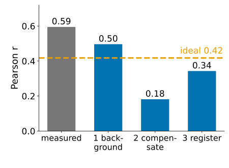

## About this lecture

The coefficients of this day measure the **images**. Between the molecules and the images sits a microscope, and it adds overlap of its own. Today: one forward model, four confounds, and the order in which to correct them.

- **Background**: a constant offset and a background shared by both channels.
- **Bleed-through**: dye A seen in channel B.
- **Chromatic shift**: the two colours focus at slightly different places.
- **Resolution**: everything closer than about one PSF width overlaps.
- The **order of corrections**, and a checklist for reporting.

*Slides titled **The math** give the formulas and proofs; the ideas are complete without them.*

::: notes
Fourth and last unit of the colocalisation day, the synthesis. Every confound is the forward model of the image formation day run on two channels at once. Bleed-through and compensation are owned by the spectral unmixing elective (crosstalk unit), the PSF and resolution by image formation, registration by the FFT registration day, the top-hat by morphology: each gets one recall slide here. The demo (colocpipeline) simulates spots at pixel 65 nm, NA 1.4, A at 520 nm, B at 670 nm; half of the A spots have a B partner, plus independent B spots; the "ideal" column is the same scene with the same noise but no confounds.
:::

## One forward model, two channels

**true positions** → **PSF** per channel (width ∝ λ) → **chromatic shift** of one channel → **bleed-through** (A's light in B's channel) → **background** (offset + uneven, shared) → **noise** → the two images.

{fig-alt="A crop of the demo scene everything at once, step by step: true positions of A (green dots) and B (magenta squares) with pairs linked; the blurred spots (PSF), white where pairs overlap; B moved 100 nm sideways (chromatic shift), green and magenta fringes; 30 % of A added to B (bleed-through), every A spot now whitish; a shared uneven background, a magenta-white haze; and finally Poisson noise." width="88%" fig-align="center"}

- Each step changes the coefficients in a known direction: blur and shift **spread** or **move** the overlap, leakage and a shared background **add** overlap, noise **dilutes** it.
- Each step has a correction, and the corrections only work in the right **order** (end of the unit).
- Recall the single-channel version: [the forward model](../psf/lec.qmd) of the image formation day, and [camera noise](../cameranoise/lec.qmd): offset, shot noise, saturation.

Demo numbers below: an ideal microscope (same PSF and noise, no confounds) gives $r = 0.42$, M1/M2 = 0.52/0.40, and 50 % of the A spots with a B spot within 130 nm.

## Background: offset and shared background

:::: {.columns}
::: {.column width="58%"}
- A **constant offset** (camera, dark current) leaves $r$ alone, but breaks the overlap coefficient and every threshold: M1 and M2 go to 1 if the thresholds sit below it (unit 1).
- A **background shared by both channels** (uneven illumination, autofluorescence, out-of-focus haze) is a common signal: it adds correlation like the cell outline did in unit 1. Demo, shared background: $r$ 0.42 → **0.48**, M1/M2 0.52/0.40 → **0.84/0.88**.
- **Fix**: subtract it. A white top-hat with a disk larger than the spots ([morphology: grey-level top-hat](../morph-grey/lec.qmd)) or a measured background image; then choose the region. Demo after the top-hat: $r$ = 0.35, M1/M2 = **0.52/0.39**.
- Not all the way back (0.35 instead of 0.42): subtraction removes the background, not its **shot noise**, which is independent in the two channels and dilutes $r$. (On a clean scene the same top-hat changes nothing: 0.416.)
:::
::: {.column width="42%"}
{fig-alt="Green/magenta merges of the demo scene with a shared uneven background of 40 photons per pixel. Measured: a bright haze over the lower part of the image, r = 0.48. After a white top-hat with a disk of radius 6 px: the haze is gone, the spots remain on a noisy dark background, r = 0.35." width="100%"}
:::
::::

## The math: a shared background {.math}

Write $A = S_A + G$ and $B = S_B + kG$ with independent signals $S_A$, $S_B$ (no colocalisation at all) and a shared background $G$:

$$r(A, B) = \frac{\operatorname{cov}(S_A + G,\ S_B + kG)}{\sqrt{\operatorname{var}A \operatorname{var}B}} = \frac{k\operatorname{var}G}{\sqrt{(\operatorname{var}S_A + \operatorname{var}G)(\operatorname{var}S_B + k^2\operatorname{var}G)}}.$$

- $\operatorname{var}S_A = \operatorname{var}S_B = 100$, $\operatorname{var}G = 50$, $k = 1$: $r = 50/150 = 0.33$ with **no** colocalisation.
- A constant $G$ has $\operatorname{var}G = 0$: no effect on $r$. Only the **variation** of the background over the region matters, which is why measuring inside small regions helps.
- The overlap coefficient and M1/M2 are hit by the mean of $G$ as well (offsets, unit 1).

## Bleed-through

Recall [bleed-through](../crosstalk/lec.qmd) (the spectral unmixing elective): dye A emits into channel B too, so channel B holds $B + s\,A$.

:::: {.columns}
::: {.column width="58%"}
- The leaked light sits **exactly at A's structures**: it correlates the channels by itself. Demo, 30 % leakage: $r$ 0.42 → **0.64**; A spots with a B spot within 130 nm: 50 % → **89 %** (the leaked copies are detected as B spots).
- Unit 2: the randomisation test calls it significant. It is real overlap in the images.
- **Fix**: measure $s$ on a **single-stained control** (only dye A: B is then pure leakage, $s$ = slope through the origin of B against A) and **compensate**, $\hat B = B - \hat s A$; or image the channels one after the other with separate excitation.
- After background subtraction, right $\hat s$ (0.3): $r$ = 0.38, objects 50 %. Too small (0.15): 0.53, 76 %. **Too large** creates **anti-colocalisation**: unrelated channels with $\hat s = 0.6$ give $r = -0.47$.
:::
::: {.column width="42%"}
{fig-alt="Scatter plot of a simulated single-stained control: only dye A present, 30 % of its light leaks into channel B. Channel B against channel A inside the cells, offset and background removed; the points scatter about a line through the origin whose fitted slope is 0.29 (true 0.30)." width="100%"}
:::
::::

## The math: leakage and compensation {.math}

$B' = B + sA$ with $A$, $B$ independent and of equal variance:

$$r(A, B') = \frac{\operatorname{cov}(A, B + sA)}{\sqrt{\operatorname{var}A\,\operatorname{var}(B + sA)}} = \frac{s\operatorname{var}A}{\sqrt{\operatorname{var}A \cdot (1 + s^2)\operatorname{var}A}} = \frac{s}{\sqrt{1 + s^2}}.$$

:::: {.columns}
::: {.column width="58%"}
- $s = 0.4$: 0.37 (the noisy coloc demo of unit 1: 0.32); $s = 0.3$: 0.29.
- Compensation: $\hat B = B' - \hat s A = B + (s - \hat s)A$: the error $(s - \hat s)A$ is again an image of A, with a sign: under-compensation leaves positive correlation, over-compensation adds negative.
- With two dyes leaking both ways, this is the $2 \times 2$ inverse of the mixing matrix ([crosstalk](../crosstalk/lec.qmd)). It is linear, so it needs offset-free data: subtract the background first.
:::
::: {.column width="42%"}
{fig-alt="The curve r = s / sqrt(1 + s^2) for the leak fraction s from 0 to 1.5, rising from 0 towards 1; s = 0.3 gives 0.29 and s = 0.4 gives 0.37." width="100%"}
:::
::::

## Chromatic shift

Different colours focus at slightly different places: laterally tens of nm (more at the edge of the field), axially 100–300 nm.

:::: {.columns}
::: {.column width="58%"}
- On small structures even a small shift costs a lot of $r$: unit 1's demo, 0.99 → 0.94 → 0.81 → 0.63 for shifts of 1, 2 and 3 px. Here: a 100 nm shift takes $r$ from 0.42 to **0.30** and the object fraction within 130 nm from 50 % to **43 %**.
- The shift curve of unit 2 shows it as a peak **off zero**.
- **Fix**: measure the shift on **two-colour beads** (each bead emits in both channels, so its true distance is 0): the peak of the cross-correlation with a sub-pixel refinement ([phase correlation](../phasecorr/lec.qmd), [sub-pixel peaks](../stitching/lec.qmd)), then shift one channel back. Demo: 100 nm estimated as **100.8 nm**; after registration $r$ = 0.42 again.
- In 3D the axial shift matters most; it is measured the same way on a bead stack.
:::
::: {.column width="42%"}
{fig-alt="Crops of the green/magenta merge of the demo with B shifted by 100 nm (1.5 px): pairs show green and magenta fringes side by side, r = 0.30. After registration with the shift measured on two-colour beads (100.8 nm): the pairs are white again, r = 0.42." width="100%"}
:::
::::

## The math: registration {.math}

The shift $\hat{\mathbf t}$ maximises the cross-correlation of the two bead images, $c(\mathbf t) = \sum_{\mathbf x} A(\mathbf x + \mathbf t)\,B(\mathbf x)$, found by the FFT; the integer peak is refined by a parabola through its neighbours or an upsampled DFT around it (recall [stitching](../stitching/lec.qmd)). Then $B$ is shifted back by $-\hat{\mathbf t}$ with the Fourier shift theorem.

- A residual registration error $\boldsymbol\epsilon$ acts like an extra shift between every pair: in the Gaussian formula below, the overlap of a pair at true distance $\delta$ becomes that at $|\boldsymbol\delta + \boldsymbol\epsilon|$.
- Many beads, many photons: the error falls like $1/\sqrt{\text{beads} \times \text{photons}}$. The demo's 25 beads give 0.8 nm.
- The shift varies over the field (chromatic aberration grows off-axis): with beads everywhere, fit a smooth shift field instead of one vector.

## Try it: confounds and corrections

```{=html}
<link rel="stylesheet" href="../demos/dist/demo.css">
<div data-demo="colocpipeline" data-preset="all"></div>
<script src="../demos/dist/colocpipeline.js"></script>
```

::: notes
Left: the truth (true positions; yellow links = pairs); middle: measured merge; right: corrected merge. Table: ideal / measured / corrected. Preset "everything at once": shared background 40, 30 % bleed-through, 100 nm shift: measured r = 0.59, M1/M2 = 0.93/0.96, 70 % of A spots with B within 130 nm (ideal: 0.42, 0.52/0.40, 50 %). Tick the corrections in order: 1 subtract background: r 0.50, M 0.68/0.52; 2 compensate (ŝ = 0.3): r 0.18, M 0.41/0.19, 42 % — worse than the ideal, because the channels are still shifted; 3 register: r 0.34, M 0.52/0.37, 53 %. Untick 1 and keep 2: r 0.33, M2 0.47: compensation on data with background. Other presets: "30 % bleed-through: compensate", "over-compensation" (unrelated channels, ŝ = 0.6: r = −0.47), "100 nm chromatic shift", "register with beads".
:::

## Resolution

The PSF spreads every spot over about one FWHM (≈ 190 nm at NA 1.4, 520 nm; recall [two points and resolution](../resolution/lec.qmd)). Two spots of different colours closer than that **overlap in the images**, whatever their true distance.

{width="55%" fig-align="center"}

- The normalised overlap of two spots falls to 0.5 at about **0.7 FWHM** apart (≈ 130 nm). "Colocalised" therefore means "**closer than about the resolution**", never "bound" or "in contact".
- The red channel's wider PSF alone costs little: 520 and 670 nm spots at the same place overlap 0.97.
- Below the resolution: centroids (unit 3) or FRET (the next day of this group).

## The math: Gaussian spot pairs {.math}

Approximate the PSF by a Gaussian of $\sigma \approx 0.21\,\lambda/\mathrm{NA}$ (78 nm at 520 nm, NA 1.4; FWHM $= 2.355\,\sigma$). For two spots of widths $\sigma_1$, $\sigma_2$ whose centres are $\delta$ apart, the normalised overlap $\int g_1 g_2 / \sqrt{\int g_1^2 \int g_2^2}$ is

$$\frac{2\sigma_1\sigma_2}{\sigma_1^2 + \sigma_2^2}\,\exp\!\Big(-\frac{\delta^2}{2(\sigma_1^2 + \sigma_2^2)}\Big).$$

- Equal widths: $e^{-\delta^2/4\sigma^2}$, the shift-curve formula of unit 2: **shift and resolution are the same formula**. It is 0.5 at $\delta = 2\sigma\sqrt{\ln 2} = 0.71$ FWHM.
- Same place, different widths: $2\sigma_1\sigma_2/(\sigma_1^2 + \sigma_2^2)$: 78 and 100 nm give 0.97.
- 100 nm apart at 520 nm: 0.66; 300 nm apart: 0.02.

## Try it: the resolution sweep

```{=html}
<link rel="stylesheet" href="../demos/dist/demo.css">
<div data-demo="colocpipeline" data-preset="sweep"></div>
<script src="../demos/dist/colocpipeline.js"></script>
```

::: notes
Tab "resolution sweep": all A spots paired with B spots at the true distance on the x axis, no other confounds. Blue: pixel r (simulated, solid; Gaussian overlap, dashed); red: the share of A spots with a detected B spot within 130 nm. r: 0.91 at 0 nm, 0.84 at 50 nm, 0.67 at 100 nm, 0.48 at 150 nm, 0.30 at 200 nm. Objects: 94 % at 0 nm, 96 % at 50, 78 % at 100, 13 % at 150 nm. 0 and 50 nm are indistinguishable for both methods; between 100 and 150 nm the object fraction drops sharply because it is a threshold on a measured distance, while r fades slowly.
:::

## The order of corrections

:::: {.columns}
::: {.column width="55%"}
1. **Offset and background**: subtract. Everything after is linear and assumes zero means zero.
2. **Compensation**: undo the mixing. Needs offset-free data, and the leaked light sits at A's position, so it must be removed **before** registration moves B.
3. **Registration**: shift B back by the bead-measured shift.
4. **Region**: inside the cells, or per cell; exclude **saturated** pixels (a clipped cloud bends every coefficient).
5. **Coefficients** with **thresholds** (and their method), or objects with $d_\text{max}$.
6. **Controls**: shift curve, block randomisation, chance level of the object fraction (units 2–3).

Demo, everything at once: measured $r$ = 0.59 → background 0.50 → compensation 0.18 → registration **0.34** (ideal 0.42). Skipping step 1: compensation alone gives 0.33 with M2 = 0.47.
:::
::: {.column width="45%"}
{fig-alt="Bar chart of Pearson r for the demo scene everything at once: measured 0.59, after background subtraction 0.50, after compensation 0.18, after registration 0.34; a dashed line marks the ideal microscope, 0.42." width="100%"}
:::
::::

## A checklist for reporting

- **Region**: whole image, cells, per cell; how it was drawn.
- **Background**: how it was measured and subtracted.
- **Bleed-through**: single-stained controls, the compensation factors, or sequential imaging.
- **Registration**: two-colour beads, the measured shift and its precision.
- **Optics**: objective NA, wavelengths, pixel size: the resolution that "colocalised" refers to.
- **Coefficients**: which ones, which Manders definition, the **thresholds** and how they were chosen.
- **Tests**: shift curve or randomisation, with the **block size**; for objects, the detection method, $d_\text{max}$ and the **chance level**.
- **Replicates**: coefficients per cell and per experiment, compared across conditions with the [statistics of the evaluation day](../replicates/lec.qmd).

## Summary

- One **forward model**: PSF per channel → chromatic shift → bleed-through → background → noise. Each step adds, moves, spreads or dilutes overlap.
- A **shared background** and **bleed-through** add overlap that randomisation calls significant; subtract the background, then **compensate** with single-stained controls (over-compensation makes anti-colocalisation).
- **Chromatic shift** moves the peak of the shift curve off zero and costs small structures much of their $r$; measure it on two-colour **beads** and register.
- **Resolution**: two spots overlap 0.5 at about 0.7 FWHM apart (≈ 130 nm at NA 1.4); "colocalised" means "closer than the resolution".
- Correct in order: background → compensation → registration → region → coefficients → controls; report every step.
