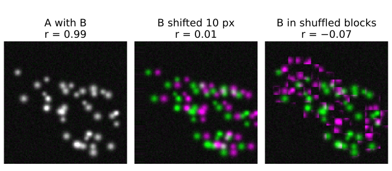
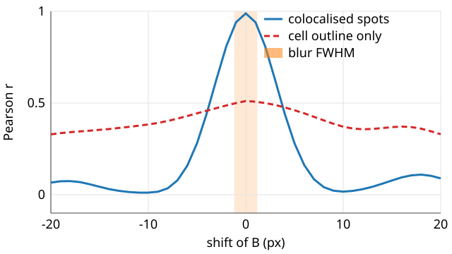
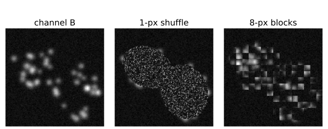
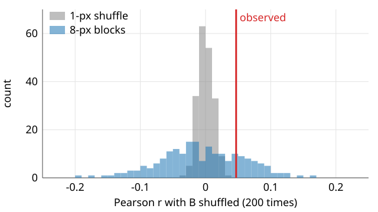
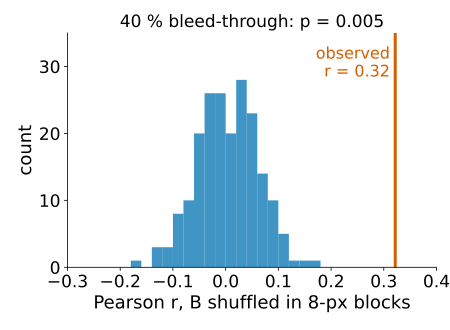
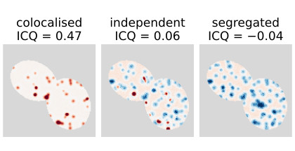
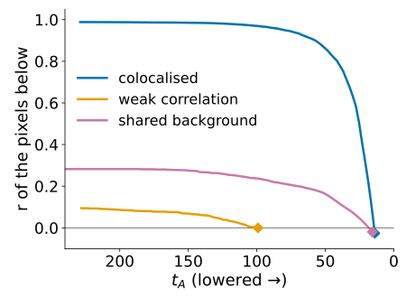

## About this lecture

The last unit turned two channels into numbers: $r$, M1, M2. A number alone does not say whether the two proteins are together **more than by chance**. Today: references for "no colocalisation".

- The **shift curve**: $r$ against a shift of one channel.
- **Randomisation**: shuffle blocks of one channel, many times; a permutation p-value.
- Why **blocks** and not single pixels: neighbouring pixels are not independent.
- What the test does **not** protect against.
- **Li's ICQ** and the product-of-differences image: *where* the correlation comes from.
- Costes' threshold as a null idea, and when it fails.

*Slides titled **The math** give the formulas and proofs; the ideas are complete without them.*

::: notes
Second unit of the colocalisation day. All numbers come from the colocnull demo (the two-cell scene of the coloc demo, 128 × 128 pixels, 200 shuffles with fixed seeds). The new idea of the unit: pixels are not independent samples, so the textbook p-value for a correlation is far too optimistic; permutation of blocks fixes that. Comparisons between conditions (many cells, several experiments) are the evaluation day's replicates unit; this unit is about one image.
:::

## A reference for "no colocalisation"

A coefficient means nothing without the value it would have **if the channels were unrelated**.

- Independent structures do not give $r = 0$ exactly: the demo's independent channels give **−0.08** inside the cells (the structures avoid each other a little, by chance).
- M1 and M2 of independent channels are not 0 but about the **area share** of the other channel above its threshold (demo: about **0.2**).
- So the question is always: **is the observed value outside what unrelated channels of the same kind would give?**

Two ways to make "unrelated channels of the same kind": **shift** one channel, or **shuffle** it in blocks. Both keep each channel's own picture; both break the link between them.

{fig-alt="Three green/magenta merges of the colocalised demo scene. A with B: white spots, r = 0.99. B shifted 10 px sideways: green and magenta spots side by side, r = 0.01. B cut into 8-pixel blocks inside the cells and shuffled: a patchwork, r = -0.07." width="60%" fig-align="center"}

## The shift curve

Shift B against A by $\Delta x = -20 \dots 20$ px and compute $r$ for every shift (van Steensel et al., 1996).

{width="62%" fig-align="center"}

- **Colocalised small structures**: a narrow peak at 0, as wide as the structures plus the blur (demo: half width **3.7 px**), falling to about 0.1 at ±20 px.
- **Large-scale correlation** (both channels bright in the cells, dark outside): a broad hump that survives large shifts (whole image: 0.51 at 0, still **0.33** at ±20 px).
- A peak **off zero** means the channels are shifted against each other (unit 4: chromatic shift).

::: notes
This is the "slide and score" of the FFT registration day's matching unit, with Pearson's r as the score; there the peak position is the answer, here the shape of the curve is. Ask: what would the shift curve of the bleed-through preset look like? (A narrow peak at 0: leakage is perfectly aligned. The shift curve cannot tell bleed-through from colocalisation either.)
:::

## The math: the width of the peak {.math}

Model a structure as a 2D Gaussian of width $\sigma$ in both channels. Shifted by $\delta$, the normalised overlap (the cosine of the last unit) is

$$\frac{\int g_\sigma(\mathbf x)\,g_\sigma(\mathbf x - \boldsymbol\delta)\,d\mathbf x}{\int g_\sigma^2\,d\mathbf x} = e^{-\delta^2/4\sigma^2},$$

because the product of two Gaussians is a Gaussian centred halfway, with the exponent $-\big(|\mathbf x|^2 + |\mathbf x - \boldsymbol\delta|^2\big)/2\sigma^2 = -|\mathbf x - \boldsymbol\delta/2|^2/\sigma^2 - \delta^2/4\sigma^2$.

- Half height at $\delta = 2\sigma\sqrt{\ln 2} \approx 1.67\,\sigma \approx 0.71$ FWHM of the structure.
- Demo: structures of radius 1.3–2.5 px blurred by σ = 1 px, total σ ≈ 2.2 px: predicted half width 3.6 px, measured 3.7 px.
- **Sub-pixel peak**: a parabola through the three values around the maximum, offset $(r_{-} - r_{+}) / \big(2(r_{-} - 2r_0 + r_{+})\big)$ (recall [stitching](../stitching/lec.qmd)). Demo: a shift of 2.4 px is found at **2.39 px**.

## Try it: shift curves

```{=html}
<link rel="stylesheet" href="../demos/dist/demo.css">
<div data-demo="colocnull" data-preset="coloc"></div>
<script src="../demos/dist/colocnull.js"></script>
```

::: notes
Tab "shift curve". Tour: "colocalised": narrow peak at 0, r = 0.988, half width 3.7 px; slide the structure size up and watch the peak widen (size 2: 6.9 px), blur up (σ = 3: 6.0 px). "large-scale correlation": whole image with a diffuse signal in both cells, r = 0.51 at 0 and 0.33 at ±20 px: a hump, no peak. "a shifted channel": B shifted 2.4 px in x, r at 0 drops to 0.74, the peak sits at 2.39 px and is still 0.98: the colocalisation is intact, the registration is not. The shaded band is the blur FWHM.
:::

## Randomisation

Destroy the spatial relation between the channels, but **keep each channel's own statistics** (Costes et al., 2004):

1. Cut B into **blocks** (inside the region), shuffle the blocks, put them back.
2. Compute $r$ of A against the shuffled B.
3. Repeat, say 200 times: the **null distribution** of $r$ for "same images, no relation".
4. **p-value** = share of shuffles with $r$ at least as large as the observed one.

Each shuffled B has the same intensities, the same structures and the same blur as the real B: only the link to A is gone.

{fig-alt="Channel B of the independent scene with blur sigma 2 px, and two shuffled copies inside the cells: shuffled pixel by pixel it becomes fine-grained noise with no spots left; shuffled in 8-pixel blocks it keeps the blurred spots, cut into squares." width="64%" fig-align="center"}

## Why blocks, not pixels

{width="60%" fig-align="center"}

- Neighbouring pixels are **not independent**: the PSF spreads every point over several pixels, and structures are several pixels wide.
- Shuffling single pixels destroys that and gives a null far too **narrow**: independent channels (blur σ = 2 px), $r = 0.047$; 1-px shuffle: sd **0.013**, none of 200 reaches 0.047: "significant", **wrongly**.
- Blocks about the size of the blur or the structures (8 px) keep each channel's texture: sd **0.064**, 44 of 200 reach 0.047, $p = 0.22$: no evidence. Correct.

## The math: the permutation p-value {.math}

With $N$ shuffles giving $r^*_1, \dots, r^*_N$ and the observed $r_\text{obs}$:

$$p = \frac{1 + \#\{k : r^*_k \ge r_\text{obs}\}}{N + 1}.$$

- The **+1** counts the observed image as one of the possible arrangements: under the null it is just another shuffle, so $p$ is never 0, and $P(p \le \alpha) \le \alpha$ exactly.
- The smallest reachable $p$ is $1/(N + 1)$: 0.02 with 50 shuffles, 0.005 with 200. "None of 200" means $p = 0.005$, not $p = 0$.
- Demo, 8-px blocks: $p = (1 + 44)/201 = 0.224$.

## The math: how wide should the null be? {.math}

For $n$ **independent** pixel pairs from unrelated channels, $E[r] \approx 0$ and $\operatorname{var} r \approx 1/(n - 1)$.

- Inside the cells $n = 5978$: sd $\approx 1/\sqrt{5977} = 0.013$, what the 1-px shuffle gives.
- Correlated pixels carry less information. If the structures (plus blur) are about $w$ pixels wide, the image holds roughly $n_\text{eff} \approx n / w^2$ independent samples (order of magnitude; the exact factor depends on the autocorrelation).
- So the honest sd is about $w$ times larger: the demo's 0.064 with 8-px blocks is 5× the 0.013, i.e. $w \approx 5$ px, the FWHM of the blurred structures.
- The textbook test of $r$ assumes independent samples: on images it is wrong by that factor.

## Try it: randomisation

```{=html}
<link rel="stylesheet" href="../demos/dist/demo.css">
<div data-demo="colocnull" data-preset="pixel"></div>
<script src="../demos/dist/colocnull.js"></script>
```

::: notes
Tab "randomisation". "pixel shuffle: everything is significant": independent channels (blur σ = 2), r = 0.047; with 1-px blocks the blue null is as narrow as the grey one, 0 of 200 reach the observed r, p = 0.005. "blocks the size of the blur": 8-px blocks, the null widens to sd 0.064, 44 of 200 reach 0.047, p = 0.22. Move the block slider 1 → 16 and press shuffle each time: the null sd grows fast up to about the structure size and then more slowly (0.013, 0.024, 0.045, 0.064, 0.078 for 1, 2, 4, 8, 16 px). "bleed-through passes the test": next slide.
:::

## What the test does not protect against

Randomisation asks: **is the overlap in these two images more than chance?** Not: are the two **molecules** together?

:::: {.columns}
::: {.column width="55%"}
- **Bleed-through** puts a copy of A into B: real overlap *in the images*. Demo, independent structures, 40 % leakage: $r = 0.32$; none of 200 block shuffles reaches it, $p = 0.005$. The test is right about the images, and the conclusion about the proteins is wrong.
- A **shared uneven background** (illumination, autofluorescence) and the **cell outline** are also real overlap.
- Structures **closer than the resolution** overlap in the image whatever their true distance.
:::
::: {.column width="45%"}
{fig-alt="Histogram of Pearson r for 200 shuffles of B in 8-pixel blocks, for independent structures with 40 % bleed-through: centred near 0, between -0.18 and 0.16. The observed r = 0.32 is a vertical line far to the right; p = 0.005." width="100%"}
:::
::::

These are fixed before the test, not by it (unit 4). And one p-value per image is not a comparison between conditions: that needs replicates ([the evaluation day](../replicates/lec.qmd)).

## Li's ICQ: where does the correlation come from?

Per pixel, the **product of the differences from the mean** (PDM): $(A - \bar A)(B - \bar B)$ (Li et al., 2004).

:::: {.columns}
::: {.column width="58%"}
- **Positive** where both are above their means, or both below: the channels vary together.
- **Negative** where one is up and the other down: segregation.
- Shown as a signed image (red +, blue −), the PDM says **where** the correlation lives: in the spots, at the cell edge, in the background. $r$ is one number for all of it.
- **ICQ** = share of pixels with positive PDM − 0.5, between −0.5 and 0.5: > 0 dependent, < 0 segregated.
- Caution: 0 is **not** the value for independent channels when the channels are skewed (sparse spots on a dark background: most pixels are below both means, so their PDM is positive). Demo, independent: ICQ = **0.06**, and block-shuffled B gives about **0.10**. Compare with the shuffled ICQ, not with 0.
:::
::: {.column width="42%"}
{fig-alt="PDM images inside the two cells, red positive, blue negative. Colocalised: deep red spots on a nearly white background, ICQ = 0.47. Independent: blue at most spots, red only where two spots overlap, pale red background, ICQ = 0.06. Segregated: blue spots and no red spots, ICQ = -0.04." width="100%"}
:::
::::

## The math: ICQ, Pearson and the sign test {.math}

With $s_A$, $s_B$ the standard deviations (the $1/n$ convention), Pearson's $r$ is the **average** PDM, scaled:

$$r = \frac{1}{n\,s_A s_B}\sum_i (A_i - \bar A)(B_i - \bar B) = \frac{\sum_i \text{PDM}_i}{n\,s_A s_B}.$$

- ICQ keeps only the **signs** of the PDM values: robust to bright outliers, blind to how strong the relation is.
- If each sign were + with probability ½ independently, $N_+ \sim \operatorname{Bin}(N, \tfrac12)$, and $z = (N_+ - N/2)/\sqrt{N/4}$ gives a sign-test p-value.
- Both assumptions fail on images: the probability is not ½ for skewed channels (previous slide), and neighbouring pixels are not independent. Demo, independent channels: sign test $p \approx 10^{-20}$, block shuffle $p = 0.98$.

## Try it: PDM and ICQ

```{=html}
<link rel="stylesheet" href="../demos/dist/demo.css">
<div data-demo="colocnull" data-preset="independent"></div>
<script src="../demos/dist/colocnull.js"></script>
```

::: notes
Tab "PDM / ICQ". "independent: ICQ is not 0": the PDM image is pale red almost everywhere (background pixels below both means), blue at most spots and red only where two spots happen to overlap; ICQ = 0.060, 3345 of 5978 pixels positive, sign test p ≈ 3·10⁻²⁰ (wrong); 200 shuffles of 8-px blocks give ICQ 0.100 ± 0.021, and the observed value is below most of them. "segregated": B's structures avoid A's: r = −0.29, ICQ = −0.038, blue at every spot (one channel bright, the other below its mean) and no red spots; shuffled ICQ 0.115 ± 0.019. Go back to the shift tab with "colocalised" and then to this tab: deep red spots, ICQ 0.47.
:::

## Costes' threshold, revisited

The stopping rule of Costes' threshold, "the pixels below the thresholds have $r \le 0$", is itself a **null idea**: below the thresholds is noise without correlation.

:::: {.columns}
::: {.column width="55%"}
- It works when there is a clear rising cloud above a background blob (unit 1).
- **Weak correlation**: $r$ of the low pixels drops to 0 early, and the walk stops **high**. Demo ($f = 0.15$, noise 12): $t_A = 99$, only 143 of 5978 pixels above both thresholds (2 %), M1 = 0.30, M2 = 0.11.
- **Shared background**: the low pixels stay correlated (the background itself), and the walk goes to the **bottom**. Demo (uneven background, whole image): 75 % of the pixels count as "signal", M1 = 0.92, M2 = 0.97.
- So look at the trace ($r$ below the thresholds against $t_A$) before trusting the thresholds.
:::
::: {.column width="45%"}
{fig-alt="Costes traces: r of the pixels below the thresholds against tA, from high to low tA. Colocalised: near 0.99, dropping to 0 at tA = 13.9. Weak correlation: starts at 0.09 and reaches 0 already at tA = 99. Shared background: stays near 0.28 and reaches 0 only at tA = 15.7, near the bottom." width="100%"}
:::
::::

## Try it: the Costes trace

```{=html}
<link rel="stylesheet" href="../demos/dist/demo.css">
<div data-demo="colocnull" data-preset="weak"></div>
<script src="../demos/dist/colocnull.js"></script>
```

::: notes
Tab "Costes trace": r of the pixels below the thresholds against tA (tB follows the regression line), the stop where it first reaches 0. "weak correlation": the trace starts at 0.09 and reaches 0 at tA = 99 after 57 steps. "shared background": the trace stays near 0.28 until the very bottom; 12294 of 16384 pixels above both. Compare with "colocalised" (shift tab preset, then this tab): r below stays near 0.99 and falls through 0 at tA = 13.9, just above the background.
:::

## Summary

- A coefficient needs a **reference** for unrelated channels: the **shift curve** (narrow peak = small colocalised structures, broad hump = large-scale correlation, peak off zero = a shift) and **randomisation**.
- Shuffle **blocks** about the size of the blur or the structures, never single pixels: neighbouring pixels are not independent, and pixel shuffles make everything "significant". $p = (1 + \#\{r^* \ge r\})/(N + 1)$.
- A significant test says the overlap **in the images** is more than chance; bleed-through, a shared background and the resolution limit pass it (unit 4).
- The **PDM** image shows where the correlation lives; the **ICQ** must be compared with shuffled data, not with 0.
- Check the **Costes trace**: weak correlation stops it high, a shared background takes it to the bottom.
