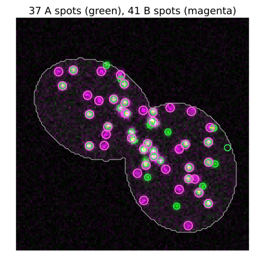
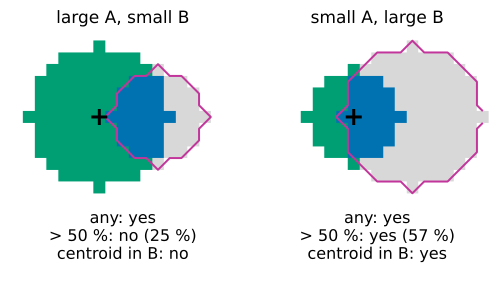
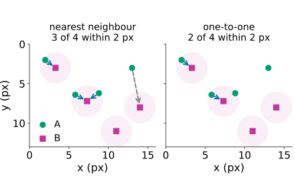
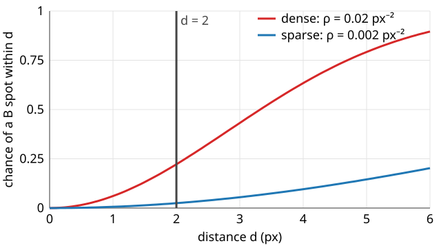
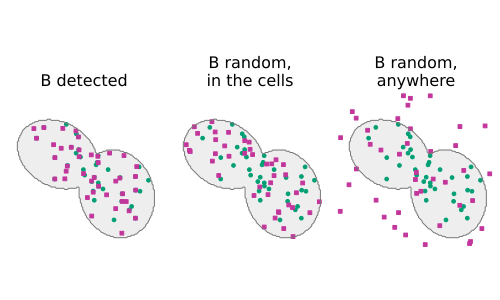
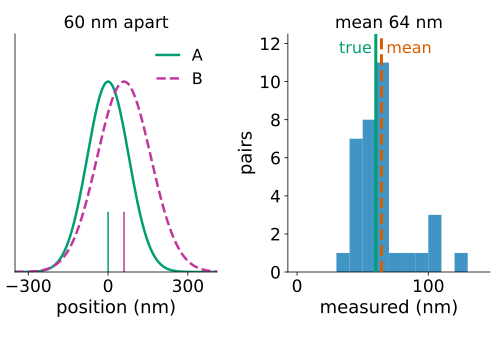
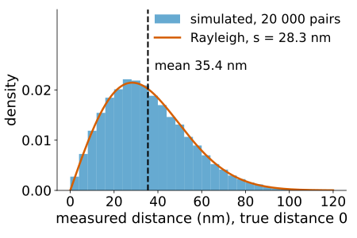

## About this lecture

Pixel coefficients put all structures of a cell into one number. Today we ask per **object**: does this spot of A have a partner in B, and **how far away** is it?

- From spots to objects: detect, locate, label.
- **Overlap** measures: by any pixel, by more than half, by the centroid.
- **Distances** between channels: nearest neighbour and one-to-one pairs.
- The **chance level**: with many B spots, every A spot has a neighbour by chance.
- **Randomisation** inside the cells and the cross-K function.
- **Below the resolution**: centroids measure distances that pixels cannot, with a bias.

*Slides titled **The math** give the formulas and proofs; the ideas are complete without them.*

::: notes
Third unit of the colocalisation day. The demo (colocobjects) simulates spots at physical scale: pixel 65 nm, NA 1.4, channel A at 520 nm (PSF σ ≈ 78 nm = 1.2 px), channel B at 670 nm (σ ≈ 100 nm = 1.55 px), Poisson noise, two cells (25 µm²) as the region. This unit is the two-channel version of the relations unit of the measurements day (parent–child, nearest neighbours, the Poisson nearest-neighbour law); it restates the law for students who skipped that day.
:::

## Why objects?

Pearson's $r$ and M1/M2 answer "how much of the signal overlaps", for the whole region at once.

- They cannot say **which** structures overlap: 60 % of the spots perfectly paired and 40 % alone give the same $r$ as all spots half overlapping.
- They cannot say **how far apart** two structures are: within one blurred spot, every distance looks the same.
- They weight by intensity: one bright aggregate can dominate.

Object-based colocalisation segments both channels and counts **objects**: the share of A objects with a B partner, and the distance to it. Every number then inherits the **detection errors** (missed and false spots).

## Recall: from spots to objects

:::: {.columns}
::: {.column width="55%"}
- **Small spots** (vesicles, single molecules): filter with a Laplacian of Gaussian of about the spot size, keep the **local maxima** above a noise threshold (the [edges day: scale space and blobs](../scale-space/lec.qmd)), and locate each spot by its **intensity-weighted centroid**, to a fraction of a pixel.
- **Larger objects** (compartments): threshold and label: one label per connected blob ([labelling](../label-connectivity/lec.qmd)).
- Detection is the subject of the [point-detection day](../spot-filters/lec.qmd) (day 20); here it is a tool. Demo: 37 of 40 A spots found at 500 photons, all 40 at 80 photons but only 32 of 40 B spots.
:::
::: {.column width="45%"}
{fig-alt="Demo preset pairs at 0 nm: the green/magenta merge of the two cells with the detected spots circled, 37 A spots in green and 41 B spots in magenta; yellow links join A spots to a B spot within 130 nm, and most green circles sit inside a magenta one." width="100%"}
:::
::::

## Overlap or centroid?

For larger objects, "A has a partner in B" has several definitions (recall [parents and children](../relations/lec.qmd) on the measurements day):

:::: {.columns}
::: {.column width="50%"}
- **Any overlap**: at least one pixel of the A object is in a B object.
- **Majority overlap**: more than 50 % of its pixels are.
- **Centroid in B**: its centre lies in a B object.

For small spots they agree. For large objects they do not:

- Large A objects (radius 6 px) next to smaller B objects (radius 4 px, 5 px away): any overlap **79 %**, majority **0 %**, centroid **0 %**.
- Swap the sizes (small A inside large B): all three give **79 %**.

State the definition; it is part of the result.
:::
::: {.column width="50%"}
{fig-alt="Two pixel diagrams with object radii 6 and 4 px and centres 5 px apart. Left, a large green A object overlapped at its edge by a small B object (outlined in magenta): any overlap yes, more than 50 % no (25 %), centroid in B no. Right, a small A object whose centre lies inside a large B object: any overlap yes, more than 50 % yes (57 %), centroid in B yes." width="100%"}
:::
::::

## Distances between channels

For small spots, measure **distances**: for every A spot, the distance to the **nearest B spot**.

:::: {.columns}
::: {.column width="50%"}
- The histogram of these distances shows whether B spots sit near A spots more often than elsewhere.
- "Colocalised" = nearest B within $d_\text{max}$ (a few hundred nm, about the resolution).
- **Nearest neighbour**: one B spot may serve many A spots. **One-to-one**: each B spot is used at most once (recall [matching objects](../object-eval/lec.qmd) on the evaluation day): count the pairs, not the neighbours.
- Demo, pairs at 0 nm with extra B spots: **65 %** of the detected A spots have a B spot within 130 nm (the true share of paired spots is 60 %; a few unpaired ones find a neighbour by chance).
:::
::: {.column width="50%"}
{fig-alt="Four green A spots and four magenta B spots with pale discs of radius 2 px around the B spots. Nearest neighbour: two A spots both point to the same B spot, so 3 of 4 A spots have a B spot within 2 px. One-to-one: that B spot pairs with only the closer of the two, so 2 of 4." width="100%"}
:::
::::

## The chance level

With **many** B spots, every A spot has a B spot nearby, related or not.

{width="56%" fig-align="center"}

- For B spots placed at random with density $\rho_B$, the chance that one lies within $d$ of a given point is $1 - e^{-\rho_B\pi d^2}$.
- At $d = 2$ px: **2.5 %** for $\rho_B = 0.002$ px⁻² (12 spots in a 6000-pixel cell), **22 %** for $\rho_B = 0.02$ px⁻² (120 spots).
- Report the observed fraction **next to** the chance fraction, or the corrected $(f_\text{obs} - f_\text{chance})/(1 - f_\text{chance})$: 30 % observed is 28 % above chance in the sparse case, 10 % in the dense one.

## The math: the chance level {.math}

Model the B spots as a **Poisson process** of density $\rho_B$: the number in a region of area $a$ is Poisson with mean $\rho_B a$, independently for disjoint regions.

- No B spot within $d$ of a point: the disc of area $\pi d^2$ is empty, probability $e^{-\rho_B\pi d^2}$.
- So the nearest-B distance $D$ has $P(D \le d) = 1 - e^{-\rho_B\pi d^2}$ and density $2\pi\rho_B\,d\,e^{-\rho_B\pi d^2}$ (the Poisson nearest-neighbour law of [the relations unit](../relations/lec.qmd), now from A to B), with mean $1/(2\sqrt{\rho_B})$.
- The formula ignores edges: near the cell border the disc sticks out of the cell, where no B spot can be, and the true chance is **lower**. Simulating random B positions inside the actual cell mask avoids this (next slides).
- One-to-one pairing is a linear assignment problem: maximise the number of pairs within $d_\text{max}$, then minimise the total distance (the Hungarian algorithm of the evaluation day, [matching objects](../object-eval/lec.qmd)).

## Try it: distances and chance

```{=html}
<link rel="stylesheet" href="../demos/dist/demo.css">
<div data-demo="colocobjects" data-preset="pairs0"></div>
<script src="../demos/dist/colocobjects.js"></script>
```

::: notes
Tab "distances". Green circles: detected A spots; magenta: detected B spots; yellow links: pairs within dMax. The histogram of A → B distances (25 nm bins) with the chance density for random B spots of the detected density (orange). "pairs at 0 nm": 65 % within 130 nm, chance 8 %, corrected 62 %; pixel r = 0.58. "independent, sparse": 2.7 % observed, 2.9 % by chance. "independent, dense": 120 B spots, only 80 detected (they merge): 21.6 % observed, 15.5 % by chance (computed from the detected density). Raise dMax to 260 nm in the dense case: 51 % against 49 % by chance: a big fraction means nothing without its chance level. "chromatic shift 100 nm": the histogram moves out, 54 % within 130 nm. "few photons": B spots are missed (32 of 40), the fraction drops to 62.5 % although all spots are paired. Toggle one-to-one: identical at 130 nm; in "pairs at 0 nm" with dMax 260 nm, 68 % instead of 81 % (one B spot no longer serves two A spots).
:::

## Randomisation for objects

The formula assumes B spots could be anywhere. In a cell they cannot: they live **inside the cells**, maybe only in the cytoplasm.

:::: {.columns}
::: {.column width="50%"}
- Move the B spots to random positions **inside the cell mask** (not the whole image), keep the A spots, recompute the statistic.
- Repeat, say 39 times: an **envelope** of what unrelated spots give (recall [simulation envelopes](../envelopes/lec.qmd), day 19).
- Random positions over the whole image would put many B spots outside the cells, far from every A spot: the chance level would look too low and everything would look "attracted".
:::
::: {.column width="50%"}
{fig-alt="Three copies of the two-cell mask with the detected A spots in green. Left: the detected B spots, all inside the cells. Middle: the same number of B spots placed at random inside the cells. Right: placed at random anywhere in the image, many of them outside the cells, far from every A spot." width="100%"}
:::
::::

**Cross-K / L function** (Ripley; recall [Ripley's K and L](../ripley-k/lec.qmd) and [two cell types](../marked-patterns/lec.qmd) on the spatial statistics day): count the B spots within radius $r$ of each A spot, for **every** $r$ at once, and compare with the envelope. Above the envelope: **attraction** at that scale; below: **exclusion**; inside: nothing to see.

## The math: the cross-K function {.math}

With $n_A$ and $n_B$ spots in a region of area $|W|$ and distances $d_{ij}$:

$$\hat K_{AB}(r) = \frac{|W|}{n_A n_B}\sum_{i=1}^{n_A}\sum_{j=1}^{n_B} [d_{ij} \le r].$$

- For B independent of A (a Poisson process of density $\rho_B = n_B/|W|$), the expected number of B spots within $r$ of an A spot is $\rho_B\pi r^2$, so $E[\hat K_{AB}(r)] \approx \pi r^2$.
- $L(r) = \sqrt{K(r)/\pi}$ turns this into $L(r) = r$; plot $L(r) - r$: 0 for independence, > 0 attraction, < 0 exclusion.
- Without edge correction $\hat K$ is biased low near the border; the envelope from relocations **in the same mask** has the same bias, so the comparison stays fair.

## Try it: cross-L

```{=html}
<link rel="stylesheet" href="../demos/dist/demo.css">
<div data-demo="colocobjects" data-preset="attract"></div>
<script src="../demos/dist/colocobjects.js"></script>
```

::: notes
Tab "cross-L": L(r) − r of the detected spots (red) against r = 25 … 525 nm, the grey band is the envelope of 39 relocations of the B spots inside the cells (fixed seed). "attraction": far above the envelope at every radius (L − r ≈ 250 nm at 100 nm). "independent": inside the envelope at every radius. Change the true distance to 300 nm in the attraction preset: the curve leaves the envelope at 325 nm, while the fraction within 130 nm (5 %) is below chance and pixel r is 0.05: only the cross-L function sees that the spots keep a distance.
:::

## Below the resolution

Two spots **60 nm** apart in two colours blur into one diffraction spot (FWHM ≈ 180 nm): pixel coefficients call them colocalised, exactly as they would at 0 nm.

:::: {.columns}
::: {.column width="50%"}
- Their **centroids** are still 60 nm apart. With enough photons and **registered** channels, that distance can be measured.
- The price: every centroid has an error, the **localisation precision** (about the PSF width divided by $\sqrt{\text{photons}}$, plus background; owned by the point-detection day, [fitting spots](../spot-fit/lec.qmd)).
- Errors add up in the distance, and a distance cannot be negative: measured distances are **biased upward**. True 0 nm with 20 nm precision per channel reads about **35 nm** on average.
- Demo, pairs at 60 nm, 2000 photons: pixel $r$ = 0.86 ("colocalised"), centroids **64 nm** on average.
:::
::: {.column width="50%"}
{fig-alt="Left: intensity profiles of an A spot (green, PSF sigma 78 nm) at 0 and a B spot (magenta dashed, sigma 100 nm) at 60 nm: they overlap almost completely; the centroids are marked at 0 and 60. Right: histogram of the measured centroid distances of 34 true pairs in the demo preset pairs at 60 nm, 2000 photons; the true 60 nm and the mean 64 nm are marked." width="100%"}
:::
::::

Below about 10 nm, [FRET](../fret-physics/lec.qmd) (the next day, day 45) takes over.

## The math: the distance bias {.math}

Let the true separation vector be $\mathbf d$, and the two centroids have independent Gaussian errors with sd $\sigma_A$, $\sigma_B$ per axis. The measured vector is $\mathbf d + \boldsymbol\varepsilon$ with $\boldsymbol\varepsilon$ Gaussian of variance $s^2 = \sigma_A^2 + \sigma_B^2$ per axis:

$$E\big[|\mathbf d + \boldsymbol\varepsilon|^2\big] = d^2 + 2(\sigma_A^2 + \sigma_B^2).$$

:::: {.columns}
::: {.column width="55%"}
- For $d = 0$, $|\boldsymbol\varepsilon|$ is **Rayleigh**-distributed with mean $s\sqrt{\pi/2}$: $\sigma_A = \sigma_B = 20$ nm gives $28.3 \times 1.253 = 35.4$ nm.
- For $d > 0$ the measured distance is **Rice**-distributed; its mean tends to $d$ when $d \gg s$ (60 nm with 20 nm precision: mean 67 nm).
- So report distances with their precision, and compare with the distance measured on a sample known to be at 0 (two-colour beads, [unit 4](../coloc-confounds/lec.qmd)).
:::
::: {.column width="45%"}
{fig-alt="Histogram of 20 000 simulated measured distances for pairs at true distance 0 with 20 nm precision per channel and axis, with the Rayleigh density for s = 28.3 nm; it peaks near 28 nm and its mean, 35.4 nm, is marked by a dashed line." width="100%"}
:::
::::

## Try it: below the resolution

```{=html}
<link rel="stylesheet" href="../demos/dist/demo.css">
<div data-demo="colocobjects" data-preset="d60"></div>
<script src="../demos/dist/colocobjects.js"></script>
```

::: notes
Tab "below the resolution": histogram of the measured distances of the truly paired spots that were detected in both channels, with the true distance (green), the measured mean (red) and the mean predicted from the measured localisation errors (orange, dashed; Rice mean). "pairs at 60 nm": precision 9 and 14 nm, measured mean 64 nm, predicted 62 nm; pixel r = 0.86. Set the distance to 0: pixel r 0.95, measured mean 22 nm (not 0). "few photons" (150 per spot, true 0 nm): precision 24 and 33 nm, measured mean 43 nm, predicted 52 nm: the bias grows as the precision gets worse.
:::

## Summary

- **Objects** answer which structures overlap and how far apart they are; they inherit the detection errors.
- For large objects, **any overlap**, **majority overlap** and **centroid-in** give different answers: state the definition.
- Nearest-neighbour **distances** between channels, counted within $d_\text{max}$, nearest neighbour or **one-to-one**.
- Always next to the **chance level**: $1 - e^{-\rho_B\pi d^2}$ for random B spots (2.5 % sparse, 22 % dense at 2 px), or better, an **envelope** from relocations **inside the cells**; the cross-L function does it at every distance at once.
- **Centroids** measure distances below the resolution, with an upward **bias** from the localisation precision (0 nm reads ≈ 35 nm at 20 nm precision).
