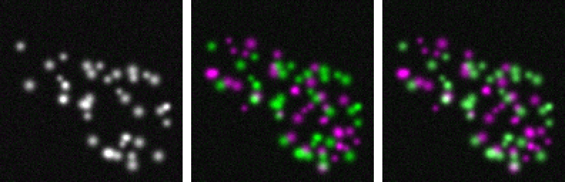

## About this lecture

Two proteins are labelled with two dyes and imaged in two channels. **Are they in the same place?** The merged picture invites a yes; this unit turns the question into numbers, and shows how those numbers fool us.

- The **scatter plot** (2D histogram) of the two channels.
- **Pearson's $r$**, the **overlap coefficient**, **Manders' M1 and M2**.
- **Thresholds** are the method: Costes' automatic threshold.
- **Controls**: shifting and scrambling one channel.
- **Pitfalls**: background in the region, bleed-through, misalignment, and the resolution limit.

*Slides titled **The math** give the formulas and proofs; the ideas are complete without them.*

::: notes
Fourth unit of the measurements day. Channels A and B are two fluorescence channels (or two stain-concentration images after unmixing). The 2D histogram is the same object as the co-occurrence matrix of the texture unit, with the second channel in place of the shifted image. Bleed-through and its compensation belong to the spectral unmixing elective (its crosstalk unit); the PSF to the image formation day. A planned fluorescence-quantification elective will take colocalisation further (FRET, FLIM, object-based methods).
:::

## "White means colocalised"?

{width="80%"}

Channel A green, channel B magenta: where both are bright the merge is **white** (yellow in a red/green merge).

- Left: B has exactly A's structures. Middle: B's structures are independent of A's. Right: the same independent structures, but 40 % of A **leaks** into the B channel.
- The right image has white spots, and its Pearson $r$ is **0.32** instead of −0.08. Nothing moved: the optics did it.
- The eye judges colour, which depends on the display range of each channel. We need numbers, and controls.

::: notes
The three panels are the presets "perfect colocalisation", "independent" and "bleed-through fakes it" of the coloc demo (128 × 128, two cells, about 40 structures per channel, Gaussian blur σ = 1 px, offset 10, noise σ = 4). The r values are inside the cells.
:::

## The scatter plot

For every pixel in the region of interest, plot $(A, B)$: the **2D histogram** of the two channels.

- **Colocalised** structures: the cloud lies along a line through the origin (after the background), $B \approx a\,A$.
- **Independent** structures: an L shape: bright A with dark B along one axis, bright B with dark A along the other.
- Background pixels: a dense blob near $(b_A, b_B)$, the two offsets.
- The texture unit drew the same picture with an image and its own shifted copy (the co-occurrence matrix).

Every coefficient below is a summary of this cloud: how linear it is, how much of each channel's mass lies above the other channel's threshold.

## Pearson's correlation

$r$ = the correlation of the two channels over the pixels of the region: +1 a perfect increasing line, 0 no linear relation, −1 a decreasing one.

- Unchanged by an **offset** or a **gain** of either channel: it centres and scales.
- **The region matters**. Cells bright in both channels on a dark background: the background pixels lie at (dark, dark), the cells at (bright, bright), so $r$ is high even if the structures inside are independent. Demo: **0.51** over the whole image, **−0.08** inside the cells.
- Lowered by **noise** (perfectly colocalised but noisy channels: 0.99 at σ = 4, 0.88 at σ = 15).
- Raised by **bleed-through** (0.32 from 40 % leakage).
- One number for the whole region: it cannot say *which* structures overlap.

## The math: correlation and overlap {.math}

Over the $n$ pixels of the region, with means $\bar A$, $\bar B$:

$$r = \frac{\sum (A_i - \bar A)(B_i - \bar B)}{\sqrt{\sum (A_i - \bar A)^2 \sum (B_i - \bar B)^2}}, \qquad \text{overlap} = \frac{\sum A_i B_i}{\sqrt{\sum A_i^2 \sum B_i^2}}.$$

- $r$ is the cosine of the angle between the **centred** vectors $A - \bar A$ and $B - \bar B$; the overlap coefficient (Manders et al., 1993) is the cosine between the **uncentred** vectors.
- $A \mapsto gA + c$: $r$ unchanged for $g > 0$. The overlap coefficient changes with $c$: a common offset pushes it towards 1 (demo: 0.84 → 0.94 when the offset goes from 10 to 50).
- $r^2$ is the share of the variance of B explained by a straight line in A.

## Manders' M1 and M2

Two questions instead of one: **how much of A sits where B is**, and how much of B sits where A is.

- **M1** = of A's intensity in its above-threshold pixels, the share that lies in pixels where B is also above its threshold.
- **M2** = the same with A and B swapped.
- **Asymmetric** by design. Small A spots inside large B structures: almost all of A is in B (M1 high), most of B has no A (M2 low). Demo: M1 = **0.79**, M2 = **0.32**, while $r = 0.37$ says little.
- Weighted by intensity: bright pixels count more than dim ones.

M1 and M2 are only as good as the **thresholds** $t_A$ and $t_B$ that decide "above background".

## The math: M1 and M2 {.math}

$$M_1 = \frac{\sum_i A_i\,[A_i > t_A]\,[B_i > t_B]}{\sum_i A_i\,[A_i > t_A]}, \qquad M_2 = \frac{\sum_i B_i\,[B_i > t_B]\,[A_i > t_A]}{\sum_i B_i\,[B_i > t_B]}.$$

- Without thresholds ($t_A = t_B = 0$) and any offset or noise, every pixel is "above", so $M_1 = M_2 = 1$ whatever the images (demo, independent channels: 0.999 and 0.997).
- Some programs define $M_1 = \sum_i A_i [B_i > t_B] / \sum_i A_i$, without the threshold on A in the denominator; on images with a background offset the two differ. State which one you use.
- Both are fractions in $[0, 1]$; the chance level for independent channels is not 0 but about the share of B's region in the image (demo, 75th-percentile thresholds: about 0.2).

## Thresholds: Costes' method

Where is the background? Costes et al. (2004) let the data decide:

1. Fit a **line** through the scatter plot (orthogonal regression: errors in both channels).
2. Start with thresholds at the top end of the line: $t_A$ = max of A, $t_B$ on the line.
3. Lower $t_A$ step by step ($t_B$ follows the line). After each step compute $r$ of the pixels **below** the thresholds (A or B below).
4. Stop when that $r$ reaches **0**: the remaining low pixels are uncorrelated noise; everything above is signal.

Then report M1, M2 and $r$ above both thresholds. It is a threshold chosen on a 2D histogram, as Otsu's threshold is on a 1D histogram (the thresholding day).

Costes' method needs a positive correlation: with $r \le 0$ there is no rising line to walk down, and the demo falls back to the 75th percentile of each channel.

## The math: the regression line {.math}

Orthogonal (total least squares) regression minimises perpendicular distances: its direction is the **first principal component** of the centred $(A, B)$ cloud (the PCA unit). With $s_{AA}$, $s_{BB}$, $s_{AB}$ the sums of squares and products,

$$\text{slope} = \frac{s_{BB} - s_{AA} + \sqrt{(s_{BB} - s_{AA})^2 + 4 s_{AB}^2}}{2\,s_{AB}}, \qquad \text{intercept} = \bar B - \text{slope}\cdot\bar A.$$

- Ordinary least squares of B on A assumes A has no noise and gives a flatter line; with noise in both channels the orthogonal line is the right one.
- The search: $t_A^{(k)} = \max A - k\,\Delta$, $t_B^{(k)} = \text{slope}\cdot t_A^{(k)} + \text{intercept}$, stop at the first $k$ with $r(\{i : A_i \le t_A \text{ or } B_i \le t_B\}) \le 0$.

## Try it: colocalisation

```{=html}
<link rel="stylesheet" href="../demos/dist/demo.css">
<div data-demo="coloc" data-preset="perfect"></div>
<script src="../demos/dist/coloc.js"></script>
```

::: notes
Tour: "perfect colocalisation": the cloud is a line, r = 0.99, M1 = M2 = 0.94. Press Costes to see the thresholds walk down the line. "independent": r = −0.08 and the cloud is an L; Costes is not defined, the thresholds go to the 75th percentiles, M1 and M2 about 0.2. "background inflates r": the whole image (r = 0.51) against inside the cells (r = −0.08). "M1 ≈ M2 ≈ 1 without thresholds". "A inside B": M1 0.79, M2 0.32. "bleed-through": r = 0.32 from leakage alone; randomise: none of 50 scrambles reaches it, so the test says "significant", wrongly. Drag the green and red lines to set the thresholds by hand.
:::

## Controls

A coefficient means little without a reference for "no colocalisation":

- **Shift one channel** by a few pixels: real colocalisation of small structures drops quickly (demo, perfect colocalisation: $r$ 0.99 → 0.94 → 0.81 → 0.63 for shifts of 1, 2, 3 px). Correlations that survive large shifts come from large-scale structure (the cell outline, the background).
- **Randomisation** (Costes): cut B into blocks about the size of the blur, shuffle the blocks, recompute $r$, many times. If the observed $r$ is above nearly all shuffled values, the overlap is more than chance. Demo: shuffled $r$ between −0.13 and 0.13 against 0.99 observed; for independent channels, 47 of 50 shuffles exceed the observed −0.08.
- A **biological** control: two labels of the same protein (expected high) and two unrelated compartments (expected low).

## Pitfalls

- **The region**: background pixels and the cell outline inflate $r$. Measure inside the cells, or per object.
- **Bleed-through**: dye A seen in channel B correlates the channels by itself, and randomisation cannot detect it (the leakage moves with the structures). Correct it first (the crosstalk unit of the spectral unmixing elective) or image sequentially.
- **Chromatic misalignment**: the two colours focus at slightly different positions; a 1–3 px shift can halve $r$ for small structures. Register the channels with beads.
- **Resolution**: two proteins within one diffraction-limited spot (about 200 nm, the PSF of the image formation day) "colocalise" at any true distance below that. Colocalisation means "closer than the resolution", never "in contact".
- **Saturation** caps the cloud; **noise** lowers $r$ and blurs the thresholds.

## Objects instead of pixels

Pixel-based coefficients mix many structures into one number. **Object-based** colocalisation segments spots in both channels and asks:

- the share of A spots whose centroid lies inside a B object (the parent–child relation of the last unit);
- the distance from each A spot to the nearest B spot, compared with the same distances after randomising the spot positions.

It needs a good segmentation of both channels, and it inherits all its errors.

## Catalogue: colocalisation columns

| column | measures | range | sensitive to |
|---|---|---|---|
| Pearson $r$ | linear relation of A and B | −1 … 1 | region, noise, bleed-through, shift |
| overlap coefficient | uncentred cosine | 0 … 1 | offsets |
| M1, M2 | share of A's (B's) intensity where the other is present | 0 … 1 | thresholds |
| $t_A$, $t_B$ (Costes) | thresholds from the regression line | intensity | correlation must be > 0 |
| $r$ above thresholds | relation within the signal | −1 … 1 | |
| slope of B on A | stoichiometry, if calibrated | | bleed-through |
| randomisation $p$ | how often shuffled B gives $r \ge$ observed | 0 … 1 | block size |

## Summary

- The **scatter plot** of the two channels is the picture; every coefficient summarises it.
- **Pearson $r$** measures linearity, depends strongly on the **region**, and ignores offset and gain. The **overlap coefficient** does not ignore offsets.
- **M1, M2** measure how much of each channel lies where the other is, asymmetrically, and are meaningless without **thresholds**; Costes chooses them from the data.
- Always run **controls**: shift a channel, randomise blocks, and check for **bleed-through**, **misalignment** and the **resolution** limit.
