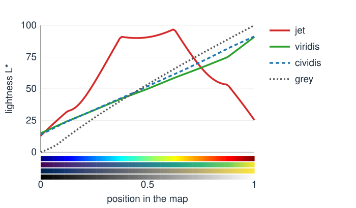

## Goal

By the end of this exercise you should be able to:

- choose a **sequential**, **diverging** or **qualitative** colour map, and a display range, for a given kind of data,
- check a map's **lightness profile** and explain why the rainbow map invents edges,
- simulate a **dichromat** as a projection and design figures that survive it,
- compute the principal axes of a colour covariance and the factors of a **decorrelation stretch**.

Do the pen-and-paper part first, then the demos. Questions marked *(math)* are for those who want the derivations; the concept questions do not depend on them.

## Background

| Idea | What it means |
|---|---|
| Colour map | data value → position $t \in [0, 1]$ (through the display range) → colour |
| Lightness profile | $L^*(t)$ along the map; should be monotone for sequential data |
| Diverging map | neutral (lightest) at its centre; use a range symmetric around the meaningful value |
| Merge | coloured channels added; magenta + green rather than red + green |
| Dichromat | two cone types: a rank-2 projection of colour space |
| Decorrelation stretch | rotate to the principal axes, equalise the variances, rotate back |

{width="80%"}

## By hand

**B1.** The lightness $L^*$ of jet and viridis at five positions:

| $t$ | 0 | 0.25 | 0.5 | 0.75 | 1 |
|---|---|---|---|---|---|
| jet | 12.9 | 54.6 | 90.6 | 67.0 | 25.4 |
| viridis | 14.9 | 33.1 | 49.9 | 66.5 | 90.9 |

(a) Which map is monotone? (b) With jet, which data value looks about as dark as the value at $t = 0.25$? (c) Between which positions does viridis change lightness fastest?

**B2.** Data range from −3 to 7. (a) With a diverging map and display range −3 … 7, which data value is shown white? (b) Which range puts zero at the centre? At what position $t$ is −3 then shown, and at what position 7?

**B3.** In LMS, a toy deuteranope keeps $L$ and $S$ and replaces $M$ by $0.5L + 0.5S$:
$$D = \begin{pmatrix} 1 & 0 & 0 \\ 0.5 & 0 & 0.5 \\ 0 & 0 & 1 \end{pmatrix}.$$
(a) Apply $D$ to a reddish $(L, M, S) = (0.8, 0.4, 0.2)$ and a greenish $(0.8, 0.9, 0.2)$. (b) What is the rank of $D$, and which vector does it send to zero? (c) Check that $D^2 = D$.

**B4.** The covariance of an image's encoded colours (in units of $10^{-3}$) is
$$S = \begin{pmatrix} 4 & 3 & 0 \\ 3 & 4 & 0 \\ 0 & 0 & 1 \end{pmatrix}.$$
(a) Find the eigenvalues and eigenvectors (the matrix is block diagonal). (b) What share of the variance is along PC1? What does PC1 mean here? (c) A decorrelation stretch scales each axis to the standard deviation $\bar\sigma = \sqrt{\operatorname{tr}S/3}$. Give the three scale factors.

**B5.** Give a better design for each figure, in one sentence: (a) a fluorescence merge in red (nuclei) and green (membrane); (b) a map of cell speeds in jet with the range set to the 1st–99th percentile; (c) a map of the change in intensity between two time points, in viridis.

::: {.callout-note collapse="true" title="Solutions"}
**B1.** (a) Viridis: its lightness increases at every step. Jet rises to 90.6 and falls again. (b) $t = 0.25$ has $L^* = 54.6$; on the way down jet passes the same lightness between $t = 0.75$ (67.0) and $t = 1$ (25.4), near the dark red end: low and high values look equally light. (c) The steps are 18.2, 16.8, 16.6, 24.4: fastest between 0.75 and 1 (the map's anchors are not perfectly uniform), slowest in the middle. Jet's steps are +41.7, +36.0, −23.6, −41.6.

**B2.** (a) The centre of the range, $(-3 + 7)/2 = 2$, is white. (b) −7 … 7. Position $t = 0.5 + v/14$: −3 at $t = 0.286$ (light blue), 7 at $t = 1$ (full red); 0 at $t = 0.5$ (white).

**B3.** (a) Reddish: $(0.8,\; 0.5 \cdot 0.8 + 0.5 \cdot 0.2,\; 0.2) = (0.8, 0.5, 0.2)$. Greenish: $(0.8, 0.5, 0.2)$ as well: the two collapse to the same colour. (b) Rank 2 (the middle column is zero; the other two columns are independent). It sends $(0, 1, 0)$ to zero: a change of $M$ alone, exactly the difference of the two colours in (a). (c) Row 2 of $D^2$ is $0.5 \cdot (1, 0, 0) + 0.5 \cdot (0, 0, 1) = (0.5, 0, 0.5)$, rows 1 and 3 are unchanged: $D^2 = D$.

**B4.** (a) The upper $2 \times 2$ block $\begin{pmatrix} 4 & 3 \\ 3 & 4 \end{pmatrix}$ has eigenvalues $4 \pm 3$: 7 with $(1, 1, 0)/\sqrt2$ and 1 with $(1, -1, 0)/\sqrt2$; the third eigenvalue is 1 with $(0, 0, 1)$. (b) $7/9 = 77.8\,\%$. PC1 is "R and G together": a brightness-like direction (in the R–G plane), the axis along which the image varies most. (c) $\operatorname{tr}S = 9$, $\bar\sigma^2 = 3$: factors $\sqrt{3/7} = 0.655$ along PC1, $\sqrt{3/1} = 1.732$ along the other two. The long axis shrinks, the thin ones grow.

**B5.** (a) Magenta for one channel and green for the other (overlap white), plus each channel separately in grey. (b) A sequential map with monotone lightness (viridis), with a colour bar that states the range and that values beyond it are clipped. (c) A diverging map centred at zero with a symmetric range, so that increases and decreases are told apart by hue and no change is neutral.
:::

### Math questions

**B6.** *(math)* Show that the decorrelation stretch $\mathbf x' = \boldsymbol\mu + U\operatorname{diag}(\bar\sigma/\sqrt{\lambda_k})U^\top(\mathbf x - \boldsymbol\mu)$ gives the covariance $\bar\sigma^2 I$, and that with $\bar\sigma^2 = \operatorname{tr}S/3$ the total variance is unchanged.

**B7.** *(math)* A deuteranope's simulation in LMS is $D$ with rows $(1, 0, 0)$, $(a, 0, b)$, $(0, 0, 1)$, where $a, b$ are chosen so that white $\mathbf w$ and blue $\mathbf q$ (both in LMS) are unchanged. Write the two equations for $a$ and $b$. Show that $D^2 = D$ for any $a, b$, and that the simulation in RGB, $T^{-1}DT$, is also a projection of rank 2.

**B8.** *(math)* A colour map is the curve $\mathbf c(t)$ in Lab. Show that if $L^*(t)$ is strictly increasing, then two different data values can never be shown with the same colour, and that the order of the values can be read from lightness alone. Is the converse true: does an injective map (no two values with the same colour) need monotone lightness?

::: {.callout-note collapse="true" title="Solutions (math)"}
**B6.** Let $A = U\operatorname{diag}(\bar\sigma/\sqrt{\lambda_k})U^\top$ (symmetric). $\operatorname{Cov}(\mathbf x') = ASA = U\operatorname{diag}(\bar\sigma/\sqrt{\lambda_k})\,\Lambda\,\operatorname{diag}(\bar\sigma/\sqrt{\lambda_k})U^\top = U(\bar\sigma^2 I)U^\top = \bar\sigma^2 I$, using $U^\top U = I$. Total variance $\operatorname{tr}(\bar\sigma^2 I) = 3\bar\sigma^2 = \operatorname{tr}S$.

**B7.** Unchanged $M$-component: $a\,w_L + b\,w_S = w_M$ and $a\,q_L + b\,q_S = q_M$ (two linear equations; the L and S components are kept by construction). $D^2$: rows 1 and 3 are unit rows that pick $L$ and $S$, which $D$ keeps, so they stay; row 2 of $D^2$ is $a\cdot(\text{row }1) + b\cdot(\text{row }3) = (a, 0, b)$. So $D^2 = D$. In RGB, $(T^{-1}DT)^2 = T^{-1}D^2T = T^{-1}DT$, and the rank is unchanged by the invertible $T$: a rank-2 projection.

**B8.** If $L^*$ is strictly increasing, $t_1 < t_2$ implies $L^*(t_1) < L^*(t_2)$: the colours differ (at least in lightness), and the larger value is always the lighter one, whatever the hue. The converse is false: a map can be injective without monotone lightness (jet is injective: no two positions have the same colour), but then the order cannot be read from lightness, and colours of very different values can have the same lightness (B1b).
:::

## Explore: colour maps {#explore}

A synthetic grey-level image through a colour map, with the colour bar and the map's lightness profile $L^*(t)$ (the readout says whether it is monotone). Images: a smooth **height field** (no edges at all), a **fluorescence**-like image, a **signed difference** (values −3 … 7). Choose the map and the display range. *Simulate colour vision* shows everything (image and bar) as a protanope, deuteranope or tritanope would see it. **Merge two channels** shows nuclei and filaments in red + green or magenta + green.

```{=html}
<link rel="stylesheet" href="../demos/dist/demo.css">
<div data-demo="colourmap" data-preset="jet"></div>
<script src="../demos/dist/colourmap.js"></script>
```

**E1.** Preset **jet invents edges**. Describe what you see in the height field. Where is the lightness maximum of jet, and what are $L^*$ at both ends? Now **viridis is monotone**: compare.

**E2.** With the height field, try **cividis**, **magma** and **hue circle**. Which are monotone? Look at the hue circle's ends: what goes wrong?

**E3.** Preset **signed data needs a diverging map** (viridis, range −3 … 7). Can you tell which regions are negative? Choose **diverging**: which value is white? Fix the display range so that zero is white.

**E4.** With viridis and the height field, simulate **deuteranope**, then do the same with jet. Which map still shows the order of values?

**E5.** Preset **red/green merge for a deuteranope**. Can you tell nuclei from filaments? Choose **magenta + green**. Then simulate **normal** vision again and compare the two merges.

::: {.callout-note collapse="true" title="Solutions"}
**E1.** Sharp-looking bands (a cyan ring, a yellow ring) around the bumps, although the field is smooth; the high peak looks dark red, darker than the middle. Jet's lightness: 12.9 at $t = 0$, a maximum of 96.8 at $t = 0.62$, 25.4 at $t = 1$: not monotone. Viridis (14.9 → 90.9, monotone) shows smooth hills; the highest values are the lightest.

**E2.** Cividis (13.8 → 91.3) and magma (0.1 → 97.9) are monotone. The hue circle is not: it starts at $L^* = 53.2$ (red), peaks at 97.1 near $t = 0.2$ (yellow), dips to 32.3 (blue) and ends at 60.3 (magenta): both ends are similar reds, so the lowest and highest values look alike.

**E3.** With viridis, nothing marks zero: negative values are just "darker". With **diverging** and the range −3 … 7, white is at 2. With the range −7 … 7 (move *display min* to −7), zero is white, the negative dip is blue and the positive peak red.

**E4.** Viridis keeps its order for the deuteranope: it becomes a blue-to-yellow ramp with the same rising lightness. Jet becomes dark blue → light blue → pale yellow → yellow → olive → dark olive, with lightness 13, 52, 87, 97 (at $t = 0.62$), 72, 31: both ends are dark, and the order is lost.

**E5.** For the deuteranope, red nuclei and green filaments both appear as yellows (pure red becomes about (156, 156, 0), pure green (214, 214, 46)): hard to tell apart, and the overlap is also yellow. With magenta + green, magenta becomes a blue (about (156, 156, 252)) and green a yellow: clearly different. For normal vision both merges are readable; magenta + green also shows the overlap as white rather than yellow.
:::

## Explore: PCA of the colour cloud {#explore-pca}

The pixels of a synthetic image in the sRGB cube, with the principal axes of the colour cloud (±2 standard deviations; orange PC1, purple PC2, green PC3). The readout gives the standard deviations along the axes, the share of PC1, its direction and the correlations of the channels (all before the stretch). *Stretch* applies a fraction of the decorrelation stretch: the cloud and the image change together.

```{=html}
<link rel="stylesheet" href="../demos/dist/demo.css">
<div data-demo="colourcloud" data-mode="pca" data-preset="he"></div>
<script src="../demos/dist/colourcloud.js"></script>
```

**P1.** Preset **H&E: a flat cloud**. Give the standard deviations along the three axes and the share of PC1. What shape is the cloud, and why? Which pair of channels is most strongly correlated?

**P2.** Move *stretch* to 1 (preset **decorrelation stretch**). What happens to the cloud and to the image? Why do some colours look clipped?

**P3.** Preset **objects: a cigar along grey**. Where does PC1 point? What is its share? Compare with B4.

**P4.** Apply the stretch to the objects (preset **objects, stretched**). What becomes easier to see, and what would you **not** do with the stretched image?

::: {.callout-note collapse="true" title="Solutions"}
**P1.** Standard deviations 0.190, 0.070 and 0.002; PC1 carries 88.0 % of the variance. The cloud is a thin, flat sheet: every pixel is a mixture of two stains (and white), two degrees of freedom, so the third axis has almost no spread. R and B are the most correlated (0.99), then G–B (0.84) and R–G (0.74).

**P2.** The sheet swells towards a round blob: the thin directions are stretched by large factors, the third one most (its σ is tiny, so the gain is about 63). The image becomes garish, but nuclei and stroma now differ strongly in colour. Values pushed outside $[0, 1]$ are clipped (14 % of the pixels), which is why some areas are flat saturated colours. A gain this large on the third axis would also amplify any noise along it.

**P3.** PC1 is $(0.55, 0.64, 0.54)$, close to the grey diagonal $(0.58, 0.58, 0.58)$: brightness (shading, shadow). It carries 77.2 % of the variance (standard deviations 0.309, 0.143, 0.088). As in B4, the correlated channels make one long axis along "all channels together".

**P4.** The stretched image exaggerates colour differences: the table, the shadow and the objects separate more by colour, and subtle tints (such as the faint cast of the shadow) are easier to see. The colours are false and depend on the image's own statistics: do not measure colours or intensities on it, and do not compare stretched images of different scenes as if their colours meant the same.
:::

## Where this leads

The course's colour maps (viridis for sequential data, a blue–white–red map for signed data, a label palette) are used in every later demo. The days that build on colour:

- [Spectral unmixing](../crosstalk/lec.qmd) (day 43) continues the colour cloud: with more channels than three, mixtures of dyes form cones and simplices in channel space ([endmembers](../endmembers/lec.qmd)), and finding the dyes' spectra is a geometric problem.
- [Colocalisation](../coloc/lec.qmd) (day 44) shows two channels as a merge and turns the impression into numbers.
- [FRET](../fret-physics/lec.qmd) (day 45) compares the intensities of two colour channels to measure distances of a few nanometres.
- [3D graphics](../pipeline3d/lec.qmd) (day 48) colours vertices and pixels, and [path tracing](../pathtrace/lec.qmd) (day 50) adds up light in linear light and converts to sRGB only for display.
