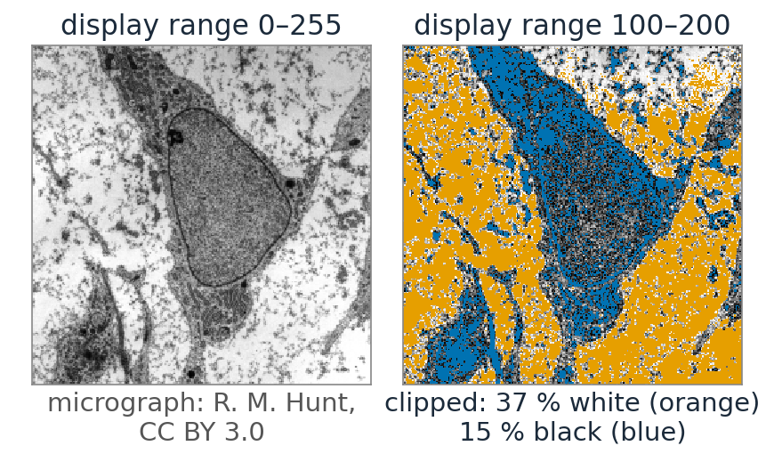
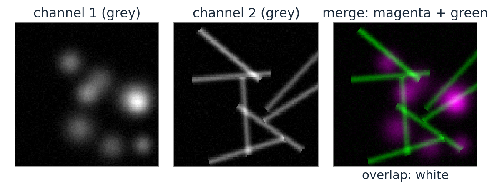
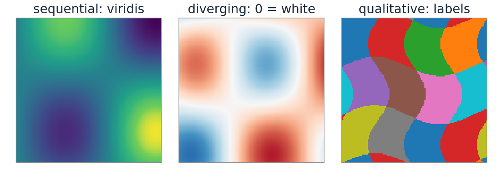
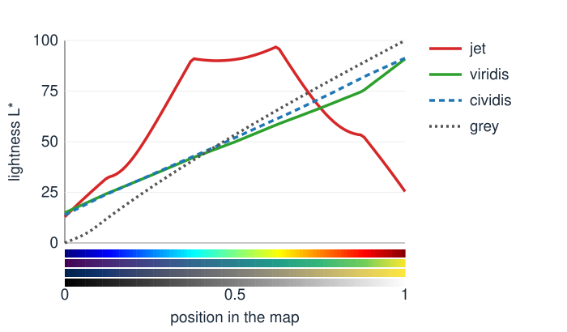
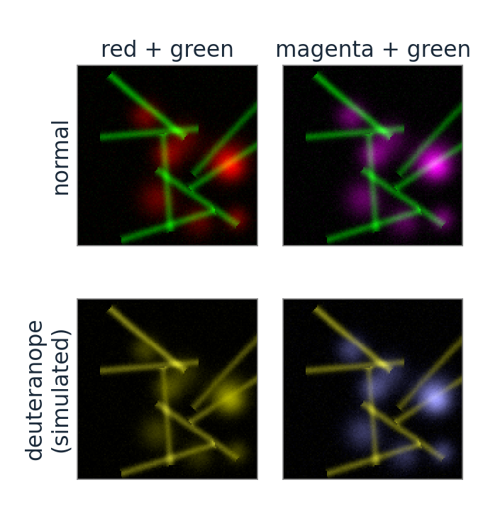
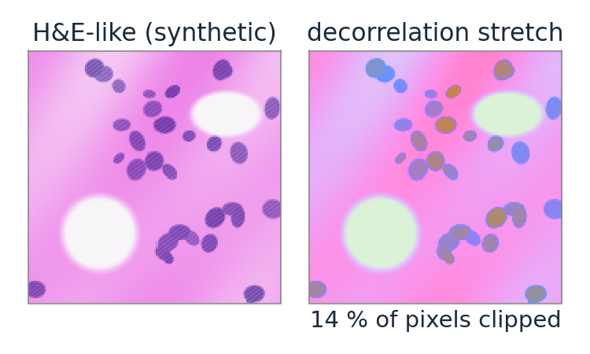

## About this lecture

The last units read colour **from** images. Now the other direction: using colour to **show** data.

- **Pseudocolour** and **channel merges** for fluorescence: a choice, not a fact.
- **Colour maps** for a scalar image: sequential, diverging, qualitative. Lightness must change **monotonically**; the rainbow map invents edges.
- **Colour-blind viewers**: a dichromat sees a **projection** of colour space; check figures with it.
- **Decorrelation stretch**: PCA of the colour cloud brings out faint colour differences.

*Slides titled **The math** give the formulas and proofs; the ideas are complete without them.*

::: notes
Every demo in the course uses the colour maps of this unit (viridis for sequential data, the blue–white–red map for signed data, the label palette for labels). Recall from the bit-depth day: window/level and lookup tables for high-bit data; the display range is part of the map.
:::

## Displaying a grey image is already a choice

:::: {.columns}
::: {.column width="52%"}
Recall ([the bit-depth day](../highbit/lec.qmd)): a **lookup table** maps each data value to a screen colour, after a **display range** (window/level).

- The display range sets which values are black and white; values outside are **clipped**. Never let a display setting silently clip data that you measure.
- A colour map is a lookup table with colours instead of greys: data value → position $t \in [0, 1]$ → colour.
- The data do not change; only how they look. But how they look decides what people **see** in them.
:::
::: {.column width="48%"}
{width="100%" fig-alt="The same electron micrograph of a cell shown with display range 0–255 and with range 100–200: the narrow range has more contrast, but pixels above 200 (marked orange) are clipped to white and those below 100 (marked blue) to black."}
:::
::::

::: notes
Micrograph: transmission electron micrograph of a mesenchymal stem cell, Robert M. Hunt, CC BY 3.0, via Wikimedia Commons.
:::

## Fluorescence: channels are grey images

A fluorescence image has one **grey** image per filter set (per dye). Colour is added for display:

{width="62%" fig-alt="Two synthetic fluorescence channels shown in grey, round spots in one and filaments in the other, and their merge with channel 1 in magenta and channel 2 in green; where both overlap the merge is white."}

::: {.smaller}
- **Pseudocolour**: each channel through its own ramp (black → green, black → magenta, ...).
- **Merge**: add the coloured channels. Where both are present the colours mix (green + magenta = white; red + green = yellow).
- The colour of a channel says nothing about the dye's emission colour unless you choose it to.
- **Red/green merges** are invisible to about 8 % of men (red–green colour blindness): red, green and their mixture become similar yellows. Use **magenta/green** (or cyan/magenta/yellow) and also show the channels **separately**, in grey.
:::

## Colour maps for scalar data

| data | map | example |
|---|---|---|
| **sequential** (low → high) | lightness increases steadily | viridis, cividis, magma, grey |
| **diverging** (signed, around a centre) | lightest (or neutral) at the centre, two hues outwards | blue–white–red |
| **qualitative** (labels, classes) | distinct hues, no order | the label palette |

- The eye reads **lightness** as "how much". A good sequential map has monotone lightness and roughly equal visible steps.
- A diverging map puts its centre at the meaningful value (zero), so the display range must be **symmetric** around it.

{width="62%" fig-alt="Three synthetic images: a smooth height field in viridis, a signed field in the blue–white–red map with zero white, and a label image in the qualitative palette."}

## Lightness must be monotone

:::: {.columns}
::: {.column width="55%"}
{width="100%"}
:::
::: {.column width="45%"}
**Jet** (the classic rainbow) goes dark blue → bright cyan/yellow → dark red: its lightness rises to $L^* = 97$ at $t = 0.62$ and falls to 25.

- Bands of fast lightness change look like **edges** that are not in the data; flat stretches hide real structure.
- High values (dark red) look **darker** than middle values: the order is lost in greyscale or for colour-blind viewers.
- Viridis and cividis rise steadily (from about 14 to 91).
:::
::::

## The math: what makes a map perceptually uniform {.math}

A colour map is a curve $\mathbf c(t)$ in Lab, $t \in [0, 1]$. Perceived contrast between neighbouring data values is about

$$\Delta E \approx \left\|\frac{d\mathbf c}{dt}\right\| \Delta t .$$

- **Uniform**: $\|\mathbf c'(t)\|$ constant, so equal data steps give equal visible steps (arc length proportional to $t$).
- **Ordered**: $L^*(t)$ strictly monotone, so "more" always looks lighter (or always darker), also without hue.
- Jet: $L^{*\prime}(t)$ changes sign twice, and $\|\mathbf c'\|$ varies strongly: false edges where it is large, flat zones where it is small. A map built by interpolating in Lab between anchors with increasing $L^*$ (as the course's maps are) is ordered by construction.

## Try it: colour maps

```{=html}
<link rel="stylesheet" href="../demos/dist/demo.css">
<div data-demo="colourmap" data-preset="jet"></div>
<script src="../demos/dist/colourmap.js"></script>
```

::: notes
A smooth synthetic height field (no edges at all), the colour bar and its lightness profile. Tour: "jet invents edges": sharp-looking boundaries at the cyan and yellow bands; L* from 12.9 up to 96.8 at t = 0.62 and down to 25.4. "viridis is monotone": the same field reads as smooth hills. "signed data needs a diverging map": data in [−3, 7] with viridis gives no clue where zero is; choose "diverging" and set the range to −7…7: zero is white. "red/green merge for a deuteranope": both channels become yellows; choose "magenta + green".
:::

## Colour-blind viewers

:::: {.columns}
::: {.column width="58%"}
About 8 % of men and 0.5 % of women have a red–green deficiency; most common is a weak or missing **M** (deutan) or **L** (protan) cone.

- A **dichromat** has two cone types: two numbers per colour instead of three. Colours that differ only in the missing cone's response **look the same**.
- For a deuteranope, red and green both look like yellows of different lightness; for the rarer tritanope (no S cones) blue and green merge.
- **Check figures** by simulating: the simulation is one $3 \times 3$ matrix in linear RGB. Use maps whose order is carried by lightness (viridis, cividis) and magenta/green rather than red/green.
:::
::: {.column width="42%"}
{width="92%" fig-alt="The same two-channel image merged red + green and magenta + green, shown normally and as simulated for a deuteranope: the red/green merge becomes yellows that barely differ, the magenta/green merge stays readable as blue and yellow."}
:::
::::

## The math: a dichromat is a projection {.math}

In LMS a deuteranope does not have $M$. Replace it by a combination of the other two that keeps two **anchor** colours unchanged (white, and blue), i.e. $M' = aL + bS$ with $a, b$ from two equations:

$$D = \begin{pmatrix} 1 & 0 & 0 \\ a & 0 & b \\ 0 & 0 & 1 \end{pmatrix}, \qquad \text{in linear RGB: } S_\text{deutan} = T^{-1} D\, T,$$

with $T$ = linear RGB → LMS.

- $D$ has rank 2 and $D^2 = D$: a **projection** onto a plane. Its null space is the direction $(0, 1, 0)$ in LMS: changes of $M$ alone are invisible.
- Two colours look the same to the dichromat iff their difference lies in that null space, as in the metamers of [the first unit](../colour-vision/lec.qmd).
- (Brettel, Viénot and Mollon used two half-planes instead of one plane; a single matrix is the common simplification.)

## Decorrelation stretch

::: {.smaller}
:::: {.columns}
::: {.column width="56%"}
Recall **PCA** ([day 1](../pca/lec.qmd)): the principal axes of a point cloud are the eigenvectors of its covariance matrix.

- In most images R, G and B are strongly **correlated**: the colour cloud is a **cigar** along the grey axis. Brightness varies a lot, colour little.
- **Decorrelation stretch**: rotate the cloud to its principal axes, **equalise** the variances, rotate back. The thin directions (colour differences) are stretched, the long one (brightness) compressed.
- Faint colour differences become visible: faded stains, rock art, remote sensing. Colours become **false**; the stretch is for seeing, not for measuring.
- **PC1** alone is a data-driven greyscale: the direction in which this image varies most.
:::
::: {.column width="44%"}
{width="100%" fig-alt="A synthetic H&E-like tissue image in pink and purple, and the same image after a full decorrelation stretch: garish false colours in which nuclei and stroma separate clearly; 14 % of the pixels are clipped."}
:::
::::
:::

## The math: decorrelation stretch {.math}

Colour vectors $\mathbf x_i$ (encoded RGB), mean $\boldsymbol\mu$, covariance $S = U\Lambda U^\top$ with eigenvalues $\lambda_1 \ge \lambda_2 \ge \lambda_3$.

$$\mathbf x_i' = \boldsymbol\mu + U\,\operatorname{diag}\!\left(\frac{\bar\sigma}{\sqrt{\lambda_k}}\right)U^\top(\mathbf x_i - \boldsymbol\mu), \qquad \bar\sigma^2 = \tfrac13(\lambda_1 + \lambda_2 + \lambda_3).$$

- The new covariance is $U\operatorname{diag}(\bar\sigma^2/\lambda_k)\Lambda U^\top = \bar\sigma^2 I$: uncorrelated channels with equal variance, and the same total variance $\operatorname{tr} S$.
- A tiny $\lambda_3$ means a huge gain $\bar\sigma/\sqrt{\lambda_3}$: noise along that axis is amplified as much. Values outside $[0, 1]$ are clipped.
- A fraction $t \in [0, 1]$ of the stretch uses factors $(\bar\sigma/\sqrt{\lambda_k})^t$.

## Try it: PCA of the colour cloud

```{=html}
<link rel="stylesheet" href="../demos/dist/demo.css">
<div data-demo="colourcloud" data-mode="pca" data-preset="he"></div>
<script src="../demos/dist/colourcloud.js"></script>
```

::: notes
The pixels of the synthetic H&E image in the sRGB cube, with the principal axes (±2 standard deviations; orange PC1, purple PC2, green PC3). Readout: σ along the axes 0.190, 0.070, 0.002; PC1 has 88.0 % of the variance; correlations R–G 0.74, R–B 0.99, G–B 0.84. The cloud is a flat sheet (two stains). Move "stretch" to 1: the sheet swells, the image gets garish but nuclei and stroma separate in colour; 14 % of the pixels are clipped. Then "objects": a cigar along grey (PC1 (0.55, 0.64, 0.54), 77.2 %).
:::

## A checklist for colour in figures

- Sequential data: a map with **monotone lightness** (viridis, cividis, magma); never jet for quantities.
- Signed data: a **diverging** map, centred on zero with a **symmetric** range.
- Labels: a **qualitative** palette; neighbouring labels must differ.
- Merges: **magenta/green** (not red/green), plus the single channels in grey.
- Always show a **colour bar** with the display range, and say if anything is clipped.
- Check the figure in **greyscale** and with a **dichromat simulation**.

## Summary

- Showing data in colour is a **lookup table**: display range + map. It changes what viewers see, not the data.
- **Sequential** maps need monotone lightness; the rainbow map invents edges and loses the order. **Diverging** maps need a centred, symmetric range; **qualitative** palettes are for labels.
- A **dichromat** sees a rank-2 projection of colour; simulate it to check figures; avoid red/green merges.
- **Decorrelation stretch** = PCA of the colour cloud, variances equalised: faint colour differences become visible (false colours, for looking only).
