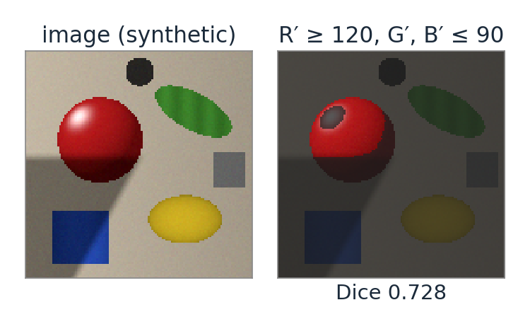
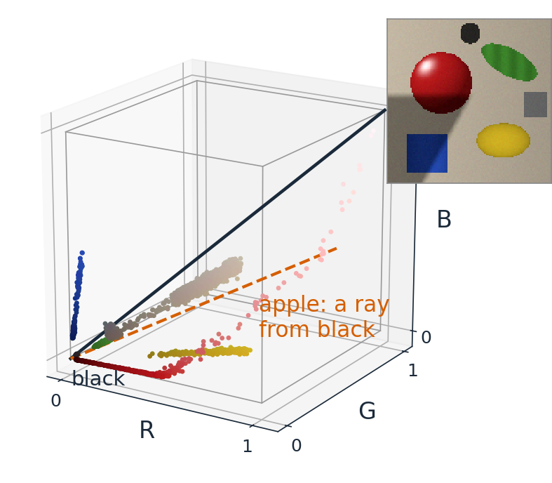
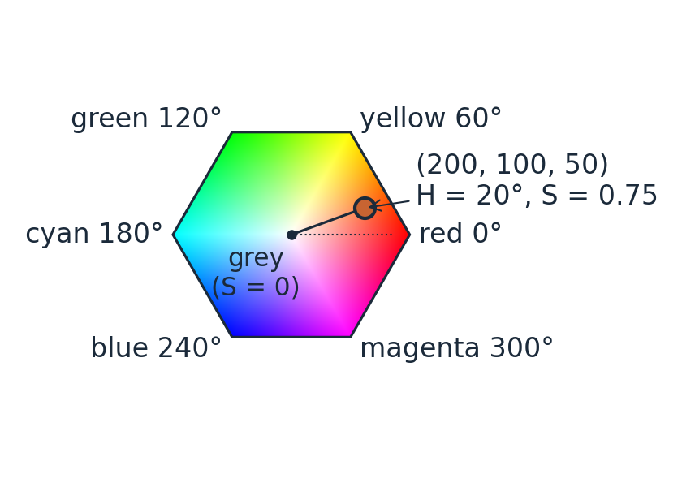
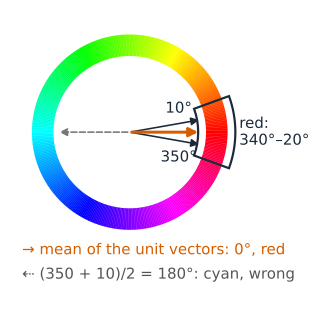
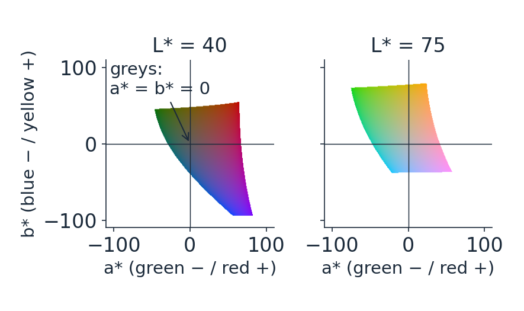
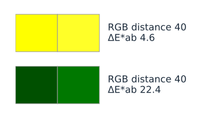
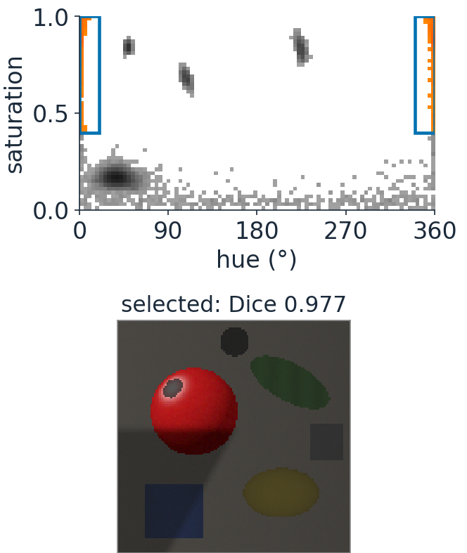
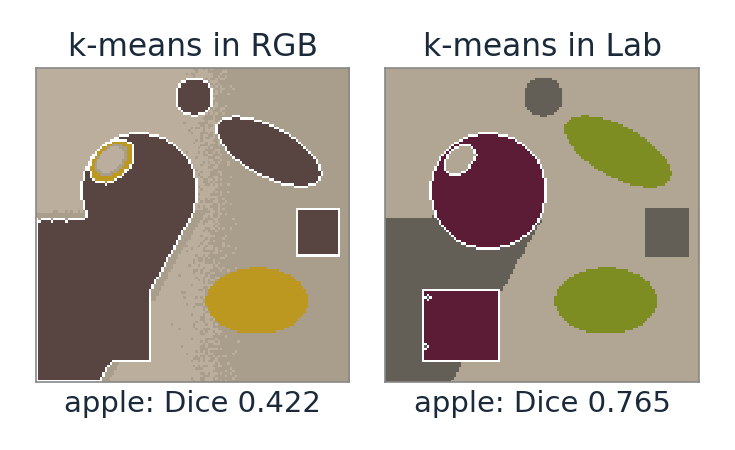

## About this lecture

Two questions an analysis asks of colour: **"find the red objects"** and **"how different are these two colours?"**. Neither is easy in RGB.

- The pixels of an image are a **cloud of points in 3D**; a colour space is a choice of coordinates for that cloud.
- **HSV**: hue as an **angle**, saturation, value. Survives shading; singular at grey.
- **CIELAB**: lightness and two opponent axes, built so that **distance ≈ perceived difference** (ΔE).
- **Segmentation**: pick the space in which the wanted colours form a **simple region**.

*Slides titled **The math** give the formulas and proofs; the ideas are complete without them.*

::: notes
Builds on the thresholding day (Otsu, isodata, Dice) and on the last two units (linear light, XYZ). The thresholds of day 6 work on one number per pixel; here each pixel has three, and the first job is to choose which numbers.
:::

## Why RGB is awkward for analysis

:::: {.columns}
::: {.column width="55%"}
- **Shading changes all three channels.** A red apple in shadow has small R, G and B: a threshold "R > 120" cuts the apple in half.
- **Equal RGB steps are not equal visible steps.** Codes (255, 255, 0) and (255, 255, 40) are hard to tell apart; (0, 80, 0) and (0, 120, 0) are obviously different. Both pairs are 40 apart.
- **Hue, saturation and brightness are mixed** in every channel. "Red" is not a range of one channel; it is a direction.

Better coordinates separate **how much light** from **which colour**, and measure differences as we see them.
:::
::: {.column width="45%"}
{width="100%" fig-alt="A synthetic scene with a red apple half in shadow, and the pixels selected by the threshold R′ ≥ 120 (G′, B′ ≤ 90): only the lit half of the apple, Dice 0.728."}
:::
::::

::: notes
The figure is the colour-segmentation demo's preset "R threshold fails in the shadow" (synthetic scene).
:::

## The pixel cloud

:::: {.columns}
::: {.column width="54%"}
Plot each pixel as a point at $(R, G, B)$: an image becomes a **cloud** inside the RGB cube.

- Greys lie on the **diagonal** from black to white.
- An object under varying light lies on a **ray from black**: all three values scale together (in linear light exactly, in encoded values nearly).
- A segmentation is a **region** of this space; a threshold on one channel is a slab with flat walls.
- A good colour space bends the cube so that the wanted region becomes simple: a wedge, a disc, a ball.
:::
::: {.column width="46%"}
{width="100%" fig-alt="The pixels of the synthetic objects scene plotted as points in the RGB cube, each in its own colour; the grey diagonal runs from black to white, and the apple's pixels lie along a ray from black."}
:::
::::

## HSV: colour for picking colours

:::: {.columns}
::: {.column width="56%"}
The RGB cube seen along its grey diagonal is a **hexagon**. HSV (Smith, 1978) uses it as a colour wheel:

- **V** (value) $= \max(R, G, B)$: how bright the strongest channel is.
- **S** (saturation) $= (\max - \min)/\max$: how far from grey (0 = grey, 1 = pure).
- **H** (hue): the **angle** around the grey axis: red 0°, yellow 60°, green 120°, cyan 180°, blue 240°, magenta 300°.

$(200, 100, 50)$: $V = 200/255 = 0.78$, $S = 150/200 = 0.75$, $H = 20°$ (orange).
:::
::: {.column width="44%"}
{width="100%" fig-alt="The RGB cube seen along its grey diagonal: a hexagon with red at 0°, yellow 60°, green 120°, cyan 180°, blue 240°, magenta 300°, grey in the centre. The orange (200, 100, 50) sits at hue 20°, three quarters of the way out."}
:::
::::

## The math: computing H, S, V {.math}

With $M = \max(R, G, B)$, $m = \min(R, G, B)$, $d = M - m$ (values in $[0, 1]$):

$$V = M, \qquad S = \begin{cases} d / M & M > 0 \\ 0 & M = 0 \end{cases}, \qquad H = 60° \times \begin{cases} \dfrac{G - B}{d} \bmod 6 & M = R \\[4pt] \dfrac{B - R}{d} + 2 & M = G \\[4pt] \dfrac{R - G}{d} + 4 & M = B \end{cases}$$

- $H$ is undefined for $d = 0$ (all greys): a **singularity** along the whole grey axis.
- Piecewise linear on the hexagon, not a true angle; good enough to order the hues around a circle.

## Hue is an angle

::: {.smaller}
:::: {.columns}
::: {.column width="62%"}
- **It wraps.** Red sits at both 0° and 360°: "red" is the interval 340°–20°, a **union** of two intervals on the number line.
- **Averaging needs care.** The mean of 350° and 10° is 0° (red), not 180° (cyan): average the unit vectors $(\cos H, \sin H)$.
- **It is undefined at grey.** Near the grey axis a tiny noise turns the hue anywhere: a hue mask of a noisy image **speckles** in grey and dark regions. Fix: require a **minimum saturation** (and value).
- **It ignores shading.** Scaling all three channels by the same factor keeps $H$ and $S$: a hue threshold survives shadows where an R threshold fails. The same idea: **normalised rgb**, $r = R/(R+G+B)$, $g = G/(R+G+B)$.
:::
::: {.column width="38%"}
{width="100%" fig-alt="A hue circle with the red interval 340° to 20° marked across 0°. Unit vectors at 350° and 10° average to a vector at 0°, red; the arithmetic mean of the numbers, 180°, points to cyan."}
:::
::::
:::

## The math: invariance and the circular mean {.math}

Shading: $(R, G, B) \to (kR, kG, kB)$ with $k > 0$ scales $M$, $m$ and $d$ by $k$, so

$$S = \frac{kd}{kM} = \frac{d}{M}, \qquad H \propto \frac{kG - kB}{kd} = \frac{G - B}{d}: \quad \text{unchanged; } V \to kV.$$

(In encoded values a scaling of light is a scaling of codes only approximately, through the power law; in linear values it is exact.)

Circular mean of angles $H_i$: $\bar H = \operatorname{atan2}\!\big(\sum_i \sin H_i, \sum_i \cos H_i\big)$, the direction of the mean unit vector. Its length $\bar R = \|\frac1n\sum_i (\cos H_i, \sin H_i)\|$ is 1 when all hues agree and near 0 when they are spread out (e.g. noise around grey).

## Try it: the colour cloud

```{=html}
<link rel="stylesheet" href="../demos/dist/demo.css">
<div data-demo="colourcloud" data-preset="hsv"></div>
<script src="../demos/dist/colourcloud.js"></script>
```

::: notes
WebGL: drag to rotate. Each point is a pixel in its own colour; the outline is the sRGB gamut (the cube's edges) in the current space; the black line is the grey axis. Tour: "cube → HSV cone": the chart of all hues fills the cube; it morphs into the cone (hue = angle, distance from the axis = S·V). Click "CIELAB": the solid becomes lopsided (yellow high, blue low). "shadows are rays through black": the red apple's pixels in linear RGB lie along a line towards black (and a curve to white for the highlight). "grey pixels scatter in hue": noise 0.03, the grey card's pixels in HSV are a ball around the axis, every hue present. Click a pixel: its coordinates in all spaces; the ball around it selects similar colours, and their pixels light up in the image.
:::

## CIELAB: a space for differences

::: {.smaller}
:::: {.columns}
::: {.column width="52%"}
CIELAB (1976) starts from XYZ and imitates perception:

- **L\*** (lightness, 0–100): a **cube root** of luminance, like the gamma curve. 18 % grey is $L^* = 49.5$: "middle grey" is not 50 % of the light.
- **a\*** (green − red) and **b\*** (blue − yellow): **opponent** axes, as in the visual system. Greys have $a^* = b^* = 0$.
- The **white point** is built in: everything is relative to the white (a simple white balance).
- Polar form: **chroma** $C^* = \sqrt{a^{*2} + b^{*2}}$ and **hue angle** $h = \operatorname{atan2}(b^*, a^*)$: a perceptual version of HSV.
:::
::: {.column width="48%"}
{width="100%" fig-alt="Two slices of CIELAB at lightness 40 and 75, showing the displayable colours in the a*–b* plane: greys at the centre, red to the right, green to the left, yellow up, blue down; the slice at 75 reaches far into yellow, the one at 40 far into blue."}
:::
::::
:::

## The math: from XYZ to Lab {.math}

With the white $(X_n, Y_n, Z_n)$ and

$$f(t) = \begin{cases} t^{1/3} & t > (6/29)^3 \\ \frac{t}{3(6/29)^2} + \frac{4}{29} & \text{otherwise} \end{cases}$$

$$L^* = 116\,f(Y/Y_n) - 16, \qquad a^* = 500\,\big[f(X/X_n) - f(Y/Y_n)\big], \qquad b^* = 200\,\big[f(Y/Y_n) - f(Z/Z_n)\big].$$

- $f$ compresses like the eye's response; the linear piece avoids an infinite slope at black.
- White: $f = 1$ everywhere, so $(100, 0, 0)$. A grey $kX_n, kY_n, kZ_n$ has equal $f$'s: $a^* = b^* = 0$.
- CIELUV (same year) does the same with a different chromatic part; it is used where a more uniform chromaticity diagram is wanted.

## ΔE: colour difference as a distance

:::: {.columns}
::: {.column width="58%"}
$\Delta E^*_{ab}$ = the Euclidean distance in Lab. About **1–2.3** is just noticeable.

| pair (codes) | RGB distance | $\Delta E^*_{ab}$ |
|---|---|---|
| (255, 255, 0) vs (255, 255, 40), yellows | 40 | 4.6 |
| (0, 80, 0) vs (0, 120, 0), dark greens | 40 | 22.4 |

- Lab is only **approximately** uniform: differences in saturated blues come out too large, and the just-noticeable "ellipses" (MacAdam) are not circles.
- **CIEDE2000** corrects this with weights for lightness, chroma and hue (formula not needed here; the demos offer it).
:::
::: {.column width="42%"}
{width="100%" fig-alt="Two pairs of swatches: two yellows (255, 255, 0) and (255, 255, 40), barely different, ΔE 4.6; two dark greens (0, 80, 0) and (0, 120, 0), clearly different, ΔE 22.4. Both pairs are 40 apart in RGB."}
:::
::::

## Choosing a space for segmentation

::: {.smaller}
:::: {.columns}
::: {.column width="58%"}
The pixels form a cloud; a class is a region of it. Choose the space in which the region is **simple**:

- **Hue wedge** with a saturation (and value) floor in HSV: "red objects, in light and in shadow".
- **Disc or box in $a^*b^*$**: colour regardless of lightness.
- **Ball of radius ΔE** around a reference colour in Lab: "everything that looks like this".
- A **2D histogram** of the two chromatic coordinates ($H$–$S$, $a^*$–$b^*$, $C_b$–$C_r$, $r$–$g$) is where to see the clusters and draw the region.
- One threshold is enough when one derived channel separates the classes: **Otsu on $a^*$** or on hue (the thresholding day's Otsu, on a better number).
:::
::: {.column width="42%"}
{width="92%" fig-alt="Hue–saturation histogram of the objects scene; the box hue 340°–20° with saturation at least 0.4 selects the apple's pixels in orange. Below, the selection in the image: the whole apple, lit and shaded, Dice 0.977."}
:::
::::
:::

## Clusters: isodata in 3D

::: {.smaller}
:::: {.columns}
::: {.column width="56%"}
The thresholding day's **isodata** alternates between "split the pixels at the threshold" and "move the threshold between the two class means". In 3D colour space the same loop is **k-means**:

1. pick $k$ initial colours (centres);
2. give each pixel to its **nearest** centre;
3. move each centre to the **mean** of its pixels; repeat until nothing changes.

- The result depends on the **space** (distances!) and on the start. In RGB the shadow and the lit side of an object may split into two clusters; in Lab the split follows colour more closely.
- k-means as an algorithm (its objective, convergence, good starts) belongs to the Gaussian-mixture elective.
:::
::: {.column width="44%"}
{width="100%" fig-alt="k-means with four clusters on the objects scene, each pixel painted in its cluster's mean colour. In RGB the apple splits into a lit and a shaded cluster (best Dice 0.422); in Lab one cluster covers most of it (Dice 0.765)."}
:::
::::
:::

## Try it: colour segmentation

```{=html}
<link rel="stylesheet" href="../demos/dist/demo.css">
<div data-demo="colourseg" data-preset="rgb"></div>
<script src="../demos/dist/colourseg.js"></script>
```

::: notes
Image (click: reference colour), 2D histogram (grey: all pixels, log counts; orange: the selected ones), result. Dice against the true apple (1810 pixels). Tour: "R threshold fails in the shadow": R′ ≥ 120 keeps only the lit half, Dice 0.728. "hue survives the shadow": hue 340°–20°, S ≥ 0.4: Dice 0.977. "red wraps around 0°": the chart of all hues, both edges selected. "grey and dark pixels speckle": noise 0.03, no saturation floor: 2096 table pixels selected, Dice 0.621; raise S to 0.4: 0.973. "ΔE ball": radius 25 in Lab Dice 0.761, RGB distance 0.566. "k-means": RGB best cluster 0.422 (shadow and light split), switch to Lab: 0.765.
:::

## A colour model as a data term

Segmentation by colour alone treats every pixel separately: noise and shading leave holes and specks.

- Fit a model of each class's colours (a Gaussian in Lab, or a mixture): $-\log P(\text{colour} \mid \text{class})$ is a **data term**.
- Add a smoothness term and minimise: **graph cuts** (day 13); interactive versions draw only a box around the object and learn both colour models (GrabCut).

## Summary

- An image's pixels are a **cloud in 3D**; a colour space is a choice of coordinates, and a segmentation is a region.
- **HSV**: hue is an **angle** (wraps, circular mean), undefined at grey (use a **saturation floor**), unchanged by shading.
- **CIELAB**: lightness by a cube root, opponent axes $a^*, b^*$, the white built in; **ΔE** = Euclidean distance ≈ perceived difference (1–2 just noticeable; CIEDE2000 refines it).
- Choose the space in which the class is simple: hue wedge, $a^*b^*$ disc, ΔE ball, Otsu on one derived channel, or **k-means** (isodata in 3D).
