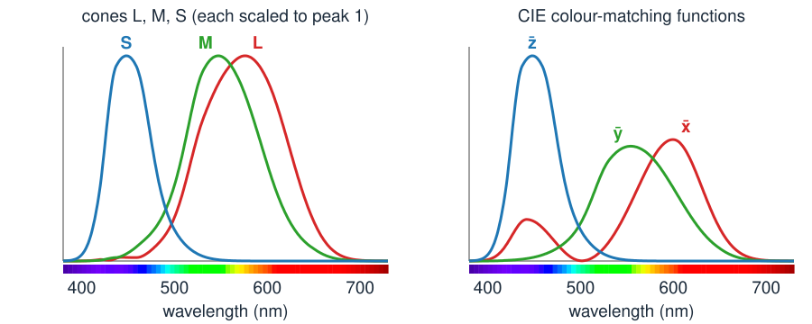

## Goal

By the end of this exercise you should be able to:

- compute the three responses of an eye (or a camera) to a sampled spectrum,
- construct a **metamer** of a spectrum and say when a match breaks (another camera, a colour-blind viewer, another lamp),
- compute **chromaticities**, and locate a mixture of two lights on the chromaticity diagram,
- decide whether a colour is inside a display's **gamut** triangle.

Do the pen-and-paper part first, then the demos. Questions marked *(math)* are for those who want the derivations; the concept questions do not depend on them.

## Background

| Idea | What it means |
|---|---|
| Spectrum | power $s(\lambda)$ at each wavelength; sampled, a vector $\mathbf s$ |
| Cone (or filter) response | a weighted sum of the spectrum: $L = \sum_\lambda \bar l(\lambda)\,s(\lambda)$; together $\mathbf c = A\mathbf s$ |
| Metamers | spectra with the same three responses: $A\mathbf s_1 = A\mathbf s_2$ |
| Surface under a lamp | the light is lamp × reflectance, wavelength by wavelength |
| CIE XYZ | a standard basis of the three responses; $Y$ = luminance; $X, Y, Z \ge 0$ for real light |
| Chromaticity | $x = X/(X+Y+Z)$, $y = Y/(X+Y+Z)$: the colour without its brightness |
| Gamut | the triangle of a display's three primaries on the $(x, y)$ diagram |

{width="90%"}

## By hand

**B1.** A toy eye sees 5 wavelength bins with three cones (rows L, M, S):
$$A = \begin{pmatrix} 0 & 0 & 1 & 2 & 1 \\ 0 & 1 & 2 & 1 & 0 \\ 1 & 2 & 1 & 0 & 0 \end{pmatrix}.$$
(a) Compute the responses $A\mathbf s$ to $\mathbf s_1 = (1, 1, 1, 1, 1)$, $\mathbf s_2 = (0, 2, 0, 2, 0)$ and $\mathbf s_3 = (2, 0, 1, 0, 2)$. Which of them look identical to this eye?
(b) The vectors $\mathbf v_1 = (3, -2, 1, 0, -1)$ and $\mathbf v_2 = (2, -1, 0, 1, -2)$ satisfy $A\mathbf v = \mathbf 0$. Check one of them. What happens to the responses if you add $\mathbf v_1$ to a spectrum?
(c) Find a third metamer of $\mathbf s_1$ that is non-negative in every bin, using $\mathbf v_1 - \mathbf v_2$. For which multiples $t$ of $\mathbf v_1 - \mathbf v_2$ does $\mathbf s_1 + t(\mathbf v_1 - \mathbf v_2)$ stay a physical spectrum?

**B2.** A toy camera looks at the same bins with the filters
$$A_\text{cam} = \begin{pmatrix} 0 & 0 & 0 & 1 & 2 \\ 0 & 1 & 2 & 1 & 0 \\ 2 & 1 & 0 & 0 & 0 \end{pmatrix}.$$
(a) Compute its responses to $\mathbf s_1$ and $\mathbf s_2$ of B1. Do eye and camera agree that the two are the same colour?
(b) A dichromat has only the L and S cones of $A$. Compute its responses to $\mathbf s_1$ and to $\mathbf s_4 = (2, 1, 0, 1, 2)$. Does it see a difference? Does the trichromat eye?

**B3.** Light 1 has $(X, Y, Z) = (20, 30, 50)$ and light 2 has $(30, 15, 5)$.
(a) Compute the chromaticities $(x, y)$ of both.
(b) Compute the chromaticity of their sum. Check that it lies on the line between the two, and say where: at what fraction of the way from light 1 to light 2?
(c) Which light is brighter? Why does the mixture lie closer to light 1 although light 1 is not brighter?

**B4.** The sRGB primaries have chromaticities R $(0.64, 0.33)$, G $(0.30, 0.60)$, B $(0.15, 0.06)$. A point is inside the triangle if it can be written as $p = \alpha R + \beta G + \gamma B$ with $\alpha + \beta + \gamma = 1$ and all three $\ge 0$ (barycentric coordinates).
(a) Find $\alpha, \beta, \gamma$ for $p = (0.30, 0.50)$. Is it inside?
(b) The same for $p = (0.20, 0.70)$, a saturated green. Can an sRGB screen show it?

**B5.** Explain in two sentences each: (a) why a photo of two fabrics that match to your eye may show them as different; (b) why a white LED and daylight can look the same white although their spectra differ.

::: {.callout-note collapse="true" title="Solutions"}
**B1.** (a) $A\mathbf s_1 = (4, 4, 4)$, $A\mathbf s_2 = (4, 4, 4)$, $A\mathbf s_3 = (3, 2, 3)$. $\mathbf s_1$ and $\mathbf s_2$ are metamers; $\mathbf s_3$ looks different.
(b) $A\mathbf v_1 = (1 + 0 - 1,\; -2 + 2 + 0,\; 3 - 4 + 1) = (0, 0, 0)$. Adding $\mathbf v_1$ does not change any response: the eye is blind to it.
(c) $\mathbf v_1 - \mathbf v_2 = (1, -1, 1, -1, 1)$, so $\mathbf s_1 + t(\mathbf v_1 - \mathbf v_2) = (1 + t, 1 - t, 1 + t, 1 - t, 1 + t)$. It is non-negative for $-1 \le t \le 1$. For example $t = 0.5$ gives $(1.5, 0.5, 1.5, 0.5, 1.5)$, with responses $(4, 4, 4)$. $t = -1$ gives $\mathbf s_2$.

**B2.** (a) $A_\text{cam}\mathbf s_1 = (3, 4, 3)$, $A_\text{cam}\mathbf s_2 = (2, 4, 2)$. The camera sees two different colours where the eye sees one: its blind directions are different.
(b) The dichromat's responses (L, S): $\mathbf s_1 \to (4, 4)$, $\mathbf s_4 \to (0 + 0 + 0 + 2 + 2,\; 2 + 2 + 0 + 0 + 0) = (4, 4)$: no difference. The trichromat eye: $A\mathbf s_4 = (4, 2, 4)$ against $(4, 4, 4)$: the M cone sees it.

**B3.** (a) Light 1: total 100, $(x, y) = (0.2, 0.3)$. Light 2: total 50, $(0.6, 0.3)$.
(b) Sum $(50, 45, 55)$, total 150: $(x, y) = (0.333, 0.3)$. Both lights have $y = 0.3$, so the line between them is $y = 0.3$, and $x = 0.333$ is $(0.333 - 0.2)/(0.6 - 0.2) = 1/3$ of the way from light 1. The weight of light 2 is its total divided by the sum of totals: $50/150 = 1/3$.
(c) Light 1 has luminance $Y = 30$, light 2 has $Y = 15$: light 1 is twice as bright. The position along the line is weighted by $X + Y + Z$ (100 against 50), not by $Y$; here both ratios happen to be 2 : 1. In general they differ: a blue light has a large $Z$, so a little blue luminance pulls the mixture strongly.

**B4.** Solve $\alpha(0.64, 0.33) + \beta(0.30, 0.60) + \gamma(0.15, 0.06) = p$ with $\alpha + \beta + \gamma = 1$ (three linear equations).
(a) $(\alpha, \beta, \gamma) = (0.067, 0.781, 0.152)$: all positive, inside.
(b) $(-0.308, 1.339, -0.031)$: two negative coordinates, outside. The screen would need negative red and blue light; it can only show a clipped, less saturated green.

**B5.** (a) The camera's filters are different weighted sums of the spectrum from the cones; the two fabrics' reflected spectra differ by something the cones cannot see but the camera's filters can. (b) The LED spectrum (a blue peak plus a yellow hump) and daylight differ only by a change that all three cones are blind to: they are metamers, and LEDs are designed to be.
:::

### Math questions

**B6.** *(math)* Let $A$ be $3 \times n$ with rank 3 and $P = I - A^\top(AA^\top)^{-1}A$. Show that $AP = 0$, that $P^2 = P$, and that $P\mathbf v = \mathbf v$ for every $\mathbf v \in \ker A$. Why does $AA^\top$ have an inverse?

**B7.** *(math)* Two lights have XYZ $\mathbf C_1$ and $\mathbf C_2$, totals $S_i = X_i + Y_i + Z_i > 0$ and chromaticities $\mathbf p_i = (x_i, y_i)$. Show that their sum has chromaticity $\frac{S_1}{S_1+S_2}\mathbf p_1 + \frac{S_2}{S_1+S_2}\mathbf p_2$. Conclude that a mixture with non-negative amounts of three primaries lies inside their triangle.

**B8.** *(math)* The cones are $\mathbf c = T\,\mathbf x$ with $\mathbf x = (X, Y, Z)$ and an invertible $3 \times 3$ matrix $T$; so $A_\text{LMS} = T A_\text{XYZ}$. Show that $\ker A_\text{LMS} = \ker A_\text{XYZ}$: metamers do not depend on the basis. Does the same argument work for a camera, $A_\text{cam}$?

::: {.callout-note collapse="true" title="Solutions (math)"}
**B6.** $AP = A - AA^\top(AA^\top)^{-1}A = A - A = 0$. $P^2 = I - 2A^\top(AA^\top)^{-1}A + A^\top(AA^\top)^{-1}AA^\top(AA^\top)^{-1}A = I - A^\top(AA^\top)^{-1}A = P$. If $A\mathbf v = \mathbf 0$ then $P\mathbf v = \mathbf v - A^\top(AA^\top)^{-1}\mathbf 0 = \mathbf v$. $AA^\top$ is $3 \times 3$ and $\mathbf u^\top AA^\top\mathbf u = \|A^\top\mathbf u\|^2 > 0$ for $\mathbf u \ne \mathbf 0$, because $A^\top$ has rank 3 (independent columns): it is positive definite, hence invertible. So $P$ projects onto $\ker A$, and $\mathbf s + tP\mathbf v$ is a metamer of $\mathbf s$ for any $\mathbf v$, $t$.

**B7.** The sum has XYZ $\mathbf C_1 + \mathbf C_2$ and total $S_1 + S_2$. Its chromaticity is $(X_1 + X_2, Y_1 + Y_2)/(S_1 + S_2) = (S_1\mathbf p_1 + S_2\mathbf p_2)/(S_1 + S_2)$, since $X_i = S_i x_i$ and $Y_i = S_i y_i$. The weights are non-negative and sum to 1: a convex combination, a point of the segment. For three primaries with amounts $a_k \ge 0$, the same argument gives $\sum_k w_k\mathbf p_k$ with $w_k = a_kS_k/\sum_j a_jS_j \ge 0$, $\sum w_k = 1$: a point of the triangle.

**B8.** $A_\text{LMS}\mathbf s = T A_\text{XYZ}\mathbf s = \mathbf 0 \iff A_\text{XYZ}\mathbf s = \mathbf 0$ because $T$ is invertible ($T\mathbf u = \mathbf 0 \iff \mathbf u = \mathbf 0$). So the null spaces agree. For a camera this works only if $A_\text{cam} = T'A_\text{XYZ}$ for some invertible $T'$, i.e. if the camera's filter curves are linear combinations of the colour-matching functions (the *Luther condition*). Real cameras do not satisfy it exactly; that is why they see metamers differently.
:::

## Explore: from a spectrum to three numbers {#explore}

Top: one or two spectra A (black) and B (orange) from 380 to 730 nm, in 10 nm bins. **Drag** on the plot to draw (choose A or B under *drag to draw*). Middle: the three sensitivity curves of the chosen **observer** (eye: L, M, S cones; a synthetic camera: R, G, B; a deuteranope: L and S), each scaled to peak 1; the shaded areas are spectrum A times each curve, and their sums are the numbers. Right: the two colours as that observer sees them, and the numbers, each relative to the response to daylight (so daylight gives 1, 1, 1). In *surfaces under a lamp*, the curves are reflectances lit by the chosen lamp, and the numbers are relative to a white surface under the same lamp (the eye adapts to the lamp). *Make a metamer* adds a seeded random spectrum from the observer's blind set.

```{=html}
<link rel="stylesheet" href="../demos/dist/demo.css">
<div data-demo="spectrum" data-preset="white"></div>
<script src="../demos/dist/spectrum.js"></script>
```

**E1.** Preset **daylight vs LED: same white**. Describe the two spectra. What numbers does the eye give for each, and what chromaticity? Now choose **camera**: what does the camera report for the LED?

**E2.** Preset **make a metamer**. Click *make a metamer* a few more times. What changes, and what stays the same? Look at the shaded areas: how can the sums stay equal while the curves differ so much?

**E3.** Still with the metamer pair, choose **camera**. Give the camera's numbers for A and B. Then choose **deuteranope**: does the pair still match?

**E4.** Preset **metameric failure under tungsten**. The curves are now reflectances. Compare the numbers for A and B under tungsten, then click **daylight**. Which lamp was the metamer made for? Try the **fluorescent** and **white LED** lamps: which one breaks the match most?

**E5.** Preset **a dichromat sees more matches**. Compare the numbers for the deuteranope, then for the **eye**. Which cone sees the difference, and how large is it?

**E6.** Preset **580 nm vs red + green**: monochromatic yellow light (A) against a mixture of 540 nm and 640 nm light (B). Is it a match for the eye? Which number differs, and why can no mixture of these two lights fix it exactly?

::: {.callout-note collapse="true" title="Solutions"}
**E1.** Daylight is smooth (about 50 to 117 across the range); the LED has a sharp blue peak (245 at 450 nm), almost nothing below 420 nm and a broad hump in the yellow–red. The eye gives 1.000, 1.000, 1.000 for both, and both have chromaticity $(0.313, 0.329)$: the two swatches are the same white. The camera gives 1.000, 1.000, 1.000 for daylight but 0.905, 0.962, 0.900 for the LED: in the photo the LED light is darker and slightly green.

**E2.** B jumps around (in the preset it ranges from 8.8 to 249 in different bins), but the numbers stay 1.022, 0.931, 0.591 for both and the chromaticity stays $(0.379, 0.372)$. Each cone curve is broad: where B has more light than A in one part of a curve's range, it has less in another part, so the weighted sums are equal. The button chooses exactly such a change for all three curves at once.

**E3.** Camera: A gives 1.161, 0.853, 0.600 and B gives 1.251, 0.865, 0.666: the camera sees two different colours. For the deuteranope (L and S only) the pair still matches: it only needs fewer equations to hold.

**E4.** Under tungsten (2800 K): A 0.602, 0.545, 0.353; B 0.589, 0.555, 0.302: the swatches differ: B has less S response, so it looks yellower. Under daylight both are 0.560, 0.500, 0.351: the metamer was made for daylight. Fluorescent: 0.587, 0.533, 0.351 against 0.635, 0.607, 0.475, the largest difference; white LED: 0.561, 0.509, 0.350 against 0.584, 0.537, 0.296. The spiky fluorescent lamp re-weights the wavelengths most unevenly.

**E5.** Deuteranope: both give L 0.955, S 0.812: a match. Eye: L 0.955 and S 0.812 as well, but M is 0.972 for A and 0.693 for B: the M cones see a difference of about 29 % of the largest number. B was built by removing light in the M cones' range in a way that L and S cannot see.

**E6.** Not quite: L 0.140 and M 0.115 agree, but S is 0.000 for the 580 nm light and 0.002 for the mixture (the demo reports 1.1 % of the largest number). Two lights give only two amounts to tune, while there are three numbers to match; the 540 nm light stimulates the S cones a little and the 580 nm light not at all. The chromaticities are close, $(0.513, 0.486)$ against $(0.511, 0.482)$: on the diagram, 580 nm lies almost (but not exactly) on the line between 540 and 640 nm.
:::

## Explore: the chromaticity diagram {#explore-chromaticity}

The $(x, y)$ chromaticity diagram with the spectral locus (wavelengths in nm) and the purple line, filled with approximate colours (outside the sRGB triangle a screen cannot show them, so they are clipped). Triangles: the gamuts of sRGB, Display P3 and Rec. 2020; the black dot is the D65 white. In **mix two lights**, drag A and B, set their brightness (luminance $Y$) and the share of B; the readout gives the mixture and its position on the line. In **design a display**, drag the primaries R, G, B, the white point W and a test colour T; the readout gives the display's RGB → XYZ matrix and its inverse (see the [next unit](../rgb-linear/lec.qmd)) and T's barycentric coordinates.

```{=html}
<link rel="stylesheet" href="../demos/dist/demo.css">
<div data-demo="chromaticity" data-preset="mix"></div>
<script src="../demos/dist/chromaticity.js"></script>
```

**C1.** Preset **mixing two lights** (A = 470 nm, $Y = 0.3$; B = 580 nm, $Y = 0.6$; share of B 0.5). Where does the mixture lie on the line from A to B? Compute the share of B that puts the mixture halfway, then check it with the slider.

**C2.** Preset **a dim blue and a bright yellow** ($Y_A = 0.1$, $Y_B = 1$). Where is the mixture now, and what does it look like? Why is it so close to white?

**C3.** Drag A off the horseshoe, outside it. What does the demo say, and why?

**C4.** **sRGB vs P3**: is the test colour T = $(0.21, 0.71)$ inside either gamut? Then **a laser display** (primaries at 635, 532 and 465 nm). Is T inside now? Compare the laser triangle with Rec. 2020.

**C5.** **A primary outside the locus**: what is wrong with this display? Drag G back inside the horseshoe and watch the matrix.

::: {.callout-note collapse="true" title="Solutions"}
**C1.** At 0.189 of the way from A, at $(0.196, 0.138)$, a blue-violet. A carries $X + Y + Z = 5.28$, B only 1.23, so A dominates although B is twice as bright. Halfway needs $w \cdot 1.23 = (1 - w)\cdot 5.28$, $w = 5.28/(5.28 + 1.23) = 0.811$.

**C2.** $X + Y + Z$ is 1.76 for A and 2.06 for B; at share 0.5 the mixture is 0.539 of the way, at $(0.333, 0.288)$: close to the white point, a slightly pinkish white. 470 nm and 580 nm are nearly **complementary**: the line between them passes close to white, so a suitable mixture of the two looks white (as in the white LED: blue plus yellow).

**C3.** "A outside the locus: not a real light". No spectrum has that chromaticity: every real light is a non-negative mixture of monochromatic lights, so it lies inside the region they span (the horseshoe closed by the purple line).

**C4.** T has barycentric coordinates $(-0.29, 1.35, -0.06)$ in sRGB and $(-0.12, 1.08, 0.04)$ in P3: outside both. For the laser display, $(0.09, 0.85, 0.06)$: inside. The laser primaries lie on the locus, so their triangle is almost as large as Rec. 2020, whose primaries are themselves (nearly) monochromatic.

**C5.** The green primary $(0.05, 0.90)$ is outside the horseshoe: no light has that chromaticity, so the display cannot be built. The matrix can still be computed (scales 0.307, 0.613, 0.080), which shows that the algebra does not know about physics: the check that primaries are real lights must be made separately.
:::

## Where this leads

The three numbers of a pixel depend on the camera's curves and on the lamp. The next unit, [RGB: gamma, linear maps & white balance](../rgb-linear/lec.qmd), asks what the numbers stored in an RGB file are: values for a particular display, **gamma-encoded**, related to XYZ by a $3 \times 3$ matrix, and how a diagonal matrix undoes the lamp (**white balance**). The [spectral unmixing day](../crosstalk/lec.qmd) (day 43) returns to the linear model $\mathbf c = A\mathbf s$ with many channels instead of three.
