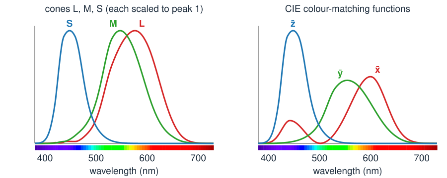
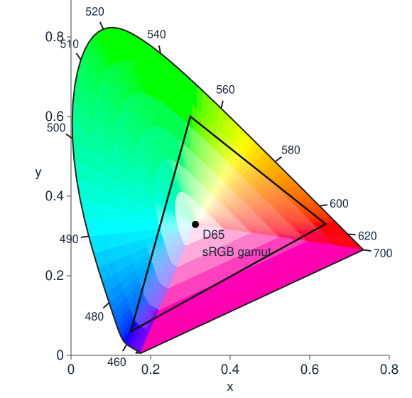

## About this lecture

So far a colour image was "an $M \times N \times 3$ array". Today: what the three numbers **mean**, and why there are three.

- Light is a **spectrum**: power at every wavelength, far more than three numbers.
- The eye (or a camera) reduces it to **three** responses: a **linear map** with a large blind spot.
- Different spectra with the same three numbers: **metamers**. They are why screens work, and why cameras and eyes disagree.
- **CIE XYZ** and the **chromaticity diagram**: a map of all colours; mixtures lie on **straight lines**; a display reaches a **triangle**.

*Slides titled **The math** give the formulas and proofs; the ideas are complete without them.*

::: notes
Linear algebra used: matrix–vector product, rank, null space, change of basis, and (math slides only) the projector onto a null space. The demos assume an sRGB screen; a projector rarely is one, so every swatch in the demos comes with its numbers. Say this once at the start.
:::

## Colour is not in the light alone

- Two lamps look the **same white**, yet a red apple looks different under them.
- Two fabrics look **identical** to us, but different in a photo.
- A colour-blind colleague cannot tell two cables apart that you can.

In each case **different light** gives **the same colour** to one observer and not to another. To understand why, follow the light from the lamp to the three numbers.

## Light is a spectrum

The light reaching a point of the eye or the sensor is a **spectrum** $s(\lambda)$: power at each wavelength from about **380 nm** (violet) to **730 nm** (deep red).

- **Daylight**: smooth, power everywhere. **A light bulb** (a hot filament): rises towards the red. **A white LED**: a sharp blue peak plus a broad yellow hump. **A laser**: one line.
- A **surface** reflects a fraction $r(\lambda)$ of each wavelength; what we see from it is $s(\lambda)\,r(\lambda)$: lamp times reflectance.
- Sample the spectrum every 10 nm: **36 numbers**. Real spectra need that many, or more.

So the input is a vector with 36 (or more) entries. The output of the eye is **three** numbers.

## Three cone types

:::: {.columns}
::: {.column width="56%"}
{width="100%"}
:::
::: {.column width="44%"}
The retina has three kinds of **cones**: **L** (long), **M** (medium), **S** (short wavelengths).

- Each cone **adds up** the light, weighted by its sensitivity curve: $L = \sum_\lambda s(\lambda)\,\bar l(\lambda)$, and so on.
- The curves are **broad** and **overlap**: L and M are almost the same.
- A camera does the same with three **filters** R, G, B; its curves are different.
:::
::::

::: notes
The cone curves here are the Hunt–Pointer–Estévez combination of the CIE colour-matching functions (right), so they are exactly a change of basis of them; real measured cone fundamentals look very similar. Each curve is scaled to peak 1 on the left. Point at 450–500 nm: S and M both respond; at 600 nm L and M both respond, L more.
:::

## The math: colour vision is a 3 × 36 matrix {.math}

Sample at 10 nm, $\lambda_j = 380, 390, \dots, 730$: a spectrum is $\mathbf s \in \mathbb R^{36}$, and

$$\mathbf c = \begin{pmatrix} L \\ M \\ S \end{pmatrix} = A\,\mathbf s, \qquad A = \begin{pmatrix} \bar l(\lambda_1) & \cdots & \bar l(\lambda_{36}) \\ \bar m(\lambda_1) & \cdots & \bar m(\lambda_{36}) \\ \bar s(\lambda_1) & \cdots & \bar s(\lambda_{36}) \end{pmatrix} \Delta\lambda .$$

- The integral $\int s(\lambda)\,\bar l(\lambda)\,d\lambda$ becomes a dot product of two vectors: row 1 of $A$ times $\mathbf s$.
- $A$ is $3 \times 36$ of **rank 3**: the eye is a linear map $\mathbb R^{36} \to \mathbb R^3$.
- A camera: $\mathbf c_\text{cam} = A_\text{cam}\,\mathbf s$, another $3 \times 36$ matrix. A surface under a lamp: $\mathbf c = A\,\operatorname{diag}(\mathbf e)\,\mathbf r$, lamp $\mathbf e$, reflectance $\mathbf r$.

## Try it: from a spectrum to three numbers

```{=html}
<link rel="stylesheet" href="../demos/dist/demo.css">
<div data-demo="spectrum" data-preset="white"></div>
<script src="../demos/dist/spectrum.js"></script>
```

::: notes
Top: the spectra (drag to draw). Middle: the three cone curves; the shaded areas are spectrum × sensitivity for A, whose sums are the numbers. Right: the colours and the numbers (each relative to daylight, so daylight gives 1, 1, 1). Tour: "daylight vs LED": two very different spectra (the LED has a peak of 245 at 450 nm and almost nothing below 420), both 1.000, 1.000, 1.000 for the eye, and chromaticity 0.313, 0.329. Click "camera": the LED becomes 0.905, 0.962, 0.900, the match is gone. Then "make a metamer" several times: B changes wildly, the numbers stay 1.022, 0.931, 0.591. Then "metameric failure under tungsten" (surfaces): click "daylight" (match), back to "tungsten" (0.602, 0.545, 0.353 against 0.589, 0.555, 0.302).
:::

## Metamers

Many spectra give the **same three numbers**: they are **metamers**, and they look identical.

- 36 numbers in, 3 out: the eye throws away almost everything. Any change of the spectrum that **all three** cones are blind to goes unnoticed.
- Those invisible changes form a huge set: wiggles that add a bit of light at some wavelengths and remove the same "cone-weighted" amount at others.
- **Why screens work**: a display has only three primaries, yet it can produce a metamer of the light from (most) real scenes. The spectrum on the screen is nothing like the scene's.
- **Constraint**: a spectrum cannot be negative. A metamer must stay $\ge 0$ everywhere.

## The math: metamers live in the null space {.math}

$A\mathbf s_1 = A\mathbf s_2 \iff A(\mathbf s_2 - \mathbf s_1) = \mathbf 0 \iff \mathbf s_2 - \mathbf s_1 \in \ker A$.

- Rank–nullity: $\dim\ker A = 36 - 3 = 33$. Every spectrum has a 33-dimensional family of metamers (cut down by $\mathbf s_2 \ge \mathbf 0$).
- Projector onto $\ker A$ (for $A$ of full row rank): $P = I - A^\top (AA^\top)^{-1} A$. Check: $AP = A - AA^\top(AA^\top)^{-1}A = 0$.
- Making a metamer: take any vector $\mathbf v$, then $\mathbf s_2 = \mathbf s_1 + t\,P\mathbf v$, with $t$ as large as the constraint $\mathbf s_2 \ge \mathbf 0$ allows. This is the demo's *make a metamer* button.

## When metamers break

A match holds for **one** observer under **one** light:

- **A different observer.** A camera has $A_\text{cam} \ne A$, with a different blind set: a pair that matches for the eye differs in the photo.
- **A colour-blind observer.** A deuteranope has no M cones: two numbers instead of three. **More** pairs match: everything that only the M cones could tell apart.
- **A different lamp** (*metameric failure*). Two fabrics match in daylight; under a light bulb the lamp re-weights the wavelengths, and they no longer match.

Metamerism is the reason colour in images is never "the" colour of an object: it is the colour **for this camera, under this light**.

::: notes
These are the demo presets "the camera disagrees", "a dichromat sees more matches" (for the deuteranope 0.955, –, 0.812 for both; the eye sees M 0.972 vs 0.693) and "metameric failure under tungsten". White balance, next unit, tries to undo the lamp; metameric failure shows why it can never be perfect.
:::

## Colour matching: how the eye was measured

Before cones could be measured, the eye was characterised by **matching** (Wright and Guild, 1920s):

- An observer sees a test light on one half of a field and adjusts three **primary** lights (red, green, blue) on the other half until the two halves look the same.
- Done for every wavelength: three **colour-matching functions** $\bar r(\lambda), \bar g(\lambda), \bar b(\lambda)$, the amounts needed.
- Surprise: for many test wavelengths **no** match is possible. One primary must be moved to the **test** side: a **negative** amount.

Three numbers per wavelength again: the matching functions describe the **same** three-dimensional information as the cones, in another basis.

## CIE XYZ: a standard basis

The CIE (1931) chose a new basis of the same three-dimensional space with two convenient properties:

- the three functions $\bar x, \bar y, \bar z$ are **never negative**, so every real light has $X, Y, Z \ge 0$;
- $\bar y$ is the eye's **brightness sensitivity**, so $Y$ is the **luminance**: how bright the light looks.

The price: the XYZ "primaries" are not real lights. XYZ is a **coordinate system** for colours, the common reference for every device.

## The math: XYZ is a change of basis {.math}

Cones, colour-matching functions and $\bar x \bar y \bar z$ are three bases of the **same row space** of $A$:

$$\begin{pmatrix} \bar l \\ \bar m \\ \bar s \end{pmatrix} = T \begin{pmatrix} \bar x \\ \bar y \\ \bar z \end{pmatrix} \;\Rightarrow\; \begin{pmatrix} L \\ M \\ S \end{pmatrix} = T \begin{pmatrix} X \\ Y \\ Z \end{pmatrix}, \quad T = \begin{pmatrix} 0.4002 & 0.7076 & -0.0808 \\ -0.2263 & 1.1653 & 0.0457 \\ 0 & 0 & 0.9182 \end{pmatrix}.$$

- $T$ is invertible, so the null spaces agree: **metamers for XYZ = metamers for the cones**.
- The same holds for $\bar r\bar g\bar b$: a matching experiment measures $A$ up to an invertible $3 \times 3$ matrix. Negative entries of $\bar r\bar g\bar b$ just mean a basis that is not inside the cone of real lights.

## Chromaticity: forget the brightness

:::: {.columns}
::: {.column width="46%"}
{width="100%"}
:::
::: {.column width="54%"}
Twice the light, same colour: divide out the brightness.

$$x = \frac{X}{X+Y+Z}, \qquad y = \frac{Y}{X+Y+Z}$$

- Every colour becomes a point $(x, y)$: the **chromaticity diagram**.
- **Monochromatic** lights trace the **horseshoe** (the spectral locus, wavelengths marked); the straight **purple line** closes it.
- All real colours lie **inside**. White (daylight D65) is near the middle, at $(0.313, 0.329)$.
:::
::::

::: notes
The colours of the figure are only approximate: outside the sRGB triangle the screen cannot show them, so they are drawn at the nearest colour the screen can show. That is also true on this projector. The axes are x and y, not the X and Y of XYZ: lower case = chromaticity.
:::

## The math: a central projection, and mixtures on straight lines {.math}

$(x, y, z) = (X, Y, Z)/(X+Y+Z)$ is the **central projection** of XYZ space onto the plane $X + Y + Z = 1$ (as homogeneous coordinates: scaling a colour does not move it).

Mixing two lights adds their XYZ: $\mathbf C = \mathbf C_1 + \mathbf C_2$. With $S_i = X_i + Y_i + Z_i$,

$$\begin{pmatrix} x \\ y \end{pmatrix} = \frac{S_1}{S_1 + S_2}\begin{pmatrix} x_1 \\ y_1 \end{pmatrix} + \frac{S_2}{S_1 + S_2}\begin{pmatrix} x_2 \\ y_2 \end{pmatrix}.$$

- A **convex combination**: the mixture lies on the **segment** between the two chromaticities, at a position weighted by $S_i$ (not by luminance $Y_i$).
- Three primaries: all non-negative mixtures fill the **triangle** they span. Monochromatic lights are the extreme points, so the horseshoe region is convex.

## Gamuts: a display is a triangle

A display mixes three **primaries** R, G, B with amounts between 0 and 1: it reaches exactly the **triangle** of their chromaticities, its **gamut**.

- **sRGB** (most screens, the web): a modest triangle. **Display P3** (newer phones and laptops): a larger green and red. **Rec. 2020** (ultra-HD video): primaries almost on the horseshoe, as only lasers can produce.
- No triangle with real primaries covers the horseshoe: some colours (saturated cyans, spectral greens) **no display can show**.
- A colour outside the gamut needs a **negative** amount of a primary: it must be clipped or mapped inwards.

## Try it: the chromaticity diagram

```{=html}
<link rel="stylesheet" href="../demos/dist/demo.css">
<div data-demo="chromaticity" data-preset="mix"></div>
<script src="../demos/dist/chromaticity.js"></script>
```

::: notes
Tour: "mixing two lights": A = 470 nm with Y = 0.3, B = 580 nm with Y = 0.6, share of B 0.5: the mixture sits at 0.189 of the way from A to B, not at 0.5, because A carries X+Y+Z = 5.28 against B's 1.23. Ask: which share puts it halfway? (0.811.) Drag A or B around: the mixture stays on the line. Then "design a display": "sRGB vs P3" (the test point T = (0.21, 0.71) is outside both), "a laser display" (T inside), "a primary outside the locus" (flagged: no light has that chromaticity).
:::

## Summary

- Light is a **spectrum**; the eye and the camera reduce it to **three numbers** by weighted sums: a **linear map** of rank 3.
- **Metamers**: different spectra with the same three numbers. They make displays possible, and break for another camera, a colour-blind viewer or another lamp.
- **CIE XYZ**: a standard basis with $X, Y, Z \ge 0$ and $Y$ = luminance; a change of basis of the cones.
- **Chromaticity** $(x, y)$ drops the brightness. Mixtures lie on **straight lines**; a display reaches a **triangle**, its gamut.
- Next unit: what the numbers stored in an RGB image mean, and why they are not proportional to light.
