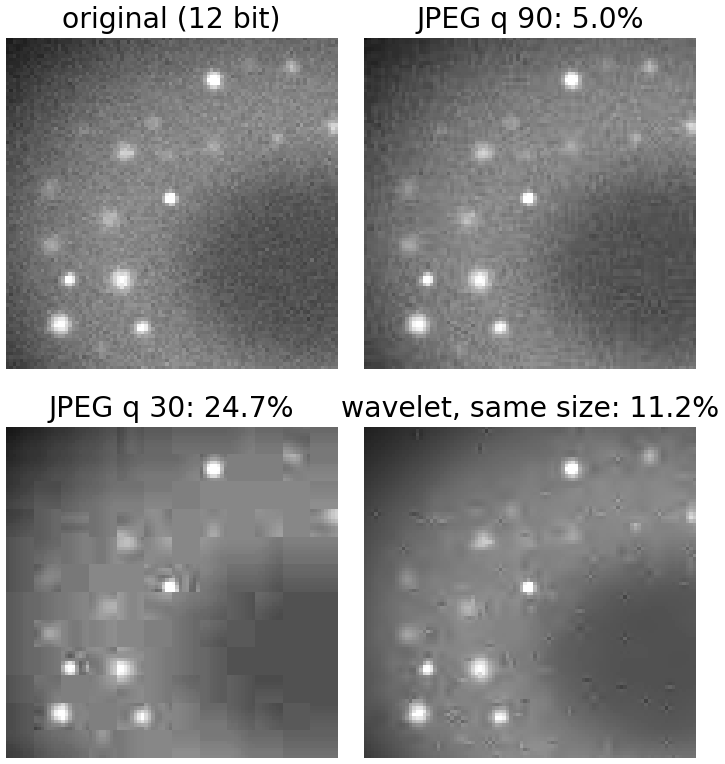
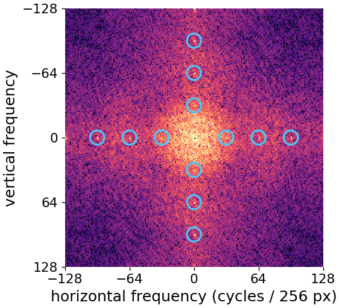
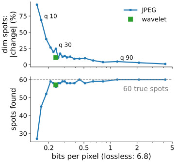
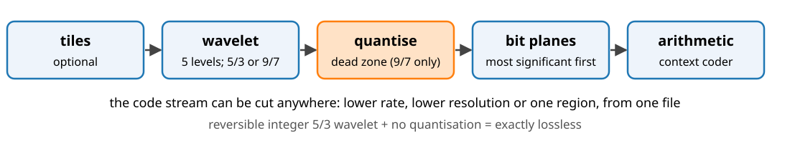
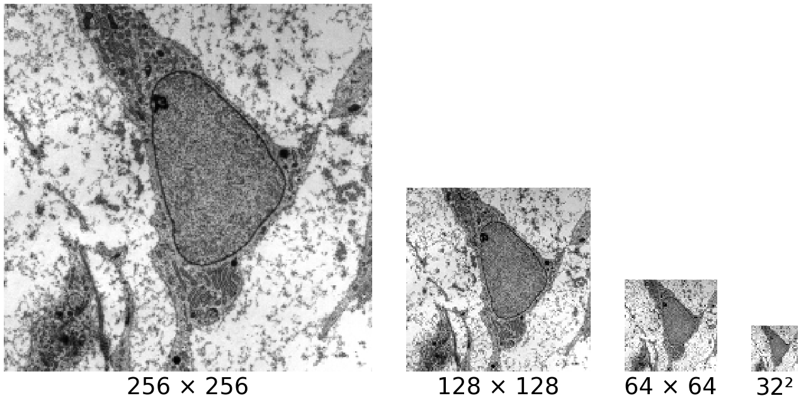
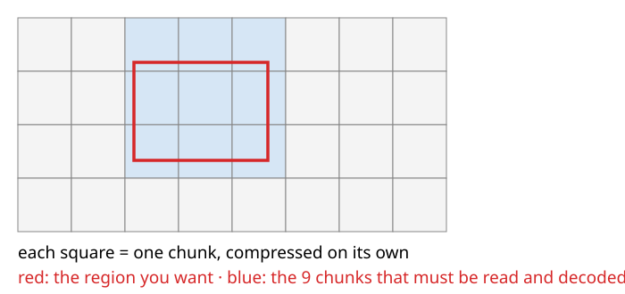

## About this lecture

For a photograph, "looks the same" is the goal. For a micrograph that will be **measured**, it is not enough. This unit asks what compression does to the numbers, and how to store scientific images safely.

- **Images are data**: what lossy compression does to intensities, spots, noise and texture.
- A measurement pipeline on compressed images: the **numbers** against the file size.
- **JPEG 2000**: wavelets instead of blocks, lossless or lossy, one file for every resolution.
- **Formats** that keep the data intact, and **chunked** storage for big data.

*Slides titled **The math** give the formulas and proofs; the ideas are complete without them.*

## Images are data

Lossy compression does not add independent noise. It changes pixel values in a **structured, content-dependent** way:

:::: {.columns}
::: {.column width="60%"}
- **Small, dim spots** lose their high frequencies: their integrated intensity changes, some vanish, close ones merge.
- **Noise and texture** are smoothed: background standard deviation, local variance, co-occurrence and power-spectrum features shift towards "smooth".
- **Blocking** adds an 8-pixel periodic grid that was not in the sample.
- **Bit depth**: baseline JPEG stores 8 bits. A 12- or 16-bit image must first be rescaled, losing 4 to 8 bits (bit-depth day).
- Changing the **display** (contrast, gamma, a lookup table) leaves the data alone (12- and 16-bit unit); compression changes the data itself.
:::
::: {.column width="40%"}
{width="100%" fig-alt="A 96 × 96 crop of the demo's synthetic 12-bit spot image: the original, JPEG at quality 90 (dim spots change by 5.0% on average), JPEG at quality 30 (blocky background, smeared spots, 24.7%) and a wavelet codec at the same size as quality 30 (smooth background, 11.2%)."}

Percent: mean change of the dim spots' integrated intensity.
:::
::::

::: notes
Figure: the measuredamage demo's scene and codecs, computed with the demo's code (tools/figs/compression). Percentages: mean absolute change of the integrated intensity of the dimmest third of the 60 spots.
:::

## Try it: what happens to the measurements

```{=html}
<link rel="stylesheet" href="../demos/dist/demo.css">
<div data-demo="measuredamage" data-preset="q95"></div>
<script src="../demos/dist/measuredamage.js"></script>
```

::: notes
A synthetic 12-bit image: 60 spots of known position and brightness, a cell with a nucleus, Poisson noise. The same analysis runs on the original and the decoded image: spot detection (difference of Gaussians, fixed threshold, 8-connected components, matched to the true spots within 3 px), integrated intensity per spot (aperture minus local background), background mean and noise, high-frequency power. Tour: q95 "looks perfect", all 60 found, but dim spots change by 3.2% on average (each, up or down). q90: 5.0%, noise sd 35.1 → 33.6, HF power −38%. q30: 4 spots missed, dim spots 24.7%. q10: 45 found, 129 false. "Blocking in the spectrum": peaks at multiples of 1/8. "Lossless": everything identical, 2.4× smaller. "Wavelet, same size as q30": 57 found, 0 false, dim spots 11.2%. The right plot follows one measurement over all qualities.
:::

## The numbers

Synthetic 12-bit image, 60 spots (demo). Raw storage 131 072 bytes (16 bits per pixel).

| codec | size (bytes) | ratio | spots found / false | dim spots: mean \|change\| | noise sd | blocking index |
|---|---|---|---|---|---|---|
| original / lossless | 55 586 | 2.4 | 60 / 0 | 0 | 35.1 | 0.9 |
| JPEG quality 95 | 17 200 | 7.6 | 60 / 0 | 3.2% | 36.3 | 3.7 |
| JPEG quality 90 | 9 786 | 13 | 60 / 0 | 5.0% | 33.6 | 52 |
| JPEG quality 30 | 1 973 | 66 | 56 / 1 | 24.7% | 30.2 | 137 |
| wavelet, same size | 1 973 | 66 | 57 / 0 | 11.2% | 29.7 | 0.7 |
| JPEG quality 10 | 1 347 | 97 | 45 / 129 | 68.8% | 32.7 | 115 |

Bright spots change by less than 1% down to quality 75: the damage is concentrated where the signal is close to the noise.

## Blocking in the spectrum

:::: {.columns}
::: {.column width="60%"}
- The **jumps** between neighbouring pixels are larger at block borders, every 8 pixels. The size of the jumps is therefore a periodic pattern with period 8.
- Its Fourier spectrum (Fourier unit) has **peaks** at multiples of $\tfrac18$ cycle per pixel: in a 256 × 256 image at 32, 64, 96 and 128 on both axes.
- The demo's **blocking index** is the height of these peaks above the surrounding spectrum: about 1 for the original, 52 at quality 90, over 100 at lower qualities; the wavelet codec has no grid (0.7–1.6).
- A texture or spatial-frequency analysis of JPEG images measures the codec, not only the sample.
:::
::: {.column width="40%"}
{width="100%" fig-alt="Power spectrum (log scale, zero frequency in the centre) of the absolute neighbour differences of the spot image after JPEG at quality 30: on both axes there are bright peaks at ±32, ±64 and ±96 cycles per 256 pixels, circled; blocking index 137."}

JPEG quality 30: peaks at multiples of 32.
:::
::::

## What to do

:::: {.columns}
::: {.column width="57%"}
- **Store raw or lossless**; compress only copies for display and figures. Journal guidelines on image integrity say the same.
- If lossy compression is unavoidable (whole-slide archives, web viewers): choose the codec and rate by **testing your own measurement** on originals and compressed copies, as the demo does, not by eye or by PSNR.
- Keep the **bit depth**: a 16-bit acquisition rescaled to 8 bits has lost information before any codec runs.
- Never analyse images that were saved as JPEG at some point in the past without knowing it: blocking peaks in the spectrum are a quick test.
:::
::: {.column width="43%"}
{width="100%" fig-alt="Such a test for the demo's spot image. Top: the mean change of the dim spots' intensity against the JPEG rate (log axis) falls unevenly from 92% at quality 5 and 69% at quality 10 to 3.2% at quality 95; the wavelet codec at the size of quality 30 gives 11.2% instead of 24.7%. Bottom: spots found, 27 of 60 at quality 5 and 45 at quality 10, 56 to 60 from quality 20 upwards, and all 60 from quality 90; the wavelet codec finds 57."}
:::
::::

## JPEG 2000: wavelets instead of blocks

{width="100%"}

- The image (or large tiles of it) goes through a **2D wavelet transform** (wavelets day): an approximation and detail subbands (LL, H, V, D) at several scales. No 8 × 8 grid, so **no blocking**; the errors appear as blur and ringing instead.
- **Lossless**: the reversible integer **5/3** wavelet, computed by lifting with integer rounding, then no quantisation: exact.
- **Lossy**: the 9/7 wavelet, a dead-zone quantiser, then **bit-plane coding**: the most significant bit of every coefficient first, then the next, each with an adaptive arithmetic coder (first unit).

## The math: an exactly reversible wavelet {.math}

Lifting (wavelets day) splits $x$ into even and odd samples and predicts and updates with integer rounding. The 5/3 transform:

$$d_n = x_{2n+1} - \Big\lfloor \tfrac{x_{2n} + x_{2n+2}}{2} \Big\rfloor, \qquad s_n = x_{2n} + \Big\lfloor \tfrac{d_{n-1} + d_n + 2}{4} \Big\rfloor$$

- The decoder undoes the steps in reverse order with the **same** rounded terms: $x_{2n} = s_n - \lfloor (d_{n-1} + d_n + 2)/4 \rfloor$, then $x_{2n+1} = d_n + \lfloor (x_{2n} + x_{2n+2})/2 \rfloor$. Integers in, integers out, exactly invertible, whatever the rounding.
- $d_n$ is a prediction residual (lossless unit): the odd sample minus the average of its even neighbours.
- **Bit planes**: write each quantised coefficient in binary; sending the planes from the top down halves the maximal error with every plane, so the stream can be **cut at any point** and still decodes to the best image for that many bits.

## Why JPEG 2000 is used for large images

- **One file, many uses**: the code stream can be truncated for a lower rate, decoded at **lower resolution** (just the coarse subbands), or for **one region** (just the coefficients and code blocks that cover it).
- **Whole-slide pathology** (gigapixel pyramids), **medical imaging** (the standard medical image format carries JPEG 2000, JPEG-LS and lossless JPEG), cultural-heritage archives.
- Bit depth up to 38 bits per channel, lossless and lossy in the same format.
- Costs: much slower to encode and decode than JPEG. Newer codecs (high-throughput JPEG 2000, JPEG-XL) keep the features and are faster.

{.nostretch width="46%" fig-align="center" fig-alt="The cell micrograph at 256 × 256 and the low-pass bands of three levels of the reversible 5/3 wavelet, 128 × 128, 64 × 64 and 32 × 32: a decoder that reads only the coarse subbands gets these smaller images."}

One stream, four resolutions: the low-pass bands of the reversible 5/3 wavelet.

::: notes
Figure: the micrograph (transmission electron micrograph of a mesenchymal stem cell, Robert M. Hunt, CC BY 3.0, via Wikimedia Commons) and the LL bands of the integer 5/3 lifting transform after 1, 2 and 3 levels (tools/figs/compression).
:::

## Formats

| format | bit depth | compression | typical use |
|---|---|---|---|
| TIFF / **OME-TIFF** | 8, 16, 32 bit, float; channels, z, t, pyramids | none, LZW, Deflate, Zstandard; or JPEG (lossy!) | microscopy, the standard exchange format |
| PNG | 1–16 bit, 2D | lossless (prediction + Deflate) | figures, masks, label images |
| JPEG | 8 bit | lossy | photos, web display only |
| JPEG 2000 | up to 38 bit | lossless or lossy | whole-slide images, medical, archives |
| JPEG-XL | up to 32-bit float | lossless or lossy | newer general format |
| medical image container | 8–16 bit | raw, JPEG-LS, JPEG 2000, lossless JPEG | clinical images with metadata |
| **HDF5**, **Zarr / OME-Zarr** | any, n-D | per chunk, lossless (e.g. Zstandard, LZ4) | large n-D data, cloud storage |

Check the **compression setting**, not only the extension: a TIFF can contain JPEG-compressed data.

## Chunked arrays

{width="62%"}

- HDF5 and Zarr cut an n-D array (x, y, z, channel, time) into **chunks**, each compressed on its own. A region is read by decoding only the chunks it touches.
- **Chunk shape vs access**: chunks of one z-slice each are ideal for showing slices, terrible for a profile along z; cubic chunks are a compromise.
- **Shuffle filters** regroup the bytes of 16-bit values (all high bytes, then all low bytes) before the compressor: the high bytes are nearly constant and compress well. It is "prediction for bytes" (lossless unit).

## The math: how many chunks? {.math}

A region $[a_d, b_d)$ along each dimension $d$, chunks of size $c_d$ starting at 0:

$$\text{chunks read} = \prod_d \Big(\Big\lfloor \tfrac{b_d - 1}{c_d} \Big\rfloor - \Big\lfloor \tfrac{a_d}{c_d} \Big\rfloor + 1\Big), \qquad \text{voxels decoded} \le \text{chunks} \cdot \prod_d c_d$$

- A 2048 × 2048 × 100 stack (16 bit), one 512 × 512 region of one slice: chunks $256 \times 256 \times 1$: 4 chunks (0.5 MB decoded); chunks $64^3$: 64 chunks (33.6 MB) for the same 0.5 MB of data.
- An x–z plane (fixed y, all 2048 × 100): $256 \times 256 \times 1$ chunks: 800 chunks (105 MB); $64^3$: 64 chunks (33.6 MB).
- The read **amplification** (decoded / needed) is what the chunk shape should minimise for the expected access pattern.

## Summary

- Lossy compression changes **measurements**: dim spots, noise, texture and an 8-pixel grid, even when the image looks perfect. Bright structures survive longest.
- Test codecs with **your** measurement, not with PSNR or by eye. Store raw or **lossless** (2–3× is what to expect).
- Baseline JPEG is **8-bit**: rescaling 12/16-bit data loses information first.
- **JPEG 2000**: wavelets (no blocking), exactly lossless with the integer 5/3 lifting, one stream for every rate, resolution and region.
- Formats: OME-TIFF, PNG, JPEG 2000, chunked **HDF5 / Zarr**; check the compression inside the file, and match chunk shape to access.
