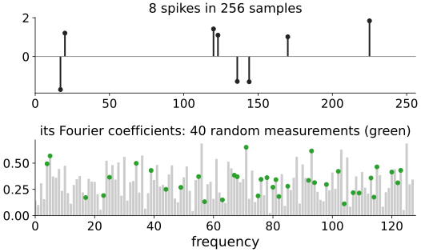
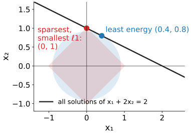
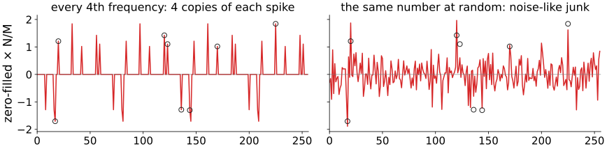
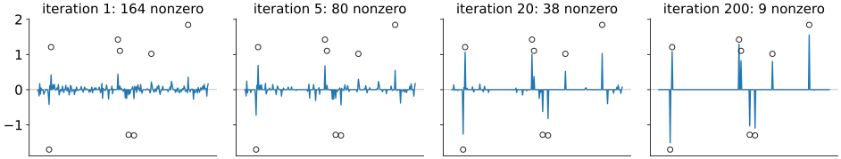
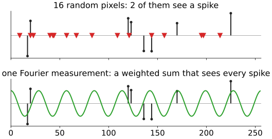
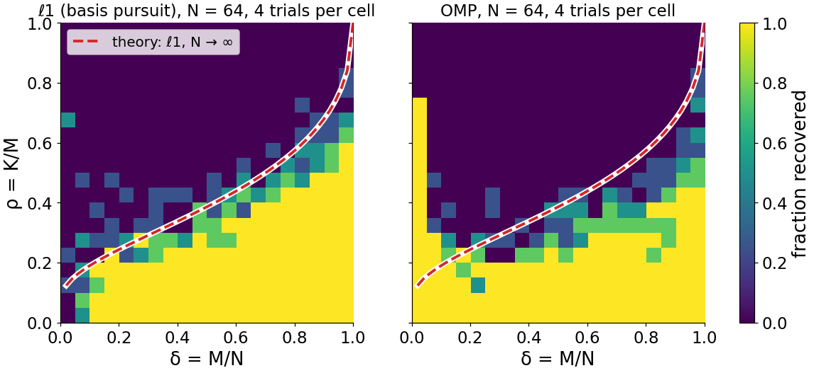
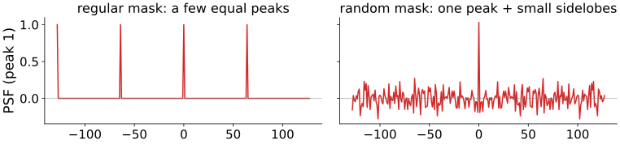
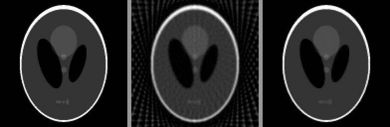
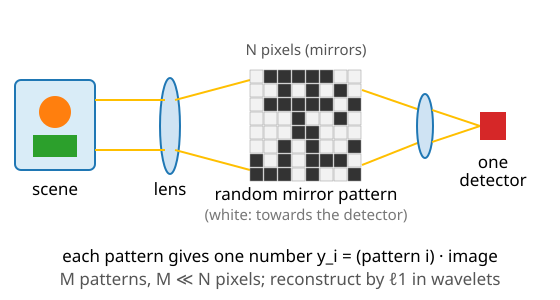

## About this lecture

The last unit used a sparsity prior to fill in missing data. Today we **leave data out on purpose**: if the signal is sparse, how few measurements are enough, and which ones?

- The surprise: a signal with $K$ nonzeros out of $N$ can be recovered from about $K\log(N/K)$ measurements, far fewer than $N$.
- The measurements must be **incoherent** with the sparsity basis: **random** undersampling gives noise-like artefacts that thresholding removes; **regular** undersampling gives copies that it cannot.
- Recovery by ℓ1 (ISTA from the last unit) or OMP.
- The **phase transition**: recovery switches from almost always to almost never.
- What compressed sensing does **not** do.

*Slides titled **The math** give the formulas and proofs; the ideas are complete without them.*

::: notes
Third unit of the sparse representations day; needs [sparsity](../sparsity/lec.qmd) and [ista](../ista/lec.qmd), and the [Fourier unit](../fourier/lec.qmd) of day 1 (aliasing). Compressed sensing: Candès, Romberg & Tao (2006), Donoho (2006). The next unit applies it to MRI. Teacher background: Candès & Wakin (2008), IEEE Signal Processing Magazine 25(2).
:::

## The surprise

:::: {.columns}
::: {.column width="44%"}
Recall [sampling](../fourier/lec.qmd): to capture a signal with frequencies up to $f$, sample at more than $2f$. A signal of $N$ samples with all frequencies needs all $N$ numbers.

But this signal has only **8 nonzero samples** out of 256. Its information: 8 values plus **where** they are, $\log_2\binom{256}{8} = 48.5$ bits for the positions.

Can we measure a few dozen numbers instead of 256, without knowing where the spikes are? For example **40 random Fourier coefficients** (green)?
:::
::: {.column width="56%"}
{width="100%" fig-alt="Top: 8 spikes of random sign in 256 samples. Bottom: the magnitudes of its 129 Fourier coefficients, all of similar size; 40 of them, chosen at random, are marked in green."}
:::
::::

::: notes
Every Fourier coefficient of a spike signal is a weighted sum of all 8 spikes, which is why the spectrum looks like noise and why any 40 coefficients carry information about every spike.
:::

## Underdetermined, so add a prior

:::: {.columns}
::: {.column width="50%"}
$M < N$ measurements: $A\mathbf x = \mathbf y$ with fewer equations than unknowns. **Infinitely many solutions**: any vector of the null space can be added (recall [ill-posed problems](../illposed/lec.qmd), [iterative reconstruction](../algebraic-recon/lec.qmd)).

Which one to pick?

- **Least energy** (smallest ℓ2): spreads the weight over all unknowns.
- **Smallest ℓ1**: the line of solutions touches the diamond at a **vertex**, a sparse solution.

On the right: one equation, two unknowns. Least energy (0.4, 0.8); smallest ℓ1 (0, 1).
:::
::: {.column width="50%"}
{width="92%" fig-alt="The line x1 + 2 x2 = 2 of all solutions. The ℓ2 disc touches it at (0.4, 0.8), the point of least energy; the ℓ1 diamond touches it at its vertex (0, 1)."}
:::
::::

## By hand: 4 unknowns, 2 measurements

$A = \begin{pmatrix}1 & 1 & 1 & 1\\ 1 & -1 & 2 & 0\end{pmatrix},\quad \mathbf y = (3,\ 6).$

| solution | $\mathbf x$ | ℓ1 | ℓ2 |
|---|---|---|---|
| least energy $A^\top(AA^\top)^{-1}\mathbf y$ | (1.2, −0.6, 2.1, 0.3) | 4.2 | 2.51 |
| sparsest | (0, 0, 3, 0) | **3** | 3 |

- Both reproduce $\mathbf y$ exactly.
- Only column 3, (1, 2), is proportional to $\mathbf y$, so (0, 0, 3, 0) is the only solution with one nonzero.
- ℓ2 prefers the spread-out answer (2.51 < 3); **ℓ1 prefers the sparse one** (3 < 4.2). If the truth was sparse, ℓ1 finds it.

## Coherent and incoherent aliasing

{width="96%" fig-align="center" fig-alt="Zero-filled reconstructions of the 8-spike signal from 64 of 256 Fourier rows. Left, every 4th frequency: each spike appears four times, a quarter of the signal length apart, all copies equally tall. Right, 64 rows at random: the spikes stand out at about their true height above noise-like ripples spread over all samples."}

Set the unmeasured coefficients to 0 and transform back (**zero filling**), with the same 64 of 256 rows:

- **regular** (every 4th frequency): each spike appears **4 times**, a quarter of the length apart (recall aliasing). The copies are as tall as the original: nothing can tell them apart.
- **random**: the spikes stand out above **noise-like junk** spread everywhere. Junk can be thresholded away.

::: notes
Regular rows: zero filling gives the average of the signal and its shifts by N/4, N/2, 3N/4 (scaled back by N/M here, so copies have the original height). Random rows: the spikes come back at about their height (1.89 for −1.89 etc. in this draw) and the junk has standard deviation 0.43. The PSF on the math slide later shows why.
:::

## Recovery by iterative thresholding

{width="96%" fig-align="center" fig-alt="ISTA from 64 random Fourier rows, four snapshots of the estimate against the true spikes (circles). Iteration 1: 164 nonzero values, the largest spikes visible above junk. Iteration 5: 80. Iteration 20: 38. Iteration 200: 9 nonzero values at the spike positions."}

ISTA from the last unit: threshold away the junk below the **strong** spikes; re-predict the data; the junk **they** caused disappears from the residual, and **weaker** spikes emerge. 164 → 80 → 38 → 9 nonzeros. With regular sampling this cannot work: a copy is not junk.

::: notes
64 random rows of the real Fourier basis, step 1, λ = 0.05 (fixed), no noise. After 200 iterations the support is right (9 nonzeros, one of them tiny) and the relative error is 0.16, all shrinkage bias; with λ decreased towards 0, or a refit on the support, it goes to 0 (the demo does this).
:::

## Try it: recovering a sparse signal

```{=html}
<link rel="stylesheet" href="../demos/dist/demo.css">
<div data-demo="csrecover" data-preset="random"></div>
<script src="../demos/dist/csrecover.js"></script>
```

::: notes
Panels: the truth with the ℓ1 and OMP recoveries; what is measured (spectrum with the sampled frequencies, Gaussian measurements, or sampled pixels); the zero-filled reconstruction (scaled by N/M); the point spread function of the sampling. Tour: "regular: copies" (every 4th frequency: ℓ1 fails, relative error 0.87); "random: noise-like junk" and "ℓ1 recovers from 25 %" (exact recovery from 64 numbers); "too few: abrupt failure" (36 measurements for 10 spikes); "random pixels see nothing"; "Gaussian matrix works for any basis" (DCT-sparse signal); "compressible signal" (best-K error in the readout); "noise: stable, not exact". The "animate" button replays the ℓ1 iterations.
:::

## Incoherence: every measurement must see every atom

:::: {.columns}
::: {.column width="50%"}
- **Random pixels** of a spike signal: most samples land between the spikes and see **nothing** (2 of 16 hit a spike here). Spikes that are not sampled are lost forever.
- **Fourier coefficients** of a spike signal: each one is a weighted sum over **all** samples, so each sees every spike a little.

Rule: the sensing basis must be **spread out** in the basis where the signal is sparse. Pixels and Fourier are maximally spread out with respect to each other (**incoherent**). A **random** (Gaussian) matrix is incoherent with every fixed basis.

For an image that is sparse in **wavelets**, random pixels are bad again only for the finest wavelets; Fourier is bad for the coarsest (next unit).
:::
::: {.column width="50%"}
{width="100%" fig-alt="The 8-spike signal twice. Top: 16 random sample positions marked with triangles; only 2 coincide with a spike. Bottom: one Fourier basis function, a cosine spanning all samples, which overlaps every spike."}
:::
::::

## How many measurements?

- Of the order of $K\log(N/K)$, a few times $K$ in practice: for 8 spikes in 256 samples $K\ln(N/K) \approx 28$; we used 40–64. For $K = 1000$ nonzeros in a million unknowns: about 7000 against $10^6$.
- The measurements need not be "clever": **random** ones work, and the decoder (ℓ1) does not need to know in advance where the nonzeros are.
- **Stable**: with noise, the error of the ℓ1 solution (with a data term, as in the last unit) is **proportional to the noise**, not amplified.
- **Compressible** signals (not exactly sparse) are recovered about as well as their best $K$-term approximation allows (recall "keep the $K$ largest" in [dwt2d](../dwt2d/lec.qmd)).

## The math: the null space property {.math}

ℓ1 recovers **every** $K$-sparse $\mathbf x$ from $A\mathbf x$ if and only if, for every nonzero $\mathbf h$ in the null space of $A$ and every set $S$ of $K$ indices,
$$\|\mathbf h_S\|_1 < \|\mathbf h_{S^c}\|_1$$
(no null-space vector is concentrated on a few entries).

Proof of "if": let $\mathbf x$ be supported on $S$ and $\mathbf x + \mathbf h$ another solution ($A\mathbf h = 0$, $\mathbf h \ne 0$). Then
$$\|\mathbf x + \mathbf h\|_1 = \|\mathbf x_S + \mathbf h_S\|_1 + \|\mathbf h_{S^c}\|_1 \ge \|\mathbf x_S\|_1 - \|\mathbf h_S\|_1 + \|\mathbf h_{S^c}\|_1 > \|\mathbf x\|_1.$$
So $\mathbf x$ is the unique ℓ1 minimiser. The 2 × 4 example: the null space is spanned by (−0.747, 0.347, 0.547, −0.147) and (−0.376, −0.424, −0.024, 0.824).

## The math: coherence and RIP {.math}

- **Mutual coherence** (unit columns): $μ(A) = \max_{i \ne j}|\mathbf a_i^\top\mathbf a_j|$. If $K < \tfrac12(1 + 1/μ)$, both ℓ1 and OMP recover every $K$-sparse signal (Donoho & Elad 2003, Tropp 2004). The 2 × 4 example: μ = 3/√10 = 0.949 (columns 1 and 3), so the guarantee covers only $K = 1$.
- Coherence is pessimistic (μ ≥ about $1/\sqrt M$ for $N \gg M$, so it guarantees only $K \lesssim \sqrt M$). The **restricted isometry property** (RIP) of order $2K$,
$$(1 - δ)\|\mathbf x\|^2 \le \|A\mathbf x\|^2 \le (1 + δ)\|\mathbf x\|^2 \quad\text{for all } 2K\text{-sparse }\mathbf x,$$
with δ small enough ($\sqrt2 - 1$, Candès 2008) also guarantees recovery. Gaussian $M \times N$ matrices satisfy it with high probability when $M \ge C\,K\log(N/K)$ (Candès & Tao 2006; Donoho 2006). Random rows of the Fourier matrix need a few extra log factors.

## The phase transition

:::: {.columns}
::: {.column width="56%"}
{width="100%" fig-alt="Two phase diagrams, ℓ1 and OMP, for N = 64 and Gaussian matrices, 4 trials per cell. Horizontal axis δ = M/N, vertical ρ = K/M; colour = fraction recovered. Both show a yellow region of success in the lower right and a dark region of failure above. The ℓ1 boundary follows the dashed theoretical curve (about 0.39 at δ = 0.5); the OMP boundary lies lower."}
:::
::: {.column width="44%"}
Donoho–Tanner diagram: **δ = M/N** (how undersampled) against **ρ = K/M** (nonzeros per measurement). Each cell: the fraction of random trials recovered.

- A **sharp boundary**: below it almost always success, above almost always failure. The transition region narrows as $N$ grows; the dashed curve is the limit for large $N$ (ρ ≈ 0.39 at δ = 0.5).
- **OMP's boundary lies below ℓ1's**: here at δ ≈ 0.5, ℓ1 succeeds up to ρ ≈ 0.35, OMP up to ≈ 0.25.
- Practical reading: for a given $K$, measure enough that you are safely **below** the curve.
:::
::::

::: notes
Signals with K random ±1 entries (the hardest amplitudes for OMP; ℓ1's curve does not depend on the amplitudes). Success: relative error below 1 %. ℓ1 = FISTA with λ decreasing to 10⁻⁵ λmax, then least squares on the support found. The curve: the ℓ1 weak threshold of Donoho & Tanner (2009), tabulated from the formula of Donoho, Maleki & Montanari (2009). At N = 64 the boundary is blurred and slightly below the curve at small δ; the left-most column (M = 2) is coarse because K can only be 1 or 2 there.
:::

## Try it: the phase transition

```{=html}
<link rel="stylesheet" href="../demos/dist/demo.css">
<div data-demo="phasetransition" data-preset="l1"></div>
<script src="../demos/dist/phasetransition.js"></script>
```

::: notes
The diagram fills in column by column (about 10 s for 16 × 16 cells × 2 trials at N = 64 with ℓ1; OMP is several times faster). Click a cell to see one of its trials on the right. Tour: "ℓ1, Gaussian"; "OMP: lower boundary"; "partial Fourier" (random rows of the real Fourier basis: about the same boundary for spike signals); "with noise: the edge blurs" (5 % noise; success = 10 % error). Switch N to 128 to see the transition sharpen (slower).
:::

## The math: zero filling is $A^\top\mathbf y$ {.math}

:::: {.columns}
::: {.column width="52%"}
Partial Fourier sampling: $A = PF$ with $F$ the orthonormal DFT and $P$ the rows kept. Zero filling is
$$F^{-1}P^\top\mathbf y = F^{-1}P^\top PF\mathbf x = \mathbf x * \mathrm{psf}_P,$$
a circular convolution with the **point spread function of the mask**, the inverse DFT of the mask (multiplication in frequency = convolution in space).

- Regular mask, every $r$-th frequency: the PSF is $r$ equal peaks, $N/r$ apart: $r$ copies.
- Random mask: one peak plus many small, irregular **sidelobes** (here at most 0.28 of the peak): noise-like.
- The sidelobe level measures incoherence.
:::
::: {.column width="48%"}
{width="100%" fig-alt="The point spread function of two masks with 64 of 256 frequencies. Regular: four equal peaks 64 samples apart. Random: one central peak and small irregular sidelobes everywhere."}
:::
::::

## You have seen it already

:::: {.columns}
::: {.column width="50%"}
{width="100%" fig-alt="Few-view tomography from the iterative reconstruction unit, three panels: the phantom; filtered back-projection from 30 views, with streaks; iterative reconstruction with non-negativity and total variation from the same 30 views, much cleaner."}
:::
::: {.column width="50%"}
Few-view CT with a TV prior ([iterative reconstruction](../algebraic-recon/lec.qmd)): 30 views, RMSE 0.081 with filtered back-projection against 0.020 with TV.

That was compressed sensing:

- the image is sparse in **differences** (a piecewise-constant phantom);
- 30 projections are far fewer than the unknowns;
- the projections (lines through the whole image) are spread out with respect to sharp edges: incoherent enough;
- the reconstruction minimises misfit + TV.
:::
::::

## The single-pixel camera

:::: {.columns}
::: {.column width="45%"}
{width="100%" fig-alt="Schematic: a scene is imaged by a lens onto an array of tiny mirrors showing a random black-and-white pattern; a second lens collects the light of the 'white' mirrors onto one photodetector, which records one number per pattern."}
:::
::: {.column width="55%"}
One detector, many random patterns (Duarte et al. 2008):

- An array of tiny mirrors shows a random pattern; the detector measures the **total light** of the pattern: one random weighted sum of all pixels.
- Repeat with $M \ll N$ patterns; reconstruct by ℓ1 in a wavelet basis.
- Worth it only where a pixel array is **expensive or impossible**: infrared, terahertz, some fluorescence lifetime setups. For visible light a camera chip is cheap and faster.
:::
::::

## What compressed sensing does not do

- It does not beat sampling theory for signals that are **not sparse**: a texture with no structure still needs all its samples.
- The sparsifying basis must be **right**: if the image is not sparse in it, recovery fails.
- With too few measurements it fails **abruptly** (phase transition), and the failure can look **plausible**: a sparse, clean, wrong image.
- It trades **measurement time for computation** and for assumptions; the assumption is part of the result.
- It does not create detail: what ℓ1 shrinks away (small, low-contrast features) is gone (next unit).

## The math: the noisy problem {.math}

With noise, $\mathbf y = A\mathbf x + \mathbf n$, $\|\mathbf n\|_2 \le ε$. Solve
$$\min_{\mathbf x}\|\mathbf x\|_1 \quad\text{subject to}\quad \|A\mathbf x - \mathbf y\|_2 \le ε,$$
which is the lasso $\tfrac12\|A\mathbf x - \mathbf y\|^2 + λ\|\mathbf x\|_1$ for a suitable λ (Lagrange multiplier). If $A$ has the RIP of order $2K$ with small enough constant, the solution $\mathbf x^\star$ obeys (Candès 2008)
$$\|\mathbf x^\star - \mathbf x\|_2 \le C_0\,\frac{\|\mathbf x - \mathbf x_K\|_1}{\sqrt K} + C_1\,ε,$$
with $\mathbf x_K$ the best $K$-term approximation. First term: compressibility (0 for exactly sparse signals); second: noise, **not amplified** beyond a constant.

## Summary

- A $K$-sparse signal of length $N$ can be recovered from about $K\log(N/K)$ measurements by **ℓ1** (or OMP), without knowing where the nonzeros are.
- Underdetermined systems have many solutions; least energy spreads them, **ℓ1 picks the sparse one**.
- Measurements must be **incoherent** with the sparsity basis: random Fourier coefficients for spikes, Gaussian matrices for any basis. Random pixels of a spike signal see nothing.
- **Regular** undersampling: copies (coherent aliasing). **Random**: noise-like junk that thresholding (ISTA) removes.
- A sharp **phase transition** separates success from failure; OMP's lies below ℓ1's.
- Stable with noise, near-optimal for compressible signals; fails abruptly and plausibly with too few measurements.
- Next: the flagship application, **fast MRI**.
