## About this lecture

The [last unit](../highbit/lec.qmd) showed a 12-bit image on an 8-bit screen with a **window**: a straight line from raw values to grey levels. This unit bends that line.

- **Point operations**: one curve, applied to every pixel; stored as a **lookup table**.
- Shaped curves: **gamma** and **log**. What the slope of a curve does to contrast and noise.
- Curves chosen by the data: **histogram equalisation**, and why its result is only roughly flat.
- Local curves: **CLAHE**. Curves chosen by another image: **histogram matching**.
- What all of this does to **measurements**: transform for looking, measure on the raw data.

*Slides titled **The math** give the formulas and proofs; the ideas are complete without them.*

::: notes
This unit owns point operations beyond the window, gamma and log as contrast curves, histogram equalisation (and the cumulative histogram as a mapping), CLAHE and histogram matching, and the "display vs analysis" table for intensity transforms. Windows, CT windows and tone mapping stay in highbit/; the sRGB transfer function and linear light stay on the colour day; background correction stays on the thresholding day. Four demos: tonecurve, equalise, clahe, displayvsdata.
:::

## Recall: a window is a curve

:::: {.columns}
::: {.column width="42%"}
From [12- and 16-bit images](../highbit/lec.qmd): a **window** $[\ell, h]$ maps raw values to the 256 display levels by a straight line, clipped at black and white.

- Draw it as a **curve**: raw value on the $x$ axis, display level on the $y$ axis, the histogram behind it.
- Raw 1653 (the middle of the window) becomes display level 128.

Every transform in this unit is **another curve** on this plot.
:::
::: {.column width="58%"}
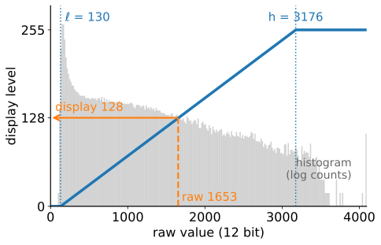{fig-alt="Histogram of the synthetic 12-bit fluorescence image (log counts, grey) with the window from 130 to 3176 drawn on top as a blue line: zero below 130, a straight ramp, 255 above 3176. An orange dashed path takes raw value 1653 up to the line and across to display level 128." width="100%"}
:::
::::

## Point operations

:::: {.columns}
::: {.column width="50%"}
A **point operation** computes each new value from the **old value of the same pixel only**: $s = T(v)$, the same function $T$ everywhere. Position and neighbours do not matter: the whole operation **is** its curve.
:::
::: {.column width="50%"}
- Examples: the window, the **negative** ($s = 255 - v$ for 8 bits), contrast stretching, clipping, a **threshold**, adding a constant.
- Not point operations: blurring, the median filter, anything that looks at neighbours.
:::
::::

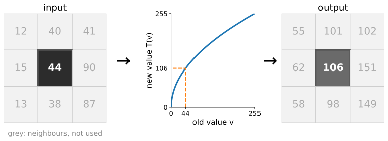{fig-alt="A 3 by 3 patch of grey values with only the centre pixel, 44, highlighted; an arrow to the curve s equals 255 times the square root of v over 255, where 44 maps to 106; an arrow to the output patch with the centre 106. The eight neighbours are greyed out because they are not used." width="80%" fig-align="center" .nostretch}

## A gallery of curves

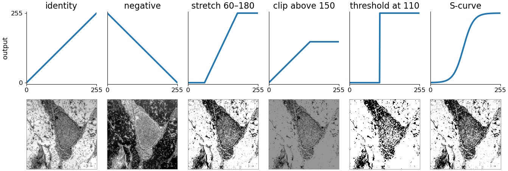{fig-alt="Six curves with their results on the electron micrograph below each: identity; negative (falling line, image inverted); stretch 60 to 180 (steep ramp, high contrast, much black and white); clip above 150 (flat top, bright parts become uniform grey); threshold at 110 (a step, the image becomes black and white); S-curve (more contrast in the middle grey levels)." width="100%"}

The **threshold** is the most extreme point operation: a step from 0 to 255 ([thresholding day](../histogram/lec.qmd)). The **S-curve** adds contrast in the middle and takes it from the ends. Micrograph: R. M. Hunt, CC BY 3.0.

## Lookup tables

An integer image has only $L$ possible values: 256 for 8 bits, 4096 for 12 bits. So compute the curve **once per value** and look the result up.

| raw $v$ | 0 | 1 | 2 | … | 44 | … | 255 |
|---|---|---|---|---|---|---|---|
| $T(v)$ | 0 | 16 | 23 | … | 106 | … | 255 |

- Cost: $L$ evaluations of $T$ (256 or 4096), then one table read per pixel, for any number of pixels.
- A display program changes the **table**, never the image: that is why a window can be dragged live.
- Two curves in a row are **one** table: $T_2(T_1(v))$ is again a table of $L$ entries.
- Image libraries call this a LUT (lookup table).

::: notes
The table above is the square-root curve of the previous figure, 255·√(v/255), rounded: 1 → 16, 2 → 23, 44 → 106. The LUT is also how colour maps work ([highbit/](../highbit/lec.qmd), [colour day](../colour-display/lec.qmd)): the table holds three numbers per entry instead of one.
:::

## Reading a curve: the slope is the contrast

:::: {.columns}
::: {.column width="50%"}
Two neighbouring raw values $v$ and $v + 1$ end up $T'(v)$ apart: the **slope** is the contrast gain.

- Slope **> 1**: values move apart. More contrast, and the **noise is amplified by the same factor**.
- Slope **< 1**: values move together, detail is compressed.
- Slope **0** (clipping, flat parts): values **merge**; the information is gone.
- A curve that **rises everywhere** (monotone) keeps the **order**: brighter stays brighter. A falling part swaps it.
:::
::: {.column width="50%"}
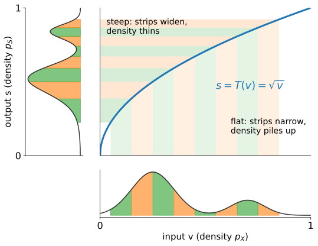{fig-alt="The curve s equals the square root of v, with eight equal-width coloured strips of input values below it and their images as strips on the output axis to the left. Near zero the curve is steep and the output strips are wide, so the output density is thin; at larger v the curve is flat, the strips are narrow and the density piles up." width="100%"}
:::
::::

## The math: a curve reshapes the histogram {.math}

Let the intensity be continuous with density $p_X$, and $T$ rising and differentiable. The pixels in $[v, v + dv]$ land in $[s, s + ds]$ with $ds = T'(v)\,dv$; their number does not change:

$$p_S(s)\,ds = p_X(v)\,dv \quad\Rightarrow\quad p_S(s) = \frac{p_X(v)}{T'(v)}, \qquad s = T(v).$$

- Slope $> 1$ spreads the density thin; slope $< 1$ piles it up (the figure on the previous slide).
- Composition: $(T_2 \circ T_1)' = T_2'(T_1(v))\,T_1'(v)$: gains multiply.
- A point operation can be undone exactly when it is **one-to-one** on the values that occur (strictly rising or strictly falling there). A flat part merges values; a curve that rises and then falls sends two inputs to one output.

## Gamma

:::: {.columns}
::: {.column width="50%"}
Scale the values to $[0, 1]$ and raise them to a power: $s = v^\gamma$.

- **γ < 1 brightens the darks**: it stretches them and compresses the brights. γ > 1 does the reverse; γ = 1 is the identity. Black and white stay fixed.
:::
::: {.column width="50%"}
- γ = 0.5: 0.04 → 0.2 and 0.81 → 0.9. Slopes there: **2.5** and **0.56**.
- Screens and image files also use a power law, for **storage** (colour day, [linear RGB](../rgb-linear/lec.qmd)): a different reason, same shape.
:::
::::

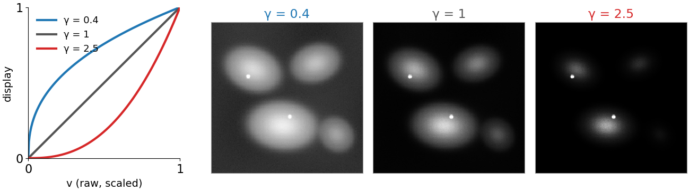{fig-alt="Left: the curves v to the power gamma for gamma 0.4 (above the diagonal), 1 (the diagonal) and 2.5 (below). Right: the synthetic 12-bit fluorescence image shown with each: at gamma 0.4 the dim cytoplasm and the dim cell at the lower right are clearly visible and the background is grey; at gamma 2.5 only the bright nuclei remain." width="96%" fig-align="center" .nostretch}

## Log: equal ratios, equal steps

:::: {.columns}
::: {.column width="50%"}
$s = c \log(1 + v)$: a ratio becomes a **step**. Every factor of 10 gets the same number of display levels.

- 12 bits on 8: $c = 255/\ln 4096 \approx 30.7$. Then 10 → 74, 100 → 141, 1000 → 212, 4095 → 255: about **71 levels per decade**.
:::
::: {.column width="50%"}
- Uses: images spanning orders of magnitude (dim cells next to bright spots, astronomy), and **Fourier spectra**, always shown as $\log(1 + |X|)$ ([Fourier unit](../fourier/lec.qmd)).
- Too much log makes the background noise as prominent as the objects.
:::
::::

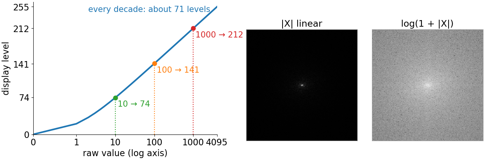{fig-alt="Left: the curve c log of 1 plus v from 12 bits to 8 bits on a logarithmic raw axis, with 10, 100 and 1000 marked at display levels 74, 141 and 212, about 71 levels per decade. Right: the Fourier magnitude of the micrograph shown linearly (black except one dot in the centre) and as log of 1 plus the magnitude (a grey cloud with structure)." width="92%" fig-align="center" .nostretch}

## The math: gamma, log and noise {.math}

- Slope of gamma: $\dfrac{d}{dv}v^\gamma = \gamma\,v^{\gamma - 1}$. For γ < 1 it goes to ∞ as $v \to 0$: gamma curves amplify the **dark** noise most.
- Log: $\log(a v) = \log a + \log v$. A multiplicative factor (exposure time, illumination) becomes an **additive shift**.
- Noise after a point operation (the **delta method**, first-order Taylor around the mean μ):
$$T(X) \approx T(\mu) + T'(\mu)(X - \mu) \quad\Rightarrow\quad \operatorname{SD}\big(T(X)\big) \approx |T'(\mu)|\,\operatorname{SD}(X).$$
- Poisson counts have $\operatorname{SD}(X) = \sqrt\mu$. With $T(x) = 2\sqrt x$: $T'(\mu) = 1/\sqrt\mu$, so $\operatorname{SD} \approx 1$ **whatever the brightness**: the variance-stabilising transform pointed to in [camera noise](../cameranoise/lec.qmd). It is a gamma of ½.

## Try it: tone curves

```{=html}
<link rel="stylesheet" href="../demos/dist/demo.css">
<div data-demo="tonecurve" data-preset="window"></div>
<script src="../demos/dist/tonecurve.js"></script>
```

::: notes
Left: the image through the current curve; click a pixel to follow it through the curve (orange dashed path). Middle: the curve over the input histogram (grey, log counts), and the output histogram below (square-root counts, so gaps show). Tour: "the window is a straight line": the window 130–3176 of highbit/, 3076 raw levels used in, 256 out. "γ = 0.5 lifts the darks": the background pixel (200, 30), raw 158, gets display 31 and a contrast gain of 4.25 (relative to showing the full range linearly): the background noise becomes visible. "γ = 2 darkens": 64 % of the pixels go black. "log": 111 display levels used, the dim cell and the cytoplasm appear. "stretch 8 bits ×4: the comb": the same image reduced to 8 bits, window 6–70: only 64 output levels, the output histogram is a comb. "the same stretch on 12 bits": window 96–1120 on the 12-bit data, 253 levels: smooth. "S-curve" and "threshold: the steepest curve" on the micrograph (2 output levels). "a falling part reverses the order": a free curve that rises, then falls; bright pixels become darker than mid-grey ones.
:::

## Stretching 8 bits leaves a comb

:::: {.columns}
::: {.column width="40%"}
A curve maps each input value to **one** output value. It can merge levels, but it can **never split** them.

- 8-bit data using values 6 … 70, stretched ×4 to fill 0 … 255: only **64** output levels are used, every 4th. The histogram is a **comb**; smooth gradients show **bands** (recall [quantisation](../quantisation/lec.qmd)).
- The same stretch on the 12-bit data: 1025 raw values for 256 levels, **253** used. Smooth.

Rule: do contrast work on the **12/16-bit or float** data; convert to 8 bits **last**, for display.
:::
::: {.column width="60%"}
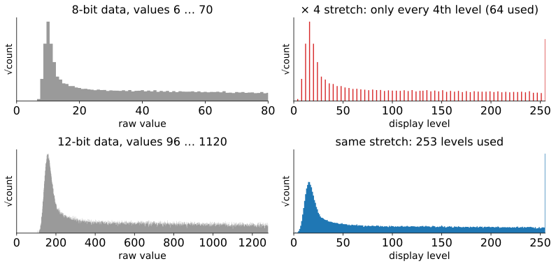{fig-alt="Four histograms. Top: 8-bit data with values 6 to 70, and after a times-4 stretch, a comb in which only every fourth display level is used, 64 in all. Bottom: the same image as 12-bit data, values 96 to 1120, and after the same stretch, a smooth histogram using 253 levels." width="100%"}
:::
::::

## Let the histogram choose the curve

:::: {.columns}
::: {.column width="42%"}
Where should a curve be steep? Where the **pixels are**: give the most contrast to the values that occur most often, and none to values that do not occur.

- Make the **slope proportional to the histogram**: steep at the peaks, flat in the empty tails.
- The curve whose slope is the histogram is its running sum: the **cumulative histogram**.

This is **histogram equalisation**.
:::
::: {.column width="58%"}
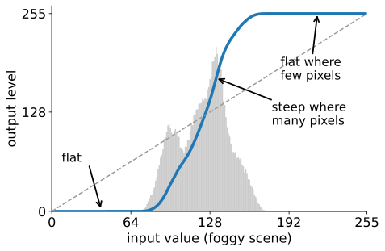{fig-alt="Histogram of the synthetic foggy scene (grey), concentrated between about 80 and 175, with the equalisation curve on top: flat at zero below the histogram, steep where the histogram is high, flat at 255 above it; the dashed diagonal for comparison." width="100%"}
:::
::::

## The cumulative histogram is the mapping

:::: {.columns}
::: {.column width="45%"}
The **cumulative histogram** $P(v)$: the fraction of pixels with value $\le v$. It rises from 0 to 1, steeply where there are many pixels.

Equalisation uses it as the curve:
$$s = \operatorname{round}\big((L - 1)\,P(v)\big).$$

- Micrograph, $L = 256$: 8 % of the pixels are ≤ 80, so 80 → level 21; 40 % are ≤ 150, so 150 → level 101.
- A pixel's new value says "**brighter than this fraction of the image**".
- Result: about the same number of pixels at every output level.
:::
::: {.column width="55%"}
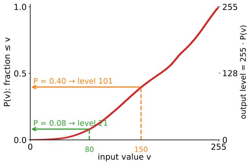{fig-alt="The cumulative histogram of the micrograph as a red S-shaped curve from 0 to 1, with a second axis from 0 to 255 on the right. Two arrows: input 80 goes up to P equals 0.08 and across to output level 21; input 150 goes up to P equals 0.40 and across to level 101." width="100%"}
:::
::::

## Worked example: 8 levels by hand

A 64-pixel image with 8 levels ($L = 8$):

| level $v$ | 0 | 1 | 2 | 3 | 4 | 5 | 6 | 7 |
|---|---|---|---|---|---|---|---|---|
| count | 6 | 22 | 18 | 8 | 5 | 3 | 1 | 1 |
| cumulative | 6 | 28 | 46 | 54 | 59 | 62 | 63 | 64 |
| $7c/64$ | 0.66 | 3.06 | 5.03 | 5.91 | 6.45 | 6.78 | 6.89 | 7 |
| **new level** | **1** | **3** | **5** | **6** | **6** | **7** | **7** | **7** |

Output counts at levels 0 … 7: **0, 6, 0, 22, 0, 18, 13, 5**. A flat histogram would have 8 at every level.

::: notes
The equalise demo's first preset is exactly this image (8 × 8, brighter towards the middle), with the numbers on the pixels. Ask before showing the last row: which levels will merge? 3 and 4 both round to 6; 5, 6 and 7 all to 7.
:::

## Why only approximately flat

:::: {.columns}
::: {.column width="50%"}
All pixels with the **same input value get the same output value**. The 22 pixels at level 1 stay together: they can be **moved**, not **split**.

- Levels can **merge** (3 and 4 here, by rounding), and output levels stay **empty** (0, 2, 4).
:::
::: {.column width="50%"}
- The output has **at most as many distinct values as the input**.
- What *is* close to straight is the output's **cumulative** histogram.
- The micrograph: 256 levels in, **195** used out.
:::
::::

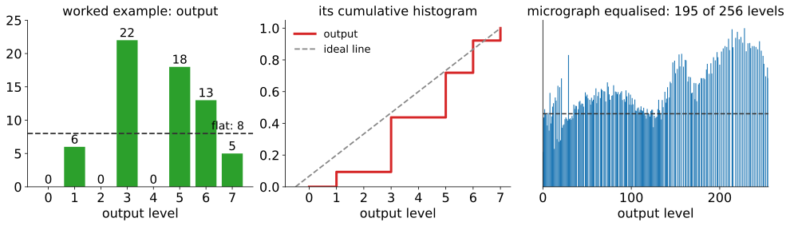{fig-alt="Left: the output histogram of the worked example, bars 0, 6, 0, 22, 0, 18, 13, 5 against a dashed flat line at 8. Middle: its cumulative histogram as a red staircase close to the dashed diagonal. Right: the histogram of the equalised micrograph: spiky bars with gaps around the flat level, 195 of 256 levels used." width="96%" fig-align="center" .nostretch}

## The math: equalisation {.math}

- **Continuous case.** If $X$ has a continuous, strictly rising cumulative distribution $F$, then $Y = F(X)$ is **uniform** on $[0, 1]$: $\;P(Y \le y) = P\big(X \le F^{-1}(y)\big) = F\big(F^{-1}(y)\big) = y$ (the probability integral transform). With $T = F$ the slope is $T' = p_X$, which is the "slope ∝ histogram" rule; the output density is $p_X / T' = 1$.
- **Discrete case.** $s_k = \operatorname{round}\big((L - 1)F(k)\big)$ with $F(k) = c_k / N$. The output count at a level is a **sum** of input counts, so a level with $h(k) > N/L$ stays above $N/L$; used output levels ≤ used input levels. Variant: $s_k = \operatorname{round}\big((L - 1)\frac{c_k - c_{\min}}{N - c_{\min}}\big)$ maps the darkest occurring value to 0.
- **Only ranks matter.** For a strictly rising $g$: $F_{g(X)}(g(v)) = P(g(X) \le g(v)) = F_X(v)$. Equalising $g(X)$ gives the same image as equalising $X$.
- **Exact equalisation:** order all $N$ pixels, break ties (at random, or by the local mean), give ranks $r$ the level $\lfloor rL/N \rfloor$. Exactly flat, at the price of an **invented** order among equal pixels.

## Try it: equalisation

```{=html}
<link rel="stylesheet" href="../demos/dist/demo.css">
<div data-demo="equalise" data-preset="hand"></div>
<script src="../demos/dist/equalise.js"></script>
```

::: notes
Panels: input and output images, the mapping (blue; dashed: (L − 1) × the cumulative histogram), the input histogram with its cumulative (red), the output histogram with its cumulative and the flat level N/L. Click a bar to highlight its pixels. Tour: "8 levels by hand": the worked example, 8 levels in, 5 used out, largest bin 22 against a flat 8. Click the output bar at level 3: the 22 pixels of input level 1. "cumulative = curve": the micrograph, 195 of 256 levels used, the output cumulative within 0.7 % of the straight line. "not flat: bins move": the foggy scene, 105 levels in, 88 out, the largest bin 1594 pixels against a flat 256. "exact: invented order": 256 of 256 levels, exactly 256 pixels each; look at the output image: flat regions turned into noise, because the order among equal pixels is invented. "gamma first: same": γ = 0.4 applied first changes the input image and its histogram, the output does not change at all. "background gets the contrast": the 12-bit image, the background peak takes half of the output levels. "match another image" and "match a Gaussian": the mapping becomes G⁻¹∘F.
:::

## Where global equalisation fails

:::: {.columns}
::: {.column width="50%"}
One curve for the whole image, steep where most pixels are. Usually that is the **background**.

- The 12-bit image: the flat background is about half of all pixels, so it gets about half of the output levels. Its **noise is amplified**: SD 0.8 → 27.5 grey levels in the green box.
:::
::: {.column width="50%"}
- Small objects with few pixels get little contrast; bright and dark regions compete for one curve.
- Rough rule: 40 % of the pixels in 20 of 256 levels gives a slope $\approx 255 \cdot 0.4/20 \approx 5$; noise of SD 3 becomes about 15.
:::
::::

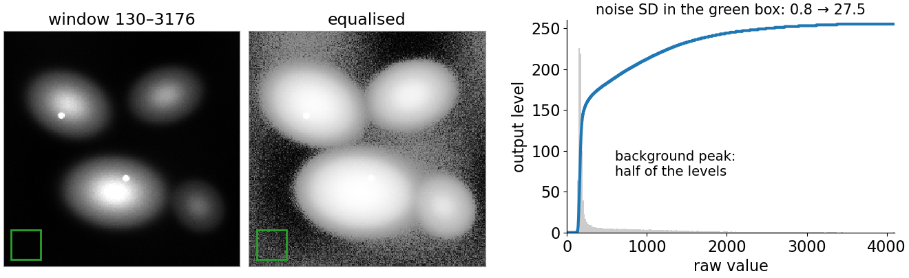{fig-alt="The synthetic 12-bit fluorescence image with the window 130 to 3176 (dark background, four cells), the same image after global equalisation (grainy, noisy grey background, cells washed out to white), and the equalisation curve over the histogram: it jumps from 0 to about 170 within the narrow background peak and then rises slowly. Title: noise SD in the green box 0.8 to 27.5." width="92%" fig-align="center" .nostretch}

## One curve per tile

:::: {.columns}
::: {.column width="50%"}
**Adaptive equalisation**: cut the image into **tiles** (say 8 × 8) and equalise each tile with its own histogram. Each tile on its own gives **seams** at the tile borders.
:::
::: {.column width="50%"}
- Instead, each pixel blends the curves of the **four nearest tile centres**, weighted by distance (bilinear interpolation, [images unit](../images/lec.qmd)).
- The curve **depends on where the pixel is**: the same raw value can become different display values in different places.
:::
::::

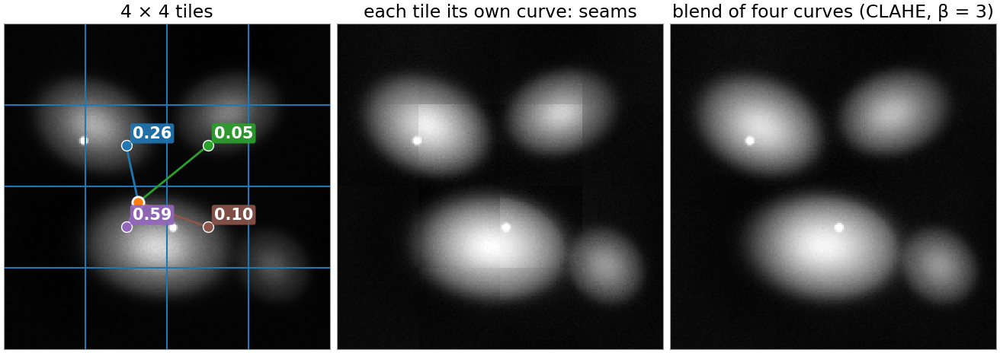{fig-alt="Left: the 12-bit fluorescence image with a 4 by 4 tile grid and one pixel joined to its four nearest tile centres, with bilinear weights 0.26, 0.05, 0.59 and 0.10. Middle: each tile equalised with its own curve: visible square seams at the tile borders. Right: the blend of the four nearest curves with clipping at beta 3: no seams, every cell has local contrast." width="88%" fig-align="center" .nostretch}

## CLAHE: clip the histogram first

:::: {.columns}
::: {.column width="50%"}
In a flat tile the histogram is one narrow peak, so its curve is nearly a **step**: noise explodes. Fix: **clip** every bin at β times the average count, spread the clipped excess evenly over all bins, then accumulate.

- The slope is the histogram, so **the clip limit is the largest contrast gain**: about β×.
:::
::: {.column width="50%"}
- β = 1: a straight line (no change). β → ∞: plain adaptive equalisation.
- Two knobs: **tile size** (larger than the objects) and **clip limit** (how much contrast, and noise; typical β = 2 … 4).
- **C**ontrast-**L**imited **A**daptive **H**istogram **E**qualisation: image libraries call it CLAHE.
:::
::::

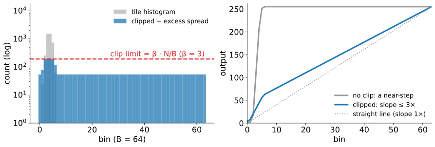{fig-alt="Left: the histogram of a background-only tile of the faint-cell scene on a log axis: a narrow peak of a few bins up to about 1400 counts, a dashed red clip line at 3 times the average count, and the clipped histogram: the peak cut at the line and the excess spread as a constant level over all 64 bins. Right: the two resulting curves: unclipped, a near-step from 0 to 255 within a few bins; clipped, a gentle curve close to the straight line." width="82%" fig-align="center" .nostretch}

## The math: CLAHE {.math}

For one tile with $N$ pixels and $B$ bins, histogram $h$:

- Clipped histogram: $\tilde h(k) = \min\big(h(k),\, \beta N/B\big) + E/B$, with $E$ the clipped excess.
- Tile curve: $T(v) = \dfrac{L - 1}{N}\sum_{k \le v}\tilde h(k)$.
- Slope (per bin, relative to the straight line, whose slope is $(L - 1)/B$): $\dfrac{B\,\tilde h(v)}{N} \le \beta + \dfrac{E}{N}$. After one spreading a bin can end slightly **above** the limit; repeating clip-and-spread until no bin exceeds it makes the bound exactly β.
- Interpolation: $T(v; \mathbf x) = \sum_{i=1}^{4} w_i(\mathbf x)\,T_i(v)$ with bilinear weights $w_i \ge 0$, $\sum w_i = 1$. Each $T_i$ rises in $v$, so the blend rises: **at a fixed position** the order is kept. Between positions $\mathbf x$ and $\mathbf y$ nothing relates $T(\cdot; \mathbf x)$ to $T(\cdot; \mathbf y)$.

## Try it: CLAHE

```{=html}
<link rel="stylesheet" href="../demos/dist/demo.css">
<div data-demo="clahe" data-preset="noclip"></div>
<script src="../demos/dist/clahe.js"></script>
```

::: notes
Left: input with the tile grid (the clicked pixel's tile outlined in red, its four nearest tile centres as dots) and the output; green box: a background region. Middle: the four tile curves with their weights and the blend (orange), and the clicked tile's histogram with the clip line and the clipped, spread histogram. Tour on the faint-cell scene: "global (1 tile)": background noise SD 3.4 → 64.8 grey levels, the curve's largest gain is 28. "no clip: the noise explodes" (8 × 8 tiles): 3.4 → 74.9. "CLAHE β = 3": 3.4 → 9.5, the clicked tile's largest gain exactly 3.00, and the faint cell is clearly visible. Then on the fluorescence image: "no interpolation: seams"; "tiles too small" (16 × 16): halos and blotches, every tile pushed to full contrast; "tiles too large = global" (2 × 2); "β = 1: nothing happens" (gain 1.00). "same raw value, two outputs" (foggy scene): two pixels with raw value ≈ 123 become 102 and 157.
:::

## Histogram matching

:::: {.columns}
::: {.column width="50%"}
Make an image's histogram look like a **target**: another image, a reference, a chosen shape. For each input value $v$, read its fraction $F(v)$ in the source's cumulative histogram; find the target value with the **same fraction** in $G$.

- Foggy scene to micrograph: $v = 130$ has $F = 0.60$; the micrograph value with 60 % of its pixels below is **197**.
:::
::: {.column width="50%"}
- **Equalisation is matching to a flat target.**
- Uses: tiles of a mosaic or frames of a time series that should **look** alike; input for a model trained on another instrument.
- It also **erases real differences**: match a treated image to a control and the treatment is gone.
:::
::::

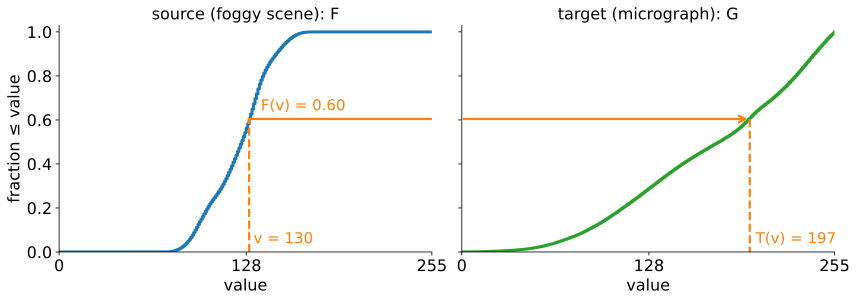{fig-alt="Left: the cumulative histogram F of the foggy scene, rising steeply between about 90 and 170; at v = 130 it is 0.60. Right: the cumulative histogram G of the micrograph, rising slowly; an arrow at height 0.60 goes across to the curve and down to value 197." width="80%" fig-align="center" .nostretch}

## The math: matching {.math}

- The matching curve is $T = G^{-1} \circ F$, with the **generalised inverse** $G^{-1}(u) = \min\{v' : G(v') \ge u\}$ (needed when $G$ has flat parts or jumps).
- Continuous case: $U = F(X)$ is uniform (previous math slide), and for uniform $U$, $G^{-1}(U)$ has distribution $G$: $P(G^{-1}(U) \le t) = P(U \le G(t)) = G(t)$. So $T(X)$ has exactly the target distribution.
- Discrete case: the same rounding problem as equalisation, plus jumps of $G$: a whole input level lands on one target level, so the match is approximate.
- Equalisation: $G$ uniform on $\{0, \dots, L - 1\}$, $G^{-1}(u) \approx (L - 1)u$.
- Worked: counts $6, 22, 18, 8, 5, 3, 1, 1$ to the target $0, 0, 8, 8, 16, 16, 8, 8$: cumulative $6, 28, 46, \dots$ against $0, 0, 8, 16, 32, 48, 56, 64$ gives the mapping $2, 4, 5, 6, 7, 7, 7, 7$.

## What each transform does to measurements

| transform | order of grey values kept? | differences, ratios kept? | same raw → same output everywhere? | comparable between images? |
|---|---|---|---|---|
| linear window | yes | yes (after removing the offset; not where clipped) | yes | yes, with the **same** window |
| gamma, log | yes | **no** (log: ratios become differences) | yes | yes, with the same curve |
| global equalisation | yes | **no** | yes | **no**: the curve depends on the image |
| CLAHE | only **locally** | **no** | **no** | **no** |
| histogram matching | yes | **no** | yes | **no**: differences removed by construction |

Two cells, raw means 300 and 600 on a background of 100 (12 bit): background-subtracted ratio $\frac{600 - 100}{300 - 100} = 2.5$. After γ = 0.5 on $v/4095$, the same computation gives **1.98**.

::: notes
The square root of a mean is not the mean of the square roots: pixels 100 and 900 have mean 500, √500 = 22.4, but the mean of √100 and √900 is (10 + 30)/2 = 20. So even "transform the mean afterwards" does not undo a measurement made on transformed pixels.
:::

## Try it: display vs data

```{=html}
<link rel="stylesheet" href="../demos/dist/demo.css">
<div data-demo="displayvsdata" data-preset="raw"></div>
<script src="../demos/dist/displayvsdata.js"></script>
```

::: notes
Synthetic control and treated images (12 bit, the same six nuclei, treated nuclei 1.5× brighter above the offset of 100, Poisson noise). Each transform is applied to both; nuclei are segmented with Otsu on each displayed image (orange outlines); the table measures both and gives the ratio, green within ±2 % of the truth. Tour: "raw: 1.50": mean 882 vs 1324 above background, ratio 1.50; areas 5024 and 5024. "same window": 1.50. "auto-windows: the figure lies": each image stretched to its own range; the two images look the same, the measured ratio on the display is 1.01. Tick "measure raw values": 1.50 again, the data did not change. "gamma: the ratio changes": 1.30, and within the control the brightest/dimmest nucleus ratio drops from 2.17 to 1.67. "equalise each: treatment gone": 1.00, and Otsu on the equalised images grabs 18 746 pixels instead of 5024: the background noise has been stretched into the nuclei's range. "match: treatment erased": 1.00. "CLAHE: cells not comparable": 1.04 between images, and within the control 1.52 instead of 2.17. "segment on CLAHE, measure raw": the masks from the CLAHE display are fine, and raw values inside them give 1.50.
:::

## The math: measurements under a point operation {.math}

- **Only affine maps commute with averaging**: $\overline{T(v)} = T(\bar v)$ for all images only if $T(v) = av + b$.
- For a **concave** $T$ (γ < 1, log), Jensen's inequality: $\overline{T(v)} \le T(\bar v)$. Pixels 100 and 900: $\sqrt{500} = 22.4$ but $(\sqrt{100} + \sqrt{900})/2 = 20$.
- **Ratios after background subtraction**, $\frac{\bar a - \bar b}{\bar c - \bar b}$, are kept by every affine $T(v) = \alpha v + \delta$ (α > 0): $\delta$ cancels in the differences, $\alpha$ in the ratio. A window is affine only where nothing clips; a curve with $T'' \ne 0$ changes the ratio.
- **Rank statistics commute with any rising $T$**: $\operatorname{median}(T(X)) = T(\operatorname{median}X)$, percentiles, the Spearman correlation (recall [colocalisation](../coloc/lec.qmd)), and any threshold **chosen by a percentile** ("the brightest 10 %": the same mask).
- **Otsu's threshold does not simply move with $T$**: it depends on class means and variances, which a non-linear $T$ changes (exercise).

## What to do

1. **Segment or detect on whatever helps**: a gamma, a log, CLAHE. Then **measure on the raw (linear) data inside the masks**.
2. Show images you compare with the **same display settings**, and say so in the caption.
3. Report **non-linear** display adjustments (gamma, log, equalisation, CLAHE) in the figure legend. Journal image-integrity guidelines ask for the same.
4. Normalise **measurements** (per well, per batch, against controls: [intensity features](../intensity-features/lec.qmd)), not pixels.
5. CLAHE makes an image **look** evenly lit; it does not make it **measurably** even. Uneven illumination is corrected by dividing or subtracting a background ([local thresholds](../local-threshold/lec.qmd)).

The [denoising unit](../denoise/lec.qmd) asks the same question for restored images.

## Summary

- A **point operation** is a curve $s = T(v)$, applied to every pixel; stored as a **lookup table**.
- The **slope** is the contrast gain, for signal and noise alike; flat parts merge values; a rising curve keeps the order. A curve cannot create levels: work on high-bit data, convert to 8 bits last.
- **Gamma** brightens (γ < 1) or darkens (γ > 1); **log** gives every decade the same number of levels.
- **Equalisation**: the cumulative histogram is the curve. Only roughly flat for images, because equal values move together.
- **CLAHE**: one clipped curve per tile, blended between tiles; the clip limit caps the gain.
- **Matching**: $G^{-1}\circ F$; equalisation is matching to flat.
- Transform for **looking** and for **finding** objects; **measure on the raw data**. Never measure intensities on an equalised, CLAHE or matched image.
