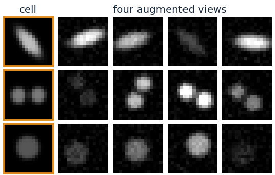
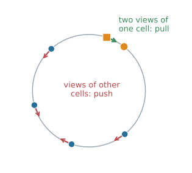
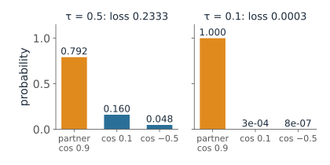
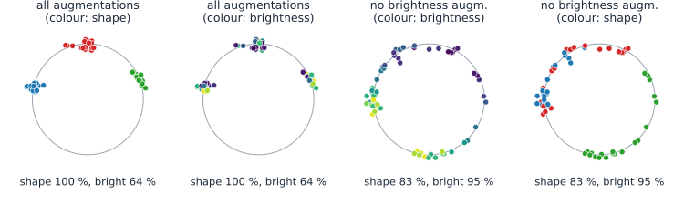
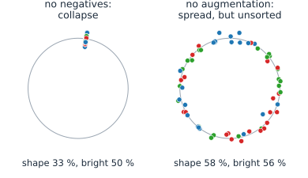
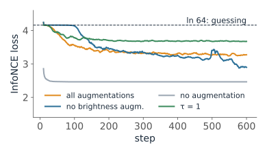

## About this lecture

*Without labels, what should two images have in common to count as "the same"? Contrastive learning lets us say it with augmentations.*

- **Two views** of the same image should get close embeddings, views of different images distant ones.
- The **InfoNCE** loss: "pick the matching view among many", a softmax classification; the **temperature**.
- The augmentations **define** what counts as the same: they decide what the features ignore.
- **Collapse**, and why the negatives prevent it.

*Slides titled **The math** give the formulas and proofs; the ideas are complete without them.*

::: notes
The attention unit had contrastive pretraining on one slide; this is the full treatment. The demo (contrastive) trains a tiny encoder (256 → 16 → 2, 4.1 k weights) live on 64 synthetic cells; the embedding is a point on the unit circle so that everything can be seen. The previous unit (pretext) learned by predicting hidden content; this one by comparing views. The next (self-distillation) removes the negatives.
:::

## Two views of the same cell

:::: {.columns}
::: {.column width="52%"}
Take an unlabelled image and make two **augmented views** of it: rotated, shifted, brightened or dimmed, with noise.

- Whatever the network should output for the cell, it should output it for **both** views.
- But a constant output also does that. So also: views of **different** cells should get **different** embeddings.
- The network must find what stays the same under the augmentations and differs between cells: here, the **shape**.
:::
::: {.column width="48%"}
{fig-alt="Three synthetic cells (an elongated one, a dividing pair, a round one; orange frames) and four augmented views of each: rotated, shifted, brighter or dimmer, with noise." width="100%"}
:::
::::

## Pull together, push apart

:::: {.columns}
::: {.column width="55%"}
- An **encoder** maps each view to an **embedding**, a vector scaled to length 1 (a point on a sphere; in the demo, on a circle).
- Similarity = the dot product = the cosine of the angle between two embeddings.
- **Pull** the two views of each cell together; **push** the views of other cells in the batch away (the **negatives**).
- No labels anywhere: the only "label" is which two views came from the same image.
:::
::: {.column width="45%"}
{fig-alt="Embeddings on a circle: two views of one cell (orange circle and square) are pulled together (green arrow); the views of four other cells (blue) are pushed away from them (red arrows)." width="90%"}
:::
::::

## InfoNCE: pick your partner

:::: {.columns}
::: {.column width="52%"}
For view 1 of a cell, score every view 2 in the batch by similarity / τ, turn the scores into probabilities (softmax), and pay $-\ln p$ of the true partner: a **classification** with as many classes as the batch.

By hand: cosines with the partner and two others $0.9, 0.1, -0.5$; τ = 0.5:

- scores $1.8, 0.2, -1.0$; $e^{\text{score}}$: $6.05, 1.22, 0.37$; probabilities $0.792, 0.160, 0.048$;
- loss $-\ln 0.792 = 0.233$.

Guessing among 64 cells costs $\ln 64 = 4.16$: where every training curve starts.
:::
::: {.column width="48%"}
{fig-alt="Bar charts of the softmax over three candidates with cosines 0.9 (the partner), 0.1 and −0.5. At τ = 0.5: probabilities 0.792, 0.160, 0.048, loss 0.233. At τ = 0.1: 1.000, 3e-4, 8e-7, loss 0.0003." width="100%"}
:::
::::

## The math: InfoNCE {.math}

Batch of $N$ images, unit embeddings $\mathbf z_i$, $\mathbf z_i'$ of their two views, temperature $\tau$:

$$\mathcal L = -\frac1N\sum_{i=1}^N \ln\frac{\exp(\mathbf z_i^\top\mathbf z_i'/\tau)}{\sum_{j=1}^N\exp(\mathbf z_i^\top\mathbf z_j'/\tau)}\qquad(\text{and the same with } \mathbf z, \mathbf z' \text{ swapped, averaged}).$$

- It is the cross-entropy of a softmax classifier whose "class weights" are the other views $\mathbf z_j'/\tau$ ([backprop unit](../backprop/lec.qmd): gradient = predicted − wanted). With $p_{ij}$ the softmax:

$$\frac{\partial\mathcal L}{\partial\mathbf z_i} = \frac1{N\tau}\sum_j (p_{ij} - [i = j])\,\mathbf z_j' = \frac1{N\tau}\Big(\underbrace{\textstyle\sum_j p_{ij}\mathbf z_j'}_{\text{push from negatives}} - \underbrace{\mathbf z_i'}_{\text{pull to partner}}\Big).$$

- Each negative pushes with weight $p_{ij}$: the most similar ("hardest") negatives push hardest.
- Then through $\mathbf z = \mathbf u/\|\mathbf u\|$: $\partial\mathcal L/\partial\mathbf u = (\mathbf g - \mathbf z(\mathbf z^\top\mathbf g))/\|\mathbf u\|$, and backpropagation into the encoder.
- $\ln N - \mathcal L$ is a lower bound on the mutual information between the two views (van den Oord et al., 2018): hence "NCE", noise-contrastive estimation.

## The temperature

- τ divides the similarities before the softmax ([attention](../attention/lec.qmd) has the same knob).
- **Small τ**: the softmax is sharp; only the closest negatives matter, and the loss is near 0 once the partner is clearly the closest (by hand: τ = 0.1 gives 0.0003).
- **Large τ**: all negatives push about equally, gently; the pull dominates.
- Demo after 600 steps, 5-nearest-neighbour accuracy of the **shape** on the embeddings (chance 33 %): τ = 0.2: **100 %**; τ = 1: 73 % (a weak push, the clusters blur); τ = 0.05: 100 %, but the cells crowd on one side of the circle and training is jumpier.
- In practice τ ≈ 0.05–0.5, chosen like a learning rate.

## Try it: views pulled together, pushed apart

```{=html}
<link rel="stylesheet" href="../demos/dist/demo.css">
<div data-demo="contrastive" data-preset="all"></div>
<script src="../demos/dist/contrastive.js"></script>
```

::: notes
Press "train 600 steps" (about 5 s). 64 cells, two views each per step; the small dots and lines are the views of the last step, the big dots the clean cells. Presets: "all augmentations": loss from about ln 64 = 4.16 to 3.34; shape 100 %, dim/bright 64 % (chance 50 %), mean-vector length 0.52: three clusters, sorted by shape, mixed in brightness. "no brightness augmentation": shape 83 %, brightness 95 %: the circle is now ordered by brightness. "no augmentation": the loss drops to 2.46 at once; shape 58 %: every cell gets its own spot, by whatever pixel detail. "no negatives": everything collapses into one point (loss −1, mean length 1.00). "τ = 1": shape 73 %. "τ = 0.05": shape 100 %, mean length 0.84.
:::

## The augmentations define "the same"

{fig-alt="Embeddings of the 64 cells on the unit circle after training. With all augmentations, three tight clusters by shape (100 % nearest-neighbour accuracy for shape); coloured by brightness the clusters are mixed (64 %, chance 50 %). Without the brightness augmentation, the circle is ordered by brightness from dark to bright (95 %), and the shapes are mixed (83 %)." width="100%"}

- With a brightness augmentation the network **cannot** use brightness to recognise a cell: it learns shape, and forgets the staining.
- Without it, brightness is the easiest way to tell 64 cells apart: the embedding sorts by brightness and the shapes mix.
- Neither is wrong. **You** choose what the features ignore, by choosing the augmentations.

## Augmentations for microscopy

| augmentation | the features ignore | harmful when |
|---|---|---|
| rotation, flip | orientation | handedness or a fixed direction matters (flow, polarity, a gradient) |
| intensity gain, offset, gamma | staining brightness, exposure | the readout **is** intensity (expression level, DNA content: cell-cycle phase) |
| blur, noise | focus, camera noise | fine texture is the phenotype |
| crop, scale | position, size | size is the phenotype (hypertrophy, nuclear size) |
| colour or channel shuffles | the stain's hue | the channels mean different proteins |

- Cell-cycle phase from a DNA stain is mostly **intensity** (G1 vs G2 has twice the DNA): an intensity augmentation erases it.
- The [training day](../augmentation/lec.qmd) uses the same augmentations in supervised training; the rule is the same: augment what does **not** matter.

## Collapse, and why negatives

:::: {.columns}
::: {.column width="56%"}
- Only pulling the views together has a perfect solution: **the same output for every image**. Loss −1, no information. That is **collapse**.
- With negatives, collapse is expensive: all scores equal, every partner has probability $1/N$: loss $\ln N$, the worst value.
- Demo, no negatives: all 64 cells in one point (mean-vector length 1.00).
- **Without augmentation** the task is trivial in the other direction: the two views are identical, the loss falls at once (to 2.46), and the cells spread over the circle by any pixel detail: shape 58 %.
:::
::: {.column width="44%"}
{fig-alt="Two embeddings after training. No negatives: all 64 cells in one point. No augmentation: the cells spread around the whole circle, with the shapes mixed." width="100%"}
:::
::::

## The math: alignment and uniformity {.math}

For large batches, InfoNCE splits into two terms (Wang and Isola, 2020):

$$\mathcal L \approx \underbrace{-\frac1\tau\,\mathbb E\big[\mathbf z^\top\mathbf z'\big]}_{\text{alignment: views together}} + \underbrace{\mathbb E_{\mathbf z}\Big[\ln\mathbb E_{\mathbf y}\, e^{\mathbf z^\top\mathbf y/\tau}\Big]}_{\text{uniformity: spread over the sphere}} + \ln N .$$

- Alignment alone is minimised by collapse (the same $\mathbf z$ for every image). Uniformity alone by spreading the embeddings evenly, ignoring the pairs.
- Collapse: $\mathbf z_i^\top\mathbf z_j' = 1$ for all $i, j$ gives exactly $\mathcal L = \ln N$.
- Perfect separation of $N$ points on a circle is impossible for large $N$: the loss has a floor (2.46 for 64 cells at τ = 0.2 in the demo); in 128 dimensions there is much more room.

## Contrastive learning as pseudocode

```
repeat:
    take a batch of N unlabelled images
    for each image i: two random augmentations → views v[i], v'[i]
    z[i] = normalise(encoder(v[i])),  z'[i] = normalise(encoder(v'[i]))
    for each i:  scores s[i][j] = z[i] · z'[j] / tau  for all j
                 loss += −log softmax(s[i])[i]          # pick the partner
    (and the same with z and z' swapped)
    update the encoder by backpropagation
keep the encoder; throw away the rest
```

::: notes
Real systems add a small projection head after the encoder, compute the loss on its output, and keep the features before it (they transfer better). The coding exercise (selfsup/src/contrastive/ in the course code download) implements the loss, its gradient and the backward pass through the normalisation, and trains the demo's toy.
:::

## Batches, negatives and false negatives

- More negatives = a harder classification = better features: batches of thousands, or a queue of embeddings from earlier batches.
- **False negatives**: two different images of the **same** kind of cell are pushed apart as if they were different. With 3 shapes and 64 cells, most negatives are false negatives! It works anyway, because the pull is stronger than the push within a cluster; with many images of one rare phenotype it can hurt.
- In microscopy: crops from the **same well or plate** share background, illumination and stain batch, which makes them easy to tell apart from other plates: the network learns the plate (a **batch effect**), not the cell. Take negatives from the same plate, or correct the features afterwards ([next unit](../self-distillation/lec.qmd)).

## Using the features

:::: {.columns}
::: {.column width="55%"}
- After training, the encoder is a feature extractor: embeddings of new images, **without** the augmentations.
- Evaluate (and use) them as in the [attention unit](../attention/lec.qmd): a **linear probe** with a few labels, or **k-nearest neighbours**: the demo's percentages are leave-one-out 5-NN accuracies.
- Clusters in the embedding are candidate phenotypes: but they follow whatever the augmentations left in, including the batch effects.
:::
::: {.column width="45%"}
{fig-alt="Training curves of the demo's InfoNCE loss over 600 steps, smoothed. All start near ln 64 = 4.16 (guessing). All augmentations ends near 3.3; no brightness augmentation near 2.9; no augmentation drops at once to 2.46 and stays; τ = 1 ends near 3.7." width="100%"}
:::
::::

A lower loss is not better features: the lowest curve (no augmentation) gives the worst ones.

## Summary

| Idea | In one line |
|---|---|
| Views | two augmented copies of one unlabelled image are a positive pair; other images are negatives |
| InfoNCE | softmax over the batch, −log p of the partner: "pick the matching view" |
| Temperature | small τ: sharp, the hardest negatives dominate; large τ: a gentle push |
| Augmentations | define what counts as the same: what they vary, the features ignore |
| Collapse | pulling alone gives a constant; negatives make collapse cost ln N |
| Pitfalls | false negatives, batch effects; a lower loss is not better features |

Next: learning without negatives, and the large pretrained models built this way.
