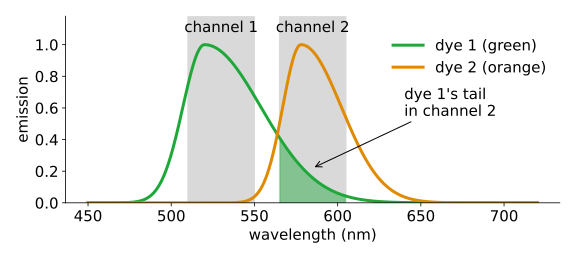
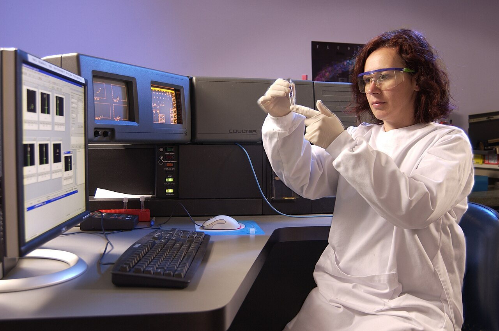

## About this lecture

A two-colour fluorescence image: nucleus labelled green, membrane labelled orange. The orange channel shows a faint **ghost of the nucleus**. Nothing orange is in the nucleus: the green dye's light leaks into the orange channel.

- Why dyes **bleed through**: broad emission spectra seen through finite filter bands.
- Each dye gives one **column** of a mixing matrix: a pixel is $\mathbf y = M\mathbf a$.
- A **single-stained control** measures a column.
- **Compensation** undoes the mixing with $M^{-1}$; under- and over-compensation, and why similar dyes are hard.

Slides titled **The math** give the formulas and proofs; the ideas are complete without them.

::: notes
First unit of the spectral unmixing day (an elective after the colour day). Adapted from the earlier course's flow-cytometry compensation unit: the cell becomes a pixel, the cytometer's detectors become image channels. Linear algebra needed: a 2 × 2 inverse and the idea that the columns of a matrix are where the axes land (the images unit, day 1).
:::

## Why a dye shows up in the wrong channel

{width="78%" fig-align="center"}

- A dye emits over a **broad** range of wavelengths, with a long tail towards the red.
- A channel's filter lets through one **band**. Channel 1 is meant for dye 1, channel 2 for dye 2.
- Dye 1's tail reaches into channel 2's band: a pixel with only dye 1 still gives a signal in channel 2. That is **bleed-through** (or crosstalk, spillover).
- A second source: one laser can **excite** both dyes. The algebra below is the same.

## A channel adds up a band

The value a channel records is the dye's spectrum **times** the filter's transmission, **added up** over wavelength.

Five bins of 25 nm (500, 525, 550, 575, 600 nm), one unit of each dye:

| | 500 | 525 | 550 | 575 | 600 |
|---|---|---|---|---|---|
| dye 1 | 0.2 | 1.0 | 0.6 | 0.3 | 0.1 |
| dye 2 | 0 | 0.1 | 0.5 | 1.0 | 0.6 |
| channel 1 filter | 1 | 1 | 0 | 0 | 0 |
| channel 2 filter | 0 | 0 | 0 | 1 | 1 |

Dye 1: channel 1 sees $0.2 + 1.0 = 1.2$, channel 2 sees $0.3 + 0.1 = 0.4$ (times 25 nm). Dye 2: channel 1 sees $0.1$, channel 2 sees $1.6$.

So one unit of dye 1 lands at $(1.2,\ 0.4)$ in channel space, dye 2 at $(0.1,\ 1.6)$.

## The math: the channel value as an integral {.math}

With emission spectrum $s_k(\lambda)$ of dye $k$ (per unit amount) and transmission $f_c(\lambda)$ of channel $c$ (filter times detector sensitivity):

$$M_{ck} = \int s_k(\lambda)\, f_c(\lambda)\, d\lambda \;\approx\; \sum_i s_k(\lambda_i)\, f_c(\lambda_i)\, \Delta\lambda .$$

- One column per dye: $\mathbf m_k = (M_{1k}, \dots, M_{Nk})^\top$, the dye as the channels see it.
- A linear map from a spectrum to $N$ numbers, the same as the camera of the colour day (three numbers from a spectrum).
- Narrower $f_c$: smaller off-diagonal $M_{ck}$, but also a smaller $M_{kk}$: fewer photons for the dye's own channel.

## Try it: spectra and filters

```{=html}
<link rel="stylesheet" href="../demos/dist/demo.css">
<div data-demo="spectramix" data-preset="classic"></div>
<script src="../demos/dist/spectramix.js"></script>
```

::: notes
Each column of the matrix is divided by its entry in the dye's own channel, so the diagonal is 1 and the off-diagonal entries are the bleed-through fractions. Tour: "classic tail": dye 1 → channel 2 is 20.4 %, dye 2 → channel 1 only 0.5 %: the tail goes to the red. Drag channel 2's band to the right: the bleed-through drops. "Narrow filters": 15.3 %, but each dye keeps only 20 % and 26 % of its photons in its own channel (61 % and 74 % before). "Two dyes 20 nm apart": dye 1 → channel 2 is 1.02 (dye 1 is as bright in channel 2 as in its own channel), dye 2 → channel 1 is 0.15; det 0.85, κ 3.1. "8-bin spectral detector": four dyes, every dye spreads over 2–3 bins; that is fine for least squares (next unit).
:::

## Fluorescence adds: the mixing matrix

Light from different dyes **adds** in each channel. A pixel with amounts $a_1$ of dye 1 and $a_2$ of dye 2 records

$$\mathbf y = a_1 \mathbf m_1 + a_2 \mathbf m_2 = M \mathbf a, \qquad M = \begin{pmatrix} \mathbf m_1 & \mathbf m_2 \end{pmatrix}.$$

- **Rows** of $M$ = channels, **columns** = dyes (components). Column $k$ is where one unit of dye $k$ lands: "the columns of a matrix are where the axes land" (the images unit, day 1).
- Scale each column by its own channel: the **spillover matrix** $S = \begin{pmatrix} 1 & s_{12} \\ s_{21} & 1 \end{pmatrix}$. From the table: $s_{21} = 0.4/1.2 = 0.33$, $s_{12} = 0.1/1.6 = 0.06$.
- The whole image: $Y = MA$, channels × pixels = (channels × dyes)(dyes × pixels). One matrix for all pixels.

## Brightfield stains multiply

Absorbing stains (H&E, DAB) do not add light, they **remove** a fraction of it: two stains on top of each other **multiply** the transmitted light.

- Take the logarithm first, the **optical density** $-\log_{10}(I/I_0)$: then the stains add, and the same model $\mathbf y = M\mathbf a$ holds.
- The unit on stain separation (colour deconvolution) does exactly that; today stays with fluorescence.

## A single-stained control measures a column

Image a sample with **only dye 1**. Every pixel is $a_1 \mathbf m_1$: in the scatter plot of channel 2 against channel 1 the pixels lie on a **line through the origin** with slope $s_{21}$.

- Four background-subtracted control pixels: $(100, 27)$, $(200, 48)$, $(300, 77)$, $(400, 98)$. The slope through the origin: $\sum xy / \sum x^2 = 74\,600 / 300\,000 = 0.249$.
- Subtract the **offset** (dark level, background) first: an offset is a fake component with a flat spectrum and tilts the estimate.
- A dim control gives a poor estimate: controls should be at least as bright as the sample.
- One control per dye; with $K$ dyes, $K$ controls give the $K$ columns.

## The math: the slope through the origin {.math}

The control pixels satisfy $y_i \approx s\, x_i$. Least squares: minimise $E(s) = \sum_i (y_i - s x_i)^2$.

$$\frac{dE}{ds} = -2 \sum_i x_i (y_i - s x_i) = 0 \quad\Longrightarrow\quad \hat s = \frac{\sum_i x_i y_i}{\sum_i x_i^2}.$$

- No intercept: zero dye gives zero signal (after offset subtraction).
- Noise in $x$ (the dye's own channel) biases a regression slope towards 0; bright controls keep that bias small.

## Compensation: undo the matrix

If $\mathbf y = S\mathbf a$, then $\mathbf a = S^{-1}\mathbf y$. With $s_{21} = 0.25$, $s_{12} = 0.02$:

$$S = \begin{pmatrix} 1 & 0.02 \\ 0.25 & 1 \end{pmatrix}, \qquad S^{-1} = \begin{pmatrix} 1.005 & -0.020 \\ -0.251 & 1.005 \end{pmatrix}.$$

- The inverse has **negative** off-diagonal entries: "subtract 25 % of channel 1 from channel 2", and a little the other way.
- Compensation is one $2 \times 2$ matrix applied to every pixel: the ghost of the nucleus disappears from channel 2.
- It does not remove noise: the compensated values carry the noise of both channels, mixed through $S^{-1}$.

## The math: the $2 \times 2$ inverse {.math}

$$\begin{pmatrix} a & b \\ c & d \end{pmatrix}^{-1} = \frac{1}{ad - bc}\begin{pmatrix} d & -b \\ -c & a \end{pmatrix}.$$

For $S$: $\det S = 1 - s_{12}s_{21} = 1 - 0.02 \cdot 0.25 = 0.995$, so $S^{-1} = \frac{1}{0.995}\begin{pmatrix} 1 & -0.02 \\ -0.25 & 1 \end{pmatrix}$.

- $\det S$ is the area of the parallelogram spanned by the two columns. Well-separated dyes: a near-square, $\det \approx 1$, $S^{-1} \approx I$ minus small corrections.
- Similar dyes: nearly parallel columns, a thin parallelogram, $\det \to 0$ and entries of $S^{-1}$ of size $1/\det$.

## Try it: compensate the image

```{=html}
<link rel="stylesheet" href="../demos/dist/demo.css">
<div data-demo="bleedthrough" data-preset="none"></div>
<script src="../demos/dist/bleedthrough.js"></script>
```

::: notes
A synthetic cell (seeded): dye 1 in the nucleus, dye 2 in the membrane, a few vesicles with both, Poisson noise. True spillover 0.25 and 0.05 (hidden). Left: channel 2 measured and compensated (buttons switch to channel 1 or the merge). Middle: channel 2 against channel 1 for every pixel. Right: after compensation with the guess. Tour: "no compensation": the nucleus pixels (green) tilt up with slope 0.25, and the ghost is in channel 2. Raise s₂₁ slowly and ask the class when to stop: the green line flattens and the median comes down to the background. "Over": the line tilts down, the nucleus gets a negative dye-2 signal and the ghost becomes a dark hole. "Reveal true S". Point at Pearson's r: 0.33 before, about 0 after. "Similar dyes": the true S is (0.9, 0.9); even exact compensation smears the populations, and the background noise grows from about 5 to 31.
:::

## Under, over, and the check without ground truth

- **Under-compensated** (guess too small): the single-stained population still **tilts up**; its median sits above the background.
- **Over-compensated** (guess too large): it **tilts down**, below the background, into **negative** values.
- A dye cannot emit negative light. Pixels of a single-stained population clearly below the background mean the spillover was set too high. A population that rises or falls with its own dye means the spillover is wrong.
- In the demo (true $s_{21} = 0.25$): guess 0.15 leaves a median of 86 in channel 2 (background 11), guess 0.35 gives $-66$.

## The math: what a wrong guess leaves {.math}

A pixel with only dye 1: $\mathbf y = a\,(1,\ s)^\top$ (take $s_{12} = 0$). Compensating with the guess $g$:

$$\hat a_2 = y_2 - g\, y_1 = (s - g)\, a .$$

- The dye-1 population lies on a line with slope **exactly** $s - g$: up when $g < s$, flat when $g = s$, down when $g > s$.
- With both off-diagonals guessed ($g_{12}, g_{21}$): $\hat{\mathbf a} = S_g^{-1} S \mathbf a$; to first order in the errors the slope is still $s_{21} - g_{21}$.

## Similar dyes: compensation amplifies noise

Two dyes with nearly the same spectrum: $S_2 = \begin{pmatrix} 1 & 0.9 \\ 0.9 & 1 \end{pmatrix}$, $\det S_2 = 0.19$,

$$S_2^{-1} = \begin{pmatrix} 5.26 & -4.74 \\ -4.74 & 5.26 \end{pmatrix}.$$

- A 10-unit error in channel 2 becomes errors of 47 and 53 in the two dyes. With $S$ of the previous slides it stays 10.
- The average is still right; individual pixels are not. In the demo the background noise grows from 4.6 to 31 after compensation.
- Choosing dyes and filters that are far apart matters more than any algorithm. The next unit measures this with the **condition number**.

## Bleed-through fakes colocalisation

Nucleus and membrane are different places, yet in the measured image the two channels **correlate**: every bright nucleus pixel is also a bit bright in channel 2.

- In the demo: Pearson's $r$ between the channels inside the cell is **0.33** before compensation and **−0.03** after.
- Any measurement that compares channels (colocalisation, ratios, FRET) must compensate first. Colocalisation itself is taught on the measurements day (`coloc/`).
- Physical remedies: **narrower filters** (cost: photons), **sequential excitation** (one laser at a time), dyes further apart.

## Aside: the same thing in flow cytometry

:::: {.columns}
::: {.column width="52%"}
{width="100%"}

[Photo: Mark Fergus, CSIRO, [CC BY 3.0](https://creativecommons.org/licenses/by/3.0/), via [Wikimedia Commons](https://commons.wikimedia.org/wiki/File:CSIRO_ScienceImage_3360_Scientist_using_a_Flow_Cytometer.jpg).]{style="font-size: 0.55em; color: #5a6b7a;"}
:::
::: {.column width="48%"}
- A flow cytometer measures thousands of cells per second, each a "pixel" with one value per detector.
- Same spillover, same $S^{-1}$, one compensation per cell. This is where "compensation" got its name.
- Spectral cytometers unmix 20 or more dyes with many detectors: the least squares of the next unit.
:::
::::

::: notes
The demo has a data-mode="cells" with the earlier course's four simulated populations (unstained, dye 1, dye 2, both; true spillover 0.25 and 0.02), if you want to show the cytometry version: same sliders, same verdicts. With the true values the dye-1 population has slope −0.004 and median 105 in the other detector, the same as the unstained cells.
:::

## Summary

- Broad emission spectra and finite filter bands: each dye shows up in several channels (**bleed-through**).
- A channel value is spectrum × filter, added over wavelength; one dye gives one **column** of $M$; fluorescence **adds**: $\mathbf y = M\mathbf a$.
- A **single-stained control** measures a column: the slope through the origin, after offset subtraction.
- **Compensation**: $\hat{\mathbf a} = M^{-1}\mathbf y$. A single-stained population should lie **flat** at the background level; tilted up = under, tilted down and negative = over.
- **Similar dyes**: $\det M \to 0$, the inverse is large and amplifies noise.
- Bleed-through makes independent channels correlate: compensate before comparing channels.
