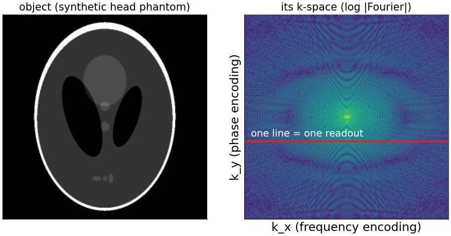
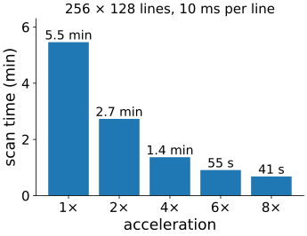
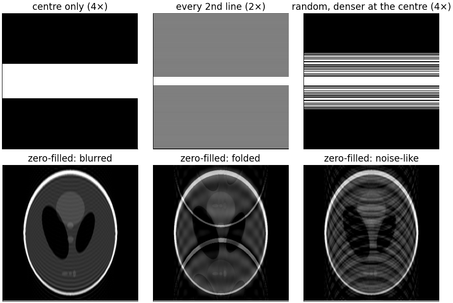
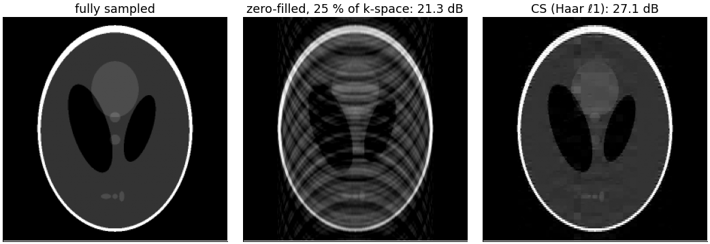
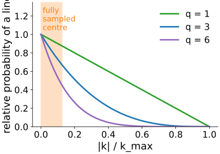
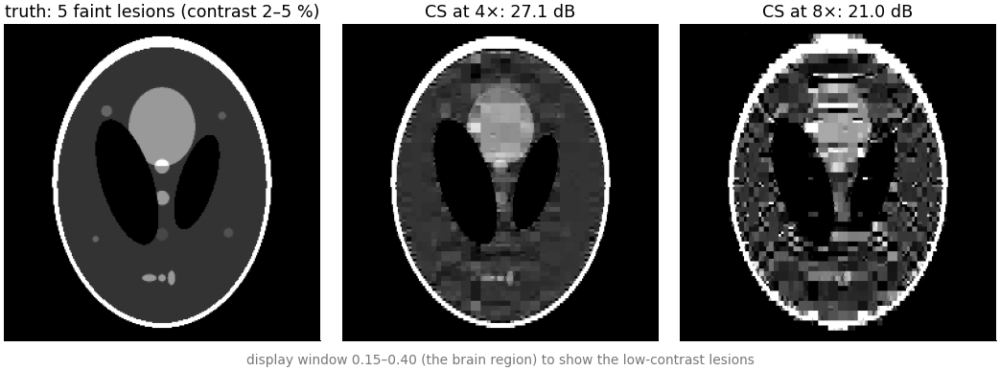

## About this lecture

Magnetic resonance imaging is the flagship application of compressed sensing: the scanner measures **Fourier coefficients**, measuring them takes **time**, and we choose **which** ones to measure.

- What the scanner measures (k-space), and why scan time grows with the number of lines.
- Three ways to skip lines: the **centre** (blur), **every other line** (fold-over), **random lines denser at the centre** (noise-like artefacts).
- The reconstruction: data consistency on the measured lines, wavelet sparsity elsewhere.
- What can go wrong: small faint details are removed; too much acceleration fails abruptly.

*Slides titled **The math** give the formulas and proofs; the ideas are complete without them.*

::: notes
Fourth unit of the sparse representations elective (about 1 h); needs compressed-sensing/ and ista/. No MRI physics beyond one slide. All images are synthetic phantoms (the modified Shepp–Logan head phantom, and a version with small faint discs); no real MRI data are used. Key reference: Lustig, Donoho & Pauly (2007), Sparse MRI, Magn. Reson. Med. 58.
:::

## MRI measures Fourier coefficients

:::: {.columns}
::: {.column width="40%"}
One concept slide, no physics:

- Magnetic field **gradients** make the signal of each position oscillate at a frequency that depends on where it is.
- The received signal at one moment is therefore one **Fourier coefficient** of the object.
- The scanner fills **k-space** (the 2D spectrum) one **line** at a time; the image is the inverse 2D DFT (recall the [Fourier unit](../fourier/lec.html)).

Most of the energy sits near the centre of k-space (the slow variations); edges and fine detail live further out.
:::
::: {.column width="60%"}
{width="100%" fig-alt="Left: the synthetic head phantom, an ellipse with a bright rim and darker inner structures. Right: the logarithm of the magnitude of its 2D Fourier transform, bright at the centre and fading outwards, with one horizontal line marked in red: one readout."}
:::
::::

## Time = lines

:::: {.columns}
::: {.column width="52%"}
- Within one line (one readout) the samples come fast. Each new line needs a new excitation: a fixed **repetition time** per line.
- A 3D scan with 256 × 128 phase-encoding lines at 10 ms per line: $256 \cdot 128 \cdot 0.01\,\text{s} = 328\,\text{s} = 5.5$ min.
- Patients move, children cannot lie still, the heart beats, contrast agents wash out. **Fewer lines = shorter scans.**
- 4× fewer lines: 82 s. But which lines may we skip?
:::
::: {.column width="48%"}
{width="100%" fig-alt="Bar chart of scan time against acceleration for 256 × 128 lines at 10 ms each: 5.5 min at 1×, 2.7 min at 2×, 1.4 min at 4×, 55 s at 6×, 41 s at 8×."}
:::
::::

## Three ways to skip lines

:::: {.columns}
::: {.column width="58%"}
{width="100%" fig-alt="Top: three k-space masks (white = measured lines). Centre only: a band of lines in the middle. Every second line: alternating lines plus a full centre. Random lines, denser at the centre. Bottom: the zero-filled images. Centre only: a blurred phantom with ringing. Every second line: the phantom plus a ghost copy shifted by half the field of view. Random: the phantom with noise-like streaks."}
:::
::: {.column width="42%"}
1. **Centre only**: a low-pass filter. The image is **blurred** with ringing (recall the [Fourier unit](../fourier/lec.html)). No reconstruction can bring the edges back: they were never measured.
2. **Every second line**: the image **folds**: a ghost copy shifted by half the field of view (aliasing, as in the 1D copies of the last unit).
3. **Random lines, denser at the centre**: **noise-like** artefacts, which a sparsity prior can remove.

Only option 3 fits compressed sensing.
:::
::::

::: notes
Zero-filled images: inverse FFT with the missing lines set to 0. Centre only: 25 % of the lines (4×); every second line: 53 % (2× plus a fully sampled centre); variable density: 25 % (4×). The phantom is real-valued, so the masks are symmetric (lines k and −k); in practice images have a phase and this symmetry is not free.
:::

## The math: k-space sampling and the PSF of a mask {.math}

Measurements: $\mathbf y = PF\mathbf x + \mathbf n$, with $F$ the orthonormal 2D DFT and $P$ the rows (k-space samples) kept.

- Zero-filled image: $F^{-1}P^\top\mathbf y = \mathbf x * \mathrm{psf}$ (noise aside), where $\mathrm{psf} = F^{-1}(\text{mask})$ (unit 3).
- A mask that keeps every $r$-th line in $k_y$: in $y$ the PSF is $r$ equal spikes $N/r$ apart, so the image is the average of $r$ copies shifted by FOV/$r$ (field of view). For $r = 2$: one ghost at half the FOV.
- Centre only ($|k_y| < c/2$): the PSF is a sinc-like (Dirichlet) kernel of width about $N/c$ along $y$: blur plus ringing.
- Random lines: a central peak plus low, irregular sidelobes along $y$.

## The reconstruction

{width="88%" fig-align="center" fig-alt="Three images of the phantom: fully sampled; zero-filled from 25 % of k-space with variable-density random lines, streaky, 21.3 dB; the compressed-sensing reconstruction with Haar wavelet ℓ1 from the same data, clean edges with some blockiness, 27.1 dB."}

FISTA with the partial-Fourier forward operator and Haar-wavelet ℓ1 from 25 % of the lines: **21.3 → 27.1 dB**. The measured lines are kept consistent with the data; the prior fills the rest with the sparsest image in wavelets.

::: notes
150 FISTA iterations, step 1, λ = 0.01, Haar with 5 levels, k-space noise 0.002 (tools/figs/cs-mri/data.ts). Honest comparison: zero-filling from the centre only (also 25 % of k-space) gives 26.7 dB, almost the same PSNR as CS (27.1 dB), because the phantom's energy is concentrated at low frequencies (77 % within the central 17 lines); the difference is in the edges and the small dots, which the centre-only image blurs and CS keeps. PSNR alone undersells it (SSIM 0.87 against 0.90). Haar gives visible blocks; TV or a combination (demo: "+ TV") look smoother. With db4 the same set-up gives 25.4 dB here.
:::

## The math: the CS-MRI problem {.math}

$$\min_{\mathbf x}\ \tfrac12\|PF\mathbf x - \mathbf y\|^2 + λ_1\|W\mathbf x\|_1 + λ_2\,\mathrm{TV}(\mathbf x)$$
(Lustig, Donoho & Pauly 2007), with $W$ an orthonormal wavelet transform.

- $PF$ has **orthonormal rows** ($PFF^{-1}P^\top = I$), so $\|PF\| = 1$, L = 1 and the ISTA step τ = 1 is safe.
- One FISTA step: one FFT and one inverse FFT (the gradient step $\mathbf x + F^{-1}P^\top(\mathbf y - PF\mathbf x)$: replace the measured k-space lines by the data), then the proximal step: a wavelet transform pair with soft thresholding; with TV as well, a few TV-denoising iterations (applying the two proximal steps one after the other is an approximation).
- Real scanners use several receiver coils: $\mathbf y_c = PFS_c\mathbf x$ with coil sensitivities $S_c$; the same algorithm with a larger operator.

## Try it: compressed-sensing MRI

```{=html}
<link rel="stylesheet" href="../demos/dist/demo.css">
<div data-demo="csmri" data-preset="cs4"></div>
<script src="../demos/dist/csmri.js"></script>
```

::: notes
Top: zero-filled and CS reconstructions (CS iterates progressively, 128 × 128 on the slide). Bottom: the lines kept, k-space with the mask, the PSF of the mask (square-root scale) and the CS error. Tour: "centre only: blur"; "every 2nd line: fold" (ghost at half the field of view; CS cannot remove it); "random: noise-like"; "variable density + wavelets: 4×"; "8×: lesions vanish" (phantom with faint lesions; compare with 4×); "TV cartoon" (micrograph, not an MRI image); "radial spokes" (radial k-space trajectory; it samples more of k-space for the same nominal acceleration). The readout gives PSNR/SSIM and the scan time.
:::

## The math: variable density {.math}

:::: {.columns}
::: {.column width="52%"}
Lines are drawn at random with probability
$$p(k) \propto \left(1 - \frac{|k|}{k_{\max}}\right)^q,$$
plus a fully sampled centre (here $N/16$ lines).

- Why denser at the centre: the energy is there (77 % of the phantom's energy within the central 17 of 256 lines), and coarse wavelets are **coherent** with low frequencies: a coarse wavelet is concentrated at low $|k|$, so random sampling there would miss most of its information.
- Fine wavelets are spread over high frequencies, where sparse random sampling is enough.
- Larger $q$: more concentrated at the centre (sharper drop).
:::
::: {.column width="48%"}
{width="100%" fig-alt="Relative probability of sampling a line against |k|/kmax for q = 1 (a straight line), q = 3 and q = 6 (steeper), with the fully sampled centre shaded."}
:::
::::

## In practice

- Compressed-sensing acceleration of about **2–8×** is used clinically (commercial implementations since about 2017), mostly combined with **parallel imaging**: several receiver coils, each seeing the object through its own sensitivity profile, which adds equations.
- **Radial** and **spiral** trajectories: radial lines through the centre of k-space are projections of the object (the Fourier slice theorem of [back-projection](../backprojection/lec.html)); undersampled radial data give streaks, which are also incoherent.
- **Dynamic MRI** (the beating heart, contrast uptake): successive frames differ little, so the series is very sparse in time; accelerations of 10× and more.
- The reconstruction takes seconds to minutes per scan: computation replaces scan time.

## What can go wrong

:::: {.columns}
::: {.column width="58%"}
{width="100%" fig-alt="The phantom with five small faint discs (contrast 2–5 %), shown with a narrow grey window. CS at 4×: the large structures are right (27.1 dB), but the five faint discs have disappeared into a blocky texture. CS at 8×: the whole image breaks into blocks, 21.0 dB."}
:::
::: {.column width="42%"}
- **Small, low-contrast lesions vanish**, already at 4× here, although the PSNR is good: the ℓ1 shrinkage of the sparsity unit removes small coefficients, and a faint 3-pixel lesion has only small coefficients.
- TV makes a **cartoon**; Haar makes **blocks**.
- Too much acceleration fails **abruptly** (the phase transition): at 8× the reconstruction breaks down.
- Unlike a learned prior, a sparsity prior does not invent plausible anatomy; but it can **remove real detail** without any visible sign.
:::
::::

::: notes
Phantom with five extra discs of contrast 0.02–0.05 (lib/sparse.ts LESION_PHANTOM), variable density sampling, Haar ℓ1 with λ = 0.015, 150 iterations. 4×: 27.1 dB; 8×: 21.0 dB (zero-filled 21.4 and 19.9 dB). The display window 0.15–0.40 stretches the brain region.
:::

## Learned reconstruction

- **Unrolling**: write a fixed number of ISTA iterations as layers, and **learn** the thresholds and filters (or replace the threshold by a small network) from pairs of undersampled and fully sampled scans: "learned ISTA" (Gregor & LeCun 2010; for MRI, variational networks). Recall [convolutional networks](../cnn/lec.html).
- **Diffusion priors** for the same inverse problem: sample images that are consistent with the measured k-space lines and look like the training data ([diffusion priors](../diffusion-inverse/lec.html)).
- Faster and often better than hand-made sparsity, but a learned prior can **hallucinate** plausible structures that were not in the patient; a hand-made one mostly removes detail. Both need validation against fully sampled scans.

## Summary

- The MRI scanner measures **Fourier coefficients**, line by line; scan time is proportional to the number of lines.
- Skipping lines: **centre only** blurs, **regular** undersampling folds (ghosts at FOV/r), **random, variable-density** undersampling gives noise-like artefacts.
- **CS-MRI**: minimise misfit on the measured lines + λ·(wavelet ℓ1, TV) with FISTA; $\|PF\| = 1$, so the step is 1; each iteration costs two FFTs and a wavelet transform pair.
- Variable density: sample the low frequencies densely (energy, coherence of coarse wavelets).
- Clinically 2–8×, combined with multiple coils. The risk: small faint details are removed, and too much acceleration fails abruptly.
- Next: instead of a fixed wavelet basis, **learn** the atoms from the images themselves.
