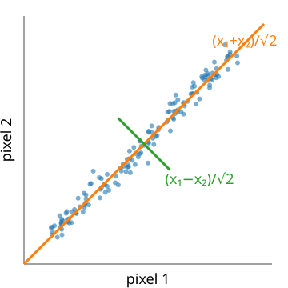
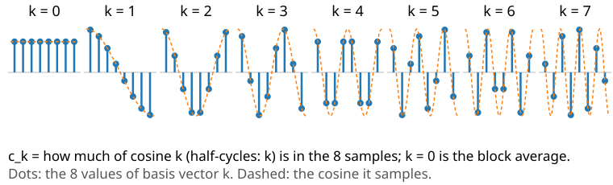
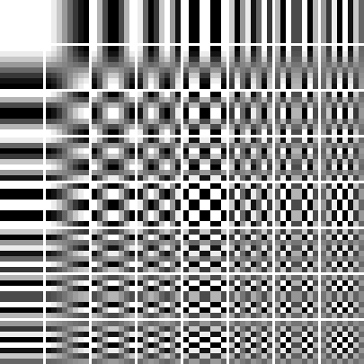
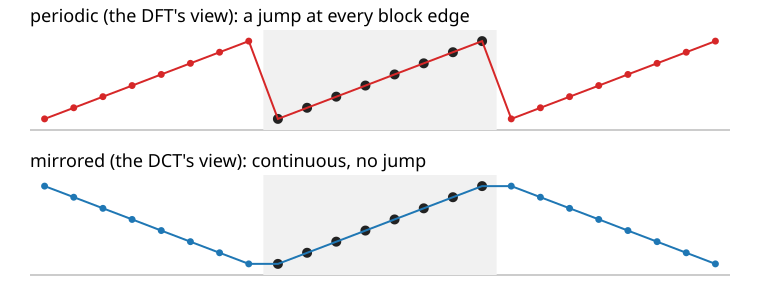

## About this lecture

The Fourier unit showed that 3% of the Fourier coefficients keep most of an image. This unit turns that observation into a codec: **transform → quantise → entropy code**.

- **Energy compaction**: a good change of basis puts most of the image in a few coefficients.
- The **KLT** (PCA of image blocks) is the best linear transform, but it depends on the data.
- The **DCT**: a fixed cosine basis, close to the KLT for natural images, and fast.
- Why the DCT and not the DFT: the DFT sees a **jump** at the block edges.
- Why **8 × 8 blocks**, and what that costs.

*Slides titled **The math** give the formulas and proofs; the ideas are complete without them.*

::: notes
Recalls: the Fourier unit (keep largest, periodic extension) and the PCA unit (covariance, eigenvectors). Neither is re-taught. Quantisation itself is the next unit's topic (JPEG); here coefficients are only kept or dropped.
:::

## From "keep the largest" to a codec

Recall (Fourier unit): keeping the **largest 3%** of the Fourier coefficients of the micrograph keeps 81% of its variation. Transform coding makes this a codec in three steps:

1. **Transform**: a change of basis that decorrelates the pixels and compacts the energy into few coefficients. Exact and invertible.
2. **Quantise**: round the coefficients, coarsely where it matters little. **The only lossy step.**
3. **Entropy code** what is left: many zeros and small integers (run lengths, Huffman, from the first unit).

The transform itself does not compress anything: 64 pixels in, 64 coefficients out. It **rearranges** the information so that steps 2 and 3 can work.

## Energy compaction: two pixels

:::: {.columns}
::: {.column width="45%"}
{width="100%"}
:::
::: {.column width="55%"}
Pairs of neighbouring pixels $(x_1, x_2)$ lie near the diagonal.

- **Rotate** the axes by 45°: new coordinates $(x_1 + x_2)/\sqrt2$ (the pair's brightness) and $(x_1 - x_2)/\sqrt2$ (its difference).
- The first carries almost all of the spread, the second almost nothing: store it coarsely or not at all.
- A rotation keeps lengths: the squared error made on the coefficients is **exactly** the squared error of the pixels (Parseval). So we may decide what to throw away in the new basis.

The 2-point DCT **is** this rotation.
:::
::::

## The math: orthonormal transforms and Parseval {.math}

An orthonormal transform $c = A x$ with $A^\top A = I$ (rows = basis vectors):

- inverse $x = A^\top c$: the image is a sum of basis images, weighted by the coefficients;
- **Parseval**: $\|c\|^2 = c^\top c = x^\top A^\top A x = \|x\|^2$;
- dropping or changing coefficients by $\delta c$ changes the image by $\delta x = A^\top \delta c$ with $\|\delta x\| = \|\delta c\|$: the error of a quantised coefficient goes **unchanged** into the image;
- keeping the coefficients $k \in K$: squared error $= \sum_{k \notin K} c_k^2$. Best $K$ for one block: the largest $|c_k|$.
- 2 points: $A = \tfrac{1}{\sqrt2}\begin{pmatrix} 1 & 1 \\ 1 & -1 \end{pmatrix}$, a rotation by 45° (and a reflection).

## The best rotation: the KLT

For more pixels, which rotation is best? Recall the PCA unit: the **principal components** of a cloud of points are the eigenvectors of its covariance matrix, ordered by variance.

- Take all 8 × 8 blocks of an image as points in 64 dimensions. Their PCA basis is the **Karhunen–Loève transform** (KLT).
- It **decorrelates** the coefficients exactly and puts the **most energy into the first $k$** coefficients, for every $k$: no linear transform compacts better.
- But it depends on the image: it must be computed (an eigenproblem of size 64) and **stored or sent** with the file, and there is no fast algorithm.

## The math: why the KLT is optimal {.math}

Blocks $x$ with mean zero and covariance $S = E[x x^\top]$ (64 × 64); eigenvectors $u_1, \dots, u_{64}$, eigenvalues $\lambda_1 \ge \dots \ge \lambda_{64}$.

- KLT coefficients $c_j = u_j^\top x$: $E[c_i c_j] = u_i^\top S u_j = \lambda_j \delta_{ij}$: **uncorrelated**, variance $\lambda_j$.
- For any orthonormal basis $a_1, \dots, a_{64}$, the expected energy in the first $k$ coefficients is $\sum_{j \le k} a_j^\top S a_j \le \sum_{j \le k} \lambda_j$ (Ky Fan; for $k = 1$ it is the Rayleigh quotient of the PCA unit). Equality for the KLT.
- Expected squared error when dropping all but $k$: $\sum_{j > k} \lambda_j$, the smallest possible.
- For a stationary signal whose neighbour correlation $\rho$ decays as $\rho^{|i-j|}$ (first-order Markov), the eigenvectors of $S$ approach the DCT basis as $\rho \to 1$: the DCT is a fixed approximation of the KLT of smooth images.

## The DCT: cosines that fit the block

{width="85%"}

- 8 basis vectors: sampled cosines with $0, \tfrac12, 1, \dots, \tfrac72$ periods across the block. $k = 0$ is the **average**.
- Real numbers, a fixed basis (nothing to store), and a fast algorithm like the FFT.
- For smooth image blocks it is almost as good as the KLT: the next slides compare them.

## The math: the DCT-II {.math}

$$c_k = \alpha_k \sum_{n=0}^{N-1} x_n \cos\frac{\pi (2n+1) k}{2N}, \qquad \alpha_0 = \sqrt{\tfrac1N},\ \alpha_k = \sqrt{\tfrac2N}\ (k \ge 1)$$

- With these $\alpha_k$ the matrix $D_{kn} = \alpha_k \cos\frac{\pi(2n+1)k}{2N}$ is **orthonormal**: $x_n = \sum_k \alpha_k c_k \cos\frac{\pi(2n+1)k}{2N}$ (the DCT-III) and Parseval holds. (Unlike the unnormalised DFT of the Fourier unit.)
- $N = 4$: rows $(\tfrac12, \tfrac12, \tfrac12, \tfrac12)$, $(0.653, 0.271, -0.271, -0.653)$, $(\tfrac12, -\tfrac12, -\tfrac12, \tfrac12)$, $(0.271, -0.653, 0.653, -0.271)$.
- $c_0 = \sqrt N \cdot$ mean: for 8 samples, $c_0 = 2\sqrt2 \cdot$ mean; in 2D on 8 × 8, $C_{00} = 8 \cdot$ mean.
- **2D**, separable: $C = D X D^\top$ (transform the rows, then the columns).

## 64 basis images

:::: {.columns}
::: {.column width="45%"}
{width="100%"}
:::
::: {.column width="55%"}
The 2D DCT of an 8 × 8 block: products of a horizontal and a vertical cosine.

- Top left: the **DC** (block average). To the right: more horizontal variation; down: more vertical variation.
- Every 8 × 8 block is a weighted sum of these 64 images; the weights are the coefficients.
- Flat block: only DC. A vertical edge: only the **top row** (horizontal frequencies). Fine stripes: one or two coefficients far to the right.
- **Zigzag order**: read the coefficients diagonally from top left to bottom right, roughly from low to high frequency.
:::
::::

## Try it: one block in three bases

```{=html}
<link rel="stylesheet" href="../demos/dist/demo.css">
<div data-demo="dctblock" data-preset="edge"></div>
<script src="../demos/dist/dctblock.js"></script>
```

::: notes
Coefficients are of the block minus 128 (JPEG's level shift). Tour: "flat block": only DC = 8 × (200 − 128) = 576. "Vertical edge": 5 non-zero coefficients, all in the top row. "Texture block": fine stripes, 5 coefficients. "A block of the cell": k = 6 largest keep 61% of the block's energy (RMS error 17.9 grey levels); the cell is grainy. Click basis images to add or drop single coefficients and watch the rebuilt block. "KLT looks like the DCT": the KLT learnt from all 1024 blocks of the cell; the curves on the left: energy in the best k coefficients averaged over all blocks, DCT and KLT almost on top of each other, DFT below.
:::

## Why not the DFT?

{width="75%"}

- The DFT treats the block as one period of a **periodic** signal (Fourier unit): a ramp becomes a sawtooth with a **jump** at every block edge. The jump needs many high frequencies: coefficients decay slowly ($\sim 1/k$).
- The DCT is the DFT of the block **mirrored**: no jump, coefficients decay fast ($\sim 1/k^2$).
- A ramp block from the demo, first 3 coefficients: DCT keeps 99.6% of the energy (error 1.6 grey levels), DFT 74.8% (error 12.7).

## The math: the DCT is a mirrored DFT {.math}

Mirror the block: $y = (x_0, \dots, x_{N-1}, x_{N-1}, \dots, x_0)$, length $2N$. Its DFT:

$$Y_k = \sum_{n=0}^{2N-1} y_n e^{-2\pi i nk/2N} = \sum_{n=0}^{N-1} x_n \big(e^{-i\pi nk/N} + e^{-i\pi(2N-1-n)k/N}\big) = 2 e^{i\pi k/2N} \sum_{n=0}^{N-1} x_n \cos\frac{\pi(2n+1)k}{2N}$$

- So $c_k = \alpha_k \tfrac12 \operatorname{Re}\!\big(e^{-i\pi k/2N} Y_k\big)$: one FFT of length $2N$ gives the DCT (this is how the demos compute large DCTs).
- The mirrored signal is continuous at the block edges (and at its period); its derivative jumps. A jump in the signal gives Fourier coefficients $\sim 1/k$, a jump in the derivative $\sim 1/k^2$.

## Try it: periodic or mirrored?

```{=html}
<link rel="stylesheet" href="../demos/dist/demo.css">
<div data-demo="dctblock" data-mode="1d" data-preset="ramp" data-k="3"></div>
<script src="../demos/dist/dctblock.js"></script>
```

::: notes
Drag the black points. Ramp 10 … 80 with the first 3 coefficients: DCT error 2.49, DFT 13.55. Step: the DCT needs more coefficients too (an edge inside the block is a real jump, for both). Smooth bump: both fine. Random: nothing compacts noise. The DFT bars stay high to the end for the ramp (slow decay); the DCT's odd coefficients fall fast.
:::

## Why blocks, and what they cost

- **Local statistics**: a block is either flat, an edge or texture; one transform of the whole image mixes them.
- **Small and fast**: 1024 independent 8 × 8 transforms for 256 × 256; little memory, easy hardware.
- At the same kept fraction the block DCT is about as good as a whole-image DCT (exercise: 3% keep 81.5% against 83.7% of the micrograph's variation), and both beat the whole-image DFT (81.3%).
- **The cost**: each block is coded alone, so errors jump at block boundaries: **blocking**, the typical JPEG artefact (next unit).
- Alternatives: the **wavelet** transform (previous day of this elective) is multiresolution and has no block grid; JPEG 2000 uses it (last unit). The moments day makes the same "keep the first coefficients" argument with Legendre polynomials.

## Summary

- Transform coding: **transform** (exact) → **quantise** (lossy) → **entropy code**.
- Orthonormal transforms keep energy (**Parseval**): errors in coefficients are errors in pixels, one to one.
- The **KLT** (PCA of blocks) compacts best but depends on the data; the **DCT** is fixed, fast and close to it for smooth images.
- The DCT is the DFT of the **mirrored** block: no jump at the edges, fast-decaying coefficients; the DFT leaks.
- 8 × 8 blocks: local, fast, but they leave **block boundaries**.
- Next: **JPEG** quantises these 64 coefficients with a table and entropy-codes the result.
