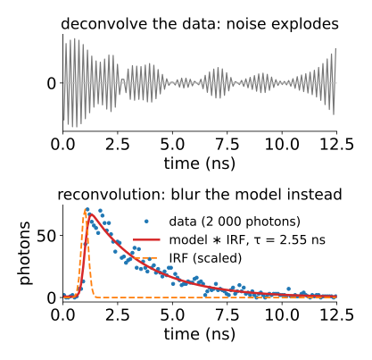
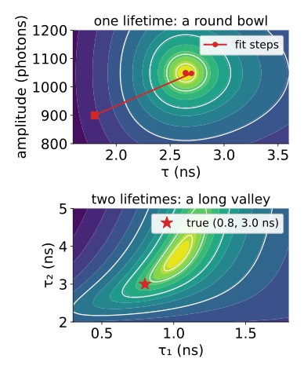
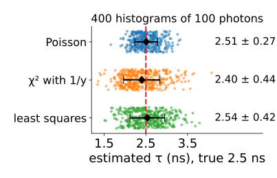
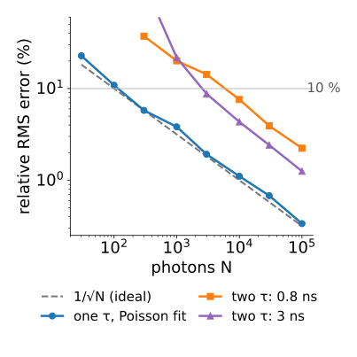
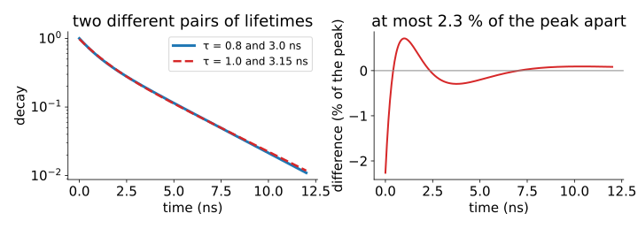
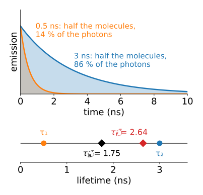
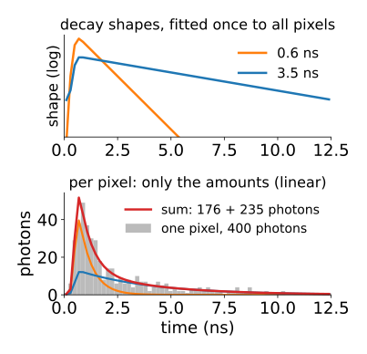
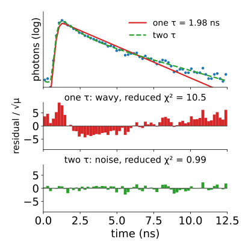

## About this lecture

[Last unit](../lifetime/lec.qmd): a pixel's photons form a histogram, the true decay convolved with the IRF, with Poisson noise. Often there are only 100 to 1 000 photons, spread over 64 to 256 bins, so many bins hold 0, 1 or 2 counts. The quick estimates used them badly. Today we **fit** τ (or τ₁, τ₂ and their fractions) and say how sure we are.

- Fit the **model through the forward model** (reconvolution), never the deconvolved data.
- Nonlinear fitting in words: start, linearise, step, repeat.
- **Which cost**: least squares, χ² with data weights, or the **Poisson likelihood**.
- **How many photons** does a lifetime need? About $1/\sqrt N$ relative error for one lifetime, far worse for two.
- **Global analysis**: lifetimes shared by all pixels, amplitudes per pixel: unmixing in time.

*Slides titled **The math** give the formulas and proofs; the ideas are complete without them.*

## Fit through the forward model

:::: {.columns}
::: {.column width="54%"}
Do not **deconvolve** the IRF out of the histogram: dividing by the transfer function amplifies noise ([ill-posed problems](../illposed/lec.qmd)).

Instead, **reconvolution**: take a candidate decay, convolve **it** with the measured IRF, add background, and compare with the data. Change the parameters until the model matches.

- The blur is applied to the noise-free model, where it is harmless.
- The IRF is measured once (a scattering sample) and used for every pixel.
- A shortcut, the **tail fit** (fit only after the peak, ignore the IRF), throws away the photons near the peak, where most of them are, and still needs the window to start late enough.
:::
::: {.column width="46%"}
{fig-alt="Top: a 2 000-photon histogram with the IRF divided out in the Fourier domain; the result is wild noise. Bottom: the same data (dots) with a model decay convolved with the IRF (red) that follows the data; the fit gives τ = 2.55 ns for a true 2.5 ns." width="100%"}
:::
::::


## Nonlinear fitting in words

:::: {.columns}
::: {.column width="54%"}
τ sits inside an exponential: no formula gives it directly. So we search.

1. **Start** from a guess: the mean arrival time of the last unit.
2. **Linearise**: near the guess, the model changes almost linearly with each parameter.
3. **Step**: solve that linear least-squares problem for the best small change.
4. **Repeat** until nothing improves. If a step makes things worse, take a shorter, more cautious step (the Levenberg–Marquardt recipe).

Picture the cost as a landscape over (τ, amplitude): for one lifetime a single round bowl; for two lifetimes a **long curved valley**, where many parameter sets are almost equally good.
:::
::: {.column width="46%"}
{fig-alt="Two cost landscapes (Poisson deviance, darker is lower). Left, one lifetime: a round bowl over τ and amplitude, with the fit steps (red) walking from a start at 1.8 ns into the minimum at 2.5 ns. Right, two lifetimes with the amplitudes optimised away: a long curved valley over τ1 and τ2, with the true pair (0.8, 3.0 ns) somewhere along it." width="100%"}
:::
::::


## The math: Gauss–Newton and Levenberg–Marquardt {.math}

Model $\mu(\theta)$ (one value per bin), data $y$, weights $W = \mathrm{diag}(w_j)$, cost $\sum_j w_j (y_j - \mu_j)^2$. Linearise $\mu(\theta + \delta) \approx \mu(\theta) + J\delta$ with the Jacobian $J_{jk} = \partial\mu_j/\partial\theta_k$:

$$\big(J^\top W J + \lambda\,\mathrm{diag}(J^\top W J)\big)\,\delta = J^\top W\,(y - \mu).$$

- $\lambda = 0$: Gauss–Newton (one linear least-squares solve per step). Large $\lambda$: a short step downhill. λ shrinks after a successful step and grows after a failed one.
- At the optimum, the parameter covariance is $\approx (J^\top W J)^{-1}$ (scaled by the residual variance for plain least squares).
- Two near lifetimes make two columns of $J$ almost parallel: $J^\top W J$ is badly **conditioned** (recall [least-squares unmixing](../lsunmix/lec.qmd)).

## Which cost?

:::: {.columns}
::: {.column width="57%"}
- **Least squares** treats a bin with 2 counts as just as reliable as one with 2 000. But Poisson noise grows with the count: the big bins get too much say.
- **χ² with data weights** $1/y_j$ (the classic choice): each bin weighted by one over its own count. Bins with 0 or 1 count get huge weight (or must be patched), and a bin that happened to come out low gets **more** weight than one that came out high: the fit is pulled **down into the tail**.
- **Poisson likelihood**: "which parameters make the observed counts most probable?" It uses the counts as what they are, including zeros. The same likelihood as [Richardson–Lucy](../richardson-lucy/lec.qmd), now with three parameters instead of a whole image.

With thousands of photons per pixel all three agree. With hundreds they do not. The demo measures the bias and the spread rather than us claiming them.
:::
::: {.column width="43%"}
{fig-alt="Estimates of τ from 400 simulated histograms of 100 photons each (true 2.5 ns, the photonbudget demo's settings), one row per cost. Least squares 2.54 ± 0.42 ns, χ² with 1/y 2.40 ± 0.44 ns (biased low by 3.9 %), Poisson likelihood 2.51 ± 0.27 ns: unbiased and the tightest." width="100%"}
:::
::::


## The math: the Poisson likelihood {.math}

Counts $y_j \sim \text{Poisson}(\mu_j(\theta))$, independent. Log-likelihood (dropping $\log y_j!$):

$$\ell(\theta) = \sum_j \big(y_j\log\mu_j - \mu_j\big).$$

Maximising $\ell$ = minimising the **deviance** ("Poisson χ²"):

$$D = 2\sum_j \Big[y_j\log\frac{y_j}{\mu_j} - (y_j - \mu_j)\Big], \qquad 0\log 0 = 0.$$

- Its gradient is $-2\sum_j \frac{y_j - \mu_j}{\mu_j}\,\frac{\partial\mu_j}{\partial\theta}$: the Gauss–Newton step above with weights $w_j = 1/\mu_j$, re-evaluated every step (iteratively reweighted least squares).
- Compare Neyman's $\sum (y_j - \mu_j)^2/y_j$ (weights from the data) and Pearson's $\sum (y_j - \mu_j)^2/\mu_j$ (weights from the model).

## Try it: fit a decay

```{=html}
<link rel="stylesheet" href="../demos/dist/demo.css">
<div data-demo="decayfit" data-preset="neyman"></div>
<script src="../demos/dist/decayfit.js"></script>
```

::: notes
Left: the histogram (dots, 128 bins over 12.5 ns, log axis), the fitted model (red) and the IRF (orange); below, the residuals (y − μ)/√μ. Middle: the cost landscape (bright = low) with the optimiser's path (white). Tour, numbers from the demo: "10 000 photons: costs agree" (τ = 2.5 ns): Poisson 2.51 ± 0.05, χ² with 1/y 2.50 ± 0.04, least squares 2.42 ± 0.05 ns (it trades τ against the background). "200 photons: 1/y goes wrong": χ² with 1/y 3.10 ± 0.80, least squares 2.58 ± 0.42, Poisson 2.74 ± 0.38 ns. One noise draw: the Monte Carlo demo next measures bias properly. "Ignore the IRF" (τ = 0.8 ns, IRF σ = 0.35 ns, reconvolution off): 0.87 ns with a reduced χ² of 1 571; reconvolution on: 0.80 ns, reduced χ² 0.99. Press "start over" and "step" to watch the path.
:::

## How many photons?

:::: {.columns}
::: {.column width="56%"}
For one lifetime with an ideal instrument, the best possible relative error is about

$$\frac{\sigma_\tau}{\tau} \approx \frac{1}{\sqrt N}:$$

100 photons → 10 %, 10 000 → 1 %. No estimator can do better on average (the Cramér–Rao bound, math slide).

- Real instruments do a bit worse: an IRF, a finite window, background. The ratio to the ideal is the instrument's **F-value**, $F = (\sigma_\tau/\tau)\sqrt N \ge 1$.
- **Binning** pixels (summing their histograms) is the main practical lever: 3 × 3 binning gives 9 times the photons, 3 times the precision, at a third of the resolution (recall [denoising](../denoise/lec.qmd)).
:::
::: {.column width="44%"}
{fig-alt="Relative RMS error against the number of photons, log-log, from the photonbudget demo. The Poisson fit of one lifetime follows the 1/√N line: 11 % at 100, 3.8 % at 1 000, 1.1 % at 10 000 photons. Two lifetimes (0.8 and 3 ns) lie far above: 14 % and 8.8 % at 3 000 photons, 7.6 % and 4.3 % at 10 000." width="100%"}
:::
::::


## The math: the best one can do {.math}

One lifetime, no IRF, an infinite window, arrival times $t_1, \dots, t_N$ (density $\tau^{-1}e^{-t/\tau}$):

$$\ell(\tau) = \sum_i\Big(-\log\tau - \frac{t_i}{\tau}\Big), \qquad \ell'(\tau) = -\frac{N}{\tau} + \frac{\sum_i t_i}{\tau^2} = 0 \;\Rightarrow\; \hat\tau = \frac1N\sum_i t_i.$$

- The maximum-likelihood estimate **is** the mean arrival time. Its variance is $\tau^2/N$ (the variance of one arrival time is $\tau^2$).
- **Fisher information** $I(\tau) = -E[\ell''(\tau)] = N/\tau^2$. **Cramér–Rao**: any unbiased estimator has $\operatorname{Var}\hat\tau \ge 1/I(\tau) = \tau^2/N$.
- So $\sigma_\tau/\tau \ge 1/\sqrt N$, i.e. $F \ge 1$. With an IRF, a window and background, $F > 1$.

## Try it: the photon budget

```{=html}
<link rel="stylesheet" href="../demos/dist/demo.css">
<div data-demo="photonbudget" data-preset="few"></div>
<script src="../demos/dist/photonbudget.js"></script>
```

::: notes
400 seeded histograms per setting (64 bins, IRF σ = 0.15 ns at 1 ns, τ = 2.5 ns), five estimators. Tour, numbers from the demo: "the 1/√N line" (1 000 photons): mean arrival 2.37 ± 0.07 (bias −5.2 %, the window cuts the tail), two gates 2.51 ± 0.22, least squares 2.50 ± 0.13, χ² with 1/y 2.31 ± 0.10 (−7.5 %), Poisson 2.50 ± 0.09; the ideal is ± 0.079. The Poisson fit's relative RMS error: 11 % at 100, 3.8 % at 1 000, 1.1 % at 10 000 photons (F ≈ 1.1 to 1.2). "Few photons" (100): Poisson 2.51 ± 0.27, χ² with 1/y −3.9 %, two gates ± 0.76. "Background" (10 %, 10 000 photons): mean arrival +6.5 %, two gates +7.7 %, the fits with a background term unbiased. "Two lifetimes" (0.8 and 3 ns, 60 % of photons in the long one): relative RMS errors 14 % / 8.8 % at 3 000 photons and 7.6 % / 4.3 % at 10 000, against about 100 photons for one lifetime.
:::

## Two lifetimes: the long valley

{width="85%" fig-align="center"}

- Sums of exponentials are badly conditioned: lifetimes 0.8 and 3.0 ns, or 1.0 and 3.15 ns with other amplitudes, give curves at most 2.3 % of the peak apart. With 1 000 photons the noise in the peak bin alone is about 10 %.
- So fits of two lifetimes need **tens of thousands** of photons, and lifetimes within a factor of about 2 are hard to separate at all.
- In the demos: for 10 % precision, one lifetime needs about 100 photons, two lifetimes (0.8 and 3 ns) between 3 000 and 10 000.

## Reporting two lifetimes as one number

:::: {.columns}
::: {.column width="56%"}
With amplitude fractions $\alpha_i$ (how many **molecules**) and photon fractions $f_i$ (how many **photons**; a long-lived species emits more photons per molecule, $f_i \propto \alpha_i\tau_i$):

- **amplitude-weighted** mean $\bar\tau_a = \sum\alpha_i\tau_i$: follows quenching of the whole population;
- **intensity-weighted** mean $\bar\tau_f = \sum f_i\tau_i$: what the mean arrival time reports.

Example: α = (0.5, 0.5), τ = (0.5, 3) ns: $\bar\tau_a = 1.75$ ns, photon fractions (0.14, 0.86), $\bar\tau_f = 2.64$ ns. They differ by 50 %: always say which. A one-exponential fit lands somewhere in between, depending on the cost and the window.
:::
::: {.column width="44%"}
{fig-alt="Top: decays of two species with equal numbers of molecules, 0.5 ns (orange) and 3 ns (blue); the shaded areas are their photons, 14 % and 86 %. Bottom: a lifetime axis with τ1 = 0.5, τ2 = 3, the amplitude-weighted mean 1.75 and the intensity-weighted mean 2.64 ns." width="100%"}
:::
::::


## Global analysis: unmixing in time

:::: {.columns}
::: {.column width="56%"}
In a cell the same few species appear in every pixel, only in different amounts.

- Fit the **lifetimes once**, to the summed decay of the whole image (or a region): millions of photons.
- Then every pixel's amplitudes are a **linear** problem: the decay shapes (convolved with the IRF) are the columns of a matrix, the time bins are the channels. This is [least-squares unmixing](../lsunmix/lec.qmd) with time bins instead of wavelength bins; non-negative least squares ([endmembers](../endmembers/lec.qmd)) keeps the amounts ≥ 0.
- A few hundred photons per pixel suffice, because the hard, nonlinear part used the photons of all pixels.
:::
::: {.column width="44%"}
{fig-alt="Top, log axis: the two decay shapes (0.6 and 3.5 ns, convolved with the IRF), fitted once to the whole image. Bottom: one pixel's histogram of about 400 photons (grey) with the two shapes scaled by their non-negative amplitudes (orange, blue) and their sum (red)." width="100%"}
:::
::::


## The math: variable projection {.math}

Model for pixel $p$: $\mu_p = B(\boldsymbol\tau)\,\mathbf a_p + b$, with $B$ the $n_\text{bins} \times K$ matrix of IRF-convolved unit decays.

- For fixed lifetimes, the best amplitudes are a linear least-squares (or NNLS) solution: $\mathbf a_p = (B^\top W B)^{-1}B^\top W(\mathbf y_p - b)$.
- Substitute them back: the cost depends on $\boldsymbol\tau$ alone. Minimise over the few lifetimes only ("variable projection"; the demo's landscape for two lifetimes profiles the amplitudes out in exactly this way).
- Mixture view: a bi-exponential arrival-time density is a two-component mixture of exponential distributions; EM ([Gaussian mixtures](../gaussian-mixture/lec.qmd)) would fit it photon by photon.

## Try it: global analysis of an image

```{=html}
<link rel="stylesheet" href="../demos/dist/demo.css">
<div data-demo="flimcell" data-mode="fit" data-preset="globalfew"></div>
<script src="../demos/dist/flimcell.js"></script>
```

::: notes
Two species (0.6 and 3.5 ns) whose photon fractions vary across the cell. The lifetimes are fitted once to the summed decay of all unmasked pixels (Poisson, with background); then each pixel's amplitudes by non-negative least squares. "Global analysis: a fraction map" (400 photons in bright pixels): 8 041 pixels, 2.3 million photons, τ = 0.60 and 3.50 ns. "50 photons per pixel still work": 289 000 photons in all, τ = 0.59 and 3.45 ns; the fraction map is noisy but shows the gradient and the nucleus. A per-pixel two-lifetime fit would be hopeless at 50 photons.
:::

## Checking a fit

:::: {.columns}
::: {.column width="56%"}
- **Residuals**, each divided by $\sqrt{\mu_j}$, should look like noise: no structure, about ±1.
- A **wavy** residual (positive at the start, negative in the middle, positive in the tail) means a **missing component**: the model has one lifetime, the data two (the residual map of unmixing, in time).
- **Reduced χ²** (Pearson's sum over the degrees of freedom) near 1: the model explains the data up to Poisson noise. Far above 1: something is missing (a component, the background, the IRF).
- Learned estimators (a network trained on simulated decays) are fast; they inherit the photon limit, and the biases of their training data ([neural networks day](../neuralnet/lec.qmd)).
:::
::: {.column width="44%"}
{fig-alt="Top: a histogram of 10 000 photons from two lifetimes (0.8 and 3 ns), on a log axis, with a one-lifetime fit (red, 1.98 ns) and a two-lifetime fit (green dashed). Middle: the one-lifetime residuals form a wave (reduced χ² 10.5). Bottom: the two-lifetime residuals look like noise (reduced χ² 0.99)." width="100%"}
:::
::::


## Summary

- Fit **through the forward model**: convolve the model with the IRF, never deconvolve the data.
- Nonlinear fitting: start, linearise, step, repeat (Levenberg–Marquardt). One lifetime: a bowl; two: a long valley.
- With few photons, the **Poisson likelihood** is the right cost; χ² with $1/y$ weights is biased low.
- Precision: at best $1/\sqrt N$ for one lifetime; two lifetimes need roughly 50 to 100 times more photons. Bin pixels to gain photons.
- Say whether a mean lifetime is **amplitude-** or **intensity-weighted**.
- **Global analysis**: lifetimes from all pixels, amplitudes per pixel by linear unmixing in time.
