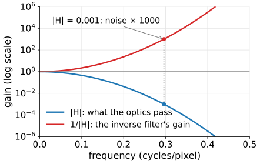
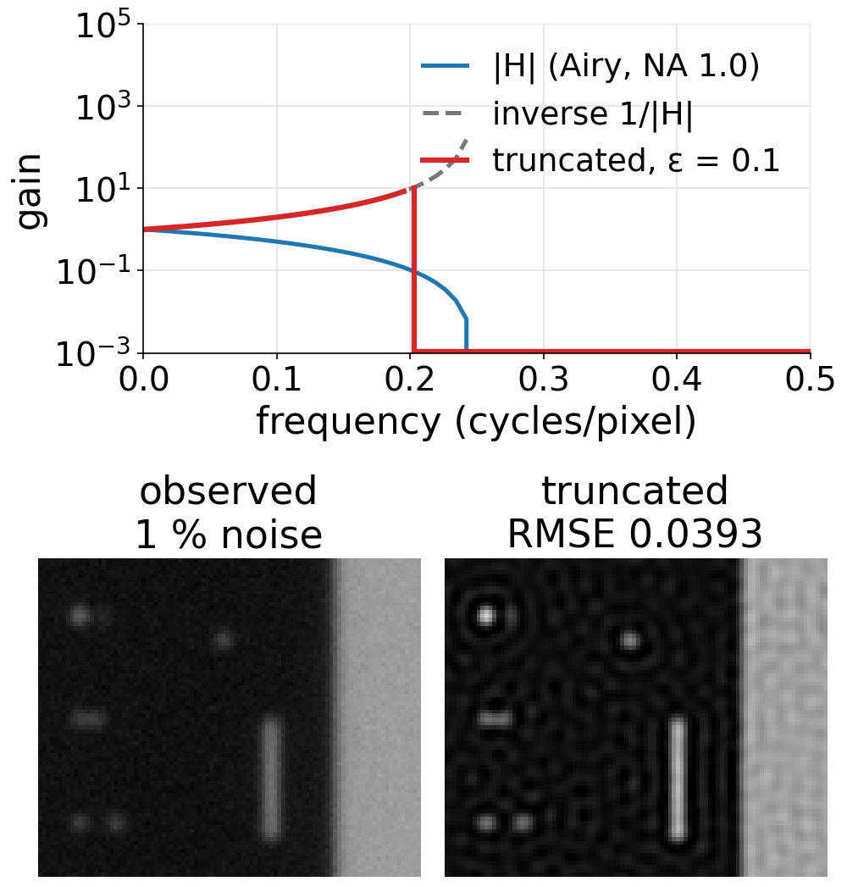
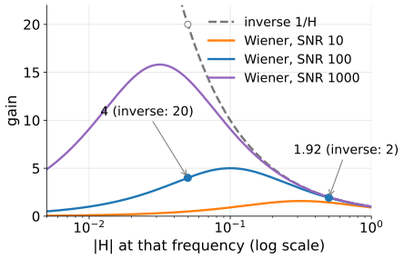
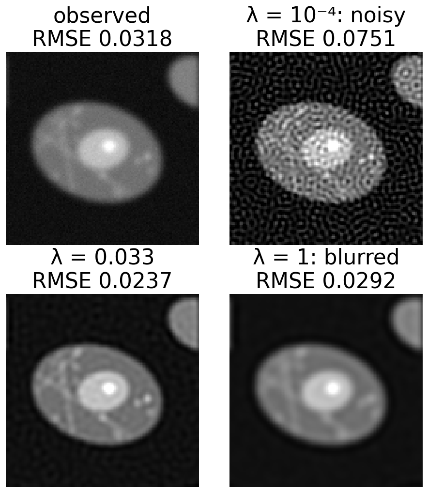
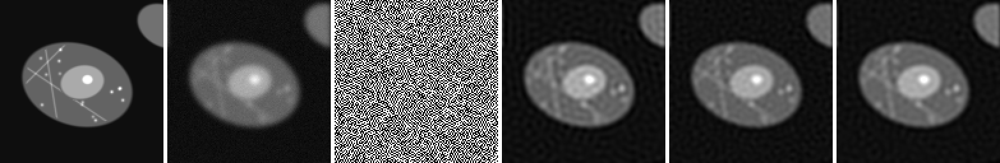
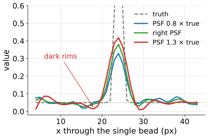
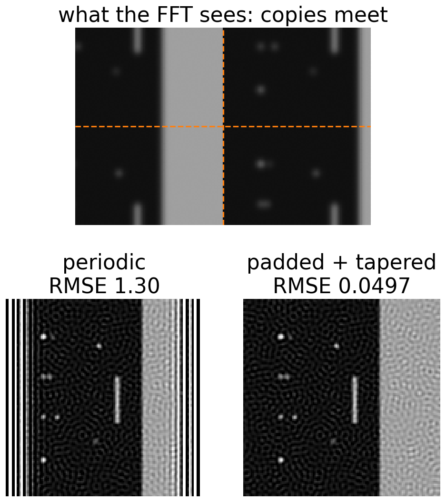

## About this lecture

The image formation day ended with a problem: dividing by the transfer function undoes the blur exactly without noise, and explodes with it. Today's answer, in three steps:

- **Give up** where the data are hopeless: the **truncated inverse**.
- **Trust each frequency** as much as its signal-to-noise ratio allows: the **Wiener filter**.
- Say what we believe about the object as a **penalty**: **Tikhonov** regularisation.
- Read every method as a **gain curve**, and predict the image from it.
- Practicalities: the right PSF, and what the FFT does at the borders.

*Slides titled **The math** give the formulas and proofs; the ideas are complete without them.*

::: notes
First unit of the deconvolution day (day 5). It recalls the forward model, the OTF and the diagnosis "inversion is ill-posed" from the image formation day (day 4) in one slide and does not re-teach them. Notation: g = observed image, f = object, h = PSF, H = OTF (its Fourier transform), n = noise with standard deviation σn; λ = regularisation weight, as everywhere in the course. Not to be confused: "colour deconvolution" of stained slides (spectral unmixing elective) is unrelated despite the name.

Teacher note (not on a slide): simulating and restoring with the same discrete PSF on a periodic image is the "inverse crime" and flatters every method. The demo's "realistic blur" option blurs a wider scene on a twice finer grid, so blur reaches in from outside the field and the PSF is not exactly the discrete one used for restoration.
:::

## Yesterday: dividing by $H$

From the image formation day: the observed image is the object blurred by the PSF, plus noise, $g = h \ast f + n$. In Fourier space each frequency is multiplied by the OTF: $G = H F + N$.

:::: {.columns}
::: {.column width="52%"}
- **Inverse filter**: $\hat F = G / H = F + N/H$. Without noise: perfect.
- Where $|H|$ is small, $N/H$ is huge: noise of 0.1 % at a frequency with $|H| = 0.001$ becomes 100 %.
- Beyond the cut-off $H = 0$: there is nothing to divide by, and no method can bring those frequencies back.
:::
::: {.column width="48%"}
{width="100%"}
:::
::::

**What must we add?** Knowledge about the noise and about the object. Today: how, and (next unit) how much.

::: notes
Recall only (owner: image formation day, unit "ill-posed"). The demo in inverse-only mode is the same one the image formation day used; here we go straight to the full demo. Gaussian σ = 2 px, phantom, σn = 0.1 % of the peak: RMSE of the inverse filter about 10⁶, half the pixels negative.
:::

## Give up where the data are hopeless

**Truncated inverse**: divide only where $|H| > \varepsilon$; set every other frequency to 0.

:::: {.columns}
::: {.column width="55%"}
- The simplest regularisation: frequencies the optics barely pass are dropped, not amplified.
- **ε small**: noisy (weak frequencies still amplified up to $1/\varepsilon$). **ε large**: blurred (good frequencies dropped too).
- Price: the cut in frequency is **sharp**, and a sharp cut in frequency is a sinc in space (the Fourier unit): **ringing**, ripples parallel to every edge and around every bright spot.

Example, ε = 0.1: gains $1/H$ for $H = 1, 0.5, 0.2$ are $1, 2, 5$; for $H = 0.1$ and below the gain is 0.
:::
::: {.column width="45%"}
{width="86%"}
:::
::::

## Trust each frequency as much as its SNR allows

:::: {.columns}
::: {.column width="54%"}
The **Wiener filter** multiplies frequency $f$ by

$$W(f) = \frac{H^*(f)}{|H(f)|^2 + 1/\mathrm{SNR}(f)}$$

($H^*$: complex conjugate; for a symmetric PSF $H$ is real and $H^* = H$).

- Where signal ≫ noise ($|H|^2 \gg 1/\mathrm{SNR}$): $W \approx 1/H$, invert.
- Where noise ≫ signal: $W \approx H\cdot\mathrm{SNR} \to 0$, damp.
- In between a smooth roll-off: much less ringing than a sharp cut.
:::
::: {.column width="46%"}
{width="100%"}
:::
::::

With SNR = 100: $H = 0.5$ gives $0.5/(0.25 + 0.01) = 1.92$ (the inverse: 2). $H = 0.05$ gives $0.05/(0.0025 + 0.01) = 4$ instead of 20.

## The math: the Wiener filter {.math}

Model per frequency: $G = HF + N$ with $F$ and $N$ independent, zero mean, powers $S_f = E|F|^2$ and $S_n = E|N|^2$. Find the linear estimate $\hat F = WG$ with the smallest expected error:

$$E|F - WG|^2 = |1 - WH|^2 S_f + |W|^2 S_n .$$

Setting the derivative with respect to $W^*$ to zero: $-(1 - WH)H^* S_f + W S_n = 0$, so

$$W = \frac{H^* S_f}{|H|^2 S_f + S_n} = \frac{H^*}{|H|^2 + S_n/S_f}, \qquad \mathrm{SNR}(f) = S_f/S_n .$$

The error that remains at each frequency is $\dfrac{S_f S_n}{|H|^2 S_f + S_n}$: about $S_n/|H|^2$ where the signal dominates, and $S_f$ (the whole signal is lost) where the noise dominates.

## What Wiener needs to know

The filter needs the **noise power** and the **signal power** at every frequency.

:::: {.columns}
::: {.column width="55%"}
- Noise: the camera noise unit (day 3) showed how to measure it: σn from offset frames or a flat region. White noise has the same power $S_n = \sigma_n^2$ at every frequency (per pixel).
- Signal: not known exactly; it is a **model**. Natural and microscope images have power falling roughly like $1/f^2$: strong at low frequencies, weak at high ones.
- So the SNR falls with frequency even where $H$ does not. A **flat** model (one SNR for all frequencies) is a compromise: the best single value is the SNR at the frequencies that matter, not the image's overall SNR.
:::
::: {.column width="45%"}
{width="100%"}
:::
::::

## Try it: Wiener and the gain curve

```{=html}
<link rel="stylesheet" href="../demos/dist/demo.css">
<div data-demo="deconvlab" data-preset="wiener" data-presets="explode,truncated,wiener,wrongsnr,f2,motion"></div>
<script src="../demos/dist/deconvlab.js"></script>
```

::: notes
Cell phantom, Gaussian σ = 2 px, σn = 1 %. Tour: "0.1% noise: inverse explodes" (RMSE 1.0e6, the red gain curve shoots up past 10⁴). "Truncated inverse: ringing" (beads + edge, Airy NA 1.0, ε = 0.1: RMSE 0.0393; ripples next to the edge and around the beads). "Wiener at the right SNR": SNR 45 is the best on the sweep, RMSE 0.0244 against 0.0318 for the observed image. Point at the readout: the image's true SNR (mean truth² / σn²) is 537, far from 45: the best flat SNR is a compromise. "Wiener with the wrong SNR" (2000): fine dots everywhere, RMSE 0.0641, 14 % negative pixels. "1/f² beats flat" on the motion-blurred star: 0.0714 against 0.0817 for the best flat SNR (161). "Motion blur": the blue curve (cut along x) has deep dips; Wiener sets the gain to almost zero there instead of dividing.
:::

## Fit the data, but not too wildly: Tikhonov

:::: {.columns}
::: {.column width="60%"}
Choose the image $x$ that minimises

$$\underbrace{\|A x - g\|^2}_{\text{misfit: blur } x\text{, compare with the data}} \;+\; \lambda\,\underbrace{\|D x\|^2}_{\text{penalty}}$$

- **Energy penalty** ($D$ = identity): prefer small values. **Roughness penalty** ($D$ = the Laplacian of the filtering unit): prefer smooth images.
- **λ small**: the misfit wins, noise is fitted: noisy. **λ large**: the penalty wins: blurred.
- With the energy penalty Tikhonov **is** Wiener with a flat spectrum, $\lambda = 1/\mathrm{SNR}$. With the roughness penalty the damping grows with frequency, like Wiener with a $1/f^2$ signal model.
- The pattern "data term + λ · penalty" is the general recipe of regularisation (next unit).
:::
::: {.column width="40%"}
{width="92%"}
:::
::::

## The math: Tikhonov {.math}

Minimise $\|A\mathbf x - \mathbf g\|^2 + \lambda\|D\mathbf x\|^2$. The gradient is $2A^\top(A\mathbf x - \mathbf g) + 2\lambda D^\top D\mathbf x$; setting it to zero gives the **normal equations**

$$(A^\top A + \lambda D^\top D)\,\mathbf x = A^\top \mathbf g .$$

For a circular blur and a circular $D$ every matrix is diagonal in the Fourier basis ($A \to H$, $A^\top \to H^*$, $D \to \hat D$), so each frequency is solved on its own:

$$\hat X(f) = \frac{H^*(f)\,G(f)}{|H(f)|^2 + \lambda|\hat D(f)|^2}.$$

- Equal to Wiener when $\lambda|\hat D|^2 = S_n/S_f$; energy penalty: $\hat D = 1$, so $\lambda = 1/\mathrm{SNR}$.
- At $f = 0$ ($H(0) = 1$): energy penalty gain $1/(1 + \lambda)$, the mean shrinks. The Laplacian has $\hat D(0) = 0$ (it kills constants), so the roughness penalty has gain exactly 1 at $f = 0$: **it keeps the mean**.

## A two-pixel blur by hand

The two-pixel blur of the image formation day: $A = \begin{bmatrix} 0.75 & 0.25 \\ 0.25 & 0.75 \end{bmatrix}$. It keeps the **sum** of the pixels (gain 1) and halves their **difference** (gain 0.5). Data $\mathbf g = (1, 0.5)$: sum part $(0.75, 0.75)$, difference part $(0.25, -0.25)$.

Tikhonov with the energy penalty multiplies each part by $s/(s^2 + \lambda)$ ($s$ = its gain):

| λ | sum gain | difference gain | $\hat{\mathbf x}$ |
|---|---|---|---|
| 0 (inverse) | 1 | 2 | $(1.25, 0.25)$ |
| 0.1 | 0.909 | 1.43 | $(1.04, 0.33)$ |
| 1 | 0.5 | 0.4 | $(0.48, 0.28)$ |

Larger λ: the difference is restored less (smoother), and the sum shrinks too (the energy penalty pulls everything towards 0).

## Three ways to read a restoration

{width="100%"}

- **Gain curve** $|W(f)|$: how much of each frequency the filter keeps or amplifies.
- **Effective transfer** $|W H|$: what optics + restoration together pass. Wider than the optics alone, never beyond the cut-off.
- **The image**: predict it from the curves. A gain peak at high frequencies means fine dots; a sharp drop means ringing; an early roll-off means blur.

::: notes
The numbers of the figure (RMSE against the truth, image values 0..1): observed 0.0318, inverse 1.0e7, truncated 0.0250, Wiener 0.0244, Tikhonov roughness 0.0237. Ask the class to predict, from the three curves of the demo, which image belongs to which method before showing the figure.
:::

## Try it: Tikhonov, wrong PSF, borders

```{=html}
<link rel="stylesheet" href="../demos/dist/demo.css">
<div data-demo="deconvlab" data-preset="toomuch" data-presets="toomuch,tikwiener,rough,wrongpsf,border"></div>
<script src="../demos/dist/deconvlab.js"></script>
```

::: notes
"Too much regularisation": Tikhonov energy λ = 0.1, RMSE 0.0341, worse than the observed image (0.0318); the mean drops from 0.1575 to 0.1432 (the factor 1/(1 + λ) = 0.909). "Tikhonov = Wiener": λ = 1/45 gives exactly the RMSE of Wiener SNR 45 (0.0244). "Roughness penalty": λ = 0.033, RMSE 0.0237, mean kept. "Wrong PSF width" (×1.3, beads, Wiener SNR 85): dark rims around the beads (the darkest pixel near the single bead is −0.028 against a background of 0.05). Move "PSF used" to 0.8: no rims, but the beads stay blurred. "Periodic borders ring": the scene continues past the border; with periodic borders the RMSE is 1.30 and stripes run across the image from the edge. Switch to "padded + tapered": 0.0497.
:::

## Practicalities: the PSF

:::: {.columns}
::: {.column width="52%"}
- The PSF must be **right**: about 20 % too wide gives over-sharpening, dark rims (halos) and ringing; too narrow leaves blur. Unit 3 treats this fully.
- Sampled at least at **Nyquist** (the image formation day): otherwise the blur is not a convolution of the pixels you have.
- Normalised to **sum 1**, so that the restoration keeps the total intensity.
- Measured (beads) or computed; measured PSFs are noisy and need care.
:::
::: {.column width="48%"}
{width="100%"}
:::
::::

## Practicalities: borders

FFT methods treat the image as **periodic**: the right edge continues at the left.

:::: {.columns}
::: {.column width="57%"}
- A bright object at the right edge "leaks" to the left in the model, and a jump in brightness between the left and right edges looks like a sharp edge to restore: **ringing** stripes from the border inwards.
- In the real image the blur came in from **outside** the field of view, which the periodic model cannot know.
- Fix: **pad** the image (continue its edge values) and **taper** to the mean towards the middle of the padding, so the periodic copies meet smoothly; restore; crop. This is the "wrap" border rule of the filtering unit, and how to avoid it.
:::
::: {.column width="43%"}
{width="80%"}
:::
::::

## Summary

- The inverse filter $1/H$ is exact without noise and useless with it; beyond the cut-off nothing can be restored.
- **Truncated inverse**: drop frequencies with $|H| < \varepsilon$; simple, but the sharp cut rings.
- **Wiener**: gain $H^*/(|H|^2 + 1/\mathrm{SNR})$; inverts where the signal is strong, damps where noise dominates; needs a signal and noise model ($1/f^2$ is better than flat).
- **Tikhonov**: minimise misfit + λ · penalty; energy penalty = Wiener with a flat spectrum; roughness penalty keeps the mean and damps high frequencies more.
- Read a method by its **gain curve** and its **effective transfer**; predict the image from them.
- Use the right PSF (sum 1, Nyquist), and **pad and taper** the borders.
