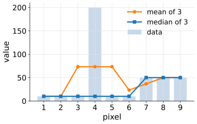
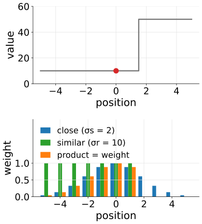
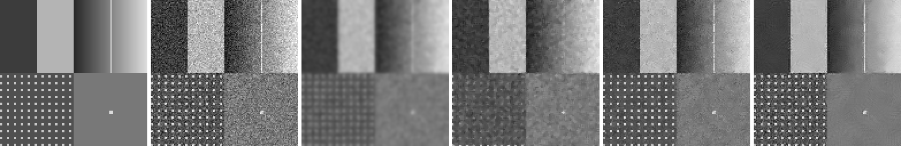
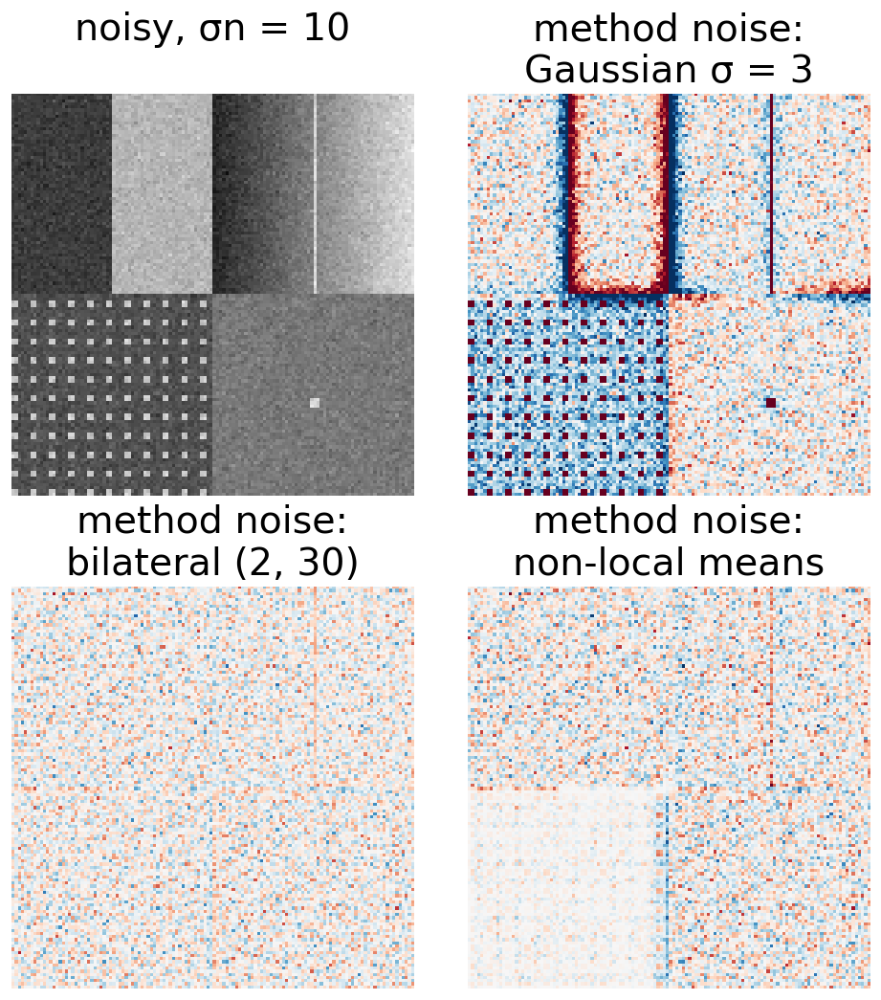

## About this lecture

Two questions to end the day:

- When there is **nothing to un-blur**, only noise: the classical **denoisers**, each judged by **what it destroys**.
  - Gaussian, **median**, **bilateral**, **non-local means**; Wiener with no blur.
  - The **method noise** check: what did the filter remove?
- A restored image is an **estimate**: which **measurements** survive restoration (total intensity), which do not (peaks, sizes, separations, counts), and what to report.

*Slides titled **The math** give the formulas and proofs; the ideas are complete without them.*

::: notes
Last unit of the deconvolution day. The median is introduced here as a denoiser (course map); the morphology day places it among the rank filters (min, median, max), and the thresholding day recalls it in one line. Noise models, PSNR and its peak: camera noise unit (day 3). All PSNR values here use peak 255 (8-bit grey levels). Statistics of measurements belong to the evaluation day (day 16).
:::

## Nothing to un-blur

With PSF = a single point ($H = 1$), Wiener and Tikhonov become **denoisers**: gain $1/(1 + 1/\mathrm{SNR}(f))$, a low-pass filter chosen by the SNR per frequency.

Classical denoisers differ in **what they average**:

| method | averages over | keeps | destroys |
|---|---|---|---|
| Gaussian | neighbours, by distance | nothing in particular | edges and noise alike |
| median | the middle value of the window | steps, against outliers | thin lines, corners |
| bilateral | neighbours that are close **and similar** | edges | ramps (cartoon), detail at the noise level |
| non-local means | pixels whose whole **patch** looks similar, anywhere nearby | repeated texture | unique fine detail |

## Gaussian and median

:::: {.columns}
::: {.column width="58%"}
**Gaussian**: a weighted mean of the neighbours (the filtering unit). Linear: noise and edges are averaged alike, so every edge is blurred.

**Median** (a rank filter): sort the values in the window and take the middle one.

- The **outlier** 200 vanishes; the **step** 10 → 50 stays sharp. The mean smears both.
- But a line **thinner than half the window** is a minority in every window and disappears; corners are rounded.
:::
::: {.column width="42%"}
{width="92%"}
:::
::::

Row $(10, 10, 10, 200, 10, 10, 50, 50, 50)$, window 3 (edges mirrored):

| | | | | | | | | | |
|---|---|---|---|---|---|---|---|---|---|
| mean | 10 | 10 | 73.3 | 73.3 | 73.3 | 23.3 | 36.7 | 50 | 50 |
| median | 10 | 10 | 10 | 10 | 10 | 10 | 50 | 50 | 50 |

## The math: the median minimises the absolute deviation {.math}

The mean minimises the sum of **squared** deviations $\sum_i (x_i - m)^2$; the median minimises the sum of **absolute** deviations

$$\operatorname*{arg\,min}_m \sum_i |x_i - m| .$$

- The derivative of $\sum_i|x_i - m|$ with respect to $m$ is $(\#\{x_i < m\}) - (\#\{x_i > m\})$: zero (changing sign) when as many values lie below $m$ as above it, the median.
- An outlier moved from 200 to 2000 changes the squared cost hugely (and pulls the mean), but only adds to one side of the count: the median does not move.
- This is the $\ell^1$ versus $\ell^2$ difference that also separates total variation from the roughness penalty (last unit).

## Bilateral: close and similar

:::: {.columns}
::: {.column width="58%"}
Average the neighbours, but weight each by how **close** it is (σs, pixels) **and** how **similar** its value is (σr, grey levels):

$$w_{pq} = e^{-\|p - q\|^2/2\sigma_s^2}\; e^{-(I_p - I_q)^2/2\sigma_r^2} .$$

- Across an edge the neighbours on the other side are dissimilar and get almost no weight: the edge stays sharp.
- Three pixels 10, 10, 50 around a centre of 10, σr = 10: the 50 gets $e^{-40^2/(2 \cdot 10^2)} = e^{-8} = 0.0003$ of the weight of a 10.
- Fails when the **noise ≈ the edge height**: noise then looks like edges and is kept, or σr is raised and edges blur. Large σr on a noisy ramp gives flat patches: a **cartoon**.
:::
::: {.column width="42%"}
{width="90%"}
:::
::::

## Non-local means: similar patches

Average pixels whose whole **patch** (say 3 × 3 or 5 × 5 around them) looks like the patch around the pixel being denoised, **wherever** they lie in a search window:

- Repetitive structure (a lattice, a texture, many similar cells) finds many good matches: strong averaging without blurring the pattern.
- **Unique** fine detail has no match; with a large $h$ (tolerance), it is averaged with dissimilar patches and fades.
- Cost: (search window) × (pixels), with box sums for the patch distances.

{width="100%"}

## The math: bilateral and non-local means weights {.math}

Both are weighted means $\hat I_p = \sum_q w_{pq} I_q \big/ \sum_q w_{pq}$, with different weights:

- **Bilateral**: $w_{pq} = \exp\!\big(-\|p - q\|^2/2\sigma_s^2\big)\exp\!\big(-(I_p - I_q)^2/2\sigma_r^2\big)$ over a window of radius about $2\sigma_s$.
- **Non-local means**: $w_{pq} = \exp\!\big(-d^2(P_p, P_q)/h^2\big)$, with $d^2$ the mean squared difference of the patches $P_p$, $P_q$, over a search window.
- Per-offset computation: for each offset $\delta$ in the search window, the squared differences $(I_r - I_{r + \delta})^2$ are summed over every patch with an integral image; the cost does not depend on the patch size.
- With noise σn, even identical patches differ by $d^2 \approx 2\sigma_n^2$; so $h$ must be of the order of σn or larger.

## Beyond these four

- **Total variation** denoising: the TV penalty of the last unit with $H = 1$; keeps steps, staircases ramps (the Ising/MRF elective).
- **Wavelet shrinkage**: a sparsity penalty, small coefficients set to zero (the wavelets elective).
- **Poisson noise** depends on the signal: either use a method that knows it (Richardson–Lucy, Poisson data terms), or transform the image so the noise variance becomes constant first (camera noise unit).
- **Learned restoration**: networks trained on noisy/clean pairs, or even on single noisy images, now beat all of these. Trained to "look right", they can **invent** structure that was never in the data. The modern deep learning day shows when, with Wiener from this day as the honest baseline.

## Method noise: what did the filter remove?

**Method noise** = noisy − denoised. If the filter removed only noise, it looks like **pure noise**: no structure.

:::: {.columns}
::: {.column width="55%"}
- An **edge**, a **line** or the **lattice** visible in the method noise = signal the filter removed.
- Gaussian σ = 3 on the test image (σn = 10): the method noise has RMS 9.9 in flat regions (≈ σn, fine) but jumps to +72 and −58 at the step: the edge was blurred away.
- PSNR against a clean truth needs the truth; the method noise needs only the noisy image. Use it on real data.
:::
::: {.column width="45%"}
{width="72%"}
:::
::::

## Try it: denoisers

```{=html}
<link rel="stylesheet" href="../demos/dist/demo.css">
<div data-demo="denoisers" data-preset="gaussstep" data-presets="gaussstep,sp,line,bilateral,cartoon,nlm,spot,methodnoise,psnr"></div>
<script src="../demos/dist/denoisers.js"></script>
```

::: notes
PSNR (peak 255) noisy → denoised. "Gaussian blurs the step" (σn 20, σ 2): 22.1 → 21.6 dB, worse than doing nothing, because the lattice is wiped out; the best Gaussian σ is only 0.6 (25.8 dB). "Salt and pepper" (10 % of the pixels 0 or 255): median 3 × 3 15.3 → 22.7 dB, Gaussian σ 1: 21.9 dB, with grey smudges. "Median eats the thin line" (5 × 5, σn 5): the line pixel at (96, 32) drops from 211 to 133; PSNR falls from 34.1 to 21.6 dB. "Bilateral keeps edges" (σn 15, σs 2, σr 30): 33.7 dB, Gaussian σ 2: 21.7 dB. "Cartoon" (σn 50, σr 100): flat patches on the ramp. "Non-local means on texture" (σn 25, patch 3 × 3, search 15 × 15, h 25): 29.5 dB overall, 26.7 dB on the lattice quarter against 23.2 for bilateral. "Smears the unique spot" (patch 5 × 5, h 45): the spot falls from 220 to 129. "Method noise shows the removed edge". "Best PSNR, wrong look" (micrograph crop, σn 25): Wiener SNR 3 23.4 dB, bilateral (1.5, 50) 23.3 dB: the PSNR prefers the blurred Wiener result by a hair.
:::

## A restored image is an estimate

- It depends on the **PSF**, the **method**, λ or the **stopping point**. Change any of them and the image changes.
- It improves **contrast** and **separation**, but cannot recover what lies beyond the cut-off (image formation day: invisible objects stay invisible).
- Its noise is no longer independent between pixels, and no longer Poisson: the camera noise unit's rules for error bars do not apply to it.
- So: what happens to the numbers we measure on it?

{width="92%"}

## What happens to measurements

| measurement | after restoration | why |
|---|---|---|
| **total intensity** over a region larger than the PSF | **kept** (RL exactly; roughness-penalised Tikhonov exactly; Wiener and energy-penalised Tikhonov slightly shrink it) | flux is the $f = 0$ coefficient |
| **peak** intensity | **rises**, non-linearly, and depends on the iterations | light is moved into the centre |
| **size** (FWHM) near the resolution limit | **shrinks** with iterations to a **floor** set by the method, not by the object | restoration stops at the noise |
| **separation** of close objects | **biased**, most when the dip between them is weak | |
| **counts** of objects | speckles and split objects **add**, ringing adds rims | |

In the demo (spots of flux 1 : 4, 3000 photons): RL after 100 iterations gives an integrated ratio of 4.00 but a peak ratio of 6.20; the raw image gives 3.86 and 4.13.

## The math: flux preservation {.math}

**RL**: $\sum_j x_j^{\text{new}} = \sum_j x_j\sum_i A_{ij}\frac{y_i}{(A\mathbf x)_i} = \sum_i \frac{y_i}{(A\mathbf x)_i}\sum_j A_{ij}x_j = \sum_i y_i$, every iteration (no background).

**Linear filters**: the total intensity is the $f = 0$ Fourier coefficient, $\hat X(0) = \sum_j x_j$, and the filter multiplies it by its gain at $f = 0$ (with $H(0) = 1$):

- Wiener: $\dfrac{1}{1 + 1/\mathrm{SNR}(0)}$, slightly below 1;
- Tikhonov, energy penalty: $\dfrac{1}{1 + \lambda}$;
- Tikhonov, roughness penalty: 1 exactly ($\hat D(0) = 0$).

Over a region rather than the whole image, flux is kept only approximately: light moves across the region's boundary by about the PSF's width, so the region must be larger than the PSF.

## Try it: what may be measured

```{=html}
<link rel="stylesheet" href="../demos/dist/demo.css">
<div data-demo="rlsteps" data-mode="measure" data-preset="integrals"></div>
<script src="../demos/dist/rlsteps.js"></script>
```

::: notes
A field with known truth, Airy PSF NA 1.0 (Rayleigh distance 4.88 px): top row, bead pairs at 0.8, 1.0, 1.2 and 1.5 × Rayleigh; middle, spots of flux 1 : 2 : 4; bottom, disks. The table compares raw, restored and truth; green within 10 %, yellow within 30 %, red worse. Tour (RL): "integrals hold" (3000 photons, k = 100): integrated ratio 4.00, peak ratio 6.20. "Peaks lie" (k = 316): peak ratio 6.53, integral 3.97. "Sizes shrink to a floor" (k = 1000): FWHM 1.93 px (raw 4.51, truth 1.45): it stops shrinking around 1.9 whatever the object. "Close pairs" (1000 photons, k = 100): the 1.2 × Rayleigh pair is 4.95 px apart in the raw image (truth 5.92), 5.85 after RL. "Extra spots" (1000 photons, k = 1000): 259 local maxima above the threshold instead of 11. "Wiener" (SNR 300): integral 4.27, peak 3.66, FWHM 3.53.
:::

## What to do, and what to report

- **Segment or detect** on the restored image if it helps (better contrast, separated objects).
- **Measure intensities on the raw image** (offset- and flat-field-corrected), inside the masks found.
- **Validate** any measurement made on restored data with a known-truth test: beads, a phantom, the same microscope and noise.
- **Report** the method, the PSF (measured or computed), λ or the number of iterations; show the raw data next to the result.
- **Never compare** images restored with different settings, and keep the raw data.
- Error bars and statistics of measurements: the evaluation day.

## Summary

- With $H = 1$, Wiener and Tikhonov are low-pass **denoisers**. Gaussian blurs edges; **median** removes outliers, keeps steps, eats thin lines; **bilateral** keeps edges, cartoons at high noise; **non-local means** loves repetition, smears unique detail.
- **Method noise** (noisy − denoised) should look like pure noise; structure in it is removed signal.
- Learned restoration is better and can invent structure (modern deep learning day).
- A restored image is an **estimate**: **total intensity** over a region larger than the PSF is kept; **peaks**, **sizes**, **separations** and **counts** change with the method and the stopping point.
- Detect on the restored image, **measure on the raw**, validate with known truth, report everything.
