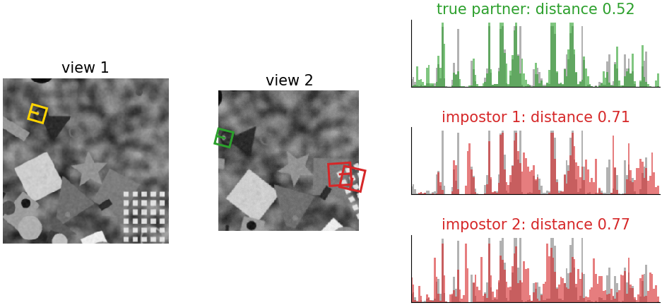
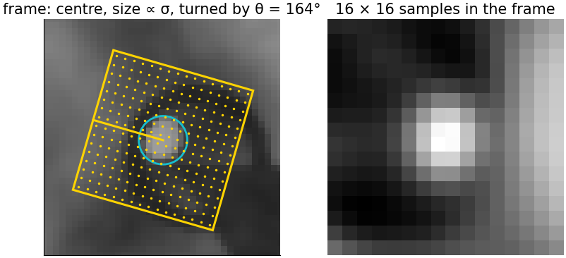
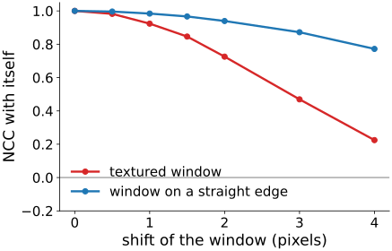
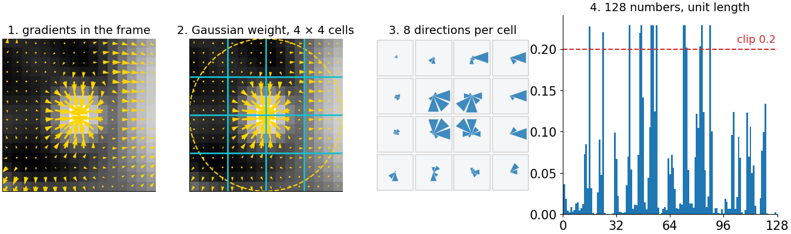
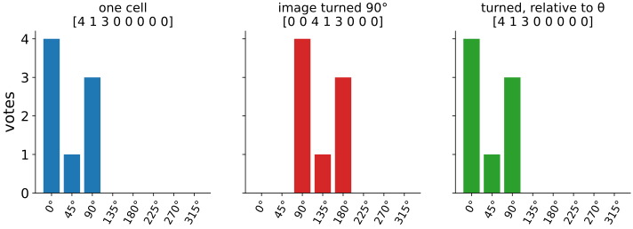
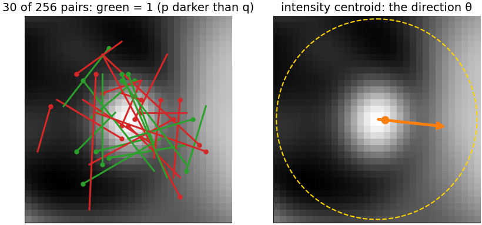
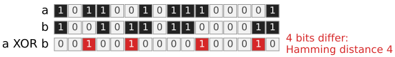
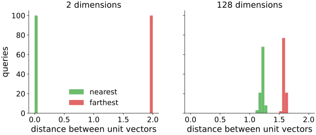
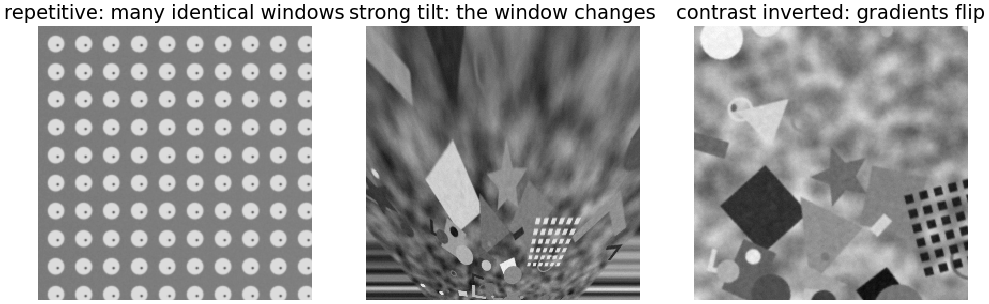

## About this lecture

The [previous unit](../keypoints/lec.qmd) found keypoints, each a small frame $(x, y, \sigma, \theta)$. Now we turn the window around each keypoint into a **vector**, so that the same physical point gives nearby vectors in both images.

- **Invariance by normalisation**: read the window in the keypoint's frame.
- The simplest descriptor: the **normalised patch**.
- **Gradient histograms**: 4 × 4 cells × 8 directions = 128 numbers.
- **Binary descriptors**: 256 intensity comparisons, compared by the Hamming distance.
- **Distances**, trade-offs, and where descriptors fail.

*Slides titled **The math** give the formulas and proofs; the ideas are complete without them.*

::: notes
This unit owns local descriptors for the course (gradient histograms, binary descriptors, invariance by normalisation, descriptor distances). The geometry day's [two-view unit](../two-view/lec.qmd) and a future window-detector (HOG) unit recall it. A descriptor is a vector d (or a bit string b); the demo descriptorlab shows every step.
:::

## The job of a descriptor

{fig-alt="Left: view 1 with one keypoint's window (yellow square). Middle: view 2 with the window of the true partner (green) and of two impostors (red). Right: three 128-bar plots comparing the descriptor of view 1 (grey) with the partner's (green, distance 0.52) and with the impostors' (red, distances 0.71 and 0.77)." width="92%" fig-align="center" .nostretch}

The same point in two views → **nearby** vectors (here distance 0.52); different points → **distant** vectors (0.71, 0.77). Matching ([next unit](../feature-matching/lec.qmd)) only compares vectors.

## Invariance by normalisation

:::: {.columns}
::: {.column width="55%"}
{fig-alt="Left: a keypoint in view 1 with its frame: a square rotated by theta = 164 degrees, side proportional to sigma, filled with a 16 by 16 grid of sample points, and a circle of radius 2 sigma. Right: the 16 by 16 patch sampled in this frame." width="100%"}
:::
::: {.column width="45%"}
The central idea of the day: the frame $(x, y, \sigma, \theta)$ is **measured**, so we sample the window **in that frame**:

- centred at $(x, y)$,
- size proportional to σ,
- turned by θ.

Translation, zoom and rotation are gone **before** anything is computed. What is left for the descriptor to tolerate: **lighting**, small errors in the frame, small deformations, noise.
:::
::::

## The simplest descriptor: the normalised patch

:::: {.columns}
::: {.column width="52%"}
Resample a 16 × 16 patch in the frame, subtract its mean, divide by its length: compare two patches by the dot product, the **normalised cross-correlation** (NCC; owned by the [template matching unit](../matching/lec.qmd)).

- Insensitive to **gain and offset** (brightness and contrast).
- But every number depends on the exact position: shift a textured window by 2 px and the NCC with itself drops to **0.73**, by 3 px to 0.47 (right, red).
- A window on a straight edge stays similar along the edge (blue): not distinctive.
:::
::: {.column width="48%"}
{fig-alt="NCC of a 17 by 17 window with itself shifted by 0 to 4 pixels: a textured window falls from 1 to 0.92 at 1 px, 0.73 at 2 px, 0.47 at 3 px and 0.22 at 4 px; a window on a straight edge stays above 0.77." width="100%"}
:::
::::

## Gradient histograms, step by step

{fig-alt="Four panels: 1. a keypoint's 16 by 16 window with gradient arrows; 2. the same with a Gaussian weight (dashed circle) and a 4 by 4 grid of cells; 3. the descriptor as 16 small roses with 8 petals each; 4. the 128 numbers as bars, with the clip level 0.2 dashed." width="100%"}

1. Gradients in the window, in the keypoint frame, weighted by a Gaussian (the centre counts more; frame errors matter most at the rim).
2. **4 × 4 cells**; in each, a histogram of gradient directions in **8 bins** of 45°. Each vote is shared between neighbouring bins and cells (soft binning).
3. Concatenate: 4 × 4 × 8 = **128 numbers**. 4. **Normalise** to length 1, **clip** at 0.2, normalise again.

## Why it works

- Within a cell, **where** exactly a gradient sits does not matter: small shifts and deformations change little. **Which way** it points does matter: the histogram keeps the shape.
- Gain multiplies all gradients: removed by normalising; an offset does not change gradients at all. Clipping at 0.2: one bright highlight cannot dominate.
- The same idea as the complex cells of the visual cortex: an oriented response, pooled over a small area.

{fig-alt="Three bar charts of an 8-bin cell histogram: the original [4 1 3 0 0 0 0 0]; after turning the image by 90 degrees [0 0 4 1 3 0 0 0]; turned but measured relative to the keypoint orientation, [4 1 3 0 0 0 0 0] again." width="80%" fig-align="center" .nostretch}

One cell's four gradients give [4, 1, 3, 0, 0, 0, 0, 0]; turning the image by 90° shifts the histogram by two bins; measured relative to θ it is the same again.

## The math: invariance and soft binning {.math}

- **Affine intensity change** $I' = aI + b$, $a > 0$: $\nabla I' = a\nabla I$, so every gradient direction is unchanged and every magnitude is multiplied by $a$. Every histogram entry scales by $a$; dividing by the length removes $a$; $b$ never appears. With $a < 0$ (contrast inversion) every direction turns by 180°: the descriptor changes completely.
- **Clipping** makes the vector approximately invariant to non-linear changes that affect a few large gradients (saturation, gamma).
- **Soft (trilinear) binning**: a gradient of magnitude $m$ at continuous cell coordinates $(u, v)$ and bin coordinate $o$ adds $m\,(1 - |u - u_i|)(1 - |v - v_j|)(1 - |o - o_k|)$ to the 8 surrounding bins $(i, j, k)$; the descriptor is then a continuous function of the frame.
- **Rotation**: sample at $\mathbf x_0 + \sigma R(\theta)\mathbf u$ and measure gradient angles in the frame; turning the image by φ changes θ by φ and leaves the descriptor unchanged up to resampling.

## Try it: a descriptor, step by step

```{=html}
<link rel="stylesheet" href="../demos/dist/demo.css">
<div data-demo="descriptorlab" data-preset="nearest"></div>
<script src="../demos/dist/descriptorlab.js"></script>
```

::: notes
View 2 = view 1 turned 25°, zoomed 1.2×, noise 2. The selected keypoint at (53, 54): its true partner is the nearest of 151 descriptors (d1 = 0.52, d2 = 0.71, ratio 0.73); over all keypoints with a partner, the nearest is the partner for 66 of 79 (84 %). Tour: "rotate 90° without θ: lost" (the partner drops to rank 20, overall 2 %), "with θ: found again" (rank 1, overall 96 %). "Gain ×3: normalising fixes it": without normalisation 0 %, with 80 %. Strip at the bottom: distances to all descriptors of view 2, sorted; the green dot is the true partner.
:::

## Binary descriptors

:::: {.columns}
::: {.column width="52%"}
Compare intensities at **pairs of points** in a smoothed patch: bit $b_i = 1$ if $I(\mathbf p_i) < I(\mathbf q_i)$.

- 256 fixed pairs (chosen once, at random with a seed, or learned to be uncorrelated) → **256 bits = 32 bytes**.
- Only the **order** of two intensities matters: invariant to **any increasing** change of intensity.
- Rotation: turn the pattern by θ, with θ from the **intensity centroid** (the direction from the keypoint to the brightness-weighted centre of the patch; first moments, see [region properties](../regionprops/lec.qmd)).
- Smooth first: single pixels are noisy, and a bit flips easily.
:::
::: {.column width="48%"}
{fig-alt="Left: a smoothed 32 by 32 patch with 30 point pairs drawn as segments, green where the first point is darker (bit 1), red otherwise. Right: the same patch with the intensity centroid (orange dot) and an arrow from the centre towards it: the orientation." width="100%"}
:::
::::

## Comparing descriptors: distances

:::: {.columns}
::: {.column width="55%"}
| descriptor | distance |
|---|---|
| gradient histogram | L2 (Euclidean); L1 or χ² weight small bins more |
| normalised patch | L2 (= NCC, see the math) |
| binary | **Hamming**: the number of differing bits |

The Hamming distance is an exclusive-or and a bit count: a few machine instructions per 64 bits, tens of times faster than 128 floating-point differences.
:::
::: {.column width="45%"}
{fig-alt="Two 16-bit strings a = 1011001011100001 and b = 1001011011000011 and their XOR 0010010000100010, whose four 1 bits are marked red: Hamming distance 4." width="100%"}
:::
::::

## The math: distances {.math}

- Unit vectors: $\|\mathbf a - \mathbf b\|^2 = \|\mathbf a\|^2 + \|\mathbf b\|^2 - 2\,\mathbf a\cdot\mathbf b = 2 - 2\,\mathbf a\cdot\mathbf b$. L2 and the cosine (for normalised patches: the NCC) give the same ranking.
- **Root descriptor**: L1-normalise ($\sum a_i = 1$), take square roots: $\|\sqrt{\mathbf a} - \sqrt{\mathbf b}\|^2 = 2 - 2\sum_i\sqrt{a_ib_i}$, the **Hellinger** distance between histograms, which weights small bins more.
- Hamming: $d_H(\mathbf a, \mathbf b) = \operatorname{popcount}(\mathbf a \oplus \mathbf b)$.
- Two unrelated binary descriptors with balanced bits differ in each bit with probability ½: $d_H \sim \mathrm{Binomial}(n, \tfrac12)$, mean $n/2$, standard deviation $\sqrt n/2$: **128 ± 8** for 256 bits. A true match at distance 40 lies $88/8 = 11$ standard deviations below.
- Intensity centroid: $m_{pq} = \sum x^py^q I(x, y)$ over a disc around the keypoint; $\theta = \operatorname{atan2}(-m_{01}, m_{10})$ (counter-clockwise on the screen, $y$ down).

## The math: distances in high dimensions {.math}

:::: {.columns}
::: {.column width="50%"}
For random unit vectors, the nearest and the farthest neighbour of a query among 400:

- in 2 dimensions: nearest at 0.01, farthest at 2.00;
- in 128 dimensions: nearest at **1.22**, farthest at **1.59**.

**Concentration of distances**: in many dimensions all distances look alike. So an absolute distance threshold separates good and bad matches badly, and the [next unit](../feature-matching/lec.qmd) compares the nearest with the **second nearest** instead.
:::
::: {.column width="50%"}
{fig-alt="Histograms of nearest and farthest neighbour distances of 100 random unit vectors among 400 others: in 2 dimensions near 0 and near 2; in 128 dimensions both lie between 1.1 and 1.65, close together." width="100%"}
:::
::::

## Trade-offs

| | gradient histogram | binary |
|---|---|---|
| size | 128 numbers (512 bytes as floats) | 256 bits (32 bytes) |
| compute and compare | slower | very fast (XOR + bit count) |
| distinctiveness | higher, more robust to blur and viewpoint | lower |
| lighting | gain and offset; clipping helps for others | any increasing change |
| typical use | accuracy: 3D reconstruction, registration in microscopy | speed: video, robots, phones |

In our demo, under a blur of σ = 2, the nearest descriptor is the true partner for 80 % (histogram) and 84 % (binary) of the keypoints; the binary descriptor has fewer keypoints with a partner (38 against 59).

## Try it: binary descriptors

```{=html}
<link rel="stylesheet" href="../demos/dist/demo.css">
<div data-demo="descriptorlab" data-preset="binary"></div>
<script src="../demos/dist/descriptorlab.js"></script>
```

::: notes
Binary mode: the smoothed 32 × 32 patch with 48 of the 256 pairs (green = bit 1), the bit string as a 16 × 16 grid, Hamming distances in the strip. The selected keypoint: partner at Hamming distance 4, the second nearest at 35 (ratio 0.11); 83 % of keypoints have their partner nearest. Tour: preset "repetitive grid: equally near impostors" (gradient histograms): the partner is only 7th of 574, the nearest is at 0.017 and the second at 0.020; only 6 % correct overall.
:::

## Where descriptors fail

{fig-alt="Three images: a regular array of identical wells; the synthetic scene seen with a strong tilt, the window content squeezed; the scene with its contrast inverted, bright and dark swapped." width="90%" fig-align="center" .nostretch}

- **Repetitive texture**: distinctive locally, not globally (many identical windows).
- **Strong viewpoint change**: the window content itself changes.
- **Another modality** (fluorescence vs brightfield, light vs electron microscopy): gradients may reverse. Orientation histograms without sign, or [mutual information](../nonrigid-reg/lec.qmd) on intensities.

## Further uses and names

- The same cell histogram of gradient directions, computed densely over a window, is the **HOG** feature of window detectors, the input to many classifiers before neural networks ([support vector machines](../maxmargin/lec.qmd)).
- **Learned** descriptors: networks trained on many image pairs; the same matching steps follow (further reading).
- Image libraries call the gradient histogram of this unit "SIFT descriptors" and the steered binary one "ORB".

## Summary

- Read the window **in the keypoint frame**: translation, zoom and rotation are removed before describing.
- **Normalised patch**: simple, invariant to gain and offset, but fragile to small shifts.
- **Gradient histogram**: 4 × 4 cells × 8 directions = 128 numbers, Gaussian weight, soft binning, normalise, clip 0.2. Tolerates shifts, lighting, small deformations.
- **Binary**: 256 intensity comparisons, Hamming distance; small, fast, invariant to any increasing intensity change.
- In high dimensions distances concentrate: absolute thresholds work badly. Next: [matching descriptors](../feature-matching/lec.qmd).
