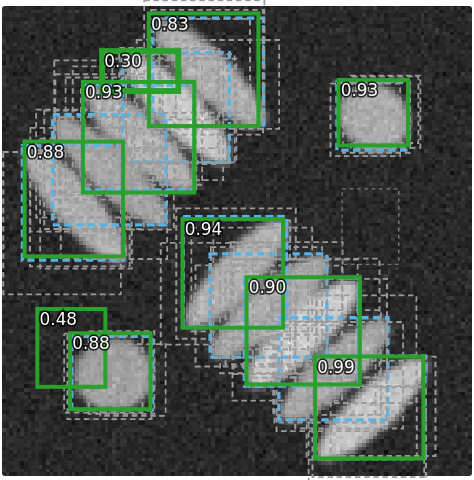

## Goal

By the end of this exercise you should be able to:

- compute the **IoU** of two boxes, and say how sensitive it is for small objects,
- run **greedy non-maximum suppression** by hand and predict the effect of its threshold,
- decide whether an object can be learned by a given set of **anchors**,
- find the **peaks** of a centre heat map, and explain the failures of each approach in crowded images.

Do the pen-and-paper part first, then the demo. Questions marked *(math)* are for those who want the derivations; the concept questions do not depend on them.

## Background

| Idea | What it means |
|---|---|
| Box | $[x_0, x_1] \times [y_0, y_1]$, a score, a class |
| IoU | intersection area / union area; for boxes the intersection is a box |
| Anchor | a template box at a grid position; it learns objects it overlaps with IoU $\ge 0.5$ |
| Centre heat map | a bump at every object centre; objects = local maxima above a threshold |
| Greedy NMS | keep the best box, delete all boxes with IoU $> t$ with it, repeat |
| Scoring | the evaluation day: matching at IoU $\ge 0.5$, TP/FP/FN, F1, matching accuracy, AP |

{width=55%}

## By hand

**B1.** IoU of boxes.
(a) $A = [0, 4] \times [0, 4]$ and $B = [2, 6] \times [2, 6]$.
(b) $A$ and the same box shifted by one pixel to the right; and shifted by one pixel right and one down.
(c) Two $2 \times 2$ boxes shifted by one pixel. What does (b)–(c) tell you about IoU thresholds for small objects?

**B2.** Greedy NMS. Five candidate boxes with scores:

| box | $[x_0, x_1] \times [y_0, y_1]$ | score |
|---|---|---|
| $b_1$ | $[0, 10] \times [0, 10]$ | 0.9 |
| $b_2$ | $[1, 11] \times [0, 10]$ | 0.8 |
| $b_3$ | $[8, 18] \times [0, 10]$ | 0.7 |
| $b_4$ | $[9, 19] \times [1, 11]$ | 0.6 |
| $b_5$ | $[20, 26] \times [20, 26]$ | 0.3 |

The true cells lie under $b_1$ and under $b_3$; $b_5$ is a false detection.
(a) Compute the IoUs $b_1b_2$, $b_1b_3$, $b_1b_4$, $b_2b_3$, $b_3b_4$.
(b) Run greedy NMS with $t = 0.3$ and with $t = 0.7$. Which boxes are kept? Count TP, FP and FN at IoU $\ge 0.5$ for both.
(c) Run it with $t = 0.1$. What goes wrong? Which box represents the second cell now, and is it a good one?
(d) Would a score threshold of 0.5 change any of the results?

**B3.** Anchors.
(a) A $10 \times 10$ anchor and a $4 \times 4$ cell with the same centre: compute the IoU. Is the cell learned by this anchor at the matching threshold 0.5?
(b) For which side lengths $s$ does a square anchor with the same centre match the $4 \times 4$ cell?
(c) A thin rod $40 \times 4$ (axis-aligned) and a $20 \times 20$ anchor, same centre: IoU? A $2{:}1$ anchor of the same area ($28.3 \times 14.1$)? What kind of anchor would match the rod?

**B4.** A $5 \times 5$ centre heat map:

$$\begin{bmatrix} 1 & 2 & 1 & 0 & 0 \\ 2 & 5 & 2 & 0 & 3 \\ 1 & 2 & 1 & 0 & 0 \\ 0 & 0 & 0 & 4 & 1 \\ 3 & 0 & 2 & 0 & 2 \end{bmatrix}$$

(a) Find the local maxima in a $3 \times 3$ window (pixels outside the image are ignored).
(b) Which of them remain with a threshold of 3.5? With a $5 \times 5$ window and no threshold?
(c) Which choice would you make if the objects are about 4 pixels apart? If the map is noisy?

**B5.** A colony of rod-shaped bacteria lying side by side, all tilted by 45°.
(a) Why do the boxes of neighbouring bacteria overlap a lot, and how much of each box is background?
(b) Explain why no NMS threshold both removes duplicates and keeps all bacteria.
(c) Which instance route of the previous unit would you use instead?

::: {.callout-note collapse="true" title="Solutions"}
**B1.** (a) Intersection $[2, 4]^2$: 4; union $16 + 16 - 4 = 28$; IoU $= 0.143$. (b) Right by one: intersection $3 \times 4 = 12$, union 20, IoU 0.6. Right and down: $3 \times 3 = 9$, union 23, IoU 0.39. (c) Intersection $1 \times 2 = 2$, union 6, IoU 0.33. A shift of one pixel already fails the matching threshold 0.5 for a $2 \times 2$ object, while a $40 \times 40$ object hardly notices it. For small objects (spots, small cells) IoU thresholds are too strict; a distance between centres is a better matching rule.

**B2.** (a) $b_1b_2$: $9 \times 10 = 90$, union 110, 0.818. $b_1b_3$: $2 \times 10 = 20$, union 180, 0.111. $b_1b_4$: $1 \times 9 = 9$, union 191, 0.047. $b_2b_3$: $3 \times 10 = 30$, union 170, 0.176. $b_3b_4$: $9 \times 9 = 81$, union 119, 0.681. (b) $t = 0.3$: keep $b_1$, delete $b_2$ (0.818); keep $b_3$ (0.111 with $b_1$), delete $b_4$ (0.681); keep $b_5$. Kept $b_1, b_3, b_5$: TP 2, FP 1 ($b_5$), FN 0. $t = 0.7$: keep $b_1$, delete $b_2$; keep $b_3$; $b_4$ survives (0.681 < 0.7); keep $b_5$. Kept $b_1, b_3, b_4, b_5$: TP 2, FP 2 ($b_4$ is a duplicate: it cannot be matched a second time), FN 0. (c) $t = 0.1$: keep $b_1$, delete $b_2$ **and $b_3$** (0.111 > 0.1); $b_4$ survives (0.047 with $b_1$); keep $b_5$. The second cell is represented by $b_4$, a shifted duplicate; its IoU with the true cell (the box of $b_3$) is 0.68, so here it still counts as a TP, but the best box of the cell was deleted because it touched the first cell. (d) It removes $b_5$ before NMS: one FP fewer in every case; the duplicates and the lost box are unchanged.

**B3.** (a) Intersection 16, union 100, IoU 0.16: not matched; the cell is never learned by this anchor. (b) $s \ge 4$: IoU $= 16/s^2 \ge 0.5$ gives $s \le 5.66$. $s \le 4$: IoU $= s^2/16 \ge 0.5$ gives $s \ge 2.83$. So $2.83 \le s \le 5.66$. (c) Square: intersection $20 \times 4 = 80$, union $400 + 160 - 80 = 480$, IoU 0.17. $2{:}1$: intersection $28.3 \times 4 = 113$, union $400 + 160 - 113 = 447$, IoU 0.25. Neither matches; it would need an elongated anchor of about $40 \times 4$ (aspect ratio 10:1) in the right orientation; a rod at 45° has a large square box (B5).

**B4.** (a) Four maxima: 5 (row 2, column 2), 3 (row 2, column 5), 4 (row 4, column 4), 3 (row 5, column 1). (b) Threshold 3.5: the 5 and the 4. $5 \times 5$ window: the 5 and the 3 in the bottom-left corner (the 4 and the 3 at the right edge have the 5 or the 4 in their larger window). (c) Objects about 4 pixels apart: a $3 \times 3$ window (a $5 \times 5$ window would suppress true neighbours). Noisy map: a threshold and a larger window, accepting that close objects merge.

**B5.** (a) A rod at 45° fills only a small part of its box (two triangles of background), and the boxes of rods lying side by side overlap almost entirely even though the rods themselves do not touch much. (b) Duplicate boxes of one rod overlap by, say, 0.6–0.9; boxes of neighbouring rods overlap by a similar amount. Any $t$ that deletes the duplicates also deletes the neighbours, and any $t$ that keeps the neighbours keeps duplicates. (c) Flows (long, touching, possibly bent cells) or, for straight rods, a distance map; the evaluation then uses masks, not boxes.
:::

### Math questions

**B6.** *(math)* Derive the closed form of the IoU of two axis-aligned boxes and show that it is invariant to scaling both boxes by the same factor and to translating both.

**B7.** *(math)* Consider $L = 1 - \mathrm{IoU}(A, B)$ as a function of the position of box $B$. Show that its gradient is zero whenever the boxes do not overlap. What does that mean for training with this loss alone?

**B8.** *(math)* Box widths are predicted as $t_w = \log(w/w_a)$ relative to an anchor of width $w_a$. Show that predicting $2w$ and $w/2$ give the same squared error in $t_w$, and that a small error $\delta$ in $t_w$ is a relative error of about $\delta$ in $w$. Why would $w - w_a$ be a worse target?

**B9.** *(math)* Show that greedy NMS gives the same result if all scores are replaced by $g(\text{score})$ for any strictly increasing $g$, and that its cost is $O(n^2)$ IoU evaluations for $n$ candidates.

::: {.callout-note collapse="true" title="Solutions (math)"}
**B6.** The intersection of $[a_0, a_1] \times [b_0, b_1]$ and $[c_0, c_1] \times [d_0, d_1]$ is $[\max(a_0, c_0), \min(a_1, c_1)] \times [\max(b_0, d_0), \min(b_1, d_1)]$ when both intervals are non-empty; its area is $wh$ with $w = \max(0, \min(a_1, c_1) - \max(a_0, c_0))$ and $h$ likewise. Union $= |A| + |B| - wh$ (inclusion–exclusion). Translating both boxes adds the same constant to all coordinates: $w$, $h$ and the areas are unchanged. Scaling all coordinates by $s > 0$ multiplies $w$ and $h$ by $s$, every area by $s^2$; the ratio is unchanged.

**B7.** If the boxes do not overlap, then $w = 0$ or $h = 0$, and this remains so for every small shift of $B$ (the max with 0 is in its flat part), so the intersection is 0 in a neighbourhood and $L = 1$ there: the gradient is zero. A network trained with this loss alone gets no signal from boxes that miss the object, however close or far they are; hence regression losses on the coordinates (or IoU variants with a distance term).

**B8.** $\log(2w/w_a) - \log(w/w_a) = \log 2$ and $\log((w/2)/w_a) - \log(w/w_a) = -\log 2$: the same squared error $(\log 2)^2$. $w = w_a e^{t_w}$, so $w(t_w + \delta) = w e^{\delta} \approx w(1 + \delta)$: relative error $\delta$. With $w - w_a$ the same error of 5 pixels would be negligible for a large object and huge for a small one, the target range would depend on the object size, and nothing would keep the predicted width positive.

**B9.** NMS only uses the **order** of the scores (which box is "the best remaining"), and a strictly increasing $g$ keeps the order (ties included). Each round keeps one box and compares it with the remaining ones: at most $n - 1 + n - 2 + \dots = O(n^2)$ IoUs (fewer when many boxes are deleted early).
:::

## Explore {#explore}

The demo has four modes on a $128 \times 128$ synthetic cell image. **IoU**: two boxes on a grid; drag a box to move it, its white corner to resize it. **NMS**: the candidate boxes of a *simulated* detector (5 jittered boxes per cell, scored by their overlap with the cell, plus 3 false boxes); **step** runs one round of greedy NMS (green: kept; grey dashed: removed, with its IoU; yellow: not yet decided), **run** all rounds; click a box and change its score with **score ±**. The readout uses the evaluation day's matching at IoU $\ge 0.5$. **Anchors**: one anchor per grid cell (or three shapes); each object shows its best anchor and that IoU, in red if below 0.5. **Heat map**: a simulated centre heat map, its local maxima and their boxes.

```{=html}
<link rel="stylesheet" href="../demos/dist/demo.css">
<div data-demo="nmsboxes" data-preset="iou"></div>
<script src="../demos/dist/nmsboxes.js"></script>
```

**E1.** Preset **IoU of two boxes**. Check B1: drag $B$ to reproduce (a), (b) and the shift by one pixel right and down. Where must $B$ be for IoU = 1/7?

**E2.** Preset **duplicates removed** (sparse image, $t = 0.5$). How many candidates and how many boxes after NMS? Use **step**: how many duplicates does the first kept box remove? Compare F1 and matching accuracy with AP. Which number is hurt by the 3 false boxes, and how can the score threshold fix it?

**E3.** Still on the sparse image, set $t$ to 0.3, 0.7 and 0.9. Write down the number of boxes and F1 each time. Why does AP hardly change?

**E4.** Preset **touching cells: NMS deletes the neighbour** ($t = 0.2$, true boxes shown). How many cells have no box after NMS? Step through the first round: what is deleted? Find the $t$ with the best F1.

**E5.** Preset **threshold too high: duplicates survive** ($t = 0.75$). Number of boxes, FP, F1, AP? Explain why AP is high although F1 is low.

**E6.** Preset **diagonal rod: a box is a poor shape**. What fraction of the rod's box is rod? What would a second box-based step (e.g. measuring the intensity inside the box) measure?

**E7.** Preset **small cell: no anchor matches** (stride 16, anchor size 20, one shape). Which objects can be learned? Try three shapes, then stride 8, then anchor size 8. Can one anchor setting match all five objects?

**E8.** Presets **heat-map peaks = objects** and **noisy heat map: two peaks in one cell**. Count peaks, TP, FP, FN. Then set the window to $7 \times 7$ and compare. What is the price of the larger window?

::: {.callout-note collapse="true" title="Solutions"}
**E1.** $A = [0, 4]^2$, $B = [2, 6]^2$: intersection 4, union 28, IoU 0.143 (= 1/7). One right: 0.600; one right and one down: 0.391. IoU = 1/7 needs intersection 4 with two $4 \times 4$ boxes, e.g. $B$ at $[2, 6]^2$ (a $2 \times 2$ overlap) or $[0, 4] \times [3, 7]$ ($4 \times 1$).

**E2.** 48 candidates, 12 boxes after NMS (all 12 rounds). The first kept box removes 4 duplicates. TP 9, FP 3, FN 0: F1 0.86, matching accuracy 0.75; AP 1.00 (0.97 without NMS). The three false boxes have low scores: they come last in the ranking, so AP (which only asks whether the good boxes rank first) is not hurt, but F1 counts them. Setting the score threshold to 0.6 removes them: 10 boxes, F1 0.95.

**E3.** $t = 0.3$: 10 boxes, F1 0.95. $t = 0.7$: 34 boxes, F1 0.42. $t = 0.9$: 46 boxes, F1 0.33. The duplicates that survive have lower scores than the box kept for the same cell; in the ranking they come after all true detections, so AP stays 1.00 (0.97 at $t = 0.9$), while F1, which counts every box above the threshold, collapses.

**E4.** 10 boxes for 12 cells; 4 cells have no box (TP 8, FP 2, FN 4, F1 0.73). The first kept box deletes 9 boxes: its own duplicates and the boxes of its neighbours, whose IoU with it is about 0.3. F1 by $t$: 0.1: 0.76; 0.2: 0.73; 0.3: 0.75; **0.4: 0.89** (15 boxes, all 12 cells found, 3 FP); 0.5: 0.83; 0.75: 0.41.

**E5.** 46 boxes, TP 12, FP 34, F1 0.41, AP 0.98. Every cell's best box is found (high scores first), and the 34 duplicates are ranked below them, so the precision–recall curve reaches recall 1 before the duplicates appear. AP measures ranking; F1 at a fixed operating point measures what a user would actually get.

**E6.** The rod fills 16 % of its box. A measurement inside the box (mean intensity, texture) would be dominated by background. A box says where an object is, not which pixels belong to it.

**E7.** One shape: only the large lower-right cell (IoU 0.67) is matched; the rod (0.17), the small cell (0.10) and the two other cells (0.39, 0.28) are not, because their centres fall between anchor centres or their size differs. Three shapes: still 1 of 5 (the elongated anchors fit no object here). Stride 8: 3 of 5 (0.76, 0.57, 0.67 for the three ordinary cells; rod and small cell still fail). Anchor size 8 with stride 8: only the small cell (0.64). No single setting matches all five: one needs several sizes, finer strides and elongated anchors in the right orientation.

**E8.** **Heat-map peaks** (crowded palisades, bump width 3, no noise): 12 peaks for 12 cells, TP 12, F1 1.00. **Noisy heat map** (sparse image, bump width 5, noise 0.2, $3 \times 3$ window): 14 peaks for 9 cells, TP 9, FP 5, F1 0.78: some cells have two peaks. With a $7 \times 7$ window: 10 peaks, FP 1, F1 0.95. The price: two true objects closer than about 3 pixels from each other's centre window would also be merged into one peak.
:::

## Where this leads

Boxes and heat maps are the outputs of detection networks; the next unit asks how a network can relate a pixel to the **whole** image (attention and transformers) and where networks come from that nobody trained on your images (pretraining). The scoring of detections is the evaluation day's.
