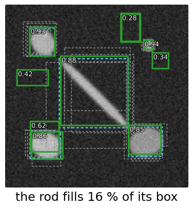
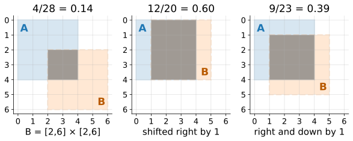
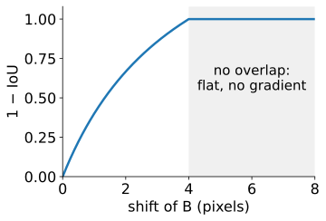
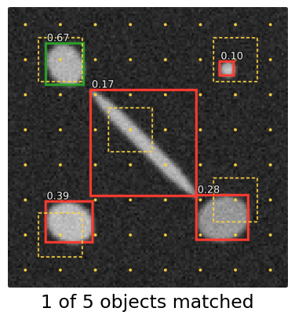
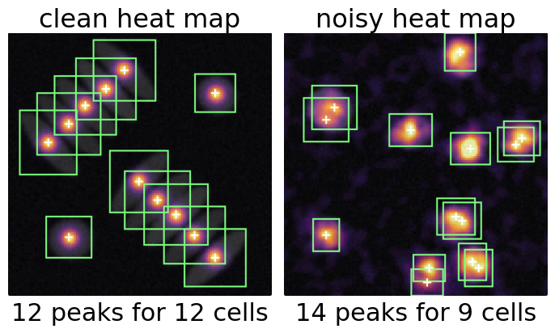
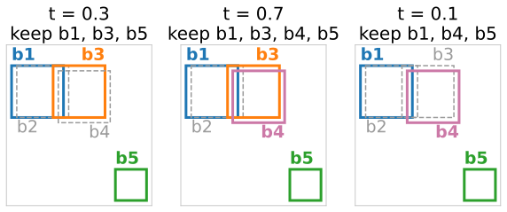
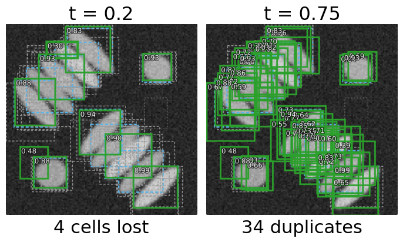

## About this lecture

*How does a network output "there are 12 cells, here", when the number is not known in advance?*

- **Boxes**: the simplest object description; **IoU** of two boxes in closed form.
- Where candidate boxes come from: **anchors** (template boxes on a grid) or **centre heat maps** (peaks = objects).
- Every object gets many candidates: **non-maximum suppression** (NMS) keeps one, and what it gets wrong in a crowd.
- How detections are scored: recalled from the evaluation day.

*Slides titled **The math** give the formulas and proofs; the ideas are complete without them.*

::: notes
This unit follows "From masks to objects" (instances/), which previewed NMS for star-convex polygons. The matching of predictions to truth, F1, matching accuracy and average precision are owned by the evaluation day (object-eval/); here they are only readouts. The demo's detector is simulated (jittered boxes around the true cells, with scores), so the effect of NMS can be seen without any trained network.
:::

## Boxes

:::: {.columns}
::: {.column width="58%"}
A box = centre, width, height (4 numbers), plus a class and a **score** (how sure the detector is).

- Enough for **counting**, **tracking**, **cropping** each object for a second network.
- Poor for long **diagonal** objects: a box around a diagonal rod is mostly background (in the demo's rod: the rod fills 16 % of its box).
- A mask per object can be predicted inside each box afterwards.
:::
::: {.column width="42%"}
{fig-alt="The diagonal-rod scene after suppression: the kept box around the long diagonal rod (score 0.88) is mostly background; the rod fills 16 % of it. Round cells fill their boxes well." width="100%"}
:::
::::

## IoU of two boxes

The evaluation day's overlap measure, intersection over union: $\mathrm{IoU} = |A \cap B| / |A \cup B|$. For two axis-aligned boxes the intersection is a box again.

- $A = [0, 4] \times [0, 4]$, $B = [2, 6] \times [2, 6]$: intersection $[2, 4] \times [2, 4]$, area 4; union $16 + 16 - 4 = 28$; $\mathrm{IoU} = 4/28 = 0.14$.
- The same $4 \times 4$ box shifted by one pixel to the right: $12/20 = 0.6$. Shifted by one pixel right **and** down: $9/23 = 0.39$.
- For small objects one pixel matters a lot.

{fig-alt="Three pairs of 4 × 4 boxes on a pixel grid, the intersection shaded dark: A = [0,4]², B = [2,6]²: IoU 4/28 = 0.14; B shifted right by 1 from A: 12/20 = 0.60; shifted right and down by 1: 9/23 = 0.39." width="72%" fig-align="center"}

## The math: IoU of boxes in closed form {.math}

$A = [a_0, a_1] \times [b_0, b_1]$, $B = [c_0, c_1] \times [d_0, d_1]$:

$$w = \max(0, \min(a_1, c_1) - \max(a_0, c_0)), \quad h = \max(0, \min(b_1, d_1) - \max(b_0, d_0)),$$

$$\mathrm{IoU}(A, B) = \frac{wh}{|A| + |B| - wh}.$$

:::: {.columns}
::: {.column width="62%"}
- **Scale invariant**: scaling both boxes by $s$ multiplies every area by $s^2$; the ratio is unchanged.
- $1 - \mathrm{IoU}$ as a training loss gives **no gradient** when the boxes do not overlap ($w = 0$ or $h = 0$ on a whole region): the loss is flat at 1 however far apart they are. Hence the regression losses on the box coordinates (next slides).
:::
::: {.column width="38%"}
{fig-alt="1 − IoU of two 4 × 4 boxes against the horizontal shift of B: it rises from 0 to 1 at a shift of 4 pixels and stays exactly 1 for larger shifts: flat, no gradient." width="100%"}
:::
::::

## Recall: scoring detections

From the evaluation day, unchanged:

- Match predictions to true objects one to one at IoU $\ge \tau$ (often $\tau = 0.5$): TP, FP, FN objects; F1 and **matching accuracy** $TP/(TP + FP + FN)$.
- Rank the scored detections, walk down the list: a precision–recall curve; its area is the **average precision (AP)**. Detection benchmarks often average AP over $\tau = 0.5, 0.55, \dots, 0.95$.

This unit is about what happens **before** the evaluation: where the scored boxes come from, and how duplicates are removed.

## Where candidates come from: anchors

:::: {.columns}
::: {.column width="58%"}
The network looks at every position of a coarse grid (a feature map, e.g. every 16 pixels; the neural networks day) and guesses there.

- At each grid cell: a few **anchors**, template boxes of preset sizes and shapes (e.g. 1:1, 2:1, 1:2).
- For each anchor the network predicts "is there an object?" (a score) and a small **correction** of the box.
- An object is learned only by anchors that overlap it well (IoU $\ge 0.5$ during training). Objects much smaller, larger or more elongated than every anchor match **no** anchor and are never learned.

A $4 \times 4$ cell and a $10 \times 10$ anchor with the same centre: IoU $= 16/100 = 0.16$: not matched.
:::
::: {.column width="42%"}
{fig-alt="Anchor grid (yellow dots, stride 16) with one 20 × 20 square anchor shape on the rod-and-small-cell scene: for each object the best anchor (dashed yellow) and its IoU: 0.67 for one round cell (green, learnable); 0.39, 0.28, 0.17 for the other cell, the large cell and the diagonal rod, and 0.10 for the small cell (red, never learned)." width="100%"}
:::
::::

## The math: boxes relative to an anchor {.math}

Anchor centre $(x_a, y_a)$, size $(w_a, h_a)$; the network predicts

$$t_x = \frac{x - x_a}{w_a}, \quad t_y = \frac{y - y_a}{h_a}, \quad t_w = \log\frac{w}{w_a}, \quad t_h = \log\frac{h}{h_a}.$$

- Dividing by the anchor size makes the targets the same for small and large objects.
- The **log**: a box twice too wide and one half as wide are equally wrong ($\pm\log 2$); the predicted width $w_a e^{t_w}$ is always positive; and an error in $t_w$ is a **relative** error in $w$.
- Training: a cross-entropy for the score of every anchor (most anchors are background, so easy background examples are down-weighted, e.g. by a factor $(1 - p)^\gamma$, the *focal loss*), and a squared or absolute error on $(t_x, t_y, t_w, t_h)$ for the matched anchors.

## Where candidates come from: centre heat maps

:::: {.columns}
::: {.column width="50%"}
Anchor-free: the network outputs a **heat map** of object centres (a small bump at every centre) and, at every pixel, the size of the box centred there.

- Objects = **local maxima** of the heat map: a pixel that is the largest in its $3 \times 3$ (or larger) window and above a threshold.
- No preset shapes. Two problems remain: two objects whose centres are too close give one peak; a noisy heat map gives two peaks in one object.
- This is the **peak picking of the Hough accumulator** (the Hough day), applied to a learned map.
:::
::: {.column width="50%"}
{fig-alt="Simulated centre heat maps with their local maxima (white crosses) and boxes (green). Clean map on touching elongated cells: 12 peaks for 12 cells. Noisy map on the sparse scene: 14 peaks for 9 cells, two cells with two peaks each and spurious peaks." width="100%"}
:::
::::

## The math: heat-map targets and peaks {.math}

Training target for objects with centres $c_k$:

$$Y(p) = \max_k \exp\!\Big(-\frac{\|p - c_k\|^2}{2\sigma^2}\Big),$$

with $\sigma$ growing with the object size; loss: a pixelwise (focal) cross-entropy.

Peaks: $p$ is a detection if $Y(p) = \max_{q \in W(p)} Y(q)$ over the window $W(p)$ (a grey-level dilation with a square, compared with the map) and $Y(p) \ge \theta$. A larger window removes noise peaks but also merges close objects.

## Many candidates per object

Whatever proposes the boxes, every object gets **several** overlapping candidates: neighbouring anchors, neighbouring pixels of a peak, jittered guesses.

**Greedy non-maximum suppression**: sort by score; keep the best box; delete every remaining box with IoU $> t$ with it; repeat with the best remaining box.

Five boxes: $b_1 = [0,10]^2$ (0.9), $b_2 = [1,11] \times [0,10]$ (0.8), $b_3 = [8,18] \times [0,10]$ (0.7), $b_4 = [9,19] \times [1,11]$ (0.6), $b_5 = [20,26]^2$ (0.3). Two true cells: under $b_1$ and under $b_3$.

:::: {.columns}
::: {.column width="44%"}
| $t$ | kept | |
|---|---|---|
| 0.3 | $b_1, b_3, b_5$ | duplicates gone |
| 0.7 | $b_1, b_3, b_4, b_5$ | $b_4$ (IoU 0.68 with $b_3$) survives |
| 0.1 | $b_1, b_4, b_5$ | $b_3$ (IoU 0.11 with $b_1$) deleted |
:::
::: {.column width="56%"}
{fig-alt="The five boxes after greedy NMS at three thresholds; kept boxes solid and coloured, deleted ones grey dashed. t = 0.3: b1, b3, b5 kept. t = 0.7: b1, b3, b4, b5 (b4 survives next to b3). t = 0.1: b1, b4, b5 (b3 is deleted because it overlaps b1 slightly, and then b4 survives)." width="100%"}
:::
::::

## The math: greedy NMS {.math}

1. Sort the candidates by score, highest first; $K = \emptyset$.
2. Take the first remaining candidate $b$; add it to $K$.
3. Remove every remaining candidate $c$ with $\mathrm{IoU}(b, c) > t$.
4. Repeat from 2 until no candidate remains; output $K$.

At most $n$ rounds, each comparing with up to $n$ boxes: $O(n^2)$ IoUs. The result depends only on the order of the scores and on $t$. It is not an optimisation of any global criterion; it is a rule. The same rule with polygon IoU prunes the star-convex polygons of the previous unit.

## Try it: boxes and suppression

```{=html}
<link rel="stylesheet" href="../demos/dist/demo.css">
<div data-demo="nmsboxes" data-preset="crowd"></div>
<script src="../demos/dist/nmsboxes.js"></script>
```

::: notes
The detector is simulated: 5 jittered boxes per true cell with scores from their IoU, plus 3 false boxes. Tour: "IoU of two boxes": drag B, watch 4/28 = 0.143 change. "duplicates removed": sparse image, t = 0.5, 48 candidates → 12 boxes, all 9 cells found (3 FP are the false boxes). Step through: the first kept box removes 4 duplicates. "touching cells": two palisades of elongated touching cells at ±45°, whose boxes overlap their neighbours by about 0.3. With t = 0.2: 10 boxes, 4 cells have no box left. "threshold too high" (t = 0.75): 46 boxes, 34 false positives (duplicates). Find the best t (about 0.4). Then "diagonal rod", "small cell: no anchor matches" (anchors: 1 of 5 objects matched) and the two heat-map presets.
:::

## What NMS gets wrong

:::: {.columns}
::: {.column width="50%"}
- In a **crowd** of touching cells, the box of a true neighbour overlaps the kept box by more than $t$: it is **deleted** (a missed cell). The fix "raise $t$" lets **duplicates** of the same cell survive.
- One threshold cannot do both when neighbours overlap as much as duplicates do. In the demo's palisade (neighbour IoU about 0.3): $t = 0.2$ loses 4 of 12 cells; $t = 0.75$ keeps 34 duplicates; the best, $t = 0.4$, still has 3 false positives.
- Hence for dense cells the **map-based** routes of the previous unit are usually preferred over boxes.
:::
::: {.column width="50%"}
{fig-alt="Two palisades of touching elongated cells after NMS (green: kept boxes with scores; blue dashed: true boxes). t = 0.2: 10 boxes, 4 cells have no box left. t = 0.75: 46 boxes, 34 of them duplicates (false positives)." width="100%"}
:::
::::

## Three meanings of "non-maximum suppression"

| Where | What is suppressed | Neighbourhood |
|---|---|---|
| Canny (the edges day) | gradient values that are not the largest **across** the edge | the two neighbours along the gradient direction |
| Hough accumulator (the Hough day) | accumulator cells that are not a local peak | a window in parameter space |
| Detection (here) | **boxes** that overlap a better box by more than $t$ | IoU with the kept boxes |

A centre heat map's peak picking is the Hough version; box NMS is a different rule with the same name.

## Summary

- A box is 4 numbers + score; IoU of boxes has a closed form; poor for diagonal or long objects.
- Candidates come from **anchors** (template boxes: objects that match no anchor are never learned) or from **peaks of a centre heat map** (no templates; close objects or noise are the risk).
- Every object gets many candidates; **greedy NMS** keeps the best and deletes overlaps above $t$.
- In crowds, one $t$ cannot both remove duplicates and keep touching neighbours.
- Scoring (matching, F1, AP) comes from the evaluation day.
