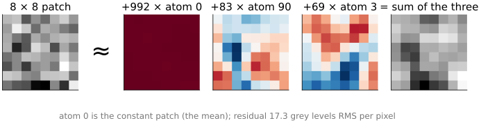
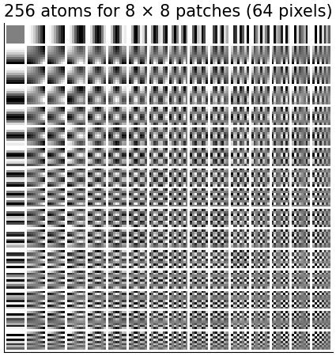
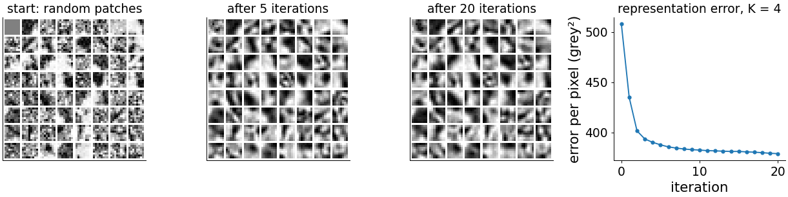
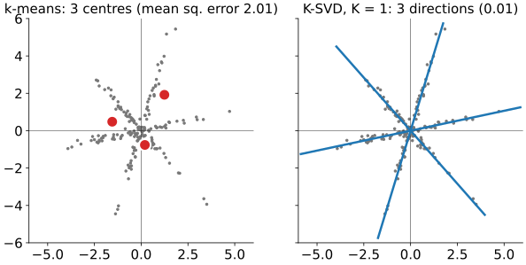
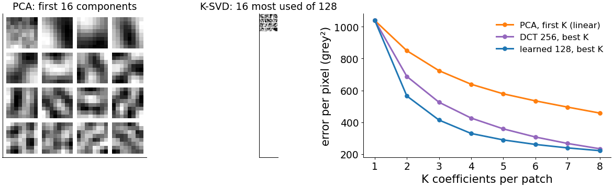
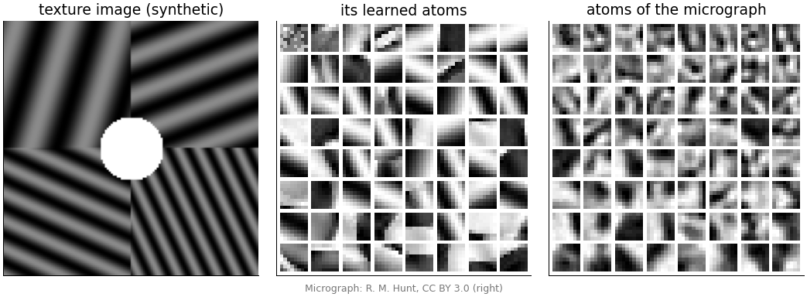
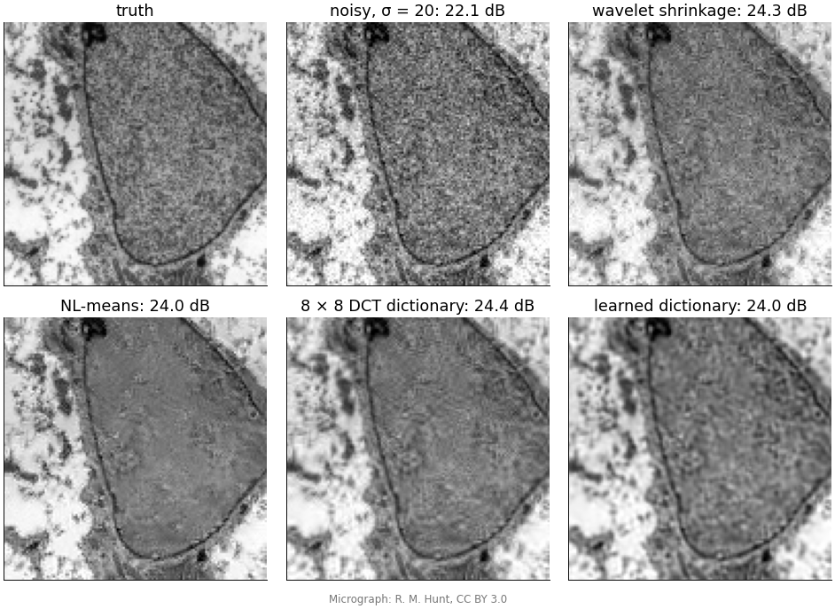
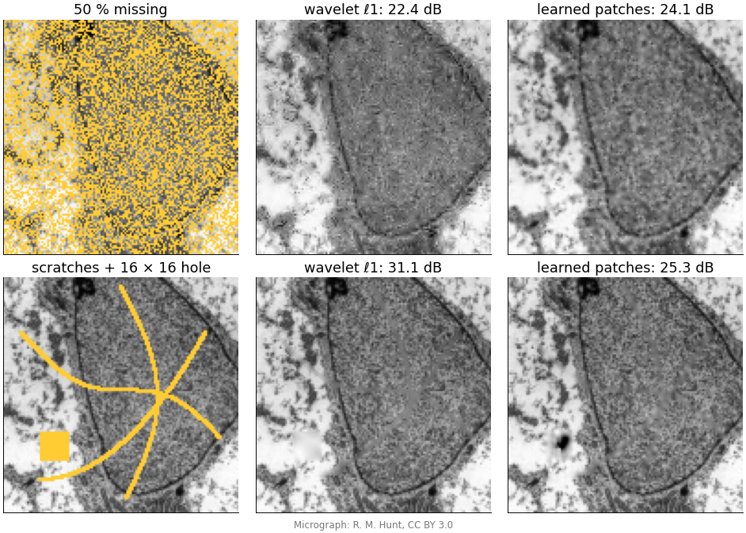

## About this lecture

So far the sparsifying basis was chosen by hand: spikes, DCT, wavelets. Today we **learn** it from the images themselves, on small patches.

- **Patches as vectors**; a **dictionary** of atoms; **sparse coding** = writing each patch as a few atoms.
- **Dictionary learning**: alternate sparse coding and atom updates (**K-SVD**, MOD); **k-means** is the one-atom special case; **PCA** is the orthogonal, non-sparse cousin.
- What learned atoms look like.
- **Denoising** and **inpainting** with overlapping patches, compared with wavelets and non-local means.
- Costs and limits, and a summary of the day.

*Slides titled **The math** give the formulas and proofs; the ideas are complete without them.*

::: notes
Fifth unit of the sparse representations day. Needs [sparsity](../sparsity/lec.qmd) and [ista](../ista/lec.qmd) (OMP); recalls [pca](../pca/lec.qmd) (day 1), [dct](../dct/lec.qmd) (compression) and NL-means ([bilateral-nlm](../bilateral-nlm/lec.qmd), first introduced in [denoise](../denoise/lec.qmd)). k-means is taught here in one slide because the Gaussian-mixture day may not have been taken. References: Aharon, Elad & Bruckstein (2006) K-SVD; Elad & Aharon (2006) denoising; Engan et al. (1999) MOD; Olshausen & Field (1996).
:::

## Patches as vectors

{width="92%" fig-align="center" fig-alt="An 8 by 8 patch of the micrograph is approximately 992 times the constant atom plus 83 times atom 90 plus 69 times atom 3 (two patterns with blue and red lobes); the sum of the three is shown on the right and resembles the patch without its fine noise."}

- An 8 × 8 patch is a point in **64 dimensions** (recall [PCA](../pca/lec.qmd): "two pixels, one point").
- A **dictionary** is a set of **atoms**, 64-vectors (here 128 of them, learned from the image).
- **Sparse coding**: write each patch as a combination of **a few** atoms. Here 3 atoms leave 17 grey levels RMS per pixel: the fine texture and noise.

## Fixed dictionaries

:::: {.columns}
::: {.column width="50%"}
- The 64 **DCT** basis images of [JPEG](../dct/lec.qmd): a basis, every patch is a unique combination.
- An **overcomplete DCT**: 256 cosine patterns (more frequencies than pixels allow). Many ways to write the same patch: choose the sparsest.
- **Wavelets** on patches, or the union of several bases.

These are good starting points and know nothing about the particular images.
:::
::: {.column width="50%"}
{width="88%" fig-alt="A 16 by 16 grid of the 256 overcomplete DCT atoms for 8 by 8 patches: horizontal and vertical cosine patterns from the constant patch at the top left to fine checkerboards at the bottom right."}
:::
::::

## Overcomplete = more atoms than pixels

- With more atoms than dimensions (256 for 64), each patch has **infinitely many** representations; the sparse one is chosen. More choice means **sparser** codes and a better fit with few atoms.
- Coding is no longer a change of basis (a matrix product) but a small **ℓ1 or OMP problem per patch**, exactly the problems of the [solvers unit](../ista/lec.qmd). For many patches we use OMP with the error target or a maximum number $K$ of atoms.
- One image of 256 × 256 has 62 001 overlapping 8 × 8 patches: a lot of small problems. Batch-OMP shares the work (the atom inner products are precomputed once).

## Learn the atoms from the image itself

:::: {.columns}
::: {.column width="40%"}
Alternate two steps on thousands of training patches:

1. **Sparse coding**: OMP for every patch with the current atoms ($K$ atoms each).
2. **Atom update**: change each atom (and the coefficients that use it) to fit the patches that use it better.

Start from random patches (left). After 5 iterations edges and bars appear; after 20 the atoms change little and the error has dropped from 508 to 379 grey levels² per pixel.
:::
::: {.column width="60%"}
{width="100%" fig-alt="64 atoms of 8 by 8 pixels: at the start, random patches of the micrograph; after 5 and after 20 K-SVD iterations, smoother patterns with edges and bars at various orientations. Right: the representation error falls from 508 to about 380 in 20 iterations, most of it in the first five."}
:::
::::

::: notes
4000 patches from the 128 × 128 centre of the micrograph, 64 atoms, K = 4 (tools/figs/dictionaries/data.ts, same code as the patchdict demo). Error per pixel (grey levels squared): 508 at the start, 388 after 5 iterations, 379 after 20. The coding step (OMP) is greedy, so a single step can increase the error slightly; the atom update never does.
:::

## k-means is the one-atom special case

:::: {.columns}
::: {.column width="48%"}
**k-means** (recall [k-means](../kmeans/lec.qmd) if you took it): each point belongs to its **nearest centre**, then each centre moves to the **mean** of its points. Repeat.

As dictionary learning: each patch uses **exactly one atom with coefficient 1**. Assignment = coding, mean = atom update.

**K-SVD** generalises it: a few atoms, **any coefficients**. Even with one atom per point it learns **directions**, not points: a patch and its brighter or inverted copy use the same atom.

Right: points along three directions through 0. k-means needs its centres to sit at averages (error 2.0); one atom per direction fits all points (0.01).
:::
::: {.column width="52%"}
{width="100%" fig-alt="A 2D point cloud along three lines through the origin, with points on both sides. Left: k-means with 3 centres, placed at cluster means, mean squared error 2.0. Right: K-SVD with one atom per point: three lines through the origin along the three directions, error 0.01."}
:::
::::

## The K-SVD atom update

- For one atom: collect the patches that **use** it; subtract the contributions of their **other** atoms; what is left are residuals that this atom should explain.
- The best single atom for those residuals, with free coefficients, is the **best direction** through them: the first principal direction, **without centring** (recall PCA). Its coefficients are the projections.
- Update atoms one by one, each time with the fresh residuals.
- **MOD** (method of optimal directions): update **all** atoms at once by least squares, given all the codes; then renormalise.

## By hand: one atom update

Three 2-pixel residuals use the same atom: (2, 1), (4, 2), (−1, −1).

- Scatter matrix $\sum \mathbf r\mathbf r^\top = \begin{pmatrix}4 + 16 + 1 & 2 + 8 + 1\\ 2 + 8 + 1 & 1 + 4 + 1\end{pmatrix} = \begin{pmatrix}21 & 11\\ 11 & 6\end{pmatrix}$.
- Eigenvalues 26.81 and 0.19; top eigenvector **(0.884, 0.467)**: the new atom.
- New coefficients = projections: $(2, 1)\cdot\mathbf d = 2.24$, $(4, 2)\cdot\mathbf d = 4.47$, $(-1, -1)\cdot\mathbf d = -1.35$.
- Remaining error: the small eigenvalue, 0.19 (out of a total of 27).

## The math: one problem, solved by alternation {.math}

Patches as columns of $Y$ ($64 \times n$), atoms as columns of $D$ ($64 \times k$, unit norm), codes as columns of $C$:
$$\min_{D,\,C}\ \|Y - DC\|_F^2 \quad\text{subject to}\quad \|\mathbf c_i\|_0 \le K \text{ for every patch } i.$$

- Not convex (a product $DC$, and ℓ0); solved by **alternation**: fix $D$, solve for $C$ (sparse coding, separate per patch); fix the supports, improve $D$ (and the values of $C$).
- With exact sparse coding each step cannot increase the objective, so it converges to a local minimum; OMP is greedy, so in practice the error can tick up slightly after a coding step.
- The result depends on the start (random patches, overcomplete DCT).

## The math: the K-SVD update {.math}

Write $DC = \sum_j \mathbf d_j\mathbf c^j$ ($\mathbf c^j$ = row $j$ of $C$, the coefficients of atom $j$). For atom $k$:
$$\|Y - DC\|_F^2 = \Big\|\underbrace{Y - \sum_{j \ne k}\mathbf d_j\mathbf c^j}_{E_k} - \mathbf d_k\mathbf c^k\Big\|_F^2.$$

- Keep only the columns (patches) that use atom $k$, so the sparsity pattern does not change: $E_k^R$, $\mathbf c^k_R$.
- Minimising $\|E_k^R - \mathbf d_k\mathbf c^k_R\|_F^2$ over a unit $\mathbf d_k$ and free $\mathbf c^k_R$ is the best **rank-1 approximation**: the leading singular pair, $\mathbf d_k = \mathbf u_1$, $\mathbf c^k_R = σ_1\mathbf v_1^\top$ (Eckart–Young; recall PCA: "the error is the sum of the dropped eigenvalues").
- **MOD**: given $C$, $D = YC^\top(CC^\top)^{-1}$, then normalise the columns.

## The math: k-means as $K = 1$, coefficient 1 {.math}

Restrict every code to one nonzero equal to 1: $\mathbf c_i = \mathbf e_{a(i)}$.

- Coding: $\min_j\|\mathbf y_i - \mathbf d_j\|^2$: the **nearest centre** (assignment step).
- Update: for fixed assignments, $\sum_{i:\,a(i) = j}\|\mathbf y_i - \mathbf d_j\|^2$ is minimised by the **mean** of those points (update step). The atoms are not normalised.
- Allowing any coefficient ("gain–shape"): coding picks the atom with the largest $|\mathbf d_j^\top\mathbf y_i|$, and the update is the rank-1 SVD above: K-SVD with $K = 1$.

## PCA or a learned dictionary?

{width="94%" fig-align="center" fig-alt="Left: the first 16 principal components of the micrograph's 8 by 8 patches, smooth patterns from the mean to increasingly fine cosine-like waves. Middle: the 16 most used of 128 learned atoms, edges and blobs at various positions. Right: error against K: PCA with the first K components falls slowest (639 at K = 4), the 256-atom DCT with the best K atoms faster (426), the learned dictionary fastest (330)."}

- **PCA** (= the KLT of [compression](../dct/lec.qmd)): orthogonal atoms, **all** used by every patch, ordered by variance: the best **linear** approximation with the first $K$ terms.
- A **learned dictionary**: overcomplete, non-orthogonal, each patch picks **its own few**: better **sparse** (non-linear) approximation. At $K = 4$: 639 (PCA), 426 (DCT, best 4 of 256), 330 (learned, best 4 of 128).

## What learned atoms look like

:::: {.columns}
::: {.column width="62%"}
{width="100%" fig-alt="Left: a synthetic texture with stripes of four orientations and frequencies and a disc. Middle: its 64 learned atoms, mostly stripe patterns at the four orientations. Right: 64 atoms learned from the micrograph: edges, bars and blobs at many positions and orientations."}
:::
::: {.column width="38%"}
- From the **texture**: stripes in its own four orientations and frequencies. The dictionary stores the image's recurring patterns.
- From the **micrograph**: oriented edges, bars and blobs at many positions.
- Learned from natural images, such atoms look like **Gabor functions**, like the receptive fields of neurons in the primary visual cortex (Olshausen & Field 1996), and like the first-layer filters of a [convolutional network](../cnn/lec.qmd).
:::
::::

## Try it: learning a patch dictionary

```{=html}
<link rel="stylesheet" href="../demos/dist/demo.css">
<div data-demo="patchdict" data-preset="learned"></div>
<script src="../demos/dist/patchdict.js"></script>
```

::: notes
Left: the atoms sorted by how many training patches use them. Middle: the image (click to pick a patch), the selected patch written as coefficient × atom + …, and the error plot. Tour: "DCT start" (no learning yet); "learned: edges appear" (20 K-SVD iterations from random patches, 128 atoms, K = 4: wait a few seconds); "k-means atoms: blurry averages"; "K = 1 vs K = 4"; "PCA vs learned at K = 4" (tab: error against K); "texture image: stripes in the atoms". The dictionary learned here is used by the restoration demo later in the deck when the images match.
:::

## Denoising with patches

:::: {.columns}
::: {.column width="55%"}
{width="100%" fig-alt="Six crops of the micrograph: truth; noisy with σ = 20 (22.1 dB); wavelet shrinkage (24.3 dB); non-local means (24.0 dB); 8 by 8 DCT dictionary (24.4 dB); learned dictionary (24.0 dB). All restorations remove most of the noise and smooth the fine texture."}
:::
::: {.column width="45%"}
K-SVD denoising (Elad & Aharon 2006):

1. Code **every overlapping** patch with OMP, stopping when the residual reaches the noise level: about $64\cdot(1.15σ)^2$ for 8 × 8 patches.
2. Each pixel is covered by up to 64 patches: **average** their reconstructions, together with the noisy pixel itself.

On this textured micrograph (σ = 20) all methods land within 0.4 dB of each other, 24.0–24.4 dB from 22.1: the fine texture is as hard to keep as the noise is to remove. On images with repeated structure (cartoons, nuclei) the patch methods gain more.
:::
::::

::: notes
Each method with its best parameter from a small grid: wavelet shrinkage db4, 4 levels, soft, cycle spinning, threshold 0.75σ; NL-means h = σ; patch methods stride 1, error target 64·(1.15σ)². The learned dictionary was trained on another region of the micrograph (128 atoms, 20 K-SVD iterations, K = 4), as in the restoration demo; Elad & Aharon learn it from the noisy image itself.
:::

## The math: averaging overlapping patches {.math}

$R_p$ extracts patch $p$ from the image; $D\mathbf c_p$ is its sparse reconstruction. The denoised image solves
$$\min_{\mathbf x}\ λ\|\mathbf x - \mathbf y\|^2 + \sum_p\|R_p\mathbf x - D\mathbf c_p\|^2
\quad\Rightarrow\quad
\hat{\mathbf x} = \Big(λI + \sum_p R_p^\top R_p\Big)^{-1}\Big(λ\mathbf y + \sum_p R_p^\top D\mathbf c_p\Big).$$

- $R_p^\top R_p$ is diagonal (1 on the pixels of patch $p$), so $\sum_p R_p^\top R_p$ is diagonal: the **number of patches covering each pixel** (64 inside, fewer at the border).
- The inverse is therefore a per-pixel division: $\hat x_q = \dfrac{λy_q + \sum_{p \ni q}(D\mathbf c_p)_q}{λ + \#\{p \ni q\}}$, a weighted average.
- Inpainting: the same with λ only on known pixels.

## Why it works

- Images **repeat** local structure: edges, textures, membranes, nuclei. The dictionary stores the recurring patterns; the sparse code picks among them.
- **Noise is not sparse** in any atom: it costs many atoms, so the error-limited code leaves it out.
- The same idea as **non-local means** ([neighbourhood filters in depth](../bilateral-nlm/lec.qmd)): average similar patches. NL-means compares patches directly; a dictionary summarises them into atoms.
- Averaging overlapping patches removes the block artefacts that coding non-overlapping blocks (as in JPEG) would leave.

## Inpainting with patches

:::: {.columns}
::: {.column width="56%"}
{width="100%" fig-alt="Top: the micrograph with 50 % of the pixels missing; wavelet ℓ1 (22.4 dB); learned patches (24.1 dB), with more texture restored. Bottom: thin scratches and a 16 by 16 hole; wavelet ℓ1 (31.1 dB) fills the hole with a smooth grey patch; learned patches (25.3 dB) remove the scratches but put a dark blob into the hole."}
:::
::: {.column width="44%"}
Code each patch using **only its known pixels** (mask the atoms the same way), then fill the unknown pixels from the code; average the overlaps.

- **50 % missing**: patches **24.1 dB**, wavelet ℓ1 22.4 dB: the learned atoms predict the texture better.
- **Scratches**: both remove them.
- A **hole larger than a patch**: filled from the border inwards. Here the patches invent a **dark blob** that is not there (25.3 dB), worse than the wavelet blur (31.1 dB). A learned prior can put plausible but wrong structure into what was not measured.
:::
::::

## Try it: restoring with dictionaries

```{=html}
<link rel="stylesheet" href="../demos/dist/demo.css">
<div data-demo="sparserestore" data-preset="dctden" data-priors="db4 tv dct learned nlmeans"></div>
<script src="../demos/dist/sparserestore.js"></script>
```

::: notes
The restoration demo of the [solvers unit](../ista/lec.qmd) with the patch priors added: 8 × 8 DCT patches (256 atoms), a learned dictionary (from the patchdict demo above if it ran on the same image, otherwise learned at start-up from another region of the image) and NL-means as a baseline (denoising only). Tour: "patch DCT denoising", "learned dictionary denoising", "NL-means baseline" (σ = 20 on the micrograph), "patch inpainting, 50 %". With deblurring, the patch priors run a few plug-and-play iterations (gradient step, then patch denoising): slow.
:::

## Deconvolution with a patch prior

- ISTA alternates a **gradient step** on the data with a **threshold**. Replace the threshold by **patch denoising**: gradient step (Landweber) → denoise the patches → gradient step → …
- This is "**plug-and-play**": any good denoiser can stand in for the proximal step, even without a written-down penalty.
- With a neural-network denoiser, or a diffusion model, this becomes the learned-prior restoration of the [diffusion priors](../diffusion-inverse/lec.qmd) unit.

## Costs and limits

- **Learning is slow**: OMP on tens of thousands of patches per iteration (for one 256 × 256 image: 62 001 patches, about $10^9$ operations per pass with 256 atoms).
- **Patch size** limits what can be modelled: holes and structures larger than a patch are out of reach (the dark blob).
- A dictionary learned on **one kind of image** may impose its patterns on another: a mild version of the hallucination warning of learned priors.
- **Texture without repetition** is not sparse in any learned atoms either: it is smoothed away like noise.
- The atoms are local; images also have long-range structure (shapes, symmetry) that patches do not see.

## Summary of the day

| penalty / prior | solver | what it buys | what it destroys |
|---|---|---|---|
| ℓ2 (Tikhonov) | linear, closed form | stable, simple | edges (blur, ringing); never sparse |
| ℓ1 in a fixed basis (wavelets, DCT) | soft threshold, ISTA/FISTA, OMP | exact zeros, sharp edges, recovery from few measurements (CS, MRI) | small low-contrast detail; contrast (bias); blocks or ringing of the basis |
| TV (ℓ1 of differences) | TV denoising inside ISTA | sharp edges, flat regions | texture; ramps become staircases |
| ℓ1 / ℓ0 in a learned dictionary | OMP per patch, K-SVD | adapts to the image's own patterns; good denoising and inpainting | slow; patterns of the training images can be imposed where data are missing |

## Summary

- A **dictionary** of atoms; **sparse coding** writes each patch as a few atoms (OMP); overcomplete dictionaries give sparser codes.
- **Dictionary learning** alternates coding and atom updates. **K-SVD**: each atom = best rank-1 fit (SVD) to the residuals of its patches. **MOD**: all atoms by least squares. **k-means** = one atom with coefficient 1.
- **PCA** is optimal for linear approximation with the first $K$ components; a learned dictionary is better for sparse approximation with each patch's own $K$.
- Learned atoms: oriented edges, bars, blobs; stripes for a texture.
- **Denoising**: code overlapping patches to the noise level and average. **Inpainting**: code with the known pixels only. Large holes get invented structure.
- Across the day: sparsity is a hand-made **prior**; it lets us measure less and restore more, and it removes what is small and faint.
