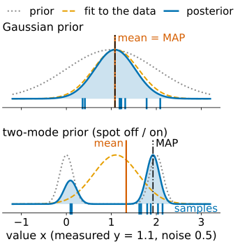
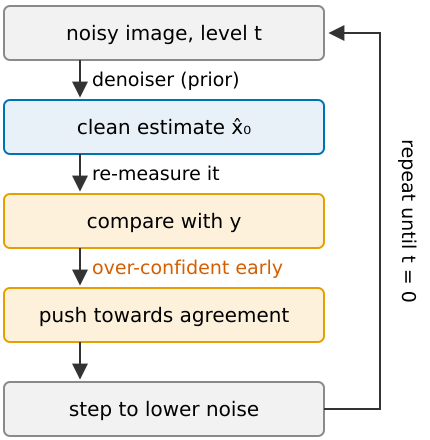
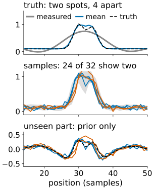
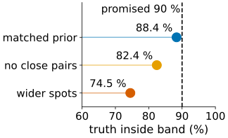

## About this lecture

*If a diffusion model restores, deblurs or "virtually stains" my image, which parts of the result were measured and which were imagined?*

- Swap the hand-made prior of the regularised estimate for a **learned** one: the same Bayes, three possible answers (MAP, posterior mean, posterior samples).
- **Sampling the posterior** with an unconditional diffusion model: a push towards the measurement at every step; replacement for holes; or a conditional model trained on pairs.
- **Where generated detail lives**: the part of the image the measurement cannot see (the **null space**) comes entirely from the prior.
- **Checks**: data consistency (necessary, not sufficient), disagreement, coverage.
- Scientific uses, honestly: denoising, super-resolution, virtual staining.

*Slides titled **The math** give the formulas and proofs; the ideas are complete without them.*

::: notes
Last unit of the diffusion-models day. Recalls the regularised estimate ([regularise/](../regularise/lec.qmd), [deconv/](../deconv/lec.qmd)), the null space ([illposed/](../illposed/lec.qmd), [resolution/](../resolution/lec.qmd)) and the mean against sample of [diffusion/](../diffusion/lec.qmd), one slide each. Demos: genrestore (recall, unchanged), posterior1d (1D signals: exact posterior, Tikhonov, approximate diffusion sampler, null space, coverage), virtualstain (exact posterior over a fluorescence channel given a transmitted-light-like channel).
:::

## Recall: the regularised estimate

From [regularisation](../regularise/lec.qmd) and [deconvolution](../deconv/lec.qmd): minimise **data term + λ·penalty**. Read probabilistically, that is the most probable image (MAP) under a **hand-made prior** ("smooth", "small"), with λ = noise variance / prior variance; λ chosen by the **discrepancy principle** (residual as large as the noise).

- For a Gaussian prior, MAP = posterior mean = Wiener/Tikhonov: one cautious answer.
- The prior is generic: it knows nothing about cells, spots or membranes.

## Recall: posterior mean against posterior sample

From [Diffusion models and generated detail](../diffusion/lec.qmd): with a generative prior, the **mean** is blurry where unsure and has the lowest error; a **sample** is sharp everywhere, with twice the error, and its detail where the data are weak comes from the prior.

```{=html}
<link rel="stylesheet" href="../demos/dist/demo.css">
<div data-demo="genrestore" data-preset="heavy"></div>
<script src="../demos/dist/genrestore.js"></script>
```

## A learned prior: same Bayes, three answers

:::: {.columns}
::: {.column width="52%"}
Replace "smooth" by "**images like the training images**" (a diffusion model). Then

- the **most probable image** (MAP): sharp but can be atypical;
- the **posterior mean**: the average of all images that fit the data and the prior: cautious, blurry where unsure;
- **posterior samples**: each a sharp, plausible image; they **disagree** where the data do not decide.

For a Gaussian prior all three coincide with Wiener/Tikhonov. With a realistic prior (cells, spots, membranes) they separate, and the choice matters for what you may measure.
:::
::: {.column width="48%"}
{fig-alt="One value x measured as y = 1.1 with noise 0.5. Top, Gaussian prior: the posterior is one bump; mean and MAP coincide and the samples scatter around them. Bottom, a prior with two narrow modes at 0 and 2 (spot off or on): the posterior has two bumps, the MAP lies on the larger one at 1.9, the mean at 1.3 lies between them where the prior has almost no mass, and the samples fall on one bump or the other." width="100%"}
:::
::::

## Sampling the posterior with a diffusion model

:::: {.columns}
::: {.column width="58%"}
The posterior's score = prior score + measurement score (Bayes, as in the introduction). The prior part is the trained denoiser; the measurement part at a **noisy** intermediate is unknown.

- **Clean-estimate trick**: at every step, ask how well the **current clean estimate** $\hat{\mathbf x}_0$ explains the measurement, and push towards agreement. Cheap; treats the estimate as certain, so it is **over-confident**, especially early (high noise).
- **Replacement** (holes, inpainting): at every step, overwrite the measured pixels with the measurement noised to the current level.
- **Conditional model** trained on pairs (measurement, truth), as in the [previous unit](../guidance/lec.qmd), when pairs exist.
- Any good denoiser can serve as the prior in an iterative restoration (the classical denoisers of [denoising](../denoise/lec.qmd) and [wavelet shrinkage](../shrinkage/lec.qmd) included).
:::
::: {.column width="42%"}
{fig-alt="Diagram of one step of posterior sampling: noisy image at level t; the denoiser (the learned prior) gives a clean estimate; it is re-measured and compared with the measurement y; the image is pushed towards agreement (over-confident early, at high noise); then a step to a lower noise level, repeated until t = 0." width="100%"}
:::
::::

## The math: the posterior score and what the trick drops {.math}

$$\nabla\log p_t(\mathbf x_t\mid\mathbf y) = \nabla\log p_t(\mathbf x_t) + \nabla\log p_t(\mathbf y\mid\mathbf x_t),\qquad p_t(\mathbf y\mid\mathbf x_t) = \int p(\mathbf y\mid\mathbf x_0)\,p(\mathbf x_0\mid\mathbf x_t)\,d\mathbf x_0.$$

Linear measurement $\mathbf y = A\mathbf x_0 + \mathbf n$, $\mathbf n \sim \mathcal N(0, \sigma_n^2I)$. For a **Gaussian prior**, $p(\mathbf x_0\mid\mathbf x_t)$ is Gaussian with mean $\hat{\mathbf x}_0 = \mathbb E[\mathbf x_0\mid\mathbf x_t]$ and covariance $C_t$, so exactly

$$p_t(\mathbf y\mid\mathbf x_t) = \mathcal N\big(\mathbf y;\ A\hat{\mathbf x}_0,\ \sigma_n^2I + A\,C_tA^\top\big).$$

The common approximation keeps the mean and **drops** $A\,C_tA^\top$: $p_t(\mathbf y\mid\mathbf x_t) \approx \mathcal N(\mathbf y; A\hat{\mathbf x}_0, \sigma_n^2I)$. At high noise $C_t$ is large, so the dropped term is large: the push is far too strong (over-confident) early on. **Replacement** for $A$ = "keep some pixels" and noise-free $\mathbf y$: the measured coordinates of $\mathbf x_t$ are exactly $\sqrt{\bar\alpha}\,\mathbf y + \sqrt{1-\bar\alpha}\,\boldsymbol\varepsilon$; the approximation is only in how they couple to the unmeasured ones (and with noisy $\mathbf y$, in treating it as exact).

## Where generated detail lives

:::: {.columns}
::: {.column width="58%"}
Split every image into the part the measurement **sees** and the part it **cannot** (the **null space**: [invisible objects](../illposed/lec.qmd), frequencies beyond the [cut-off](../resolution/lec.qmd)).

- The seen part is pinned by the data (up to noise). The unseen part comes **entirely from the prior**.
- **Denoising**: no null space, but detail below the noise level comes from the prior.
- **Deblurring, super-resolution**: everything beyond the cut-off is prior. NA 1.4, green light (520 nm): periods below $520/(2\cdot1.4) = 186$ nm are not measured.
- **Inpainting**: the hole is prior.
- **Virtual staining** (predict a fluorescence channel from a transmitted-light image): the whole target is unmeasured; only what is **correlated** with the input in the training data can be predicted.
:::
::: {.column width="42%"}
{fig-alt="From the posterior1d demo, preset below the cut-off: two spots 4 samples apart measured through a low-pass that keeps 6 cosines. Top: the measurement is one smooth bump; the posterior mean is close to the truth. Middle: five posterior samples and the 90 % band; 24 of 32 samples show two spots, 8 show one. Bottom: the unseen (null-space) part of each sample; the samples differ there exactly where the spots are." width="100%"}
:::
::::

## Try it: measured and imagined, in 1D

```{=html}
<link rel="stylesheet" href="../demos/dist/demo.css">
<div data-demo="posterior1d" data-preset="below"></div>
<script src="../demos/dist/posterior1d.js"></script>
```

::: notes
Signals of 64 samples, one or two spots; prior: 400 training signals; numbers from the demo's code. "two spots resolved" (separation 8, cut-off 24 cosines): Tikhonov, mean and all 32 samples show 2 spots. "below the cut-off" (separation 4, cut-off 6): truth 2 spots; Tikhonov 1, mean 2, samples 8 × one spot, 24 × two; the unseen part of the samples differs exactly where the spots are. "prior without close pairs": all samples show 2 spots, but farther apart; truth inside the band at only 50 of 64 positions. "consistent and wrong" (prior with wider spots): 30 of 32 samples show one spot; residual/expected 1.02 for a sample, 0.63 for the mean: the check passes. "approximate sampler": the clean-estimate push with exact prior denoiser: residual 0.00 (it fits the noise), band 0.188 wide against 0.202 for the exact posterior, split 16/16. "coverage": 88.4 % with the matched prior, 74.5 % with the wide-spot prior, 82.4 % with no close pairs. "gap": 29 of 32 samples fill the hole with one spot (truth: two).
:::

## The math: the null space belongs to the prior {.math}

Let $A$ keep some coordinates in a basis (low frequencies, measured pixels) and $P_0$ project onto the others (the null space): $AP_0 = 0$.

- **Consistency is blind to it**: $\|A(\mathbf x + P_0\mathbf z) - \mathbf y\| = \|A\mathbf x - \mathbf y\|$ for every $\mathbf z$. Any null-space hallucination passes the residual check.
- **The posterior's null-space part is the prior's**: write $\mathbf x = (\mathbf u, \mathbf v)$ with $\mathbf u$ measured, $\mathbf v$ in the null space. $p(\mathbf y\mid\mathbf x) = p(\mathbf y\mid\mathbf u)$, so $p(\mathbf u, \mathbf v\mid\mathbf y) \propto p(\mathbf y\mid\mathbf u)\,p(\mathbf u)\,p(\mathbf v\mid\mathbf u)$, and $p(\mathbf v\mid\mathbf u, \mathbf y) = p(\mathbf v\mid\mathbf u)$: given the seen part, the unseen part is exactly the prior's conditional. If the prior factorises, $p(\mathbf v\mid\mathbf y) = p(\mathbf v)$.
- **Scalar Gaussian** $x \sim \mathcal N(0, s^2)$, $y = x + n$, $n \sim \mathcal N(0, \sigma_n^2)$: posterior mean $= \text{MAP} = \frac{s^2}{s^2 + \sigma_n^2}y$ = Wiener = Tikhonov $\arg\min (y - x)^2 + \lambda x^2$ with $\lambda = \sigma_n^2/s^2$.

## Checks

:::: {.columns}
::: {.column width="60%"}
1. **Data consistency**: re-apply the forward model; the residual should look like noise of the right size (the discrepancy principle). Necessary, **not sufficient**: every null-space hallucination passes.
2. **Disagreement** between samples (or between models) locates the prior's contribution.
3. **Coverage**: on images with known truth, does the 90 % band of the samples contain the truth 90 % of the time? With the right prior it does by construction (88 % in the demo); with a mismatched prior the bands are over-confident (75 %).
4. A prior trained **without** the phenotype you look for turns it into the normal case (recall `genrestore`'s "prior without dividing cells").
:::
::: {.column width="40%"}
{fig-alt="Coverage of the 90 % band of the posterior samples in the posterior1d demo, over 200 signals with known truth: 88.4 % with the matched prior, 82.4 % with a prior without close pairs of spots, 74.5 % with a prior with wider spots, against the promised 90 %." width="100%"}
:::
::::

## Virtual staining

Predict a fluorescence channel from a transmitted-light image, trained on pairs. The target channel is **not measured at all**: the prediction is the prior's view of "what the stain usually looks like in cells that look like this".

- What is **visible** in the input (a nucleus outline) is predicted well.
- What is **not visible** (a marker's position) is painted as the training average: the mean is a haze, samples disagree.
- What **changed** with a treatment that the input does not show (stain intensity) is predicted at the untreated level: the effect **vanishes**.

## Try it: what virtual staining can know

```{=html}
<link rel="stylesheet" href="../demos/dist/demo.css">
<div data-demo="virtualstain" data-preset="spots"></div>
<script src="../demos/dist/virtualstain.js"></script>
```

::: notes
32 × 32 synthetic cells; 300 training pairs (75 geometries × 4 draws of the marker); exact posterior; numbers from the demo's code. "nucleus": truth area 88, prediction 82 (mean and samples), intensity 0.40 = truth; disagreement ≈ 0. "spots": truth 2 spots; samples 2, 3, 2, 2 spots in other places; mean 0 spots (a haze over the cell, area 62); disagreement up to 0.34. "treated": truth intensity 0.80, prediction 0.40: the treatment effect is gone, and nothing (no disagreement) warns. "noisier input" (0.4): 44 training pairs share the weight; samples show nuclei of area 57 or 82; the mean area 56.
:::

## Scientific uses, honestly

- **Denoising** low-light images: good for display and as a segmentation aid; measure on validated readouts (the five rules of the introduction).
- **Super-resolution**: beyond the cut-off is prior. Spacings below 186 nm (NA 1.4, 520 nm) in a restored image are not measurements.
- **Virtual staining**: saves a channel and photodamage; cannot discover what is not in the input (an unexpected localisation, a treatment effect).
- **Restoration for data reduction**: keep the raw data.
- Restoration for **display** is not restoration as **data**: report the method, show the raw image, validate the readout with ground truth.

## Summary

- A learned prior in the same Bayes: MAP, posterior mean (cautious) and posterior samples (sharp, varied) separate; for a Gaussian prior they are all Wiener/Tikhonov.
- Posterior sampling with a diffusion model: a push towards the measurement from the clean estimate (over-confident), replacement for holes, or a conditional model.
- The **null space** (beyond the cut-off, inside a hole, an unmeasured channel) comes entirely from the prior; consistency checks cannot see it.
- Check disagreement and **coverage**; never let a restoration decide a measurement it cannot support.
