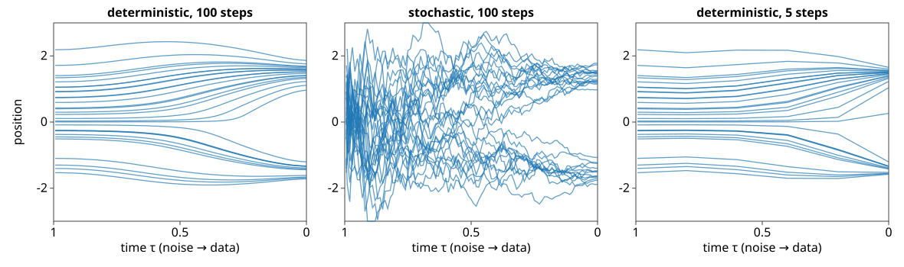

## Goal

By the end of this exercise you should be able to:

- take one **deterministic** and one **stochastic** sampling step by hand, and say how they differ over many draws,
- predict what **too few steps** do (too little spread, samples between modes), and why **step placement** matters,
- explain why fresh noise **forgets** a wrong position, and what **inversion** is,
- judge generated samples as a **distribution**: precision, recall, Fréchet distance, nearest-training distance, and the readout you will measure.

Do the pen-and-paper part first, then the demos. Questions marked *(math)* are for those who want the derivations; the concept questions do not depend on them.

## Background

| Idea | What it means |
|---|---|
| Deterministic step | $x_{i-1} = \sqrt{\bar\alpha_{i-1}}\,\hat x_0 + \sqrt{1-\bar\alpha_{i-1}}\,\hat\varepsilon$: keep the noise direction, at the lower level |
| Stochastic step | sample a Gaussian around a point closer to $\hat x_0$ (formulas in [the introduction](../diffusion/lec.qmd)) |
| η | 0 = deterministic, 1 = ancestral; same distribution at every level |
| Network evaluations | the cost of a sampler: one per step (two for a two-stage step) |
| Precision / recall | fraction of samples near real data / of real data near samples ($k$-NN balls) |
| Fréchet distance | distance between Gaussians fitted to the two clouds; in 1D $(\mu_1-\mu_2)^2 + (s_1-s_2)^2$ |
| Memorisation check | distance of each sample to its nearest training image |

{width=100%}

## By hand

**B1.** One **deterministic** step. $x_i = 1$, $\bar\alpha_i = 0.36$, predicted noise $\hat\varepsilon = 0.5$; the next level has $\bar\alpha_{i-1} = 0.64$.
(a) Compute $\hat x_0$ and $x_{i-1}$.
(b) Run the same step for $\hat\varepsilon = 0.5$ but $x_i = 1.2$. Is the map from $x_i$ to $x_{i-1}$ invertible?

**B2.** One **stochastic** step from the same numbers. Its mean is $\frac{\sqrt{\bar\alpha_{i-1}}\,\beta}{1-\bar\alpha_i}\hat x_0 + \frac{\sqrt{\alpha}\,(1-\bar\alpha_{i-1})}{1-\bar\alpha_i}x_i$ and its variance $\frac{\beta(1-\bar\alpha_{i-1})}{1-\bar\alpha_i}$, with $\alpha = \bar\alpha_i/\bar\alpha_{i-1}$, $\beta = 1-\alpha$.
(a) Compute $\alpha$, $\beta$, the mean and the variance.
(b) Compare with B1: which lands closer to $\hat x_0$ on average, and which spreads more over many draws?

**B3.** Gaussian data with sd 1. A deterministic sampler starts at noise level σ = 3, where the points have spread $\sqrt{1 + 9} = 3.16$. The best denoiser at level σ multiplies by $1/(1+\sigma^2)$.
(a) One step straight to σ = 0 returns the denoiser's answer. What is the spread of the samples?
(b) Two steps, 3 → 1.5 → 0. The first step multiplies by $1 - (3 - 1.5)\cdot 3/(1 + 9) = 0.55$. Compute the final spread.
(c) The exact answer is 1. Predict roughly what ten steps give, and why the error never makes the spread too **large** here.
(d) Put the middle step at σ = 1 instead (3 → 1 → 0). Better or worse than (b)?

**B4.** Fréchet distance in 1D against the data $\mathcal N(0, 1)$, for generators $\mathcal N(0, s^2)$ with $s$ = 0.316, 0.535 and 1 (the spreads of B3). Compute $d^2 = (\mu_1 - \mu_2)^2 + (s_1 - s_2)^2$.

**B5.** Data: two modes at ±2, each with sd 0.5, equally likely.
(a) Mean and variance of the data?
(b) A generator draws from $\mathcal N(0, 4.25)$. What is its Fréchet distance to the data?
(c) What fraction of its samples falls in $[-1, 1]$? What fraction of the data does? (Use $\Phi(0.485) = 0.686$, $\Phi(-2) = 0.023$.)
(d) Which metric catches this generator?

**B6.** Four generated cell images have nearest-training distances 0.02, 0.9, 1.1 and 0.03 (in some feature space). Held-out real images have nearest-training distances of about 0.8 to 1.2. Which generated images are suspicious, and what would you show to check?

**B7.** A paper reports that its generated cell images have a lower Fréchet distance than a competitor's. You want to use the generator to augment a training set for counting dividing cells (5 % of real cells). What else would you ask for?

::: {.callout-note collapse="true" title="Solutions"}
**B1.** (a) $\hat x_0 = (1 - 0.8 \cdot 0.5)/0.6 = 1.0$; $x_{i-1} = 0.8 \cdot 1.0 + 0.6 \cdot 0.5 = 1.1$. (b) $\hat x_0 = (1.2 - 0.4)/0.6 = 1.333$, $x_{i-1} = 0.8 \cdot 1.333 + 0.3 = 1.367$. For a fixed $\hat\varepsilon$ the step is $x_{i-1} = \frac{0.8}{0.6}x_i + \text{const}$: a smooth one-to-one map (with a real denoiser $\hat\varepsilon$ depends smoothly on $x_i$ too, and for small steps the map stays invertible). That is what inversion uses.

**B2.** (a) $\alpha = 0.36/0.64 = 0.5625$, $\beta = 0.4375$. Mean $= \frac{0.8\cdot 0.4375}{0.64}\cdot 1.0 + \frac{0.75 \cdot 0.36}{0.64}\cdot 1 = 0.547 + 0.422 = 0.969$; variance $= \frac{0.4375\cdot 0.36}{0.64} = 0.246$ (sd 0.50). (b) The stochastic step's mean (0.969) is closer to $\hat x_0 = 1.0$ than the deterministic 1.1: it denoises more and then adds back fresh noise with sd 0.50. Over many draws the stochastic step spreads more; the deterministic one always gives 1.1.

**B3.** (a) The denoiser at σ = 3 multiplies by $1/10$: spread $3.16/10 = 0.316$. (b) $0.55 \cdot 3.16 = 1.74$, then $\cdot\frac{1}{1 + 2.25} = 0.308$: spread $1.74 \cdot 0.308 = 0.535$. (c) Ten equal steps give 0.89 (computed); a hundred, 0.99. Each straight step uses the slope at its start, where the denoiser shrinks more than it will at lower noise: every step shrinks too much, so the spread stays too small and approaches 1 from below. (d) Better: $(1 - 2 \cdot 0.3) = 0.4$, then $\cdot\frac{1}{2} = 0.2$, spread $0.632$. Same number of steps, better placed.

**B4.** $(1 - 0.316)^2 = 0.468$; $(1 - 0.535)^2 = 0.216$; 0.

**B5.** (a) Mean 0; variance $0.25 + 4 = 4.25$. (b) Both are summarised by $\mathcal N(0, 4.25)$: Fréchet distance 0. (c) Generator: $2\Phi(1/\sqrt{4.25}) - 1 = 2\Phi(0.485) - 1 = 0.37$. Data: $\Phi(-2) - \Phi(-6) = 0.023$ (per mode almost nothing lies within 1 of the other side; all of it is the tail of each mode inside ±1). (d) Precision: 37 % of the samples lie where almost no real data are, so precision drops. (Recall stays high: the wide Gaussian covers both modes.)

**B6.** The ones at 0.02 and 0.03: they lie much closer to a training image than real images ever do (0.8–1.2): probably copies. Show them side by side with their nearest training images, and check what fraction of all samples are this close.

**B7.** A comparison of the **readout**: the fraction of dividing cells among generated images (by the same counting method) against held-out real images; precision and recall separately (is the rare class covered?); a memorisation check; and ideally a test that training on augmented data improves the counter on held-out real images. A lower Fréchet distance says nothing about whether the 5 % class is reproduced.
:::

### Math questions

**B8.** *(math)* For Gaussian data $\mathcal N(0, s^2)$, solve the probability-flow ODE $\frac{dx}{d\sigma} = \frac{x - D(x, \sigma)}{\sigma}$ with $D = \frac{s^2}{s^2 + \sigma^2}x$. Then show that one Euler step from σ to σ′ multiplies $x$ by $1 - \frac{(\sigma - \sigma')\sigma}{s^2+\sigma^2}$; compare with the exact factor on the steps of B3, and show that a last step to σ′ = 0 always shrinks too much.

**B9.** *(math)* Show that the deterministic step of B1, written in $\mathbf y = \mathbf x/\sqrt{\bar\alpha}$ and $\sigma = \sqrt{(1-\bar\alpha)/\bar\alpha}$, is an Euler step of the ODE in B8.

**B10.** *(math)* Derive the 1D Fréchet distance $(\mu_1-\mu_2)^2 + (s_1-s_2)^2$ from the general formula, and check that for $\Sigma_1 = \Sigma_2$ only the means matter.

::: {.callout-note collapse="true" title="Solutions (math)"}
**B8.** $x - D = \frac{\sigma^2}{s^2+\sigma^2}x$, so $\frac{dx}{d\sigma} = \frac{\sigma}{s^2+\sigma^2}x$, $\frac{d\ln x}{d\sigma} = \frac{d}{d\sigma}\tfrac12\ln(s^2+\sigma^2)$, hence $x(\sigma) = C\sqrt{s^2 + \sigma^2}$. Euler: $x' = x + (\sigma' - \sigma)\frac{\sigma}{s^2+\sigma^2}x = \big(1 - \frac{(\sigma-\sigma')\sigma}{s^2+\sigma^2}\big)x$. Exact ratio: $\sqrt{\frac{s^2+\sigma'^2}{s^2+\sigma^2}} = \exp\big(-\int_{\sigma'}^{\sigma}\frac{t}{s^2+t^2}\,dt\big)$. On the numbers of B3 ($s = 1$): 3 → 1.5: Euler 0.55, exact $\sqrt{3.25/10} = 0.570$; 1.5 → 0: Euler $\frac{1}{3.25} = 0.308$, exact $\sqrt{1/3.25} = 0.555$. The last step to σ′ = 0 always gives the denoiser's answer, factor $\frac{s^2}{s^2+\sigma^2}$, which is the **square** of the exact factor $\frac{s}{\sqrt{s^2+\sigma^2}} < 1$: always too small. Euler uses the slope at the start of the step, where (for σ > s) the shrinking per unit σ is still strong, for the whole step.

**B9.** $\hat{\mathbf x}_0 = (\mathbf x_i - \sqrt{1-\bar\alpha_i}\,\hat{\boldsymbol\varepsilon})/\sqrt{\bar\alpha_i} = \mathbf y_i - \sigma_i\hat{\boldsymbol\varepsilon}$, so $\hat{\boldsymbol\varepsilon} = (\mathbf y_i - \hat{\mathbf x}_0)/\sigma_i$. Dividing the step by $\sqrt{\bar\alpha_{i-1}}$: $\mathbf y_{i-1} = \hat{\mathbf x}_0 + \sigma_{i-1}\hat{\boldsymbol\varepsilon} = \mathbf y_i + (\sigma_{i-1} - \sigma_i)\frac{\mathbf y_i - \hat{\mathbf x}_0}{\sigma_i}$: Euler for $\frac{d\mathbf y}{d\sigma} = \frac{\mathbf y - D(\mathbf y, \sigma)}{\sigma}$ with $D = \hat{\mathbf x}_0$.

**B10.** In 1D, $\Sigma_i = s_i^2$ and $(\Sigma_1^{1/2}\Sigma_2\Sigma_1^{1/2})^{1/2} = (s_1 s_2^2 s_1)^{1/2} = s_1s_2$, so $d^2 = (\mu_1-\mu_2)^2 + s_1^2 + s_2^2 - 2s_1s_2 = (\mu_1-\mu_2)^2 + (s_1 - s_2)^2$. With $\Sigma_1 = \Sigma_2 = \Sigma$: $(\Sigma^{1/2}\Sigma\Sigma^{1/2})^{1/2} = \Sigma$, the trace term is $\operatorname{tr}(2\Sigma - 2\Sigma) = 0$, and $d^2 = \|\boldsymbol\mu_1 - \boldsymbol\mu_2\|^2$.
:::

## Explore: samplers in 1D {#explore-samplerpaths}

1D data (a mixture of Gaussians), so the best denoiser is exact at every noise level. Background: the density of the noised data, with time τ from 1 (pure noise, left) to 0 (data, right); positions in the form $\sqrt{\bar\alpha}\,x_0 + \sqrt{1-\bar\alpha}\,\varepsilon$ of the introduction. Blue: 30 sample paths; right: a histogram of 2 000 endpoints against the true density. Controls: number of steps, η, step spacing, two-stage steps, Langevin corrections, a deliberately bad start, and inversion of a data point.

```{=html}
<link rel="stylesheet" href="../demos/dist/demo.css">
<div data-demo="samplerpaths" data-preset="same"></div>
<script src="../demos/dist/samplerpaths.js"></script>
```

**P1.** Preset **same endpoints, different paths** (two modes, 100 ancestral steps). Compare the endpoint sd with the data. Set η to 0: what changes in the paths, and in the endpoints?

**P2.** Preset **one step: everything at the mean**. Where are the samples, and why (B3a)? Increase the steps to 2, 5, 20 and read the sd.

**P3.** Preset **5 steps: too narrow** (three unequal modes). Compare sd and the fraction off the data with 10 and 20 steps. Then switch on **two-stage** with 3 and with 5 steps and compare the network evaluations and the Fréchet distance with plain steps.

**P4.** Preset **spacing matters**: 5 steps uniform in log-SNR. Read the sd and Fréchet distance; then switch to uniform in time and to dense near the data. Which spacing wastes its steps where?

**P5.** Preset **stochastic forgets a bad start**: the starting noise is 5 times too small. Read the sd for η = 1, then η = 0.5 and η = 0. Then keep η = 0 and add 1 and 3 Langevin corrections. What does each cost?

**P6.** Preset **inversion and back**: the data point 1.3 is run backwards to noise and forwards again. Read the noise value and where it comes back. Move the data point to 1.5 and to 0; try 5 and 100 steps. What happens to points in a mode, and to the point in the middle?

::: {.callout-note collapse="true" title="Solutions"}
**P1.** Endpoint sd 1.51 (data 1.51), Fréchet 0.0005. With η = 0 the paths become smooth curves that hardly cross; the endpoints have the same distribution (sd 1.51, Fréchet 0.0000), but each sample ends somewhere else than with fresh noise.

**P2.** All 2 000 samples at 0 (sd 0.02, 100 % off the data): one deterministic step returns the denoiser's answer at the highest noise level, the mean of the data. 2 steps: sd about 1.1 with 37 % off the data; 5 steps: 1.44; 20 steps: 1.49.

**P3.** 5 steps: sd 1.18 (data 1.38), 5.8 % off the data, Fréchet 0.038. 10 steps: sd 1.28, 1.1 %, 0.0094; 20 steps: sd 1.33, 0.6 %, 0.0025. Two-stage with 3 steps costs 5 evaluations and gives Fréchet 0.046 (plain 5 steps: 0.038); with 5 steps it costs 9 and gives 0.0056 (plain 10 steps: 0.0094). Per evaluation the two-stage step is about as good as plain steps at very few steps, and better from about 10 evaluations.

**P4.** Uniform in log-SNR: sd 0.78, 12.8 % off the data, Fréchet 0.35. Uniform in time (cosine schedule): sd 1.18, Fréchet 0.038. Dense near the data: sd 0.77, Fréchet 0.37. Log-SNR spacing puts steps at extreme noise levels (σ = 100 to 7) and at tiny ones (below 0.03, finer than these modes), and makes only one or two steps where the paths bend (σ around 0.1–3). The cosine schedule happens to put its 5 steps there for data of this scale.

**P5.** η = 1: sd 1.31 (Fréchet 0.0046), almost as good as a correct start; η = 0.5: sd 1.21 (0.031); η = 0: sd 0.69 (0.49): the deterministic map carries the too-narrow start to too-narrow samples. Langevin with η = 0: 1 correction per level: sd 1.30, Fréchet 0.0080, but 39 evaluations instead of 20; 3 corrections: sd 1.37, Fréchet 0.0004, 77 evaluations.

**P6.** 1.3 maps to noise 0.20 and comes back to 1.305 (20 steps; 1.307 with 5, 1.301 with 100). 1.5 maps to 0.62 and comes back to 1.47 (5 steps: 0.46 and 1.41; 100 steps: 0.66 and 1.49): the round trip is only as accurate as the steps. 0 maps to 0 and back to 0: by symmetry it sits exactly on the boundary between the modes; any tiny change sends it to one or the other.
:::

## Explore: judging the samples {#explore}

2D data (the clouds of the introduction's demo): 1 000 held-out **real** points (dark) and 1 000 **generated** points (blue) from a generator menu: the exact diffusion sampler (steps, η), one wide Gaussian matched in mean and covariance ("between the modes"), mode dropping, a memoriser (copies of 50 training points), samples shrunk towards their mode ("too narrow"). Ellipses: the fitted Gaussians (2 sd) used by the Fréchet distance. Bars: precision and recall with $k = 3$. **k-NN balls** shows the neighbourhoods of the real points. **Curve against steps** plots precision and recall of the diffusion sampler for 1 to 100 steps.

```{=html}
<link rel="stylesheet" href="../demos/dist/demo.css">
<div data-demo="genmetrics" data-preset="between"></div>
<script src="../demos/dist/genmetrics.js"></script>
```

**M1.** Preset **between the modes** (two blobs). Compare its Fréchet distance with the diffusion sampler's (choose **diffusion sampler**). Which metric tells them apart? Switch on the k-NN balls.

**M2.** Preset **mode dropping** (ring of 8, two blobs missing). Read precision, recall and Fréchet distance. Why does precision stay high?

**M3.** Preset **memoriser** (two moons). Read every metric and compare with the diffusion sampler. Which one is the clearest alarm, and why is recall also low here?

**M4.** Choose **too narrow** on the two blobs. What does it do to precision and recall? To the Fréchet distance?

**M5.** Preset **more steps**, then **curve against steps**. Describe the curve. From how many steps is the sampler as good as it gets?

**M6.** Choose the **rare blob** data with the diffusion sampler, then **mode dropping**. Why does recall fall so far while precision barely moves, and the Fréchet distance explodes?

::: {.callout-note collapse="true" title="Solutions"}
**M1.** Between the modes: Fréchet 0.014; the diffusion sampler: 0.020 (both small; the wide Gaussian is even "better"). Precision tells them apart: 0.48 against 0.97 (recall 0.99 and 0.98). The k-NN balls of the real points cover the two blobs only; half the wide Gaussian's samples fall between them.

**M2.** Precision 0.97, recall 0.73, Fréchet 0.32. Every generated point still lies in a real blob (precision measures realism), but two of the eight blobs have no samples nearby, so 27 % of the real points are not covered.

**M3.** Memoriser: precision 0.95, Fréchet 0.022 (sampler 0.025), recall 0.09, median nearest-training distance 0.010 against 0.021 for held-out real points. The nearest-training distance is the clearest alarm: generated points are closer to training points than real data ever are. Recall is low because 1 000 samples sit on only 50 places: their k-NN balls are tiny, and most real points are not inside any.

**M4.** Precision 0.99 (the samples are all in the blobs), recall 0.53 (the outer parts of each blob are not covered); Fréchet 0.025, hardly worse than the sampler's 0.020: the means are right, and the overall covariance is dominated by the distance between the blobs.

**M5.** 1 step: precision 0, recall 0 (all samples at the mean, between the moons). 2 steps: 0.37 and 0.29; 5 steps: 0.75 and 0.69; 20 steps: 0.97 and 0.91; 50 and 100 steps about 0.96 and 0.95–0.96. Precision saturates around 20 steps, recall a little later.

**M6.** The rare blob holds 5 % of the data. Mode dropping removes the first component, the big blob (95 %!): all samples are in the rare blob, precision 0.94 (all realistic), recall 0.05 (only the rare blob's real points are covered), Fréchet 6.7 because the mean moves to the rare blob. (Dropping a rare blob instead would leave the Fréchet distance almost unchanged.)
:::

## Where this leads

Samplers follow a denoiser; the next unit, [Conditioning, guidance and latent diffusion](../guidance/lec.qmd), changes **which** denoiser: one that knows a label, pushed harder with guidance, or one that works in a VAE's latent space. The same metrics will show what guidance trades.
